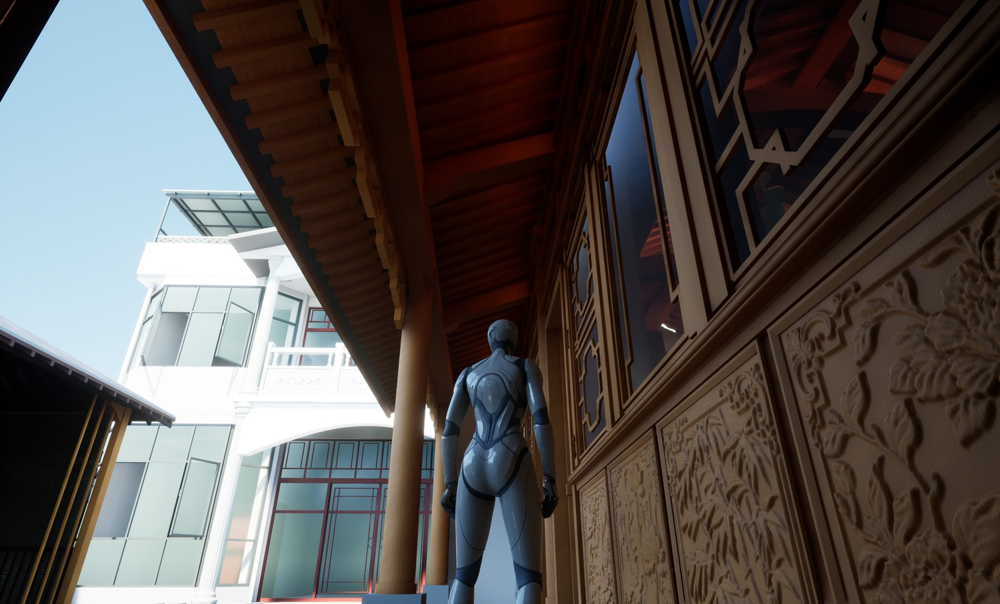

# TAO 家庭数字孪生

同一套家庭住宅从实景资料和可编辑模型开始，经 Blender、Rhino 和 Datasmith 进入 UE5，逐轮完善漫游、门窗、日照、夜间照明与风环境。设备登记与本地软件灯作为接入准备，Web 端用于模拟遥测。

地面细节由 Insta360 全景相机拍成视频，场地地理信息和屋顶鸟瞰照片由 DJI Mini 2 无人机采集。[采集资料与建模基线](docs/history/reconstruction.md#源资料与建模基线)

| 建筑重建 | 智慧家场景 |
| --- | --- |
|  |  |

## 迭代与日常更新

| 入口 | 内容 |
| --- | --- |
| [项目总台账](docs/history/README.md) | 两个过程项目在同一条住宅数字孪生时间线中的衔接与来源。 |
| [建筑重建逐版记录](docs/history/reconstruction.md) | 从首版到 V26.20，82 条可追溯的模型迭代。 |
| [智慧家逐版记录](docs/history/smart-home.md) | Rhino / Datasmith 转换，21 次保存通过与 1 个候选，附场景和环境功能演进。 |
| [日常更新](docs/history/updates.md) | 按实际过程文件续记，统一更新 `main`。 |
| [图文案例](docs/case-studies/reconstruction-to-smart-home.zh-CN.md) | 台阶前后、构件交接、昼夜场景、三工况和三向风场切片。 |

## 当前进度

- **建筑与场景**。V26.20 是住宅重建交付基线。UE5 当前模型发布号 `20261030_025240_41748228`，登记 819 个构件，处于编辑器与 PIE 迭代阶段。
- **环境**。可切换门窗关闭、厨房四窗双门开启、全场地门窗全开，查看 OpenFOAM 代表风与三个方向的切片。日照是场景预览，CFD 用于对照和交互。
- **设备**。本地已验证设备目录与软件灯路径。真实灯具、电机、传感器和监控码流处于绑定准备阶段。 [智慧家领域](domains/smart_home/README.md)
- **Web**。React/Three.js 场景和 FastAPI 提供模拟设备与 WebSocket 遥测。 [本地演示](frontend/README.md)

## 工程文档

| 内容 | 文档 |
| --- | --- |
| 资料、构件和漫游 | [住宅建模方法](docs/case-studies/residential-reconstruction.zh-CN.md) |
| Datasmith 重导入、UE5 交互与 CFD | [建筑数字孪生制作实战](docs/case-studies/ue5-building-twin.zh-CN.md) |
| 场景、状态、命令和设备接入 | [家庭孪生架构](docs/architecture.md) · [UE 客户端](clients/unreal/README.md) · [领域模型](docs/domain-model.md) |
| 协议、设备闭环与安全 | [协议](docs/protocols.md) · [安全](docs/security.md) · [家庭路线图](docs/roadmap.md) |
| 下一轮建模与发布 | [发布与核验模板](docs/templates/building-twin-release.zh-CN.md) |

项目过程来源为“整理建筑重建资料”和“准备数学孪生智慧家庭模型”。公开仓库记录精选图文、核验摘要与 Web 模拟原型。 [来源索引](docs/history/README.md#过程来源)

维护者 TYSON Pengtao
