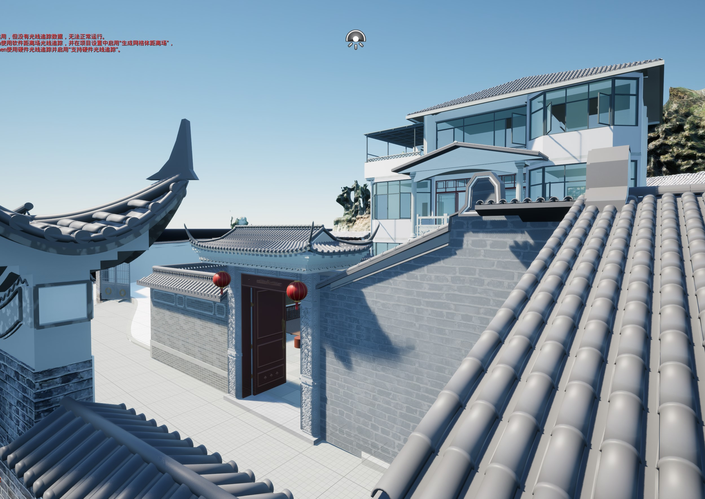
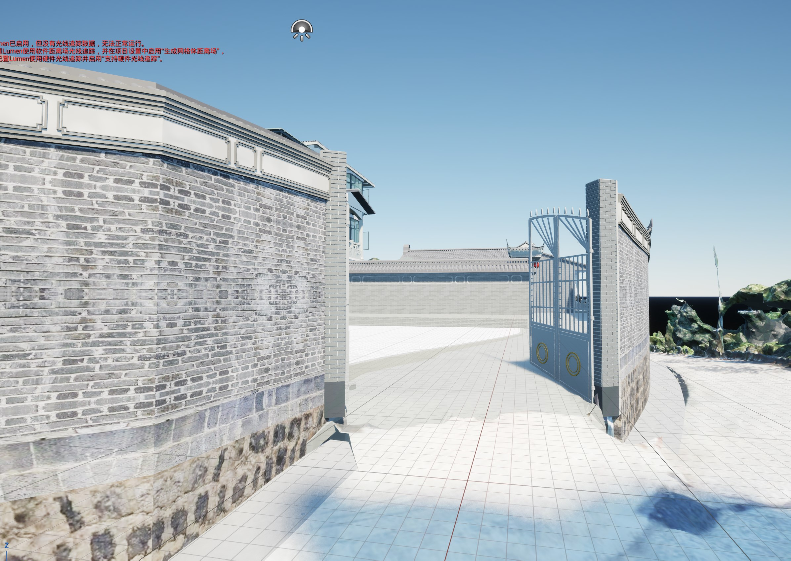
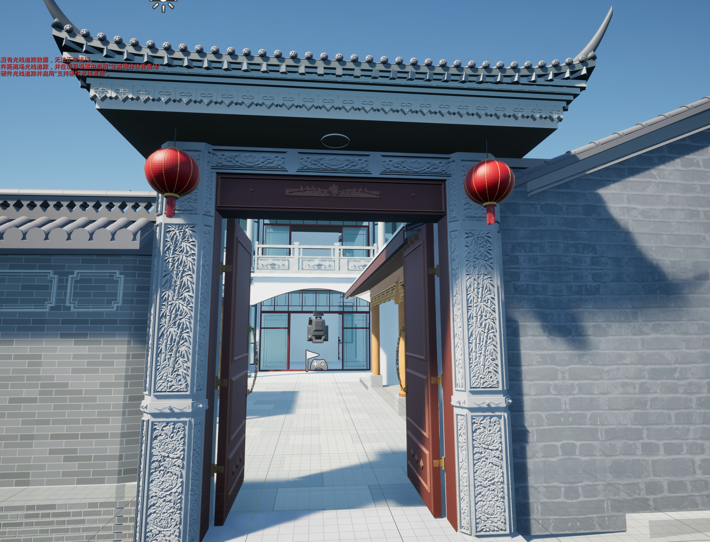
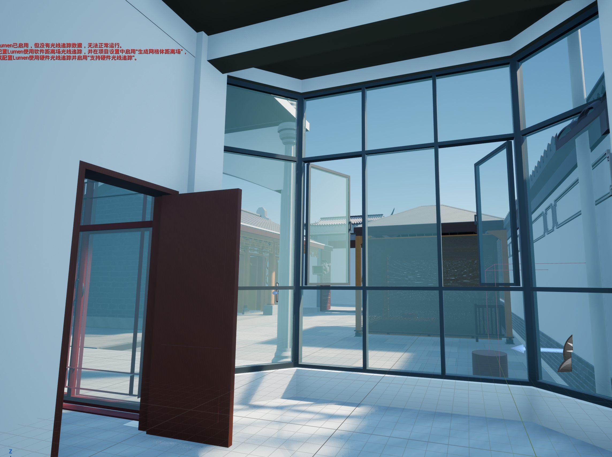
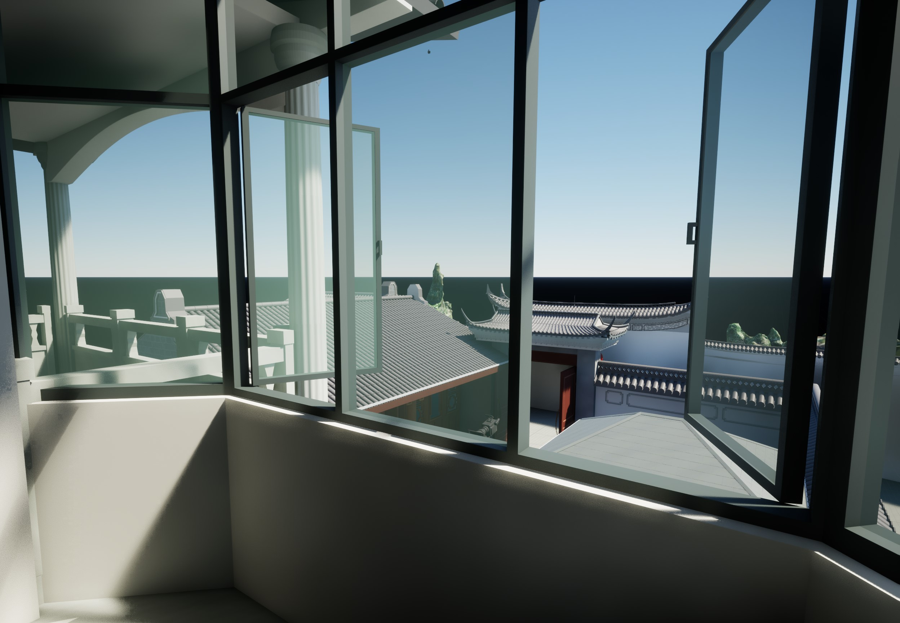
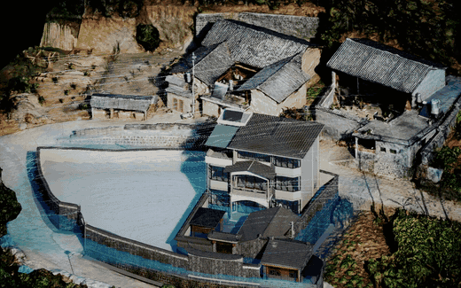
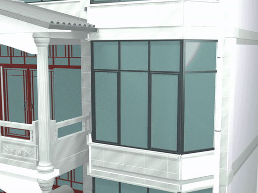

# TAO 家庭数字孪生

**从实景重建，到可交互、可核验的家庭场景。**

以同一套家庭住宅为对象，把航拍、地面全景与历次改模连接起来，经 Blender、Rhino 和 Datasmith 进入 UE5，持续完善漫游、门窗、日照、照明和风环境。

瓦檐望主楼 · 用户提供的 UE5 编辑器原始预览，保留场景中的提示与图标。

[**逐版技术文章**](docs/history/research/versions/README.md) · [**原实现脚本**](docs/history/research/source-code/README.md) · [**过程动画**](docs/history/research/animations/README.md) · [**日常更新**](docs/history/updates.md)

## 同一住宅，连续迭代

**进入庭院** · 从外围铁门到雕花门楼，核对入口、围墙与建筑之间的关系。

**从室内看院落** · 一层通高窗与二层窗边视角，将室内、屋顶和院落放在同一个模型中复核。

[五张介绍图的来源与校验值](docs/media/project/README.md) · [五参考机位巡游 MP4](docs/history/research/animations/ue-five-view-tour.mp4)

## 动态观察与分析

点击动画打开完整 MP4。预览由原过程视频缩放和降帧得到。

**UE5 风场流线 · 软件模拟**

8 秒原过程片段，2026-10-29 的 annual_coarse 室外基准；流线沿已计算场运动。当前全开门窗工况的结果见风环境核验记录。

**V24.18 外开窗 · 模型动作**

用于观察窗扇动作与层级，尚不代表实物电机接入。

[全部五段动画与出处](docs/history/research/animations/README.md) · [V24.17 外景环绕](docs/history/research/versions/v24-17.md#原过程动画) · [V26.8 楼梯斜视复核](docs/history/research/versions/v26-8.md#原过程动画)

## 从资料到模型，怎样实现

1. **采集与交叉核对**。DJI Mini 2 获取航拍地理信息和屋顶鸟瞰照片，Insta360 全景相机补足室内与近地面视频。原有图纸作为轴网与尺寸参考，实景资料用于识别未随施工更新的部分。[采集与空地融合](docs/history/reconstruction.md#源资料与建模基线)
2. **重建与结构推敲**。航拍照片经 ContextCapture（CC）生成倾斜摄影模型；对遮挡或不清晰的构造，结合实景照片，用 GPT Image 制作设计参考及构件分解图。尺寸来自模型量取与 AI 辅助估算，并在各轮记录中注明依据。[大门改模过程](docs/case-studies/residential-reconstruction.zh-CN.md#大门结构推敲与改模)
3. **定位、改模与读回**。Codex 将问题圈画映射到坐标、剖面和对象，组织材质取样与映射，调用 Blender、Rhino 和 UE5 完成处理，再对保存文件复开核验。[实现方法与过程图档](docs/history/codex-methods.md)
4. **进入家庭场景**。通过 Datasmith 同步构件身份、材质与门窗层级，逐轮加入人物漫游、环境分析和设备准备。[智慧家逐轮研究实现](docs/history/research/smart-home.md)

## 按版本查证据

- [**专业方法与完整过程**](docs/history/research/methodology.md) — 解释坐标、采样、配准、局部保护、材质、动作与风场；[按版查全部过程](docs/history/research/process-coverage.md)。

- [**建筑重建：82 篇独立技术文章**](docs/history/research/versions/README.md) — 每版的问题、输入、实现、过程图、核验和出处；对应[建筑逐版台账](docs/history/reconstruction.md)。
- [**每版原实现脚本**](docs/history/research/source-code/README.md) — 共 2,272 个脚本与启动文件，按版提供阅读入口、原路径及双 SHA-256；含站点坐标的 31 项附明确脱敏说明。
- [**智慧家：逐版场景与交互记录**](docs/history/smart-home.md) — Rhino / Datasmith、ModelSync、UE5、环境分析与设备准备沿同一时间线记录。
- [**研究方法与复算**](docs/history/research/README.md) — 按迭代查算法、采样和验证；[凉亭研究](docs/history/research/pavilion.md)提供原数据复算依据。
- [**图文案例**](docs/case-studies/reconstruction-to-smart-home.zh-CN.md) — 台阶前后、构件交接、昼夜场景、三工况与三向风场切片。
- [**项目总台账与日常更新**](docs/history/README.md) — 两个过程项目的衔接、来源与[实际日期记录](docs/history/updates.md)，统一维护 `main`。

## 当前保存与验证范围

- **建筑基线**：V26.20；UE5 模型发布号 `20261030_025240_41748228`，登记 819 个构件，持续进行编辑器与 PIE 核验。
- **环境分析**：门窗关闭、厨房四窗双门开启、全场地门窗全开三种状态；OpenFOAM 代表风与三向切片用于软件模拟对照。日照属于场景预览。
- **设备准备**：设备目录与本地软件灯路径已经验证，真实灯具、电机、传感器与监控码流等待绑定。[智慧家领域](domains/smart_home/README.md)
- **Web 原型**：React / Three.js 与 FastAPI 提供模拟设备和 WebSocket 遥测。[本地演示](frontend/README.md)

各轮分别标注已保存、候选、估算、软件模拟和实物确认，按相应过程报告判断完成范围。

## 工程与复现

[住宅建模方法](docs/case-studies/residential-reconstruction.zh-CN.md) · [UE5 制作实战](docs/case-studies/ue5-building-twin.zh-CN.md) · [发布与核验模板](docs/templates/building-twin-release.zh-CN.md)

[家庭孪生架构](docs/architecture.md) · [UE 客户端](clients/unreal/README.md) · [领域模型](docs/domain-model.md) · [协议](docs/protocols.md) · [安全](docs/security.md) · [路线图](docs/roadmap.md)

项目过程来自“整理建筑重建资料”和“准备数学孪生智慧家庭模型”。公开内容包括有出处的图文、原脚本公开副本、核验摘要与 Web 模拟原型；原始照片、站点绝对坐标、完整生产模型和设备连接配置保留在本机。[过程来源](docs/history/README.md#过程来源)

维护者 TYSON Pengtao
