# 从建筑重建到智慧家数字孪生

同一套住宅模型先在 Blender 里验收构件和通行，再以 Rhino 发布副本经 Datasmith 进入 UE5。这里用同机位对照、场景截图和风场切片，记录模型如何从重建成果变成可漫游、可切换工况的智慧家场景。

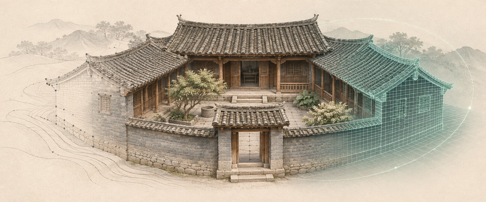

*图 01 · AI 生成封面，表现从资料到模型的过程。*

[建筑重建](#1-建筑重建) · [模型交接](#2-模型交接) · [智慧家场景](#3-智慧家场景) · [风环境与三向切片](#4-风环境与三向切片)

## 1. 建筑重建

原有设计图纸提供初始轴网与尺寸。DJI Mini 2 采集场地地理信息和屋顶鸟瞰照片，航拍照片经 ContextCapture 生成外部倾斜摄影实景模型。室内和遮挡的近地面区域依据 Insta360 全景视频、实景照片与逐轮修改指令补建。Rhino 用于对齐尺度和搭建骨架，Blender 用于深化几何、材质、门窗动作与漫游。现场量测、照片估算和指定的模型目标分别记录。[空地融合过程](../history/reconstruction.md#空地融合建模)

| 青砖封口 | 厨房侧出檐 | 内院 L 形墙瓦顶 |
| --- | --- | --- |
| 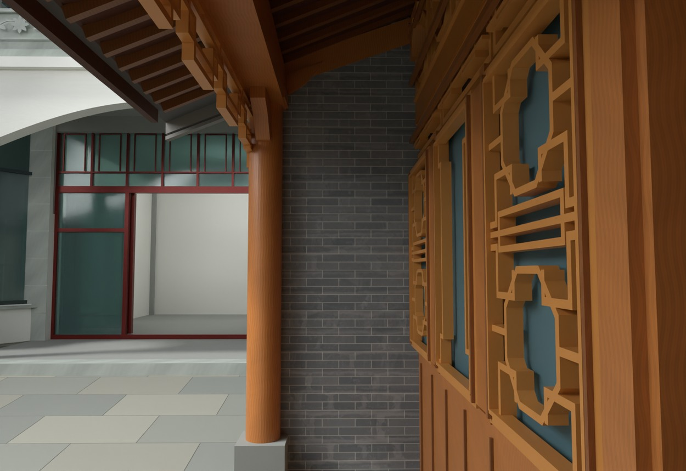 | 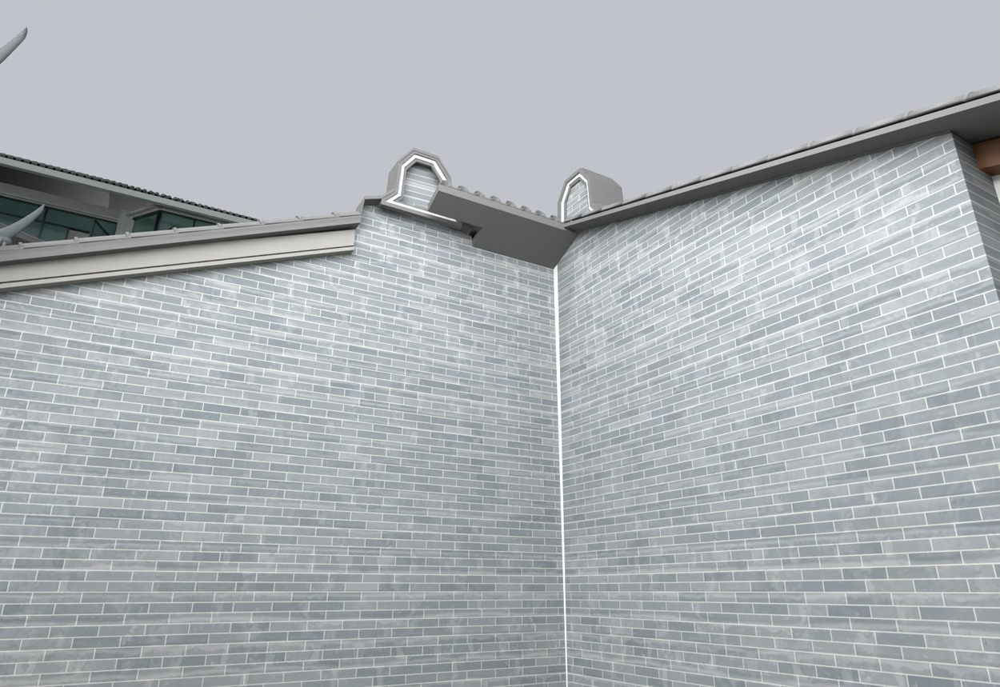 | 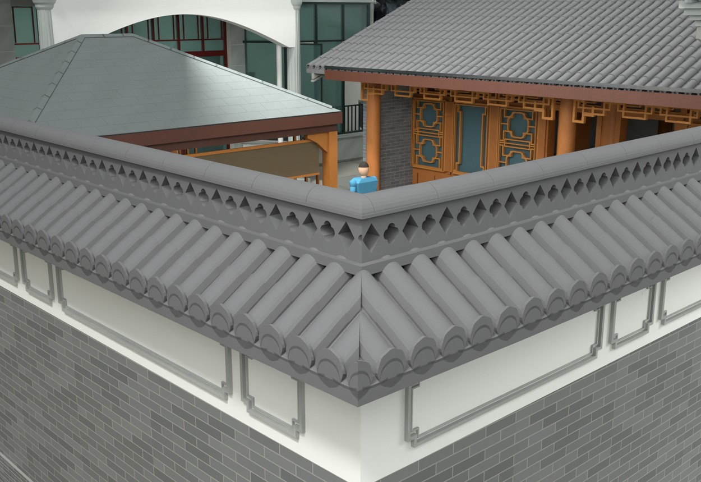 |

*图 02–04 · V24.26 的三处 Blender 模型渲染。*

### V26.20 储藏房入口

储藏房与相邻厨房共用连续地面网格。先划定储藏房和相连廊道的修改范围，以外部铺地为基准抬高内部完成面 **150 mm**，在入口形成一道台阶。厨房地面和墙体列入保护范围。两扇门只修短下沿，沿原合页轴复核开合间隙。

| V26.19 · 修改前 | V26.20 · 修改后 |
| --- | --- |
| 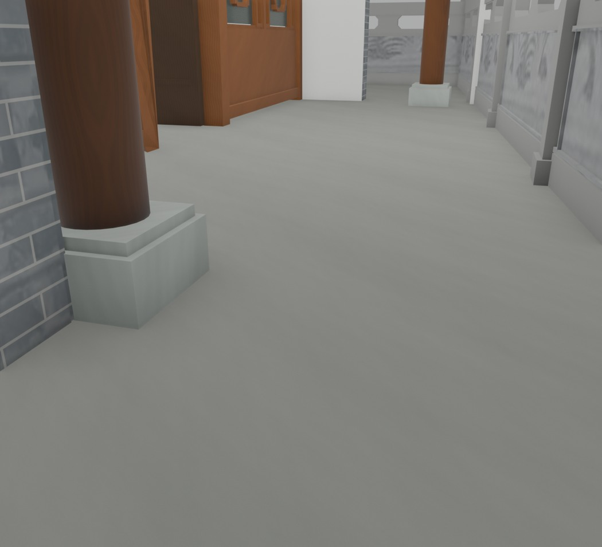 | 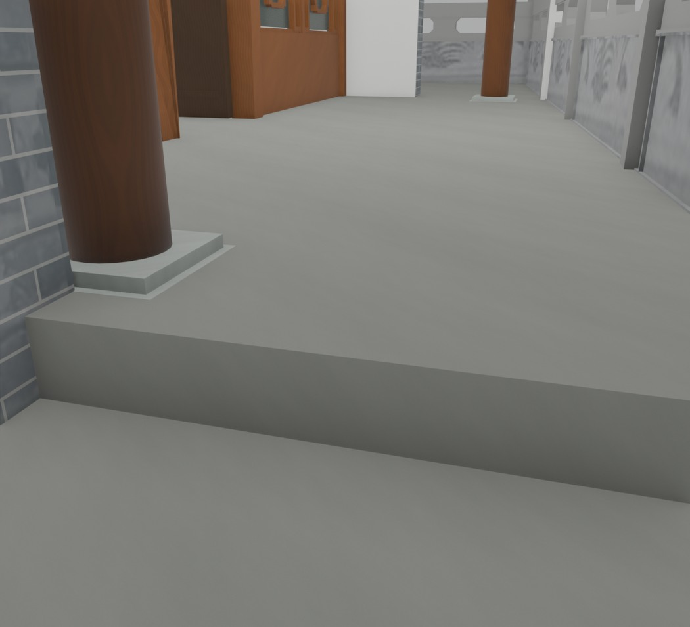 |

*图 05–06 · Blender 同机位渲染。台阶高度来自保存后几何核验。*

保存后以 **161 个入口采样点**检查单阶高差。对两扇门合计 **80 个开合姿态**做间隙检查，并通过 **80 项漫游与碰撞检查**。交付包含完整编辑版、Fast 漫游版及分项 QA。[建筑重建方法与复核](residential-reconstruction.zh-CN.md)

## 2. 模型交接

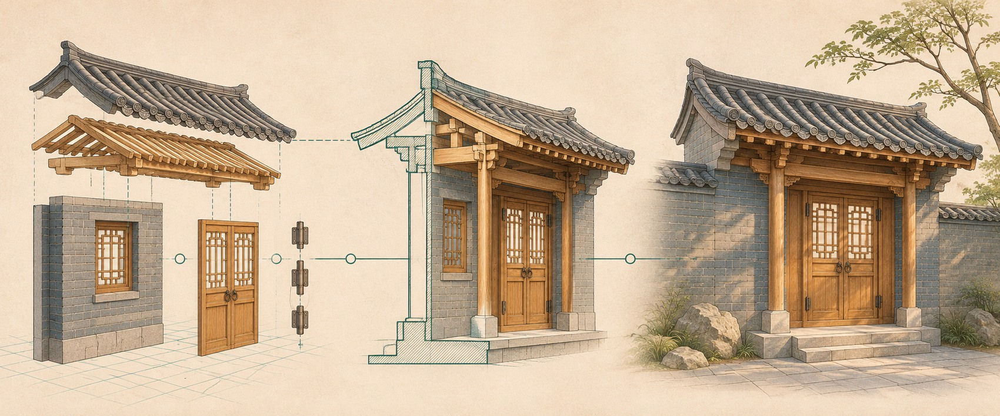

*图 07 · AI 生成过渡图，用虚构门廊说明构件拆分与场景装配。*

实际重建中，遇到照片看不清的结构，先用 GPT Image 根据实景制作整体和分解图，再结合倾斜摄影模型量取与 AI 辅助测算，把选定设计、尺寸和验收要求写成 Codex 改模指令。[大门改模示例](residential-reconstruction.zh-CN.md#大门结构推敲与改模)

| 环节 | 交接内容 | 检查点 |
| --- | --- | --- |
| Blender → Rhino | 以 V26.20 为初始源，整理网格、材质和构件标识，输出米制 `.3dm` | 首轮 Rhino 保存重开核对了 794 个对象及其构件记录 |
| Rhino → Datasmith → UE5 | 将发布副本导入同一 Datasmith Scene，核对米到厘米换算、轴向和活动扇轴心 | 检查 UV、材质槽、玻璃随动、通行与碰撞 |
| 后续修改 → 受控重导入 | 通过构件 `PartId` 核对新增、删除及修改，独立维护 UE 相机、灯光、材质覆盖和交互 | 保存并重开关卡，复核覆盖及门窗姿态 |

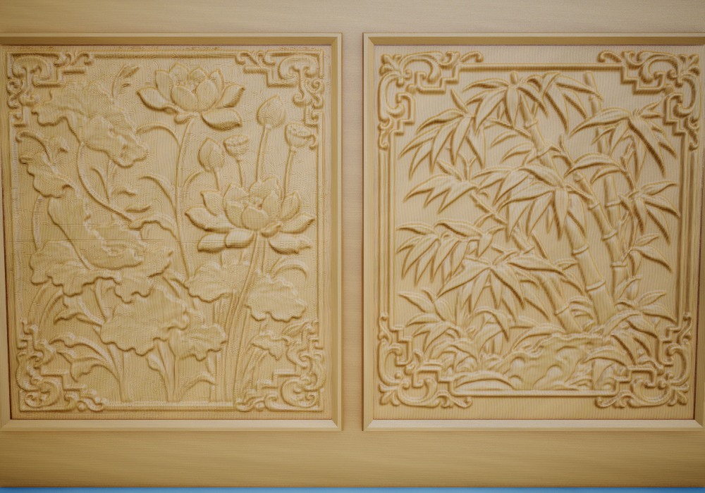

*图 08 · Blender 独立雕花资产渲染。用 16 位高度图生成毫米级起伏，深度按照片估算。*

重导入后按同一机位比对目标部件，把模型版本、构件差异及关卡复核一起归档。[UE5 发布与重导入方法](ue5-building-twin.zh-CN.md#3-保持构件身份按差异发布到-ue5)

## 3. 智慧家场景

| 日间人物漫游 | 夜间照明预览 |
| --- | --- |
| 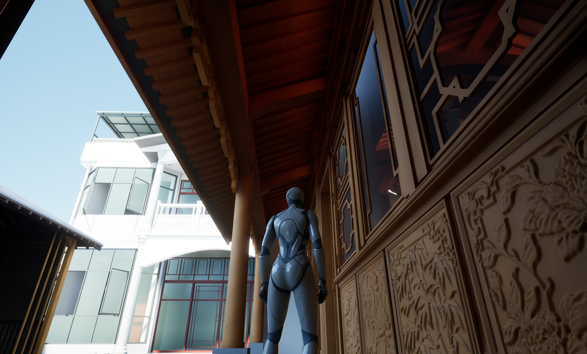 | 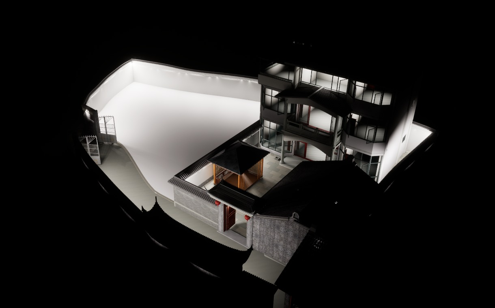 |

*图 09–10 · UE5 项目截图。左图在人物视点复查木构和通行，右图从高位查看顶灯与院墙灯带的覆盖。*

场景支持人物漫游、近距离门窗交互、全年太阳位置与阴影预览。独立灯光与日照参数由 UE 管理，设备层已做本地软件灯演示。真实灯具、电机与传感器的状态反馈仍处于接入准备阶段。[TAO 领域模型](../domain-model.md)

## 4. 风环境与三向切片

从发布模型分别派生**门窗关闭、厨房四窗与双门开启、全场地门窗全开**三种求解几何。全开状态采用 **19 组门、19 组窗**的模型最大开启姿态。每种状态各有四套预计算结果，对应全年主导、夏季主导、冬季主导与全年较强风。

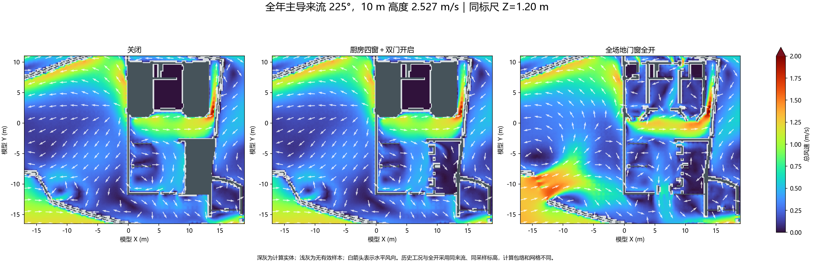

*图 11 · OpenFOAM 结果对照。三图同用 225° 来流、10 m 参考风速 2.527 m/s、模型 Z = 1.20 m 和 0–2 m/s 色标。历史工况与全开工况的计算包络及网格有差异。*

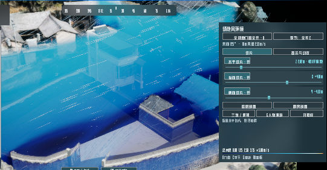

*图 12 · UE5 隔离 PIE 核验截图，截取风场视口与右侧切片控制。*

在本地工程播放后，按 **F10** 进入风场，**O** 切换门窗状态，**C** 切换代表风。右侧可独立调整水平（Z）、纵向（X）和横向（Y）切片。按 **G** 切入人物漫游，全开状态下收起面板后可按 **F9** 读取人物脚下标高以上 1.65 m 的模拟风速。退出风场时恢复进入前的门窗姿态。

三向切片候选在隔离 PIE 中核验了独立滑杆、白迹对齐、漫游换季和退出恢复。已安装到本地主工程的蓝图与候选 SHA-256 一致。全开网格有 **363,543 个单元**，四套求解达到本轮残差阈值，扩展检查记录 **20,508 个凹单元**。结果用于 EPW 代表风条件下的交互和对照，工程量化判断仍需现场校准与网格独立性复核。[求解与验收记录](ue5-building-twin.zh-CN.md#5-从-epw-生成可比较的风环境工况)

## 项目资料

- 逐版改动、源文件与保存结果。[建筑重建台账](../history/reconstruction.md) · [智慧家迭代台账](../history/smart-home.md) · [日常更新](../history/updates.md)
- 建模、几何修复、同机位复核和 Fast 漫游交付。[建筑重建方法](residential-reconstruction.zh-CN.md)
- Rhino 发布、Datasmith 重导入、UE5 交互和 OpenFOAM 工作流。[建筑数字孪生制作实战](ue5-building-twin.zh-CN.md)
- 每张配图的来源、处理及两张生成图的原始提示词。[配图来源](media/reconstruction-to-smart-home/README.md)
- 后续模型更新、复核和回退记录。[发布与核验模板](../templates/building-twin-release.zh-CN.md)

本仓库收录图文案例和核验摘要。原始实景资料、可编辑模型及完整 UE 工程由本地交付目录管理。
