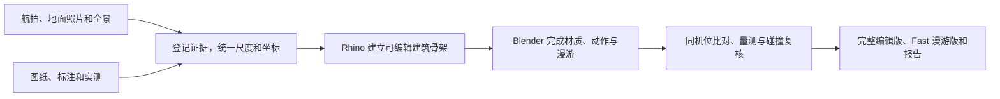

# 三层住宅数字孪生建模方法与经验

这个案例从三层住宅、院落和附属房的现状重建开始。航拍建立场地关系，图纸提供轴网和构件线索，地面实景补足门窗、楼梯和室内细节。模型在 Rhino 中建立建筑骨架，再到 Blender 做材质、门窗动作和漫游。本文记录制作流程，以 V26.20 的脱敏案例展示怎么复核一次局部修改。

重建版本的同机位对照与后续 UE5 场景见 [从建筑重建到智慧家数字孪生](reconstruction-to-smart-home.zh-CN.md)。

各版改动按过程文件登记。[建筑重建逐版台账](../history/reconstruction.md)

## 1. 整理资料和坐标基准

| 资料 | 用来确认什么 | 怎么使用 |
| --- | --- | --- |
| 航拍与 ContextCapture 实景网格 | 建筑和地形的相对位置、屋脊、院墙轮廓 | 保留原始网格和贴图，作为配准和外部轮廓参考 |
| 平面、立面和结构图 | 轴网、开间、层高及梁柱板的关系 | 逐层核对现场变化，把设计尺寸与现状尺寸分开登记 |
| 地面照片与全景视频 | 材质、接缝、门扇开启方向、空间连通 | 记录楼层、房间、机位或时码，重点补拍门两侧、楼梯转折和遮挡角落 |
| 现场量尺和已确认的尺寸 | 门洞偏距、净宽、窗台、完成面和踏步高差 | 标清测量基准和单位。将照片比例拟合记为估计尺寸，缺测项标为待复测 |

建模前统一用米、Z 轴向上。保留原始东—北—天（ENU）坐标及工程局部坐标之间的变换，连同原点、旋转和单位一起登记。以面向院子的正立面为例，取立面朝外的方向向量，用变换的旋转部分得到东、北分量，再将 `atan2(东, 北)` 换成角度并归一到 0° 至 360°，得到从真北顺时针的方位角。把这个结果记录为模型推算朝向，现场测向单独记录。

## 2. 从可编辑骨架做到可漫游模型

1. **先搭结构。** 在 Rhino 中对齐实景底模，建立楼层完成面、轴网、墙体、梁柱、楼板和洞口，再落实楼梯井、平台与通道。实景层和重建层分开管理，检查时切换显示，避免两套重合表面同时参与渲染。
2. **再拆可活动构件。** 在 Blender 中把墙、门框、门扇、固定玻璃、开启扇和推拉扇按角色组织。记录每个洞口连通的空间，按实景设置铰轴或轨道。窗型逐层确认，本案首层凸窗有下段固定玻璃，二层开启扇落在实体窗台上，后侧使用推拉窗。
3. **最后做接缝和材质。** 先量几何，再检查面材质槽、法线和 UV。青砖看砌筑模数与转角砖缝，石基看接缝两侧的纹理尺度，木构看木纹方向。用实景视角校核白墙、石材和玻璃交界，并用统一的阴天柔光复查局部。

每条修改记录至少写清 `版本 / 楼层和部位 / 实景或图纸依据 / 尺寸及来源 / 涉及对象或面域 / 保护范围 / 复核结果`。同一张截图可能同时圈到梁、窗框和墙面，先查对象归属再动手。脚本改模时从确认过的上版文件读取，给新结果另存版本，并记录输入与输出的 SHA-256。[建筑孪生发布与核验模板](../templates/building-twin-release.zh-CN.md)

## 3. 反复遇到的几个问题

| 看到的现象 | 排查过程与处理 |
| --- | --- |
| 台面或窗边转动时闪烁 | 分别显示旧件、补片和现行件，检查是否同时存在重叠的可见面。定位后修剪或移除重叠面，保留清楚的接缝和连续铺面，再从斜角移动复查。 |
| 窗顶破角，梁端和墙角出现凸条 | 先按轴网和剖面核对梁、柱、楼板，再看窗组。固定斜窗曾反切梁柱节点，修正时恢复原有梁柱交接，把固定窗收至柱前，并把窗脚与板边接齐。 |
| 楼梯板底有错台，平台侧面颜色不对 | 分开处理两处。让楼梯斜板底连续接到楼板底，检查踏步和平台标高。半层平台外露侧面用白色，踏步立面保留石材。复查时从楼梯上下两侧分别看。 |
| 内大门雕刻在漫游中像平板 | 先用同一模型和机位比较局部遮蔽开关，再检查灰度高度图、网格与材质。恢复 V24 石刻网格和原 UV，按实景重排柱面与转角分格，以统一灰石材质表现隆起和凹槽。Fast 版保留网格起伏和局部遮蔽，细节可随视角检查。 |

窗边、楼梯井、门槛和木构收头都适合做剖面检查。先处理构件之间的几何关系，再用材质解决表面的观感。远景容易漏掉的台阶、薄片和缝隙，要在人的视点高度下走近看。

## 4. 储藏房入口的一阶 150 mm 台阶

以入口外完成面为相对零点，入口内檐廊、储藏房和相连外廊完成面提高 150 mm，在窄入口形成一道立面。验收时把厨房和墙体单列为保护区。

1. **定位共用网格。** 储藏房、厨房、地基和围边共用连续地面网格。先提取各区平面边界和原标高，检查相交范围，再按储藏房的平面范围局部增高，并让新增台阶与原地面实体连续。
2. **续接贴图。** 新顶面沿用原地面世界 XY 投影的比例和起点。新增外露竖面沿相邻石基的纹理方向和相位接续。原照片在上沿直接延伸会拉出一条纹带，本次只在新增竖面使用镜像续接。
3. **校核门和通行。** 两扇门只裁短下沿并封底，沿原合页轴和动作范围取样。更新局部碰撞后，测试从外部走上台阶和从内部返回院地。
4. **按保护范围复核。** 保存后读回网格，比较厨房区域的几何、材质和 UV，并核对墙体对象的网格和变换。因为厨房与储藏房共用网格，厨房按区域逐面取样，整件网格另做完整性检查。

V26.20 的复核记录包含下面几组结果。数字对应本次模型及其测试路线。

| 检查 | 本次结果 |
| --- | --- |
| 保存后几何与原生场景 | 几何 15 项、原生场景 18 项通过 |
| 门扇运动 | 两扇各取 40 个姿态，均通过间隙检查，门底最小间隙约 8.4 mm |
| 漫游与材质视口 | 碰撞与通行 80 项通过，另保存 4 张实际 Fast 材质视口检查图 |
| 修改前后对照 | 6 组同机位视图覆盖入口、门扇、外侧地基和厨房交界 |

## 5. 显示优化和版本交付

- **完整编辑版**保留原生构件、材质、UV 和动作，供后续修改。**Fast 漫游版**从同一版几何派生，使用较低的视口采样和半分辨率预览，保留阴天柔光及用于辨认接缝和浮雕的局部遮蔽。V26.20 验证了漫游、碰撞和实际视口表现。帧率对比需要另在同一硬件、分辨率、着色模式和路线下记录帧时间。
- **交付包**包含两份可打开的 `.blend`、漫游入口、同机位对照和分项 QA。保存后分别打开两份文件，检查贴图能否读到、漫游入口能否启动，以及测试报告记录的模型哈希是否匹配。截图用于定位问题，模型和检查记录用于重做验证。

## 6. 与 TAO 平台衔接

这个案例交付的是现状场景和本地 Blender 漫游。早期 Rhino 版本另有以局部米制坐标输出的 GLB。发布给 Web 或 UE5 时，用已知长度和方向的构件校核尺度与轴向，再检查贴图、活动扇和通行。Datasmith 重导入、UE5 交互与环境分析可接着看已发布的实战指南。[模型资产目录](../../assets/models/README.md) · [建筑数字孪生制作实战](ue5-building-twin.zh-CN.md)

场景用稳定编号记录房间和构件。接入 TAO 时用 `Space` 登记建筑、楼层和房间，再以 `entity_id` 绑定需要实时状态的设备节点。资产导入、状态同步和实物反馈各有验收记录。[TAO 架构](../architecture.md) · [领域模型](../domain-model.md) · [路线图](../roadmap.md)
