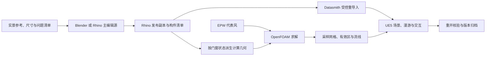

# 建筑数字孪生制作实战

本案例从一套带院落的建筑场景出发，在 Blender 和 Rhino 中维护模型，经 Datasmith 发布到 Unreal Engine 5，再加入漫游、门窗、全年日照和风环境对照。以下记录取自项目的建模、发布、求解与播放核验。项目方法面向可持续迭代的建筑场景，平台接口见 [TAO 架构](../architecture.md) 和 [UE 客户端](../../clients/unreal/README.md)。

## 1. 先确定尺寸基准和编辑范围

1. 整理已有模型、参考照片和现场量测，把来源记到部件清单。尺寸标明参考面、方向、单位及公差。照片估值单独登记，方便后续用实测替换。
2. 建立统一原点、标高和真北。用已知尺寸检查 Blender 和 Rhino 的米制输出、UE 的厘米换算以及导入轴向。先验证一个有明确方向和长度的构件，再导入整场。
3. 区分建筑网格、材质分支、活动扇和 UE 独立对象。修改前检查对象归属。例如相邻房间可能共用一张地坪网格，局部抬高时先限定顶点或面区，再复查邻区标高。
4. 给修改写下可核验的目标。亭子一轮修订以院内铺地为基准核对 **100 mm 平台高差**，再以平台面核对 **900 mm 扶手高度**。保存后逐点测量，并从低视角检查木封边与支脚遮挡。这些数字是该轮模型目标。

## 2. 用不同的检查方法验收不同部件

| 部件或问题 | 制作方法 | 验收 |
| --- | --- | --- |
| 墙面、屋面漏缝 | 在源模型定位缺口，检查相接表面的边界，再补闭合几何。青砖沿实际尺寸重建 UV，按材质分支保留内墙饰面。 | 用成组射线检查遮挡和穿透，近景检查纹理比例、接缝与拐角。 |
| 厨房门窗 | 将固定框、活动扇、玻璃和五金分组，以实景标注确定铰链侧和开向。玻璃厚度按 **6 mm 建模值**处理。 | 核对关闭、中间和最大开启姿态，检查铰链漂移、关合位置、玻璃随动和碰撞间隙。 |
| 实体木窗台 | 用固定竖框前表面作基准，向外挑出 **30 mm**。Rhino 中构建连续台板、前沿线脚和端封，发布时保持构件身份。 | 保存重开后检查闭合边、正体积和外挑量，进 UE 再量一次。板厚、总进深和窗扇间隙沿用照片估算，待实测校准。 |
| 雕花木板 | 将整理后的照片纹样制成非色彩空间的 **16 位灰度高度图**，映射到毫米级起伏，再封闭侧边与背板。底色取干净木纹，微细节用法线图补充。 | 先用无纹理灰模看几何起伏，再核对闭合网格、UV 和 UE 采样。照片遮挡处按设计补全，深度属于模型近似。 |

雕花先在独立 Blender 文件里建立高、中、低三档网格，再发布到建筑场景。独立雕花资产采用四种纹样，场景用中档网格，轻量资产另导出 GLB。早期单纹样版本用每块 **256 × 256 格**、约 **0.5–6.0 mm** 的外凸范围验证流程。导入后的顶点会受量化影响。该轮把精确坐标匹配改为带容差的邻域匹配，才完成全部 256 个抽样点的逐点对照。模型细节尺寸和导入容差应分别记录。

## 3. 保持构件身份，按差异发布到 UE5

每轮指定 Blender 或 Rhino 为主编辑源。Blender 负责网格资产与细节，Rhino 可用于尺寸复核、实体构件和发布副本，UE 维护灯光、材质覆盖、摄像机、人物及交互。跨来源改动先合并并重建基线。

1. 保留编辑源和上次发布快照。Blender 对象持有稳定标识，Rhino 保留对象 GUID 与构件 `PartId`。部件拆成多个材质分支时保留各分支的身份。复制对象要检查标识是否重复。
2. 将新模型、材质依赖和构件表导出到暂存目录。比较新增、删除、几何、UV、材质槽和单位。源几何变化时复查特殊 UV 或顶点属性，确认仍适用后再恢复。
3. 停止编辑器内播放（PIE），备份源文件、关卡、导入资产和 UE 覆盖。重导入同一个 Datasmith Scene。把自定义照片材质保存在导入目录之外，按构件身份恢复覆盖。独立灯光、人物、相机和交互对象放在导入场景之外。
4. 核对构件数、身份唯一性、非目标资产差异、材质槽、门窗轴心和碰撞。保存并重开关卡，再用同一机位、时间、曝光和焦距拍对照。把空更新、失败与回退结果一并留档。遇到超时，先读取实际发布号和结果再决定重试。

同一 Datasmith Scene 的资产与关卡实例各有更新行为，重导入后要分别检查。用一个已知尺寸的测试构件先验证导入和覆盖恢复，再应用到整栋建筑。[Epic Datasmith 重导入](https://dev.epicgames.com/documentation/en-us/unreal-engine/datasmith-reimport-workflow-in-unreal-engine) · [Rhino 与 Datasmith](https://dev.epicgames.com/documentation/en-us/unreal-engine/using-datasmith-with-rhino-in-unreal-engine)

## 4. 把漫游、门窗与环境参数连起来

- **人物与相机**。先检查落地、碰撞和通行，再调第一、第三人称。案例第一人称视高为 **1.65 m**。进入风场时保留漫游位置。面板打开可调参数，收起后恢复行走。
- **门窗姿态**。每个活动组记录固定件、轴心、活动段和最大开度。风场切换加载与数据集一致的门窗姿态，退出后恢复进入前的交互状态。
- **地理日照**。登记纬度、经度、时区、模型真北和日期时刻，计算太阳方向。全年日期选择、固定时刻播放、月度角度和闰日边界已在本机核验。日照功能用于阴影预览。全年日照时数、辐射量和能耗需要另行计算。
- **照明**。将可见灯具与实时照明组件分开检查。整组灯光或虚拟阴影贴图（VSM）出现问题时，用固定夜景机位比较覆盖、阴影和性能提示，再保存重开核验。

## 5. 从 EPW 生成可比较的风环境工况

**气象 → 几何 → 网格 → 求解 → 显示**各留一份记录，门窗状态和天气共同组成工况键。

1. **统计来流。** 从 EPW 读取逐时风速、来向，校验缺测编码、单位和方向。在项目示例中按 22.5° 分扇区，以风速低于 0.5 m/s 为静风阈值，按有效风记录的频数选主导扇区。全年、夏季和冬季分别取其主导扇区平均风速，较强风取全年主导扇区的第 95 百分位。把气象站来源、统计月份、阈值和参考高度随工况归档。确认气象“来向”到求解流动方向、模型真北与 UE 轴向的转换。[EnergyPlus EPW 数据字典](https://bigladdersoftware.com/epx/docs/23-2/auxiliary-programs/energyplus-weather-file-epw-data-dictionary.html)
2. **派生计算外形。** 从已发布的建筑版本建立独立求解外形，分别处理门窗关闭、厨房四窗与双门开启、全场地门窗全开。保留开口、主要遮挡和室内通路，简化小五金和细木纹。沿外部至室内检查连通性。发现墙芯形成空腔时复核墙厚和封口，修补墙体后重新检查开口。
3. **生成网格并求解。** 用 OpenFOAM 建立外域，在建筑表面和开口局部加密。记录网格数、质量检查、入口剖面、地面粗糙度、湍流模型和求解器版本。案例采用本机 blueCFD / OpenFOAM 5.x 做稳态中性风压分析。收敛核验同时看残差、边界通量与代表点。网格细化、几何变更和室内通路错误会分别影响结果，按来源排查。[OpenFOAM 5.0 发行说明](https://openfoam.org/release/5-0/)
4. **导出显示数据。** 保存坐标原点、步长、速度分量、有效流体掩码和工况标识。显示网格与求解网格分开登记。流线与粒子从速度场积分或采样，动画速度、拖尾长度和密度属于显示参数。剖面的白迹使用面内速度，颜色使用风速大小，图例标明 m/s。
5. **做同条件对照。** 对比开闭窗时锁定来流、切片位置、相机和色标。几何包络、加密策略或其他求解条件有差异时标在图旁。漫游探针需要记录楼层、参考高度和掩码状态。模拟值、现场读数和无效采样使用各自的状态。

### 一轮全开验证的数据

| 代表来流 | 来向 | 10 m 参考风速 |
| --- | ---: | ---: |
| 全年主导 | 225° | 2.527 m/s |
| 夏季主导 | 225° | 2.184 m/s |
| 冬季主导 | 0° | 1.207 m/s |
| 全年主导方向较强风 | 225° | 5.000 m/s |

全开网格为 **363,543** 单元。标准 `checkMesh` 和四个代表风求解通过该轮检查，逐项检查了 **38 组开口、52 个活动段和 16 个代表点**的室内外连通性。末步压力初始残差均低于该轮设定的 `1e-4`。扩展检查仍记录 **20,508 个凹单元待复核**。开口局部目标网格约 0.094 m，外形体素 0.10 m，UE 显示网格间距 0.25 m。它们分别描述网格加密、外形处理和显示采样。

这组结果可用于观察代表来流下的流向和局部风速分布。将其用于工程量化判断，需要进一步核验网格独立性、开口简化、粗糙度和现场风速。较强风仍按典型年统计选取。早期关闭、厨房开启与全开使用了不同的计算包络或加密网格，图示差异包含这些因素。稳态案例未纳入热浮力和机械排风。

## 6. 在 UE5 里验收切片和发布状态

- 切片页放三条位置滑杆。水平面按铺地以上高度移动，纵向竖剖面沿 X 平移，横向竖剖面沿 Y 平移。每张可独立开关。季节与门窗选择放顶部，色标放底部。粒子、流线和斜向剖面调节放在显示页。
- 逐个拖动滑杆，检查另外两张切片的位置，并对齐剖面与白迹的坐标。用真实数据网格边界限制范围。依次检查三种开闭状态、漫游换季、楼层采样和退出恢复。
- 将切片组件保存在风场蓝图中，运行时调节位置、可见性及材质参数。一次运行时临时增组件触发了既有切片材质初始化错误，改为在蓝图中添加横剖与白迹组件，在隔离工程播放后核验。
- 打开的 UE 编辑器可能锁定蓝图包。该次发布先保留原包和校验值，再由原启动入口在启动新编辑器前比较旧版与候选文件的 SHA-256，匹配后替换。隔离 PIE 通过三轴独立、白迹对齐、漫游换季和退出恢复检查。随后核对了主工程已安装包与候选的哈希。PIE 验收、部署和打包运行分别记录。

## 7. 从本地原型走向 TAO 集成

| 层 | 本案例的工作 | 接入 TAO 时的约定 |
| --- | --- | --- |
| 场景与交互 | Blender / Rhino / Datasmith 管理建筑部件，UE 管理人物、门窗、日照和风场。 | 用稳定映射关联 UE Actor 或组件和 TAO 实体。构件身份与设备身份各自维护。 |
| 环境数据 | 季节、开闭状态、数据版本和采样位置用于检索预计算风场。 | 状态记录附来源、时间、单位和有效性，明确数据由 CFD、模拟器还是传感器产生。 |
| 设备闭环 | 本地测试涉及软件灯和编辑器联调。仓库的 Web 原型提供 REST 与 WebSocket。 | 按 TAO 的实体、命令和事件契约接入。分别记录用户请求、执行反馈、设备确认状态和时间。真实硬件与打包客户端仍需单独验收。 |

新一轮先定义改动范围和证据，再记录模型发布号、分析数据版本和文档提交号。用同条件画面、保存后重开、文件哈希和失败记录串起每次更改。每次 PR 可直接复制 [建筑孪生发布与核验模板](../templates/building-twin-release.zh-CN.md)。TAO 侧继续按 [领域模型](../domain-model.md)、[通信协议](../protocols.md) 和 [安全说明](../security.md) 管理设备接入。
