# Codex 如何定位、改模和验收

同一处问题通常经过几个来回。先把用户圈出的现象对到实景和模型，再用坐标、剖切或对象读回确定改动范围。改完用相同视角回看，同时核对保存后的几何、材质或交互状态。下面按原记录串起这些步骤。每张关键图都能点开，完整过程图按编号回查原文件。 [过程图档与出处](process/README.md)

各方法第一次出现及后续怎样沿用，按建筑版本和 UE5 发布顺序另列。凉亭高度散点图可根据原输入与代码复算。 [逐版研究实现](research/README.md) · [凉亭案例](research/pavilion.md)

| 当时要回答的问题 | Codex 查的证据 | 留下的过程记录 |
| --- | --- | --- |
| 圈画指的是哪一处 | 先用楼层、门窗和相邻构件复原视角，再对照全景抽帧、实景和模型对象 | 用户圈画、对照图、对象名和版本 |
| 缺面、穿插还是材质问题 | 把视图落到模型局部坐标，按 Z 高度或 Y 位置切开，必要时对照材质、遮蔽和几何的不同状态 | 坐标图、剖面轮廓、候选与修前修后 |
| 如何改到指定部位 | 写清操作对象、保护范围、单位和验收条件，再用软件脚本或编辑器接口执行 | 修改脚本、构件差异、同机位画面 |
| 保存以后是否仍成立 | 重读模型或重开关卡，检查范围、身份、材质、碰撞与开合，记录测试所用的版本和场景 | 读回 QA、PIE 验收、失败或候选记录 |

## 从圈画定位到模型坐标

### V7 把山墙缺面对应到原模型

用户画的红线先确定正面山墙的缺面位置。Codex 依据附近的拱梁和两坡屋面，在全景与航拍参考里对回同一处，再按拱梁顶和屋面底约束封闭山墙。相近的二层楼梯墙、三层横墙和阳台门分开处理。例如 V7 的需求表把二层楼梯墙记录在模型 `Y = 7.3 m`，把移位后的阳台门记录在 `X = 3.9 m` 侧墙，便于在同一模型里复查。坐标来自模型定位，红线提供的是部位线索。原记录见 `Rebuild_V7_Hybrid/06_Report/需求汇总与修模依据_V7.md`。

| 用户红线定位 | 封闭山墙后的复核 |
| --- | --- |
| [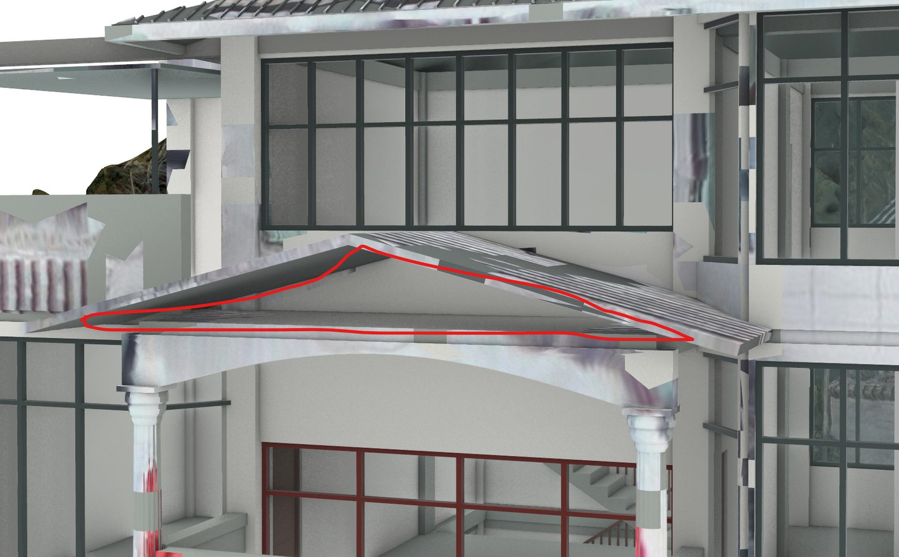](process/media/focus/v7-gable-mark.jpg) | [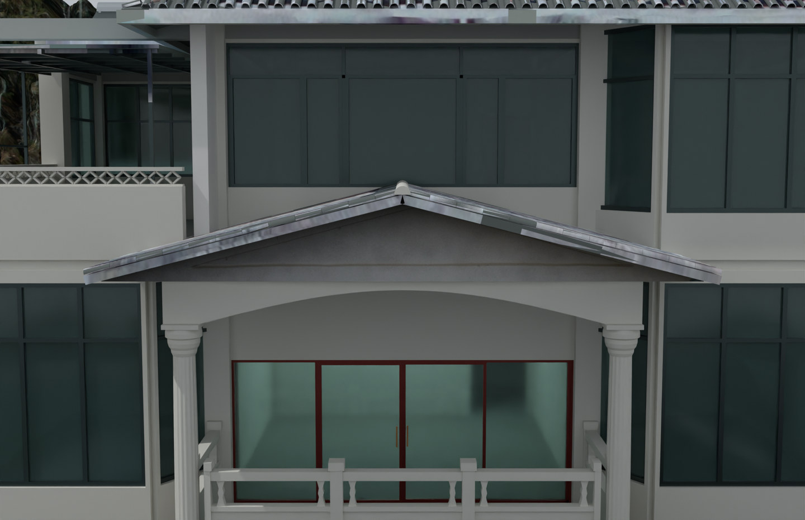](process/media/focus/v7-gable-saved.jpg) |

### V24.22 用多个高度和纵向位置拆开重叠墙体

Codex 先按对象名读出六组墙体网格，包含厨房与储藏房连体砌体、旧山墙补片、内侧白灰层和门楼接合封口。用 `v24_22_analyze.py` 输出相同坐标基准的轮廓，再由 `v24_22_plot.py` 画图。同一颜色对应同一源对象。水平图对比 `Z = 1.0 / 2.35 / 3.0 m` 时哪些墙段出现或断开，纵向图把靠得很近的 Y 截面并排，观察山墙、饰面和封口的相交与重叠。图上的数值是切片位置，用来回找对象和面，构件尺寸须回到网格复核。原轮廓见重建工作目录 `work/v24_22/Wall_Contours_Before.json`。

| 三层 Z 水平切片（附件一） | 六处 Y 定值剖面（附件二） |
| --- | --- |
| [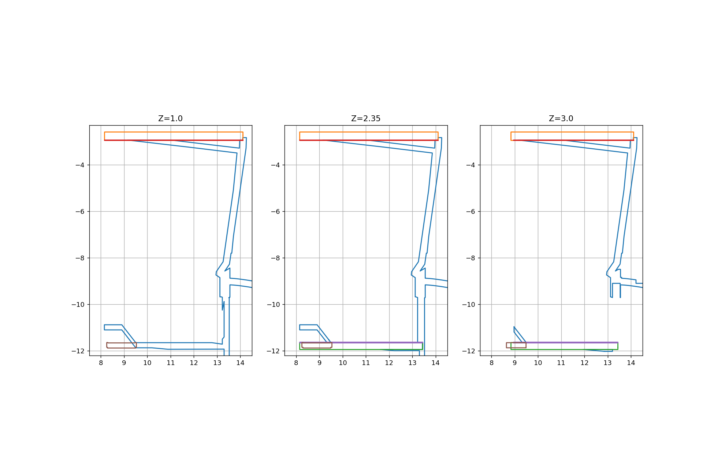](process/media/focus/v24-22-z-sections.png) | [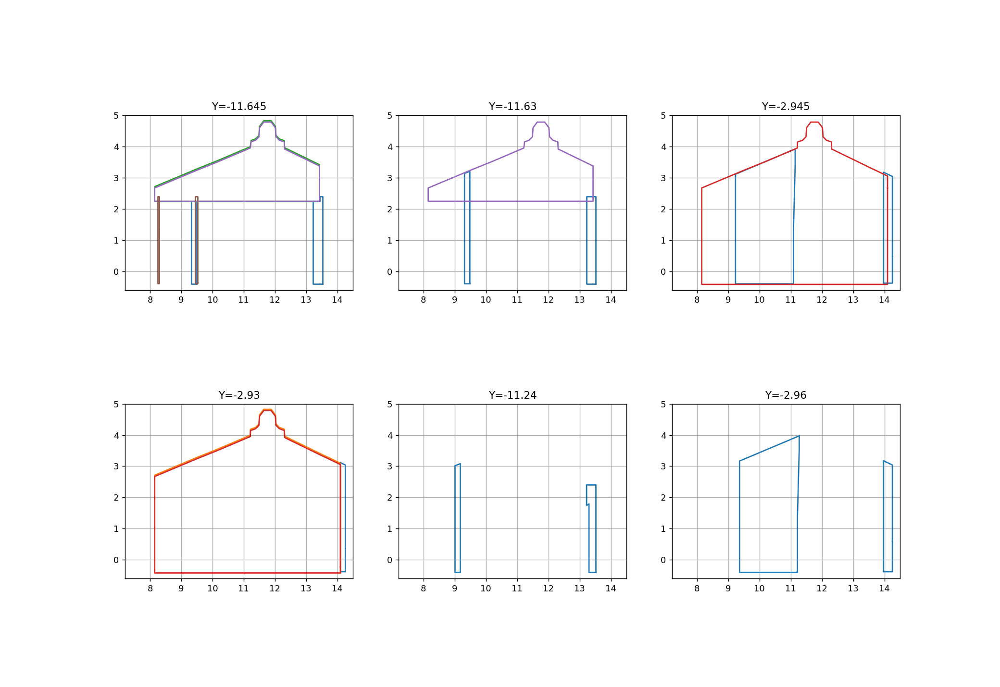](process/media/focus/v24-22-y-sections.png) |

根据诊断调整连体砌体，移除独立旧补片与旧白灰层，并复核新山墙封檐、廊梁和墙拉结。修改对象清单与保存后实体检查分别见 `Rebuild_V24_22/Reports/V24_22_Changes.json` 和 `V24_22_Solid_QA.json`。 [保存后的厨房山墙视图](process/media/focus/v24-22-gable-review.jpg)

照壁同样通过截面定位。V24.16 在原墙 `Z = 1.0 m` 的两侧取中点，查到旧直线瓦顶与缓弯墙身最大偏离约 0.305 m，再用原墙中线统一瓦顶、承托和底座的走向。读回检查的误差是相对原模型中线的几何误差。 [V24.16 墙身与瓦顶截面对照](process/media/focus/v24-16-wall-centerline.jpg)

### V24.36 在正射网格上复查北侧漫游道路

`v24_36_route_debug_plot.py` 按正射图的模型中心和覆盖宽度设置图的 XY 范围，再叠加地面 XYZ 采样。彩色点用于辨认地面高程，红叉是当时的候选路点。沿道路边界核对点位后，脚本重选了部分路点。`v24_36_plan_walkable_routes.py` 从相邻采样点试走，过滤过陡边，并用角色胶囊验证可落地、能走通和高程能接上。图上的 XY 为场地模型局部坐标。

[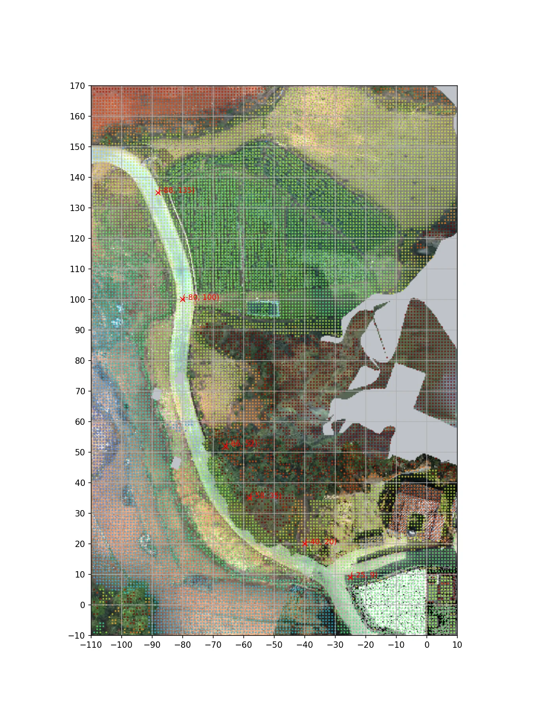](process/media/focus/v24-36-road-grid.webp)

这张图记录的是选路诊断。最终路径与碰撞核验另见重建工作目录 `work/v24_36/Planned_Routes.json` 和交付 `Rebuild_V24_36/Reports/V24_36_Surface_QA.json`。

## 从实景取样到可用材质

**原有投影与现场照片。** 原实景网格已有 UV 与贴图时先复用。V7 的封闭山墙用 DJI 0429 照片投射 UV，色块来自错误的门或阴影投影时按实景改为统一饰面。新建局部构件则另查对应的原照片和视频帧。

**V18 储藏房外墙。** Codex 在实景照片上给毛石、条石和栏板分别圈出四点采样区，把透视斜面展开成矩形。毛石和条石做周期边界校正，减轻平铺时的亮度接缝，再派生灰度微凹凸图；石栏按实际雕花片做图集。原木纹调色和路肩程序纹理在记录中另列。取样区、步骤、贴图通道和模型参数见 `Rebuild_V18/08_Editable_Source/V18_Scripts/v18_design.py`。照片中的光照仍会影响颜色，粗糙度与凹凸强度按外观匹配。

| 取样依据 | 毛石颜色贴图 | 微凹凸图 | 模型外观复核 |
| --- | --- | --- | --- |
| [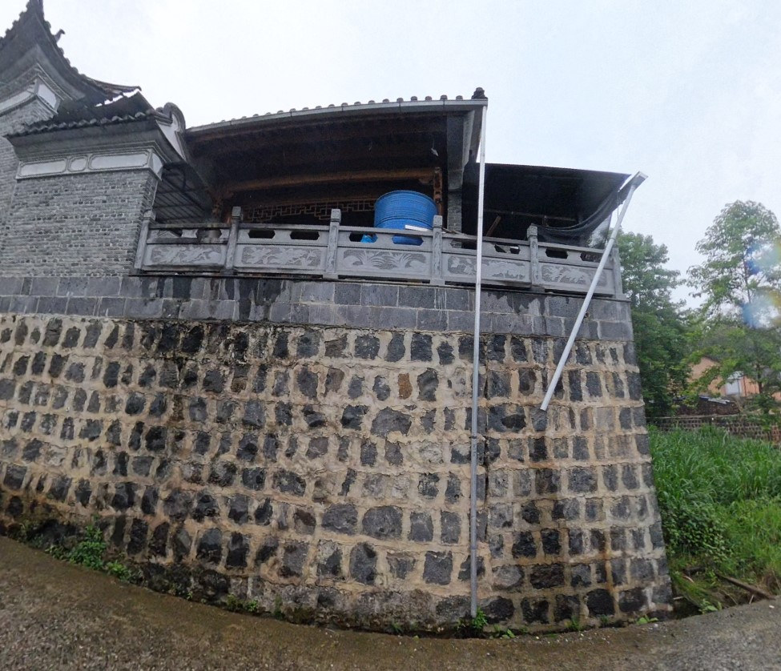](process/media/focus/v18-material-photo.jpg) | [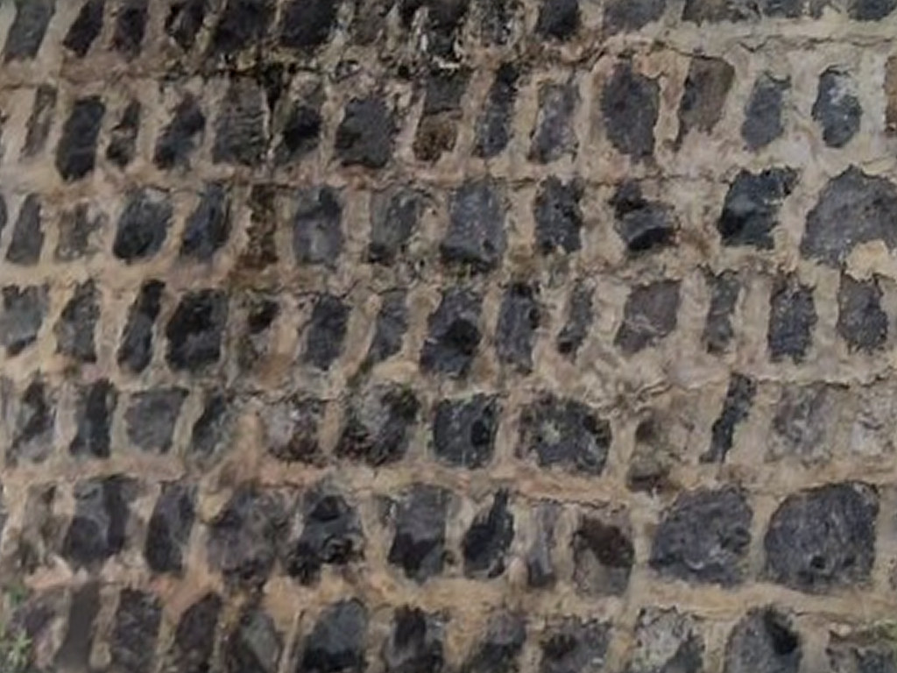](process/media/focus/v18-rubble-color.jpg) | [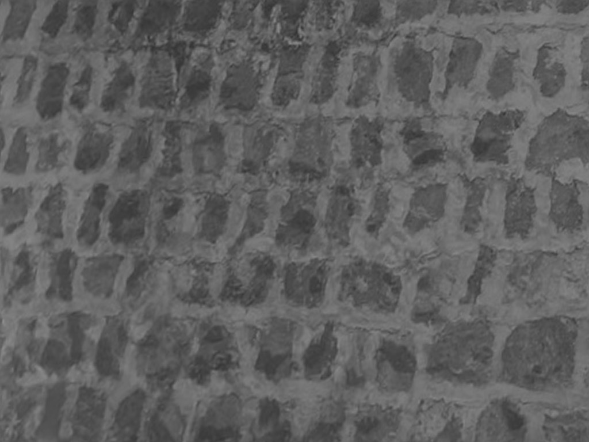](process/media/focus/v18-rubble-height.jpg) | [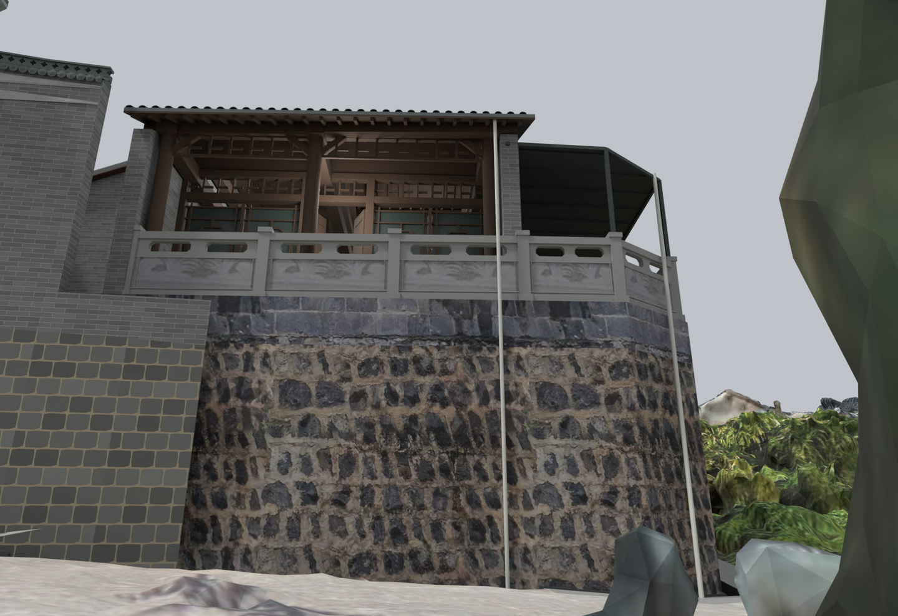](process/media/focus/v18-material-result.jpg) |

**V26.11 大门石浮雕。** 把用户提供的图整理成灰度高度图，用深浅控制浮雕网格起伏，再看近景和边缘。高度图与石材颜色分开管理，起伏属于建模设定。原过程见 `Rebuild_V26_11/Sources/v26_11_gate_relief_prepare.py` 及同轮 `Reports/`。

| 参考图与灰度转换 | 读回的浮雕细节 |
| --- | --- |
| [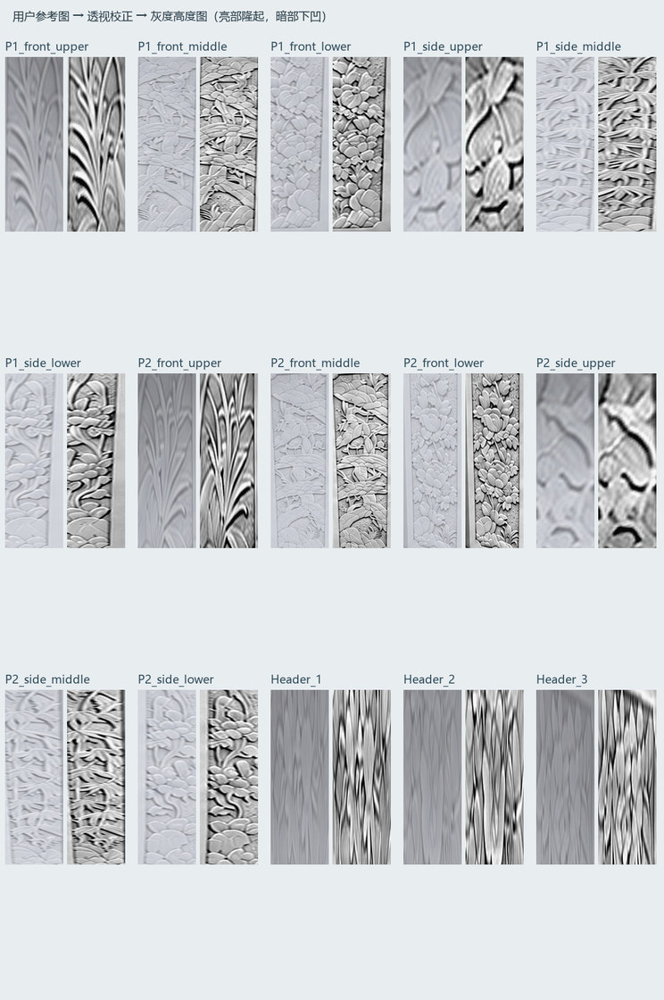](process/media/focus/v26-11-relief-reference.jpg) | [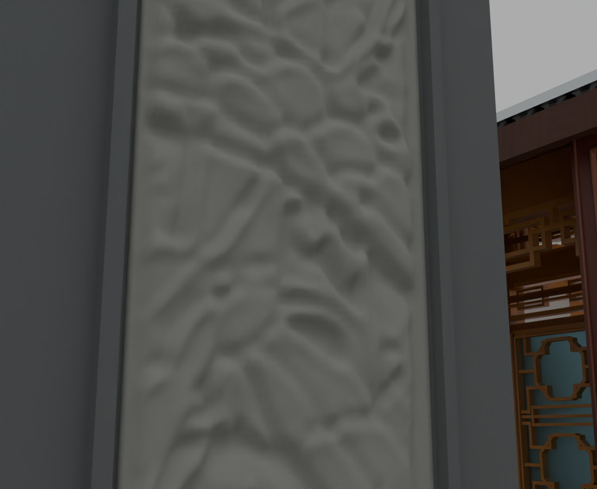](process/media/focus/v26-11-relief-result.jpg) |

**UE5 储藏房复现材质。** 在 Rhino 到 UE 的转换后看到木构灰白，Codex 检查了材质图与引用，确认旧木材色相和饱和度处理没有完整保留。用实景照片中的木梁像素框 `(750, 300, 440, 40)`（x、y、宽、高）制作木纹样本，按构件方向设置两个木纹实例。墙面从同一张照片采样并压低大尺度明暗，花窗玻璃单独设置。保存重开后复核 28 处绑定和贴图引用，几何、包围盒和原 UV 继续以本轮源文件为基准。前后图使用同一相机和预览光照。依据见 `Reports/storage_photo_plan.json`、`Reports/storage_photo_capture.json` 和 `Reports/storage_photo_verification.json`。

| 实景照片 | 旧材质 · 檐下花格 | 照片材质 · 同机位 |
| --- | --- | --- |
| [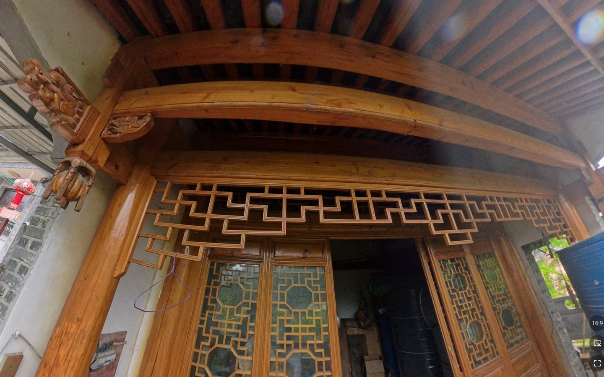](process/media/focus/ue-storage-photo.jpg) | [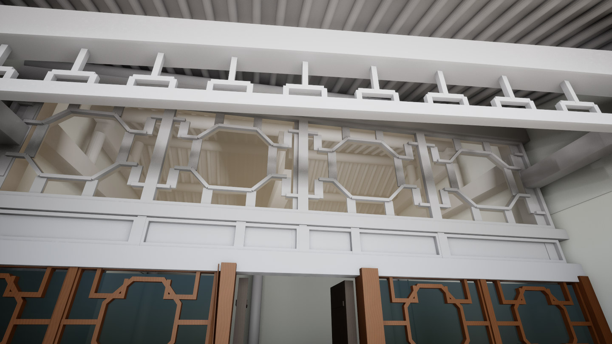](process/media/focus/ue-storage-before.jpg) | [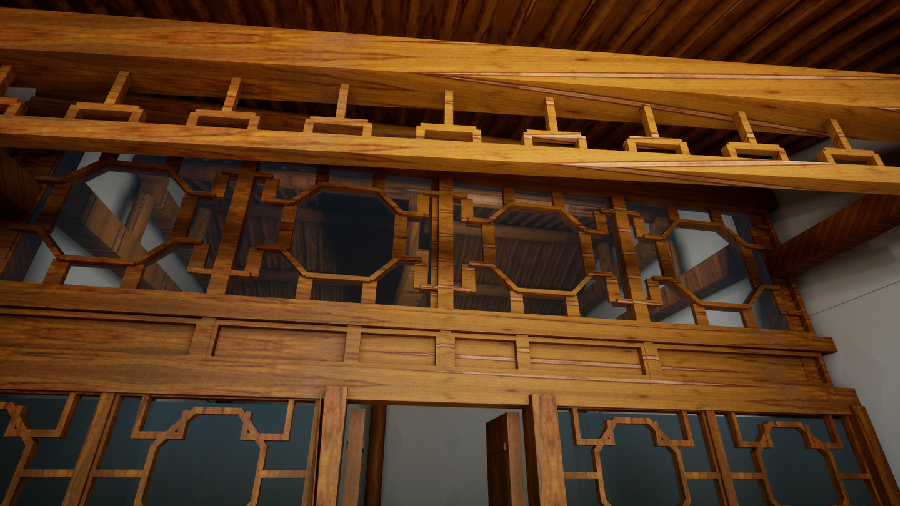](process/media/focus/ue-storage-after.jpg) |

## 让 Blender、Rhino 和 UE5 按同一问题记录接力

### Blender 用对象、范围和动作做局部修正

Codex 用 Blender Python 打开基线模型，读对象名、变换、求值后的网格、材质槽和门扇姿态。可重复的读取、构造、渲染和核验通过后台脚本分步运行。V26.20 中，储藏房、厨房和相连廊道存在共用地面网格。`v26_20_probe.py` 和厨房重叠审计先把储藏房的改动区与厨房保护区分开，随后地面局部抬高 150 mm，并在原铰链轴上复核修短后的两扇门。保存后回读 161 个入口采样点、两扇门共 80 个开合姿态以及漫游碰撞检查。后台读回和实际 Fast 视口都归档在 `Rebuild_V26_20/Sources/Scripts/` 与 `Reports/`。 [V26.20 入口同机位对照](media/reconstruction/v26-20.jpg)

[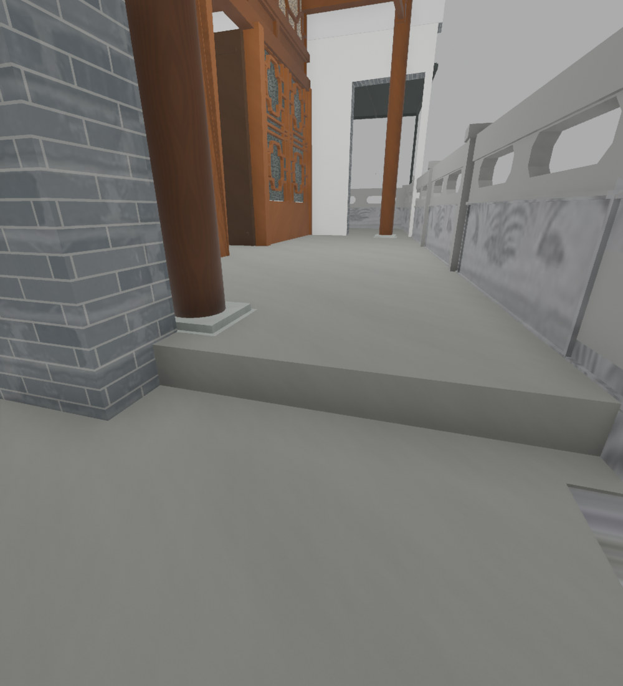](process/media/focus/v26-20-blender-viewport.jpg)

### Rhino 用原生读回和构件标识完成交接

早期重建用 `rhino3dm` 写入米制 `.3dm`，按图层、网格和材质组织对象，再用 RhinoCommon 读回原生文件检查对象、实体和嵌入贴图。V12 的 `08_Editable_Source/Build_Scripts/export_v5.py` 与 `validate_v12_native.py` 保留了两步的程序记录。V13 的原生读回视图展示雨棚下侧和接合位置。 [V13 Rhino 原生复核图](process/media/focus/v13-rhino-native.jpg)

交接给智慧家时，`Scripts/export_mesh_data.py` 从 Blender 的求值结果导出网格、UV 和材质。`Scripts/build_rhino.py` 写入米制发布副本与构件登记，`Scripts/verify_rhino.py` 重读 `.3dm`。首轮保存重开核对了 794 个对象和对应记录。后续从 Rhino 或 Blender 选一份主源，先比对 `PartId`、Rhino GUID、变更范围、材质分支和贴图依赖，再交给 UE。 [首次转换核验](smart-home.md#从-v2620-到第一版-ue-场景)

### UE5 用既有场景受控重导入并逐项回看

首次导入由 `Scripts/import_ue.py` 调用 Unreal Editor Python 的 Datasmith 接口，加载 `.3dm` 后给关卡构件写入 `TwinId` 与 `PartId`，保存并重读关卡。迭代时，`ModelSync/ue/apply_update.py` 在既有 Datasmith Scene 上先保存快照和备份，再应用已审查的差异，恢复匹配的 UE 材质和 UV 覆盖。门窗、镜头、灯光与场景控制在重导入后单独复核。预检、实际保存和 PIE 观察分别留证。 [ModelSync 逐轮记录](smart-home.md)

**厨房后墙。** 围绕用户指出的洞口和接缝，先在源模型上剖切并检查邻接，改好后重导入，再从关卡截图检查洞口。该轮同时另验收青砖实尺 UV 和门扇中柱侧的铰链。原记录见 `ModelRepair_FinalReview_20261028/Reports/修复复核.md`。

| 源几何剖切 | UE5 修前洞口 | UE5 修后复核 |
| --- | --- | --- |
| [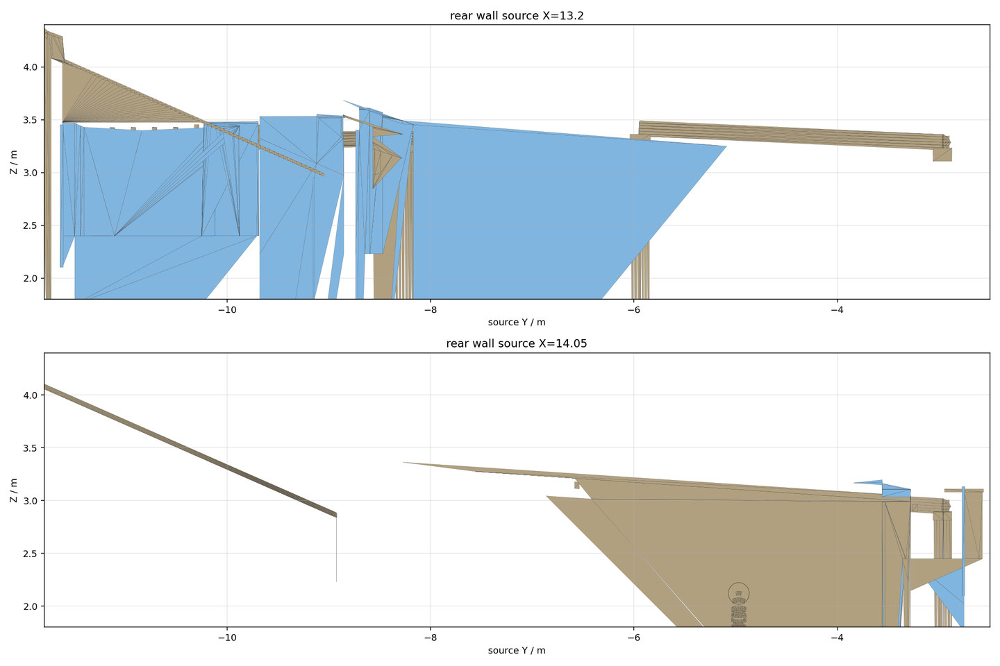](process/media/focus/ue-wall-sections.jpg) | [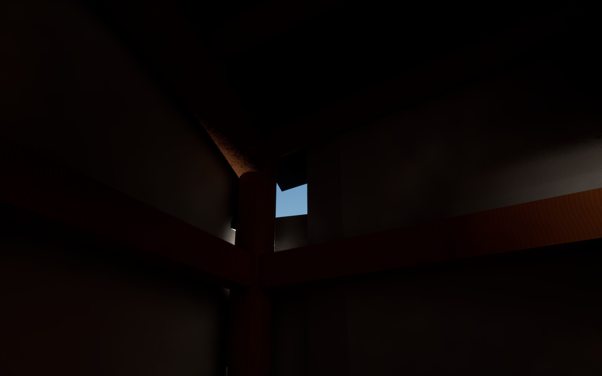](process/media/focus/ue-wall-before.jpg) | [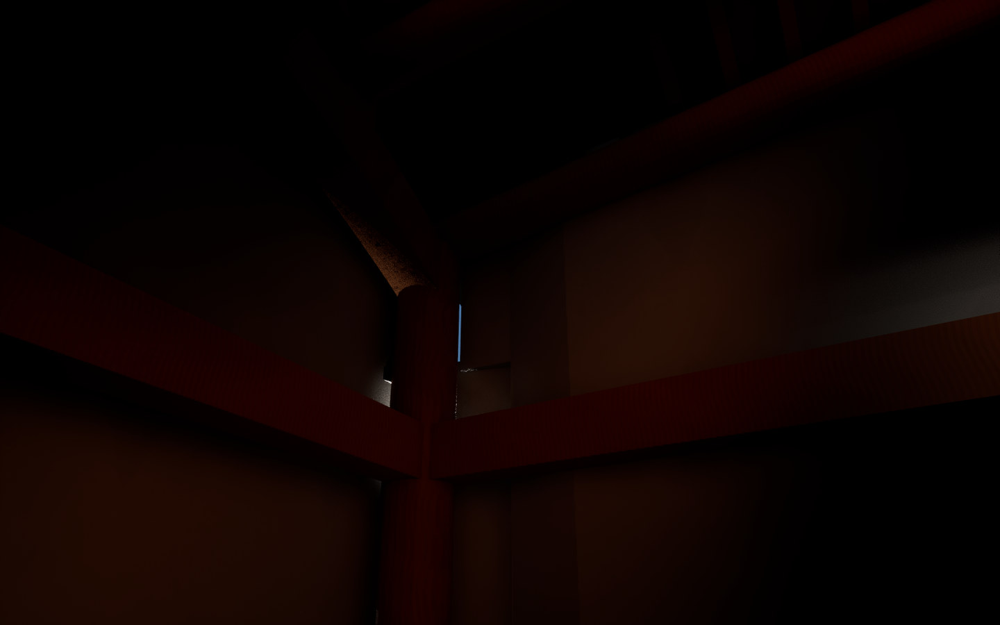](process/media/focus/ue-wall-after.jpg) |

**外墙显示问题。** Codex 另外保存了关闭 Nanite 的对照，从显示路径排查外墙异常，再回查源面和材质。对照只记录切换后的画面，处理结果和通过条件按同轮报告核对。 [无 Nanite 的原诊断图](process/media/focus/ue-nanite-off.jpg)

## 下一轮继续留哪些证据

把问题原图、定位图、取样或修改过程、保存后结果放在同一条记录。标注图注明模型版本、楼层或构件、坐标基准和单位。材质图注明照片与样本、UV 或材质实例以及相机条件。跨软件发布时同时记录源文件、构件标识、发布号和对应的关卡验收。 [日常更新](updates.md) · [图页和逐图来源](process/README.md)
