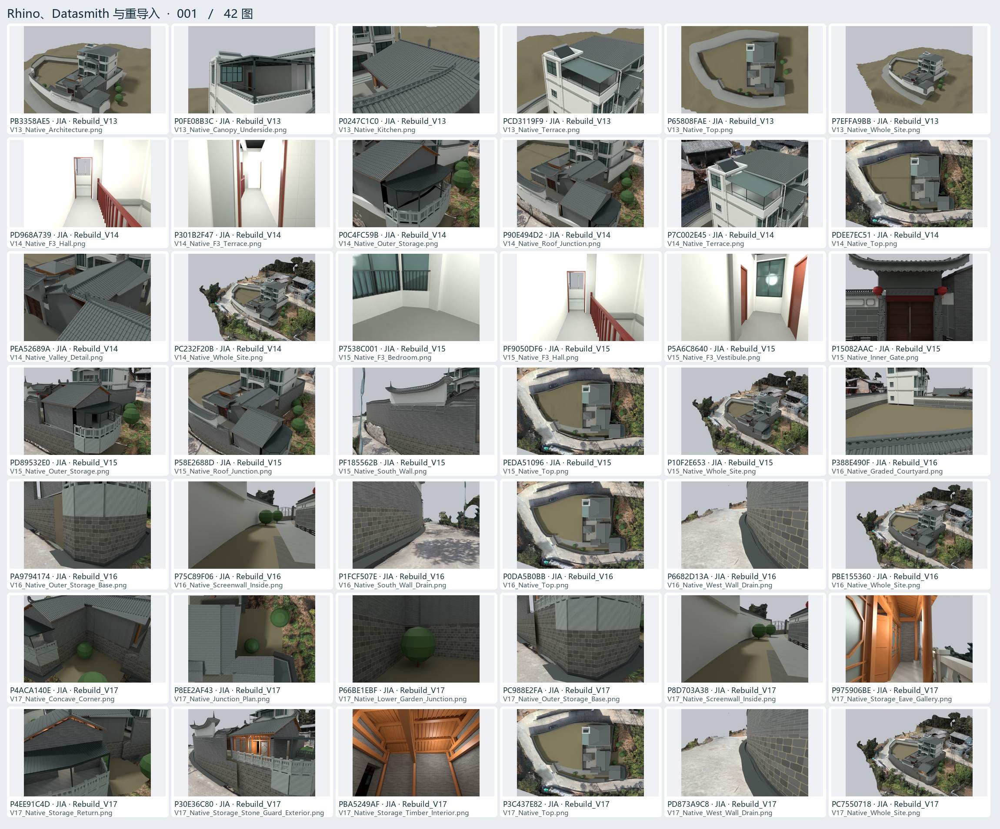
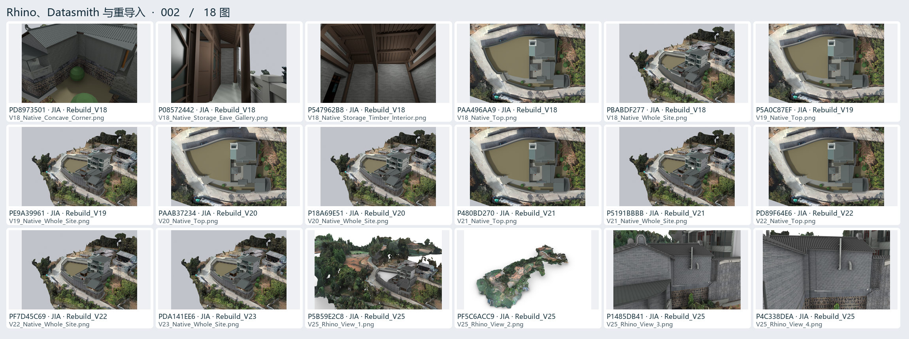

# Rhino、Datasmith 与重导入 · 01

原生构件、发布交接、身份对照与重新打开核验。

[返回过程图档](README.md) · [本页逐图来源 CSV](handoff-01.csv)

点开图页查看大图。图下方的编号可以在 CSV 里查询原路径与同图的其他出处。

## 图页 001 · 42 图

编号 PB3358AE5 · P0FE08B3C · P0247C1C0 · PCD3119F9 · P65808FAE · P7EFFA9BB · PD968A739 · P301B2F47 · P0C4FC59B · P90E494D2 · P7C002E45 · PDEE7EC51 · PEA52689A · PC232F20B · P7538C001 · PF9050DF6 · P5A6C8640 · P15082AAC · PD89532E0 · P58E2688D · PF185562B · PEDA51096 · P10F2E653 · P388E490F · PA9794174 · P75C89F06 · P1FCF507E · P0DA5B0BB · P6682D13A · PBE155360 · P4ACA140E · P8EE2AF43 · P66BE1EBF · PC988E2FA · P8D703A38 · P975906BE · P4EE91C4D · P30E36C80 · PBA5249AF · P3C437E82 · PD873A9C8 · PC7550718

## 图页 002 · 18 图

编号 PD8973501 · P08572442 · P547962B8 · PAA496AA9 · PBABDF277 · P5A0C87EF · PE9A39961 · PAAB37234 · P18A69E51 · P480BD270 · P5191BBBB · PD89F64E6 · PF7D45C69 · PDA141EE6 · P5B59E2C8 · PF5C6ACC9 · P1485DB41 · P4C338DEA
