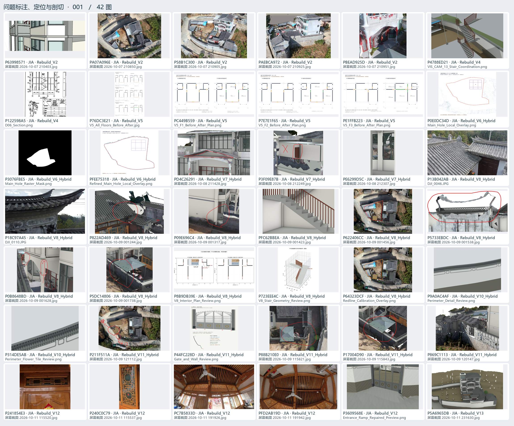
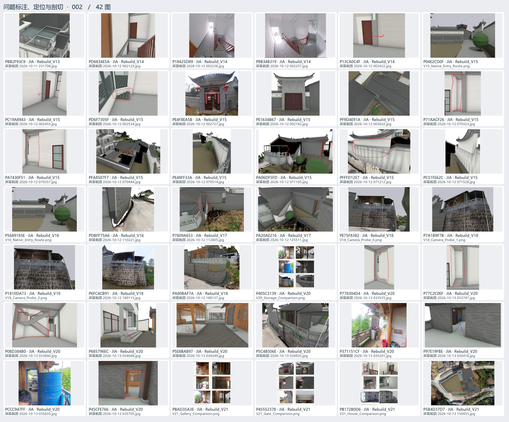
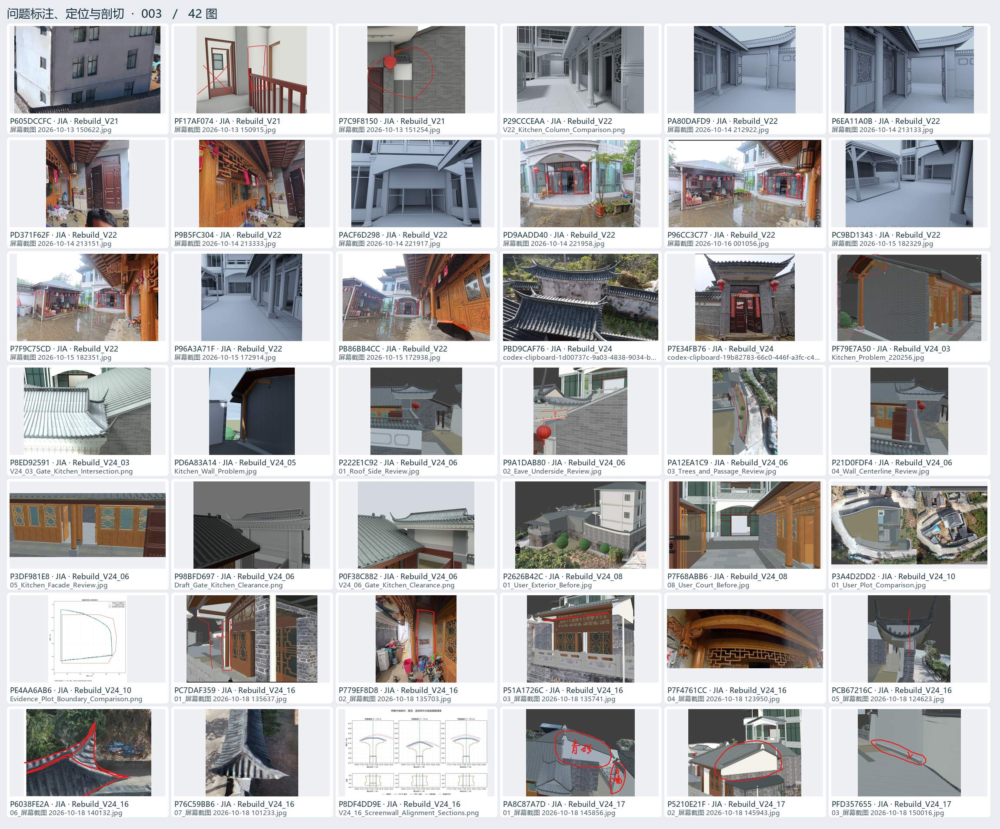
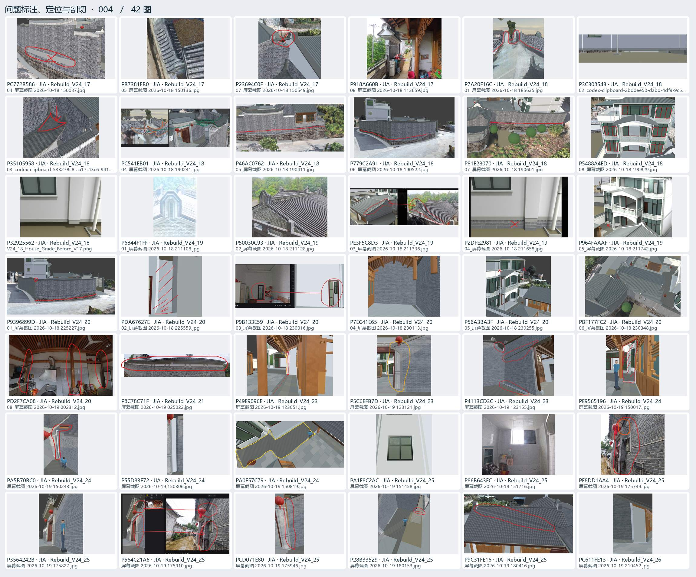
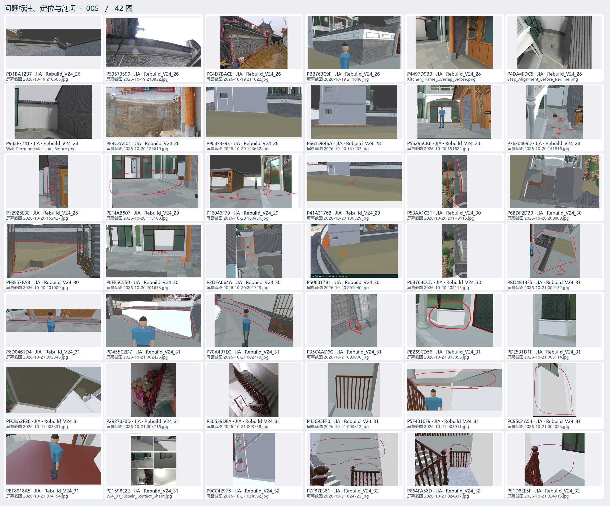

# 问题标注、定位与剖切 · 01

用户圈画、实景对照、局部坐标、剖面、遮挡与碰撞排查。

[返回过程图档](README.md) · [本页逐图来源 CSV](locate-01.csv)

点开图页查看大图。图下方的编号可以在 CSV 里查询原路径与同图的其他出处。

## 图页 001 · 42 图

编号 P63998571 · PA07A096E · P58B1C300 · PAEBCA972 · PBEAD925D · P4788ED21 · P122598A5 · P76DC3E21 · PC449B559 · P7E7E1F65 · PE1FFB223 · P0E0DC34D · P3076FBE5 · PFEE75318 · PD4C26291 · P3F09E87B · PE6299D5C · P13B042AB · P18C97A45 · P822AD469 · P09E696C4 · PFC62BBEA · P622406CC · P5733EBDC · P0B8648BD · P5DC14806 · P8B9DB39E · P723EEE4C · P64323DCF · P9A0AC4AF · P314DE5AB · P211F511A · P44FC228D · P88B210E0 · P17004D90 · P869C1113 · P241854E3 · P240C0C79 · PC7B5833D · PFD2AB19D · P3609568E · P5A6965DB

## 图页 002 · 42 图

编号 PBB2F93C9 · PD6834E5A · P18425D89 · P8B34B319 · P13CA0C4F · P04E2CD0F · PC19A8943 · PD6F7305F · PE4F8EA5B · PE1634B67 · PF9D4E91A · P71AACF26 · PA7430F51 · PFA8507F7 · PE48FF33A · PA06DF5FD · PFFFD12E7 · PC51FE62C · P5689193E · PDBFF75A6 · P7609A653 · PA20AE216 · PE75F8382 · P7A1B9F7B · P1810DA73 · P6FC4CB91 · PA80BAF7A · P405C3139 · P778304D4 · P77C2C0EF · P08D384B0 · P685796EC · P5E8BAB97 · P5C4B506E · P371151CF · P97E19FBE · PCCC947FF · P45CFE766 · PBAD35A3E · P45552378 · PB172B0D6 · P5B4D37D7

## 图页 003 · 42 图

编号 P605DCCFC · PF17AF074 · P7C9F8150 · P29CCCEAA · PA80DAFD9 · P6EA11A0B · PD371F62F · P9B5FC304 · PACF6D298 · PD9AADD40 · P96CC3C77 · PC9BD1343 · P7F9C75CD · P96A3A71F · PB86BB4CC · PBD9CAF76 · P7E34FB76 · PF79E7A50 · P8ED92591 · PD6A83A14 · P222E1C92 · P9A1DAB80 · PA12EA1C9 · P21D0FDF4 · P3DF981E8 · P98BFD697 · P0F38C882 · P2626B42C · P7F68ABB6 · P3A4D2DD2 · PE4AA6AB6 · PC7DAF359 · P779EF8D8 · P51A1726C · P7F4761CC · PCB67216C · P6038FE2A · P76C59BB6 · P8DF4DD9E · PA8C87A7D · P5210E21F · PFD357655

## 图页 004 · 42 图

编号 PC772B586 · PB7381FB0 · P23694C0F · P918A660B · P7A20F16C · P3C308543 · P35105958 · PC541EB01 · P46AC0762 · P779C2A91 · P81E28070 · P5488A4ED · P32925562 · P6844F1FF · P50030C93 · PE3F5C8D3 · P2DFE2981 · P964FAAAF · P9396899D · PDA67627E · P9B133E59 · P7EC41E65 · P56A3BA3F · PBF177FC2 · PD2F7CA08 · P8C78C71F · P49E9096E · P5C6EFB7D · P4113CD3C · PE9565196 · PA5B70BC0 · P55D83E72 · PA0F57C79 · PA1E8C2AC · P86B643EC · PF8DD1AA4 · P3564242B · P564C21A6 · PCD071E80 · P28B33529 · P9C31FE16 · PC611FE13

## 图页 005 · 42 图

编号 PD1BA12B7 · P53573590 · PC4D7BACE · PBB763C9F · P4497D9BB · P4DA4FDC5 · P985F7741 · PFBC2A401 · P908F3F93 · P661DB46A · P55295CB6 · P76F0869D · P12928E3E · PEF4AB807 · PF6046F79 · P41A3176B · P53AA1C31 · P6BDF2DB0 · PFBE57FAB · P8FE5C550 · P2DFA864A · P506817B1 · P8B764CCD · PBD4B13F5 · P6D0461D4 · PD455C2D7 · P70A497EC · P35CAAD6C · PB269CD56 · PDE531D1F · PFCBA2F26 · P29278F8D · P50539DFA · P45095FF0 · P5F4810F9 · PC95C4A54 · PBF8918A5 · P21598E22 · P9CC42978 · P7F87E381 · P664FA58D · P91D8EE5F
