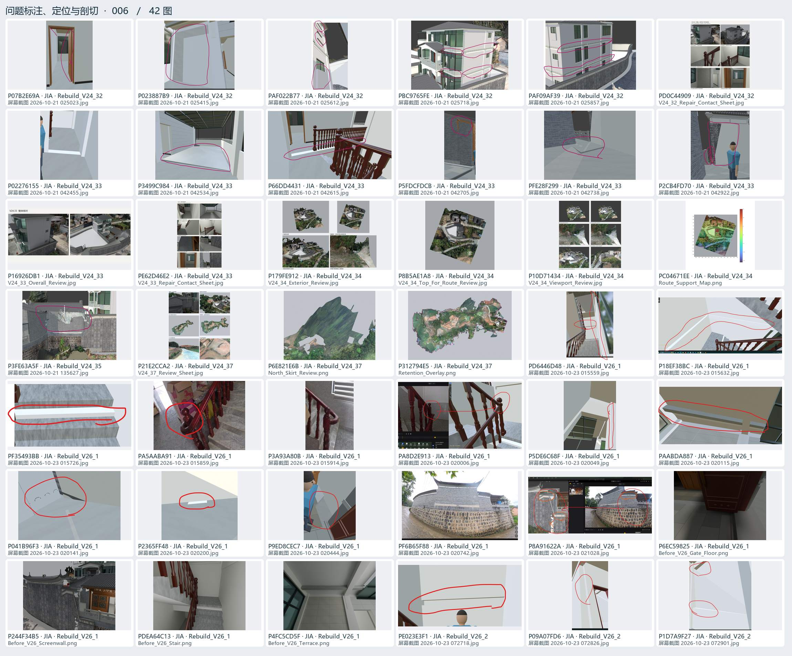
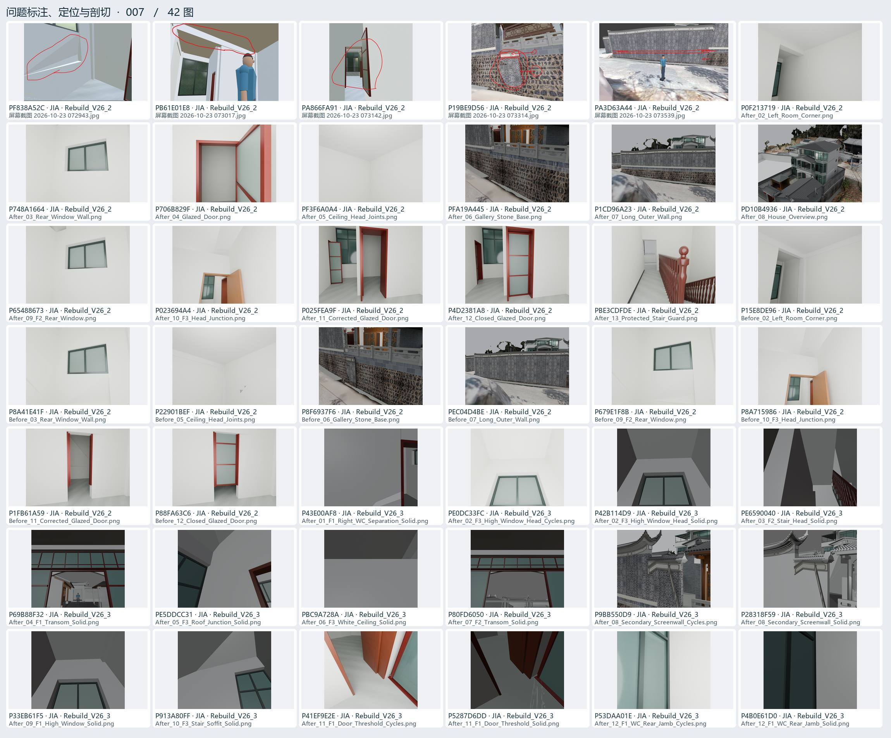
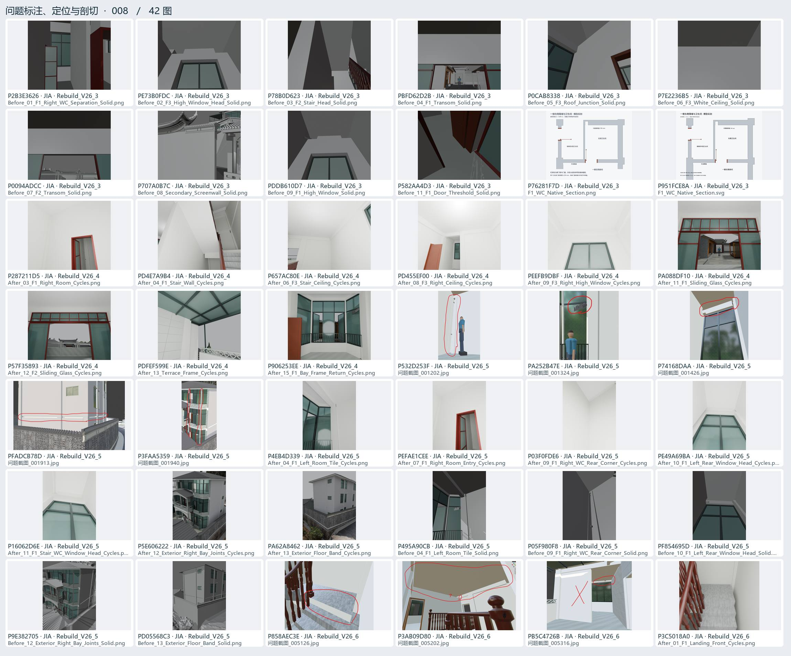
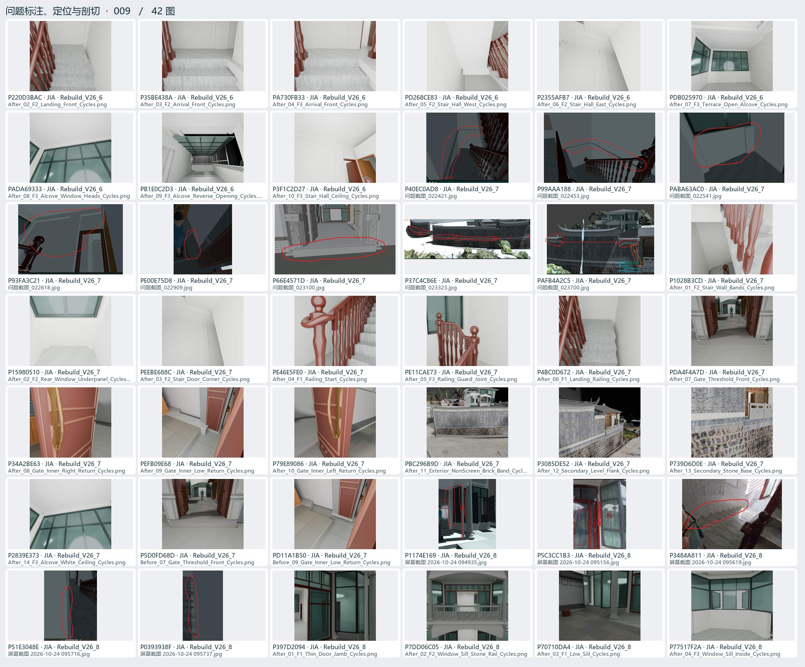
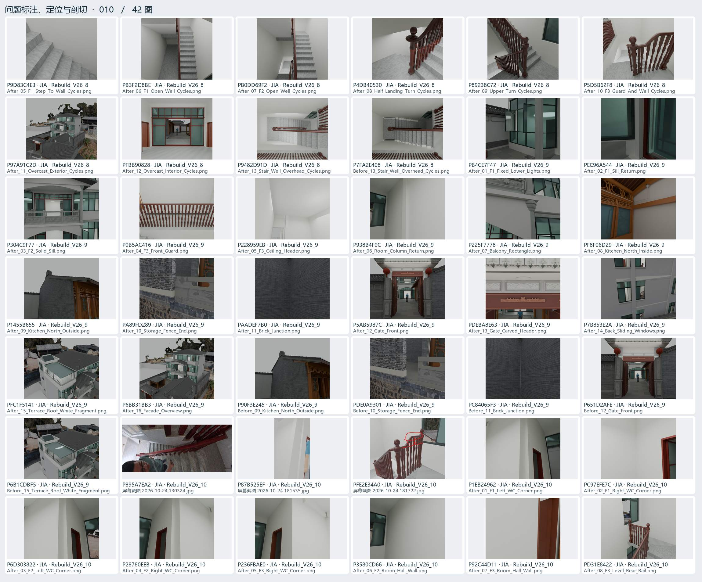

# 问题标注、定位与剖切 · 02

用户圈画、实景对照、局部坐标、剖面、遮挡与碰撞排查。

[返回过程图档](README.md) · [本页逐图来源 CSV](locate-02.csv)

点开图页查看大图。图下方的编号可以在 CSV 里查询原路径与同图的其他出处。

## 图页 006 · 42 图

编号 P07B2E69A · P023887B9 · PAF022B77 · PBC9765FE · PAF09AF39 · PD0C44909 · P02276155 · P3499C984 · P66DD4431 · P5FDCFDCB · PFE28F299 · P2CB4FD70 · P16926DB1 · PE62D46E2 · P179FE912 · P8B5AE1A8 · P10D71434 · PC04671EE · P3FE63A5F · P21E2CCA2 · P6E821E6B · P312794E5 · PD6446D48 · P18EF38BC · PF35493BB · PA5AABA91 · P3A93A80B · PA8D2E913 · P5DE6C68F · PAABDA887 · P041B96F3 · P2365FF48 · P9ED8CEC7 · PF6B65F88 · P8A91622A · P6EC59825 · P244F34B5 · PDEA64C13 · P4FC5CD5F · PE023E3F1 · P09A07FD6 · P1D7A9F27

## 图页 007 · 42 图

编号 PF838A52C · PB61E01E8 · PA866FA91 · P19BE9D56 · PA3D63A44 · P0F213719 · P748A1664 · P706B829F · PF3F6A0A4 · PFA19A445 · P1CD96A23 · PD10B4936 · P65488673 · P023694A4 · P025FEA9F · P4D2381A8 · PBE3CDFDE · P15E8DE96 · P8A41E41F · P22901BEF · P8F6937F6 · PEC04D4BE · P679E1F8B · P8A715986 · P1FB61A59 · P88FA63C6 · P43E00AF8 · PE0DC33FC · P42B114D9 · PE6590040 · P69B88F32 · PE5DDCC31 · PBC9A728A · P80FD6050 · P9BB550D9 · P28318F59 · P33EB61F5 · P913A80FF · P41EF9E2E · P5287D6DD · P53DAA01E · P4B0E61D0

## 图页 008 · 42 图

编号 P2B3E3626 · PE73B0FDC · P78B0D623 · PBFD62D2B · P0CAB8338 · P7E2236B5 · P0094ADCC · P707A0B7C · PDDB610D7 · P582AA4D3 · P76281F7D · P951FCE8A · P287211D5 · PD4E7A9B4 · P657AC80E · PD455EF00 · PEEFB9DBF · PA088DF10 · P57F35893 · PDFEF599E · P906253EE · P532D253F · PA252B47E · P74168DAA · PFADCB78D · P3FAA5359 · P4EB4D339 · PEFAE1CEE · P03F0FDE6 · PE49A69BA · P16062D6E · P5E606222 · PA62A8462 · P495A90CB · P05F980F8 · PF854695D · P9E382705 · PD05568C3 · P858AEC3E · P3AB09D80 · PB5C4726B · P3C5018A0

## 图页 009 · 42 图

编号 P220D3BAC · P35BE438A · PA730FB33 · PD268CE83 · P2355AFB7 · PDB025970 · PADA69333 · PB1E0C2D3 · P3F1C2D27 · P40EC0AD8 · P99AAA188 · PABA63AC0 · P93FA3C21 · PE00E75D8 · P66E4571D · P37C4C86E · PAFB4A2C5 · P1028B3CD · P15980510 · PEEBE688C · PE46E5FE0 · PE11CAE73 · P4BC0D672 · PDA4F4A7D · P34A2BE63 · PEFB09E68 · P79E89086 · PBC296B9D · P3085DE52 · P739D6D0E · P2839E373 · P5D0FD68D · PD11A1B50 · P1174E169 · P5C3CC1B3 · P3484A811 · P51E3048E · P0393938F · P397D2094 · P7DD06C05 · P70710DA4 · P77517F2A

## 图页 010 · 42 图

编号 P9D83C4E3 · PB3F2D8BE · PB0DD69F2 · P4DB40530 · P89238C72 · P5D5B62F8 · P97A91C2D · PFBB90828 · P9482D91D · P7FA2E408 · PB4CE7F47 · PEC96A544 · P304C9F77 · P0B5AC416 · P228959EB · P938B4F0C · P225F7778 · PF8F06D29 · P1455B655 · PA89FD289 · PAADEF7B0 · P5AB5987C · PDEBA8E63 · P7B853E2A · PFC1F5141 · P6BB31BB3 · P90F3E245 · PDE0A9301 · PC84065F3 · P651D2AFE · P6B1CDBF5 · P895A7EA2 · P87B525EF · PFE2E34A0 · P1EB24962 · PC97EFE7C · P6D303822 · P28780EEB · P236FBAE0 · P3580CD66 · P92C44D11 · PD31E8422
