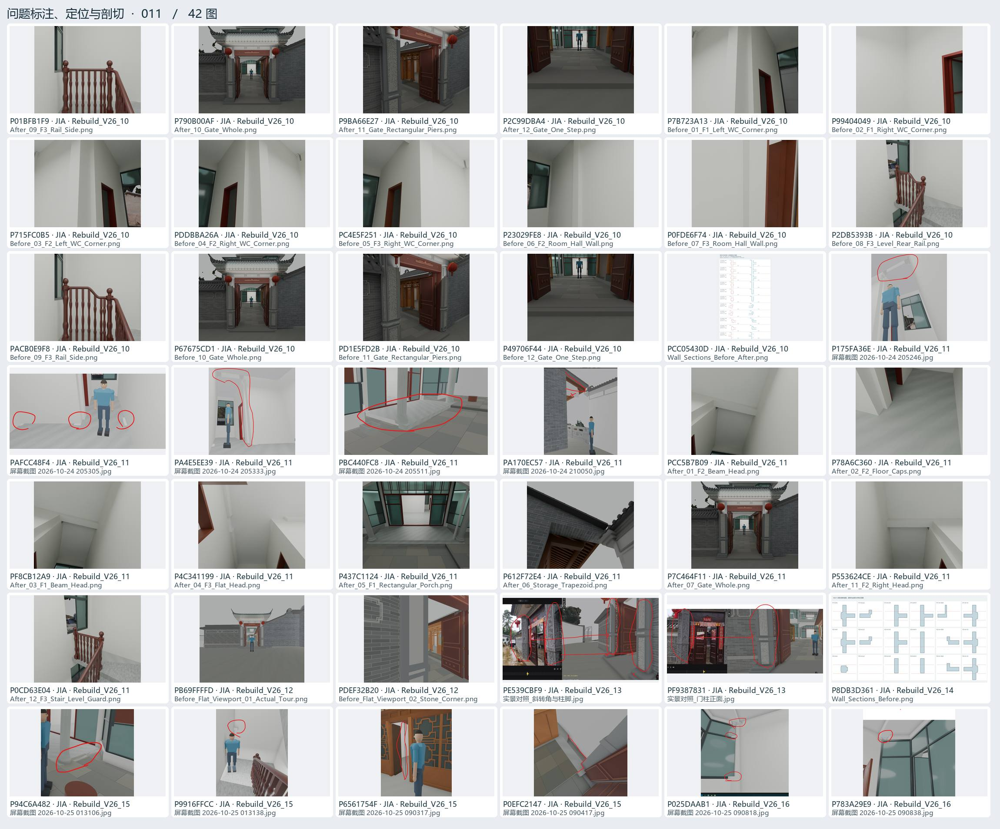
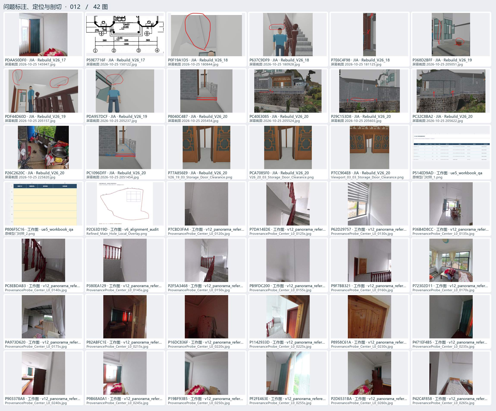
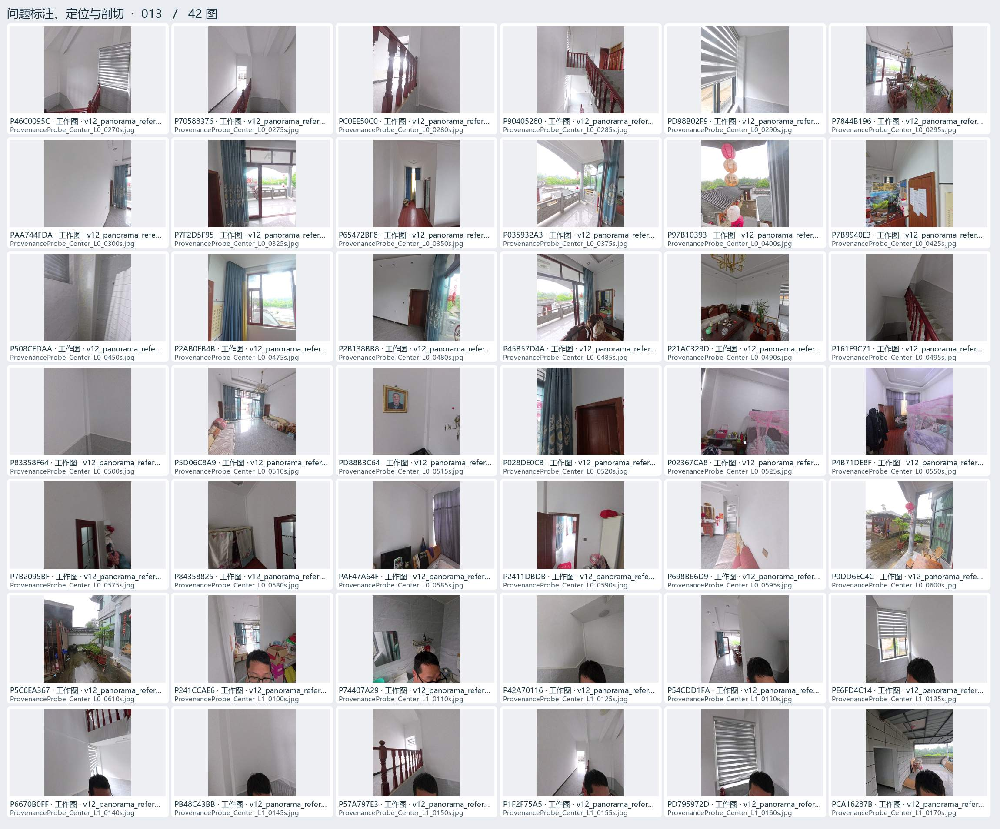
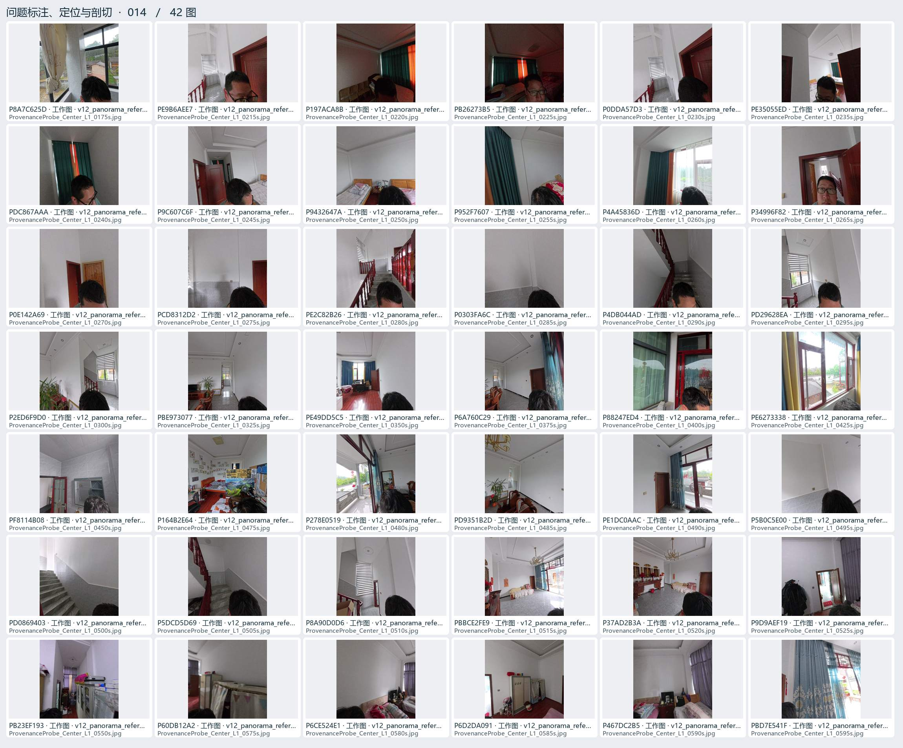
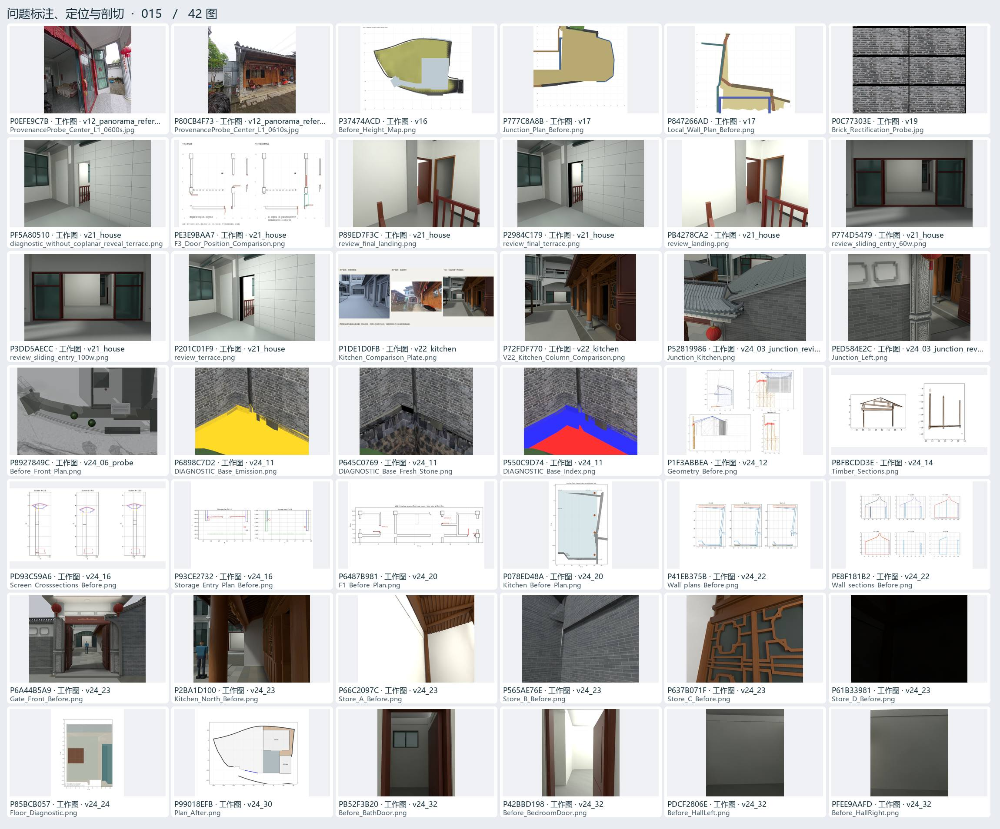

# 问题标注、定位与剖切 · 03

用户圈画、实景对照、局部坐标、剖面、遮挡与碰撞排查。

[返回过程图档](README.md) · [本页逐图来源 CSV](locate-03.csv)

点开图页查看大图。图下方的编号可以在 CSV 里查询原路径与同图的其他出处。

## 图页 011 · 42 图

编号 P01BFB1F9 · P790B00AF · P9BA66E27 · P2C99DBA4 · P7B723A13 · P99404049 · P715FC0B5 · PDDBBA26A · PC4E5F251 · P23029FE8 · P0FDE6F74 · P2DB5393B · PACB0E9F8 · P67675CD1 · PD1E5FD2B · P49706F44 · PCC05430D · P175FA36E · PAFCC48F4 · PA4E5EE39 · PBC440FC8 · PA170EC57 · PCC5B7B09 · P78A6C360 · PF8CB12A9 · P4C341199 · P437C1124 · P612F72E4 · P7C464F11 · P553624CE · P0CD63E04 · PB69FFFFD · PDEF32B20 · PE539CBF9 · PF9387831 · P8DB3D361 · P94C6A482 · P9916FFCC · P6561754F · P0EFC2147 · P025DAAB1 · P783A29E9

## 图页 012 · 42 图

编号 PDAA50DF0 · P59E7716F · P0F19A1D5 · P637C9DF9 · P7E6C4F98 · P368D2BFF · PDF44D60D · PDA957DCF · P8040C4B7 · PC40E3085 · P29C153D8 · PC32C8BA2 · P26C2620C · PC1096DFF · P77A856E9 · PCA7085F0 · P7CC904E8 · P514ED9AD · P806F5C16 · P2C63D19D · P7CBD3FA4 · P7DA14EDE · P62D29757 · P36B4D8CC · PC8EBDAB3 · P380EA129 · P2F5A3468 · PB9FDC200 · P9F7BB321 · P72302D11 · PA973D620 · P82ABFC1E · P16DC836F · P1142933D · P8958C61A · P471EF4B5 · P903378A8 · P9B68A0A1 · P19BF93B5 · PF2FE463E · P2D6531BA · P42C4F858

## 图页 013 · 42 图

编号 P46C0095C · P70588376 · PC0EE50C0 · P90405280 · PD98B02F9 · P7844B196 · PAA744FDA · P7F2D5F95 · P65472BF8 · P035932A3 · P97B10393 · P7B9940E3 · P508CFDAA · P2AB0FB4B · P2B138BB8 · P45B57D4A · P21AC328D · P161F9C71 · P83358F64 · P5D06C8A9 · PD88B3C64 · P028DE0CB · P02367CA8 · P4B71DE8F · P7B2095BF · P84358825 · PAF47A64F · P2411DBDB · P698B66D9 · P0DD6EC4C · P5C6EA367 · P241CCAE6 · P74407A29 · P42A70116 · P54CDD1FA · PE6FD4C14 · P6670B0FF · PB48C43BB · P57A797E3 · P1F2F75A5 · PD795972D · PCA16287B

## 图页 014 · 42 图

编号 P8A7C625D · PE9B6AEE7 · P197ACA8B · PB26273B5 · P0DDA57D3 · PE35055ED · PDC867AAA · P9C607C6F · P9432647A · P952F7607 · P4A45836D · P34996F82 · P0E142A69 · PCD8312D2 · PE2C82B26 · P0303FA6C · P4DB044AD · PD29628EA · P2ED6F9D0 · PBE973077 · PE49DD5C5 · P6A760C29 · P88247ED4 · PE6273338 · PF8114B08 · P164B2E64 · P278E0519 · PD9351B2D · PE1DC0AAC · P5B0C5E00 · PD0869403 · P5DCD5D69 · P8A90D0D6 · PBBCE2FE9 · P37AD2B3A · P9D9AEF19 · PB23EF193 · P60DB12A2 · P6CE524E1 · P6D2DA091 · P467DC2B5 · PBD7E541F

## 图页 015 · 42 图

编号 P0EFE9C7B · P80CB4F73 · P37474ACD · P777C8A8B · P847266AD · P0C77303E · PF5A80510 · PE3E9BAA7 · P89ED7F3C · P2984C179 · PB4278CA2 · P774D5479 · P3DD5AECC · P201C01F9 · P1DE1D0FB · P72FDF770 · P52819986 · PED584E2C · P8927849C · P6898C7D2 · P645C0769 · P550C9D74 · P1F3ABBEA · PBFBCDD3E · PD93C59A6 · P93CE2732 · P6487B981 · P078ED48A · P41EB375B · PE8F181B2 · P6A44B5A9 · P2BA1D100 · P66C2097C · P565AE76E · P637B071F · P61B33981 · P85BCB057 · P99018EFB · PB52F3B20 · P42BBD198 · PDCF2806E · PFEE9AAFD
