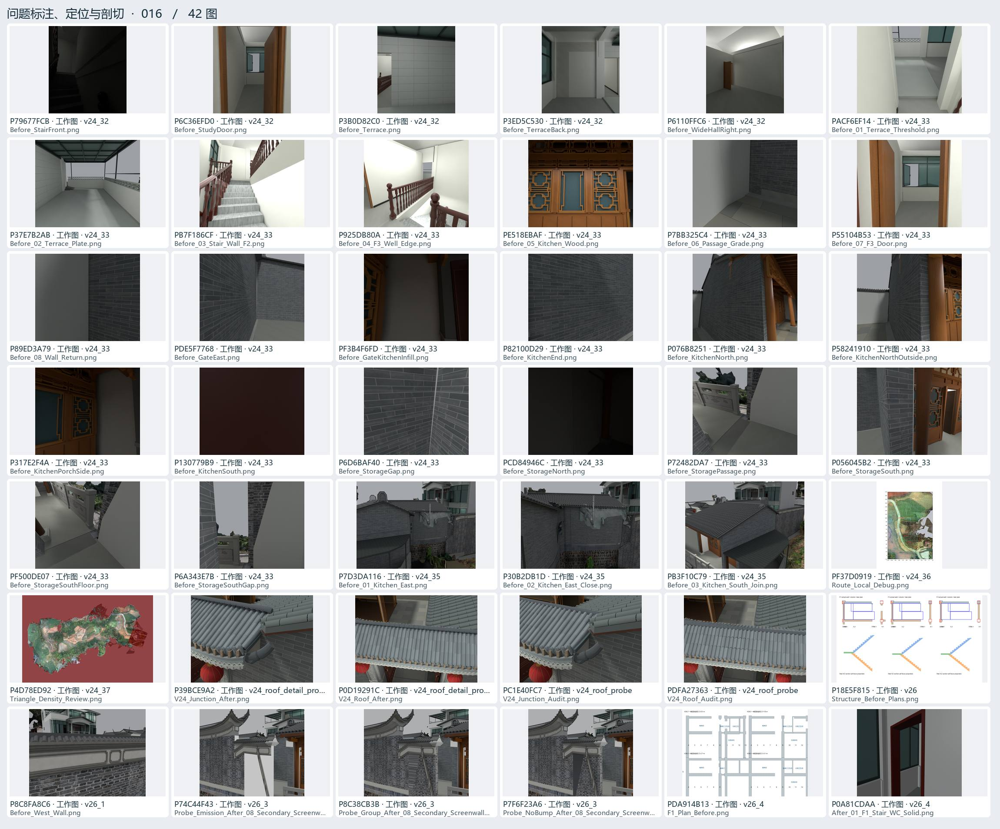
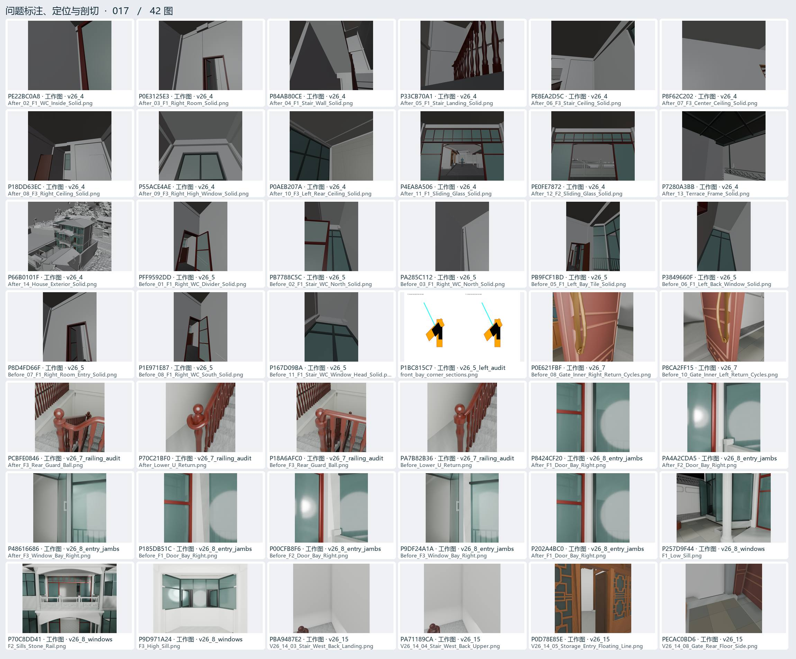
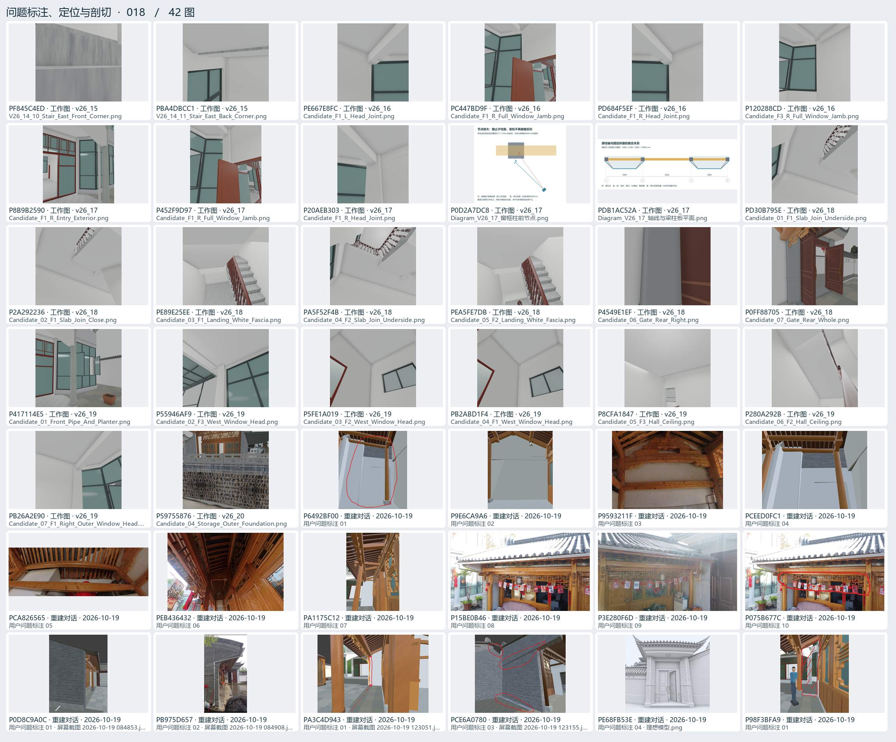
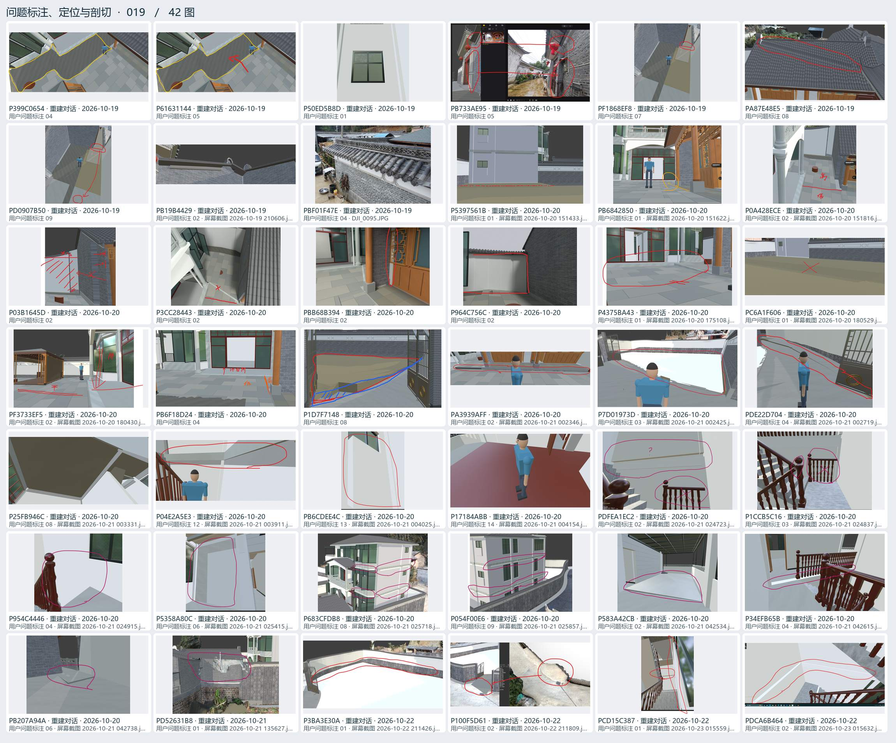
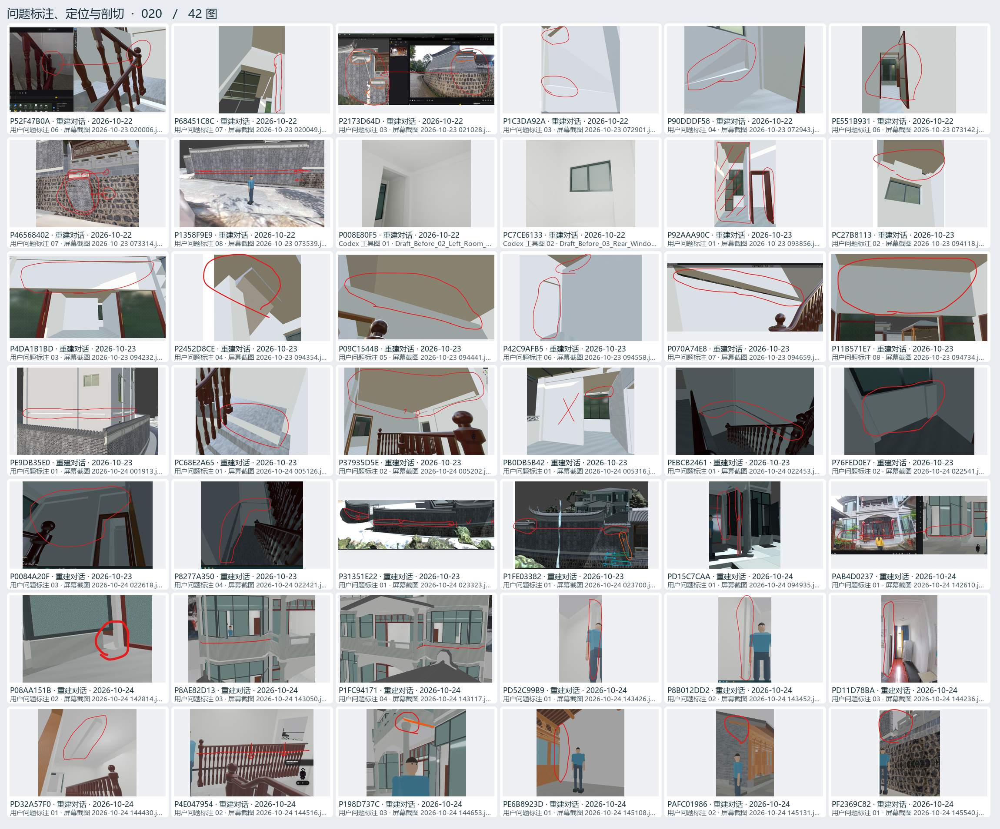

# 问题标注、定位与剖切 · 04

用户圈画、实景对照、局部坐标、剖面、遮挡与碰撞排查。

[返回过程图档](README.md) · [本页逐图来源 CSV](locate-04.csv)

点开图页查看大图。图下方的编号可以在 CSV 里查询原路径与同图的其他出处。

## 图页 016 · 42 图

编号 P79677FCB · P6C36EFD0 · P3B0D82C0 · P3ED5C530 · P6110FFC6 · PACF6EF14 · P37E7B2AB · PB7F186CF · P925DB80A · PE518EBAF · P7BB325C4 · P55104B53 · P89ED3A79 · PDE5F7768 · PF3B4F6FD · P82100D29 · P076B8251 · P58241910 · P317E2F4A · P130779B9 · P6D6BAF40 · PCD84946C · P72482DA7 · P056045B2 · PF500DE07 · P6A343E7B · P7D3DA116 · P30B2DB1D · PB3F10C79 · PF37D0919 · P4D78ED92 · P39BCE9A2 · P0D19291C · PC1E40FC7 · PDFA27363 · P18E5F815 · P8C8FA8C6 · P74C44F43 · P8C38CB3B · P7F6F23A6 · PDA914B13 · P0A81CDAA

## 图页 017 · 42 图

编号 PE22BC0A8 · P0E3125E3 · P84AB80CE · P33CB70A1 · PE8EA2D5C · P8F62C202 · P18DD63EC · P55ACE4AE · P0AEB207A · P4EA8A506 · PE0FE7872 · P7280A3BB · P66B0101F · PFF9592DD · PB7788C5C · PA285C112 · PB9FCF1BD · P3849660F · P8D4FD66F · P1E971E87 · P167D09BA · P1BC815C7 · P0E621FBF · P8CA2FF15 · PCBFE0846 · P70C21BF0 · P18A6AFC0 · PA7B82B36 · P8424CF20 · PA4A2CDA5 · P48616686 · P185DB51C · P00CFB8F6 · P9DF24A1A · P202A4BC0 · P257D9F44 · P70C8DD41 · P9D971A24 · PBA9487E2 · PA71189CA · P0D78E85E · PECAC0BD6

## 图页 018 · 42 图

编号 PF845C4ED · PBA4DBCC1 · PE667E8FC · PC447BD9F · PD684F5EF · P120288CD · P8B9B2590 · P452F9D97 · P20AEB303 · P0D2A7DC8 · PDB1AC52A · PD30B795E · P2A292236 · PE89E25EE · PA5F52F4B · PEA5FE7DB · P4549E1EF · P0FF88705 · P417114E5 · P55946AF9 · P5FE1A019 · PB2ABD1F4 · P8CFA1847 · P280A292B · PB26A2E90 · P59755876 · P6492BF00 · P9E6CA9A6 · P9593211F · PCEED0FC1 · PCA826565 · PEB436432 · PA1175C12 · P15BE0B46 · P3E280F6D · P075B677C · P0D8C9A0C · PB975D657 · PA3C4D943 · PCE6A0780 · PE68FB53E · P98F3BFA9

## 图页 019 · 42 图

编号 P399C0654 · P61631144 · P50ED5B8D · PB733AE95 · PF1868EF8 · PA87E48E5 · PD0907B50 · PB19B4429 · PBF01F47E · P5397561B · PB6842850 · P0A428ECE · P03B1645D · P3CC28443 · PBB68B394 · P964C756C · P4375BA43 · PC6A1F606 · PF3733EF5 · PB6F18D24 · P1D7F7148 · PA3939AFF · P7D01973D · PDE22D704 · P25FB946C · P04E2A5E3 · PB6CDEE4C · P17184ABB · PDFEA1EC2 · P1CCB5C16 · P954C4446 · P5358A80C · P683CFDB8 · P054F00E6 · P583A42CB · P34EFB65B · PB207A94A · PD52631B8 · P3BA3E30A · P100F5D61 · PCD15C387 · PDCA6B464

## 图页 020 · 42 图

编号 P52F47B0A · P68451C8C · P2173D64D · P1C3DA92A · P90DDDF58 · PE551B931 · P46568402 · P1358F9E9 · P008E80F5 · PC7CE6133 · P92AAA90C · PC27B8113 · P4DA1B1BD · P2452D8CE · P09C1544B · P42C9AFB5 · P070A74E8 · P11B571E7 · PE9DB35E0 · PC68E2A65 · P37935D5E · PB0DB5B42 · PEBCB2461 · P76FED0E7 · P0084A20F · P8277A350 · P31351E22 · P1FE03382 · PD15C7CAA · PAB4D0237 · P08AA151B · P8AE82D13 · P1FC94171 · PD52C99B9 · P8B012DD2 · PD11D78BA · PD32A57F0 · P4E047954 · P198D737C · PE6B8923D · PAFC01986 · PF2369C82
