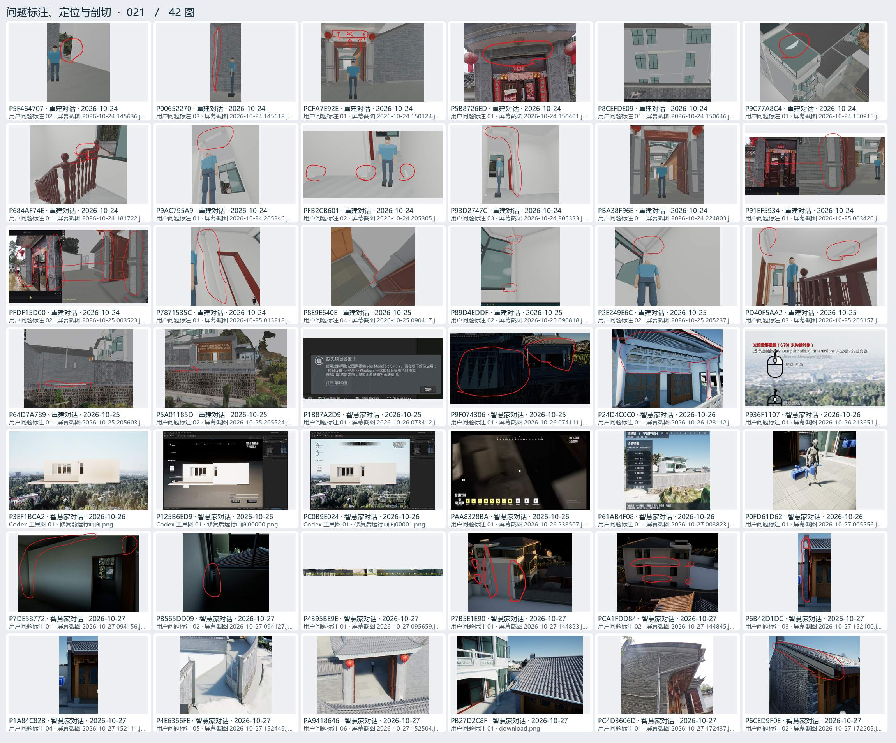
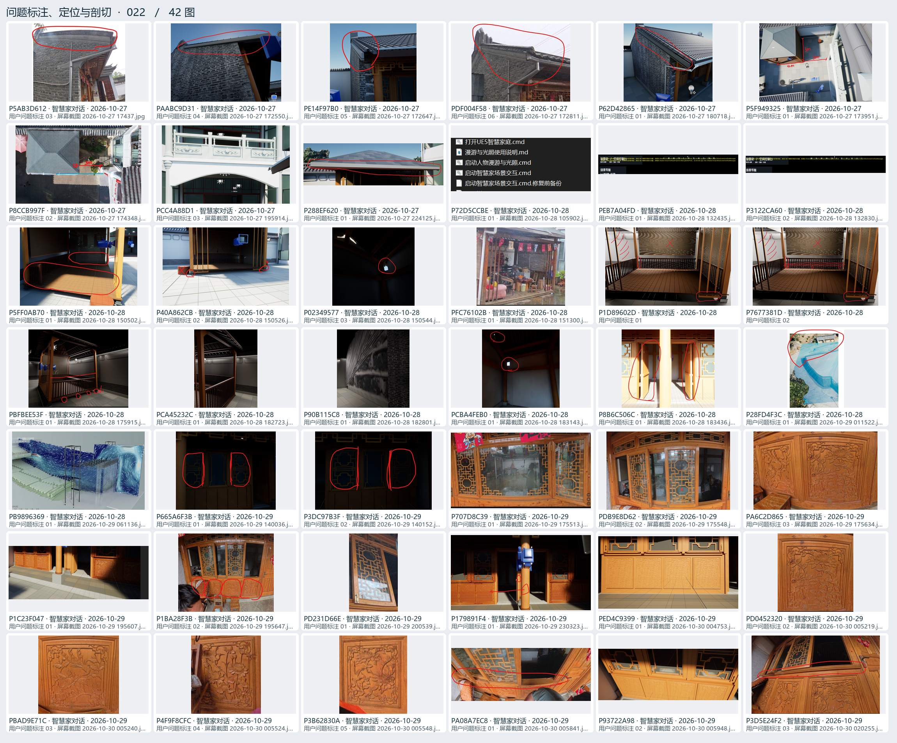
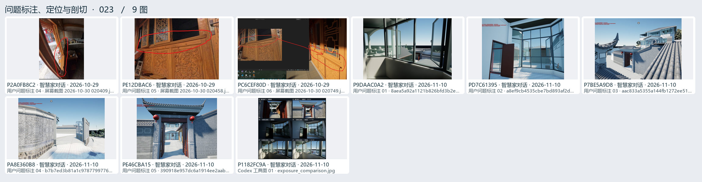

# 问题标注、定位与剖切 · 05

用户圈画、实景对照、局部坐标、剖面、遮挡与碰撞排查。

[返回过程图档](README.md) · [本页逐图来源 CSV](locate-05.csv)

点开图页查看大图。图下方的编号可以在 CSV 里查询原路径与同图的其他出处。

## 图页 021 · 42 图

编号 P5F464707 · P00652270 · PCFA7E92E · P5B8726ED · P8CEFDE09 · P9C77A8C4 · P684AF74E · P9AC795A9 · PFB2CB601 · P93D2747C · PBA38F96E · P91EF5934 · PFDF15D00 · P7871535C · P8E9E640E · P89D4EDDF · P2E249E6C · PD40F5AA2 · P64D7A789 · P5A01185D · P1B87A2D9 · P9F074306 · P24D4C0C0 · P936F1107 · P3EF1BCA2 · P125B6ED9 · PC0B9E024 · PAA8328BA · P61AB4F08 · P0FD61D62 · P7DE58772 · PB565DD09 · P4395BE9E · P7B5E1E90 · PCA1FDD84 · P6B42D1DC · P1A84C82B · P4E6366FE · PA9418646 · PB27D2C8F · PC4D3606D · P6CED9F0E

## 图页 022 · 42 图

编号 P5AB3D612 · PAABC9D31 · PE14F97B0 · PDF004F58 · P62D42865 · P5F949325 · P8CCB997F · PCC4A88D1 · P288EF620 · P72D5CCBE · PEB7A04FD · P3122CA60 · P5FF0AB70 · P40A862CB · P02349577 · PFC76102B · P1D89602D · P7677381D · PBFBEE53F · PCA45232C · P90B115C8 · PCBA4FEB0 · P8B6C506C · P28FD4F3C · PB9896369 · P665A6F3B · P3DC97B3F · P707D8C39 · PDB9E8D62 · PA6C2D865 · P1C23F047 · P1BA28F3B · PD231D66E · P179891F4 · PED4C9399 · PD0452320 · PBAD9E71C · P4F9F8CFC · P3B62830A · PA08A7EC8 · P93722A98 · P3D5E24F2

## 图页 023 · 9 图

编号 P2A0FB8C2 · PE12DBAC6 · PC6CEF80D · P9DAAC0A2 · PD7C61395 · P7BE5A9D8 · PA8E360B8 · PE46CBA15 · P1182FC9A
