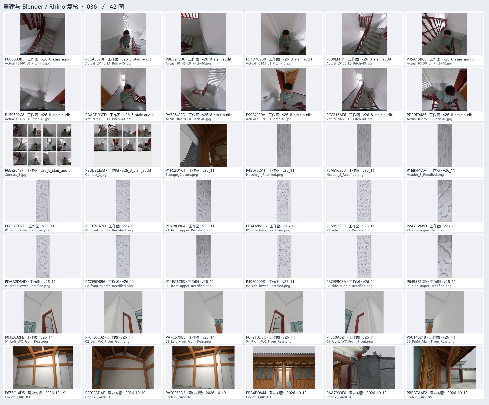
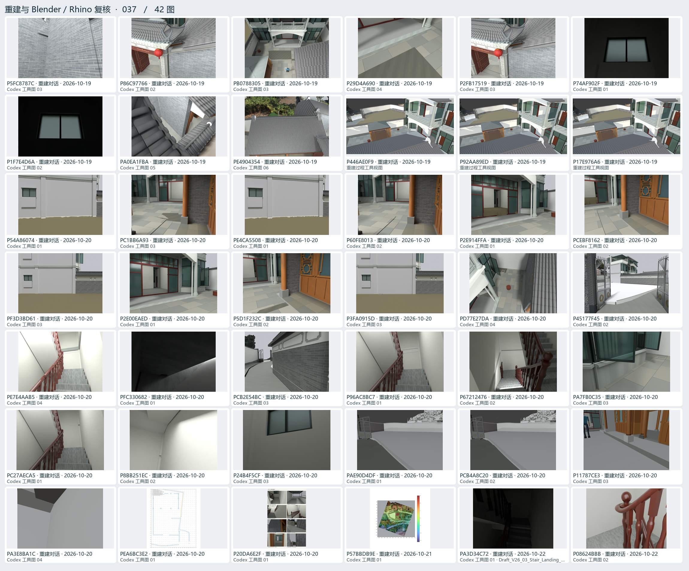
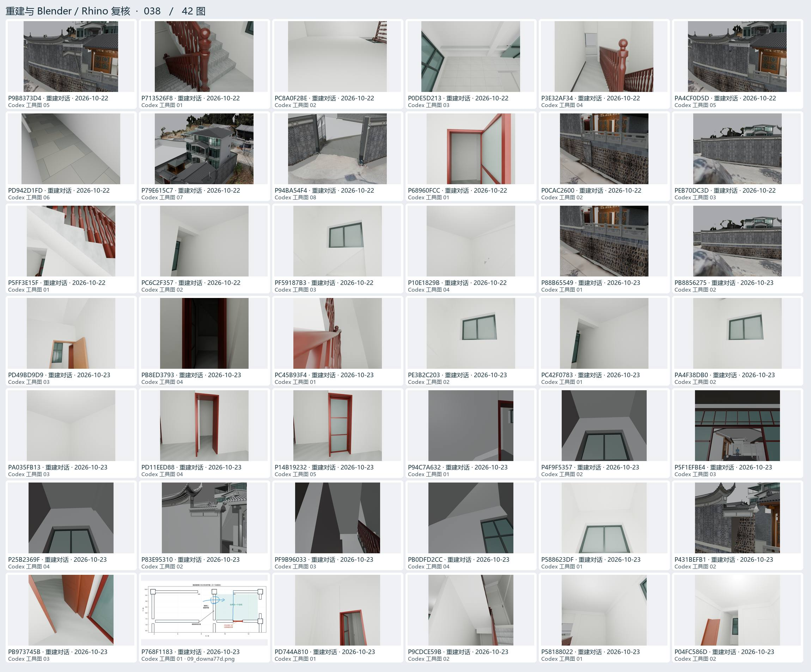
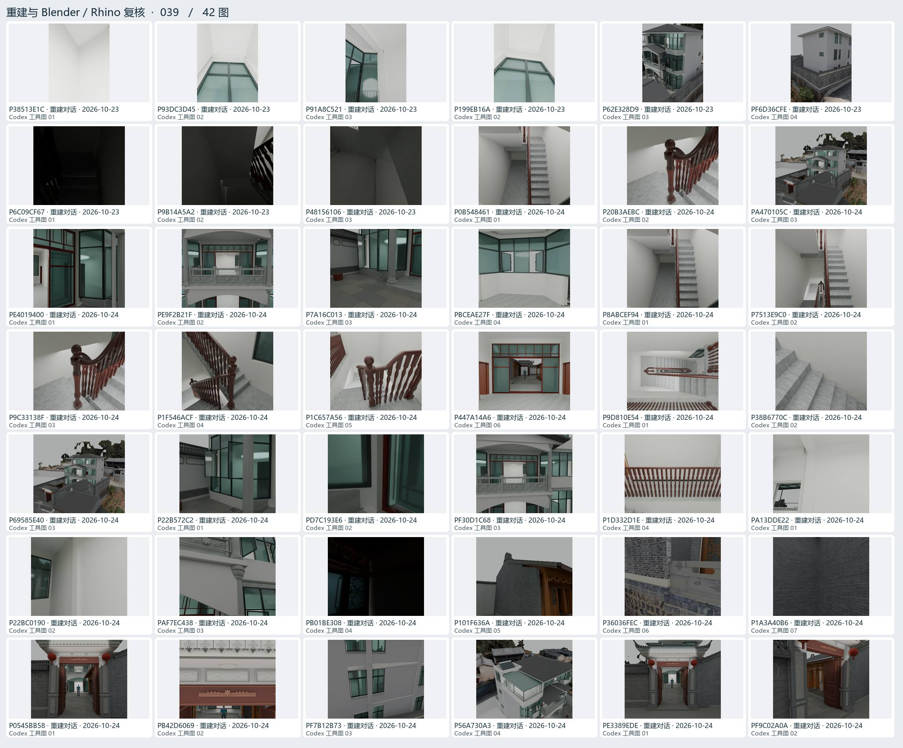
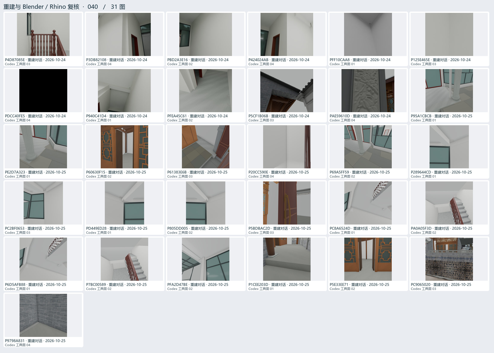

# 重建与 Blender / Rhino 复核 · 08

各版过程视图、改模对照、原生读回、局部细节和漫游试验。

[返回过程图档](README.md) · [本页逐图来源 CSV](rebuild-08.csv)

点开图页查看大图。图下方的编号可以在 CSV 里查询原路径与同图的其他出处。

## 图页 036 · 42 图

编号 P6B0603B5 · P8CA8878F · PBB521736 · P57D782B8 · P8B0EFF41 · P45A45B80 · P159502C8 · PAABD067D · PA7F64F9D · P99E4220A · PCC216AE6 · PD29F9425 · P68E2643F · PB8DECE33 · P1FC2D1C1 · P4B0F52A1 · P8AE1CE00 · P1EBFF1AA · P6B577D7D · PCC078A7D · PF878D86A · PBAD2B82B · PC59532FB · P2A71268D · PDAA2D54D · PCCF5D896 · P11EC3C63 · P49F0409D · PBCEF9C5A · P6495F2DD · P83EA02FE · PF0FE6C02 · PA7C579B0 · PCF210D3C · PF8C8A821 · P5C146E4B · P675C14D5 · PFE0B3DAF · PAE0F53D3 · PBB4D0844 · PAA7933F0 · PBBB7AAE2

## 图页 037 · 42 图

编号 P5FC8787C · P86C97766 · PB0788305 · P29D4A690 · P2FB17519 · P74AF902F · P1F7E4D6A · PA0EA1FBA · PE4904354 · P446AE0F9 · P92AA89ED · P17E976A6 · P54A86074 · PC1BB6A93 · PE4CA5508 · P60FE8013 · P2E914FFA · PCEBF8162 · PF3D3BD61 · P2E00EAED · P5D1F232C · P3FA0915D · PD77E27DA · P45177F45 · PE7E4AAB5 · PFC330682 · PCB2E54BC · P96AC8BC7 · P67212476 · PA7FB0C35 · PC27AECA5 · P8BB251EC · P24B4F5CF · PAE90D4DF · PCB4A8C20 · P11787CE3 · PA3E8BA1C · PEA6BC3E2 · P20DA6E2F · P57BBDB9E · PA3D34C72 · P08624BBB

## 图页 038 · 42 图

编号 P9B8373D4 · P713526F8 · PC8A0F2BE · P0DE5D213 · P3E32AF34 · PA4CF0D5D · PD942D1FD · P79E615C7 · P94BA54F4 · P68960FCC · P0CAC2600 · PEB70DC3D · P5FF3E15F · PC6C2F357 · PF59187B3 · P10E1829B · P88B65549 · PB8856275 · PD49BD9D9 · PB8ED3793 · PC45B93F4 · PE3B2C203 · PC42F0783 · PA4F38DB0 · PA035FB13 · PD11EED88 · P14B19232 · P94C7A632 · P4F9F5357 · P5F1EFBE4 · P25B2369F · P83E95310 · PF9B96033 · PB0DFD2CC · P588623DF · P431BEFB1 · PB973745B · P768F1183 · PD744A810 · P9CDCE59B · P58188022 · P04FC586D

## 图页 039 · 42 图

编号 P38513E1C · P93DC3D45 · P91A8C521 · P199EB16A · P62E328D9 · PF6D36CFE · P6C09CF67 · P9B14A5A2 · P48156106 · P0B548461 · P20B3AEBC · PA470105C · PE4019400 · PE9F2B21F · P7A16C013 · PBCEAE27F · P8ABCEF94 · P7513E9C0 · P9C33138F · P1F546ACF · P1C657A56 · P447A14A6 · P9D810E54 · P38B6770C · P69585E40 · P22B572C2 · PD7C193E6 · PF30D1C68 · P1D332D1E · PA13DDE22 · P22BC0190 · PAF7EC438 · PB01BE308 · P101F636A · P36036FEC · P1A3A40B6 · P0545BB58 · PB42D6069 · PF7B12B73 · P56A730A3 · PE3389EDE · PF9C02A0A

## 图页 040 · 31 图

编号 P4D87085E · P3DB82108 · PBD2A3E16 · P424024AB · PFF10CAA8 · P125E465E · PDCC40FE5 · P940C41D4 · PFEA45C61 · P5CF1B06B · PAE59610D · P95A1CBCB · PE2D7A323 · P60630F15 · P61383E6B · P20CC590E · P69A5FF59 · P289644CD · PC2BF0653 · PD449ED28 · P805DD005 · P5BDBAC2D · PC8A6524D · PA0A05F3D · P6D5AFB88 · P7BC00589 · PFA2D47BE · P1CEE203D · P5E33EE71 · PC9065020 · P9798A831
