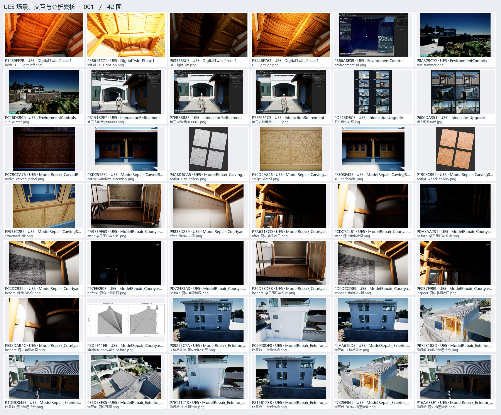
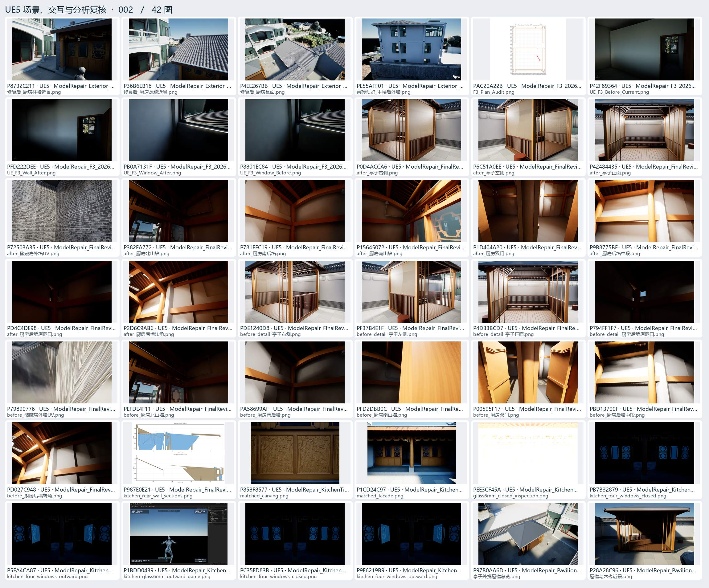
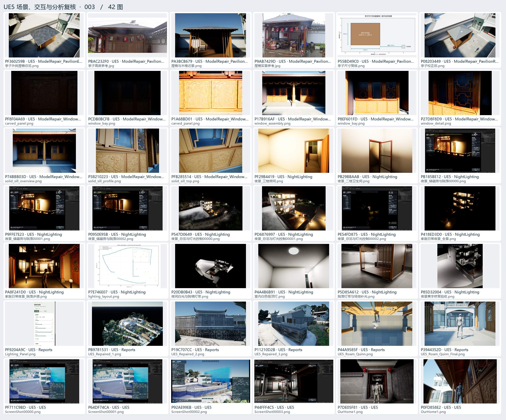
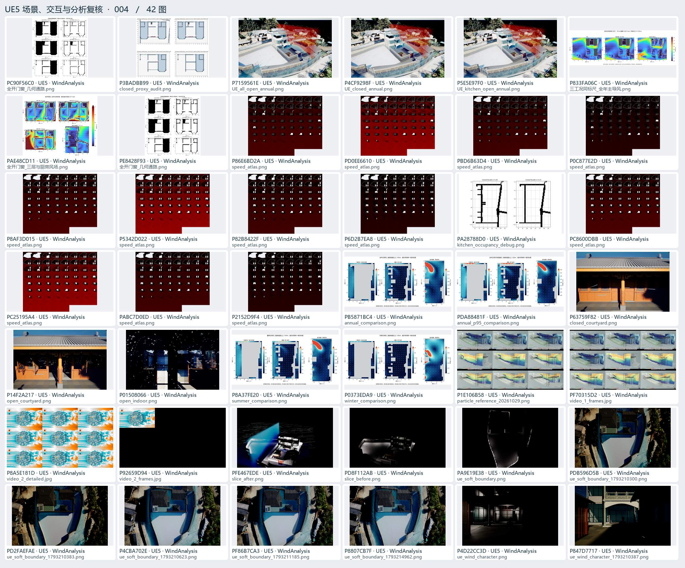
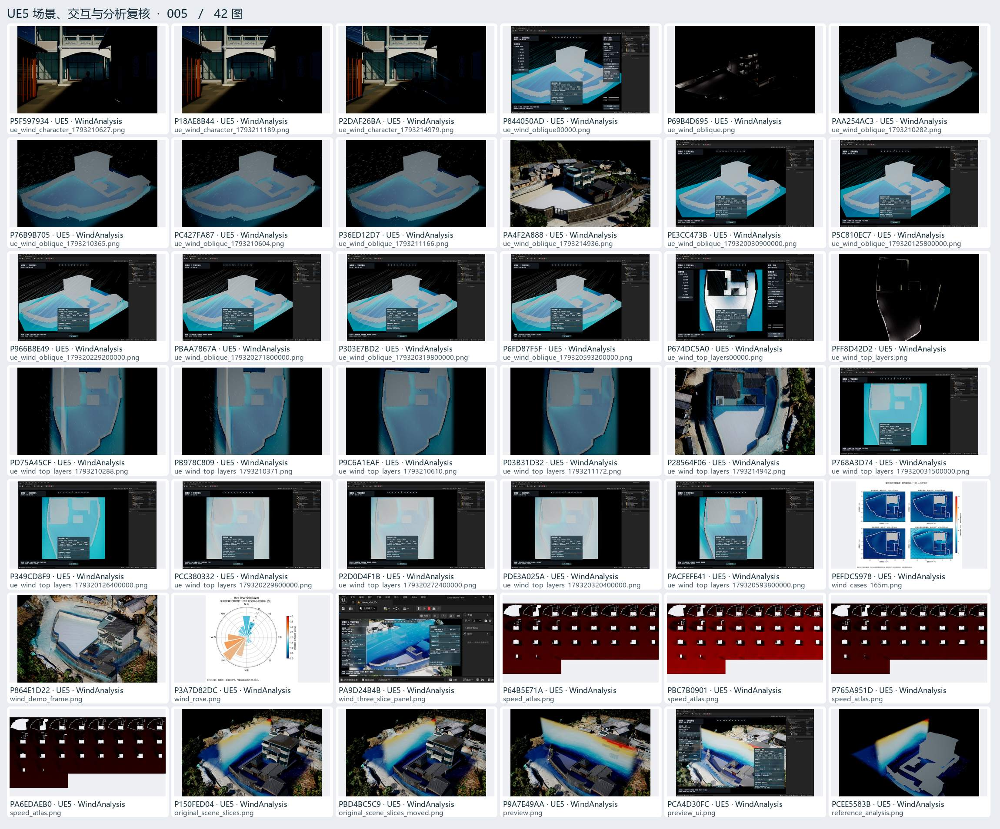

# UE5 场景、交互与分析复核 · 01

编辑器和 PIE 验收、门窗、照明、风环境及交互界面试验。

[返回过程图档](README.md) · [本页逐图来源 CSV](ue-01.csv)

点开图页查看大图。图下方的编号可以在 CSV 里查询原路径与同图的其他出处。

## 图页 001 · 42 图

编号 P1989FF2B · P58613C71 · P633683C5 · P5446E763 · P866A6E09 · P8A329C92 · PC26D39C0 · PB151B2E7 · P7FB8B88F · P7EF961CB · PD213D8C7 · P600DA351 · PCC9CCA75 · PBD251F74 · P4A8D6CA5 · P59D9A846 · P5E03F435 · P190FCBB2 · PF9BE22B8 · PA9739F63 · P983ED279 · P7A6313CD · PCDC74461 · PDA5AA231 · PC2DC9324 · P97EE390F · PD724F3A3 · P30D5ED3B · PD0DCCD89 · PFCB7F989 · PE38DAB4C · P8D4F11FB · P09285C7A · P02920DF0 · P4AA610D5 · PB723188D · P4DDD0483 · PE6D53F35 · P7E141213 · P215617BB · P742EF869 · P16AAEBE1

## 图页 002 · 42 图

编号 P8732C211 · P36B6EB18 · P4EE267BB · PE55AFF01 · PAC20A22B · P42F89364 · PFD222DEE · PB0A7131F · P8801EC84 · P0D4ACCA6 · P6C51A0EE · P42484435 · P72503A35 · P382EA772 · P781EEC19 · P15645072 · P1D404A20 · P9B8775BF · PD4C4DE98 · P2D6C9AB6 · PDE1240D8 · PF37B4E1F · P4D33BCD7 · P794FF1F7 · P79890776 · PEFDE4F11 · PA58699AF · PFD2DBB0C · P00595F17 · PBD13700F · PD027C948 · P987E0E21 · P858F8577 · P1CD24C97 · PEE3CF45A · PB7B32879 · P5FA4CA87 · P1BDD0439 · PC35ED83B · P9F6219B9 · P97B0AA6D · P28A28C96

## 图页 003 · 42 图

编号 PF360259B · PBAC232F0 · PA3BCB679 · P9AB7429D · P55BD49C0 · P08203449 · PF8F04A69 · PCDB0BCFB · P1A68BD01 · P17B916AF · P8EF601FD · P27D8F8D9 · P74BBB03D · P38210223 · PFB285514 · PF29B4419 · PB29BBAAB · PB185BE12 · P9FFE7E23 · P0950E95B · P547D0649 · PD6876997 · PE54FD875 · P418ED3D0 · PA8F241D0 · P7E746E07 · P20DB0B43 · P4A4B6B91 · P5D85A612 · P85D32004 · PF9204A9C · PB9781531 · P19C707CC · P11210D2B · P44A9585F · P3944352D · PF711C9BD · P64DF74CA · P92AE99EB · P44FFF4C5 · P7DE05F81 · P0FD858E2

## 图页 004 · 42 图

编号 PC90F56C0 · P3BADBB99 · P7159561E · P4CF9298F · P5E5E97F0 · P833FA06C · PAE48CD11 · PE8428F93 · P86E6BD2A · PD0EE6610 · PBD6B63D4 · P0C877E2D · P8AF3D015 · P5342D022 · P82B8422F · P6D2B7EA8 · PA28788D0 · PC8600DBB · PC25195A4 · PABC7D0ED · P2152D9F4 · PB5871BC4 · PDA88481F · P63759F82 · P14F2A217 · P01508066 · P8A37FE20 · P0373EDA9 · P1E106B58 · PF70315D2 · P8A5E181D · P92659D94 · PFE467EDE · PD8F112AB · PA9E19E38 · PDB596D5B · PD2FAEFAE · P4CBA702E · PF86B7CA3 · P8807CB7F · P4D22CC3D · P847D7717

## 图页 005 · 42 图

编号 P5F597934 · P18AE8B44 · P2DAF26BA · P844050AD · P69B4D695 · PAA254AC3 · P76B9B705 · PC427FA87 · P36ED12D7 · PA4F2A888 · PE3CC473B · P5C810EC7 · P966B8E49 · PBAA7867A · P303E7BD2 · P6FD87F5F · P674DC5A0 · PFF8D42D2 · PD75A45CF · PB978C809 · P9C6A1EAF · P03B31D32 · P28564F06 · P768A3D74 · P349CD8F9 · PCC380332 · P2D0D4F1B · PDE3A025A · PACFEFE41 · PEFDC5978 · P864E1D22 · P3A7D82DC · PA9D24B4B · P64B5E71A · PBC7B0901 · P765A951D · PA6EDAEB0 · P150FED04 · PBD4BC5C9 · P9A7E49AA · PCA4D30FC · PCEE5583B
