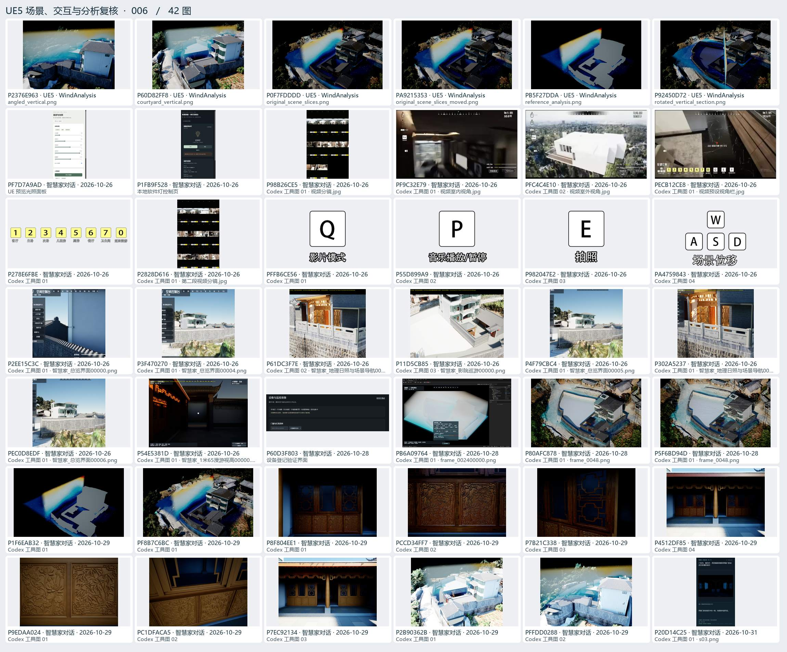
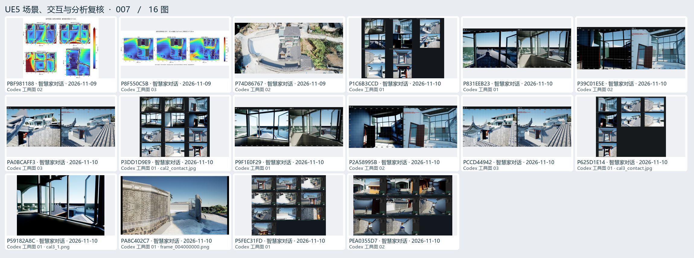

# UE5 场景、交互与分析复核 · 02

编辑器和 PIE 验收、门窗、照明、风环境及交互界面试验。

[返回过程图档](README.md) · [本页逐图来源 CSV](ue-02.csv)

点开图页查看大图。图下方的编号可以在 CSV 里查询原路径与同图的其他出处。

## 图页 006 · 42 图

编号 P2376E963 · P60D82FF8 · P0F7FDDDD · PA9215353 · PB5F27DDA · P92450D72 · PF7D7A9AD · P1FB9F528 · P98B26CE5 · PF9C32E79 · PFC4C4E10 · PECB12CE8 · P278E6FBE · P2828D616 · PFFB6CE56 · P55D899A9 · P982047E2 · PA4759843 · P2EE15C3C · P3F470270 · P61DC3F7E · P11D5CB85 · P4F79CBC4 · P302A5237 · PEC0D8EDF · P54E5381D · P60D3F803 · PB6A09764 · P80AFC878 · P5F6BD94D · P1F6EAB32 · PF8B7C6BC · P8F804EE1 · PCCD34FF7 · P7B21C338 · P4512DF85 · P9EDAA024 · PC1DFACA5 · P7EC92134 · P2B90362B · PFFDD0288 · P20D14C25

## 图页 007 · 16 图

编号 PBF981188 · P8F550C5B · P74D86767 · P1C6B3CCD · P831EEB23 · P39C01E5E · PA0BCAFF3 · P3DD1D9E9 · P9F1E0F29 · P2A58995B · PCCD44942 · P625D1E14 · P59182A8C · PA8C402C7 · P5FEC31FD · PEA0355D7
