# 建筑重建逐版台账

这张表追溯同一住宅和院落的可编辑模型。每行以“整理建筑重建资料”的交付说明、改动文件或保存后核验为依据。源文件列相对于重建资料的 `JIA` 目录，是原项目的定位索引。

每个版本旁都有对应过程图，点缩略图可看大图。图片所示部位见图注。[配图出处](media/README.md#建筑重建版本)

圈画对应的构件、模型局部坐标、修改前剖面和保存后读回另有图解。V24.22 用水平和纵向切片辨认重叠墙体，V24.36 用正射图、地面采样和路点复核漫游。 [坐标与剖切案例](codex-methods.md#从圈画定位到模型坐标) · [全部过程图页](process/README.md)

点击版本号可读该版的技术记录，查实现步骤、核验结果和过程图出处。 [82 篇版本文章](research/versions/README.md) · [建筑逐版研究实现](research/README.md)

## 源资料与建模基线

| 过程与配图 | 资料及用途 |
| --- | --- |
| 原有设计图纸  原图整理与实景核对 · 过程资料图 | 图纸提供起模的轴网、开间、层高和梁柱板关系。由于图纸未随现场变化更新，按可见实景逐项核对差异。记录见 `Rebuild/09_Report/Drawing_vs_Reality_Report.md`。 |
| 地面全景视频 [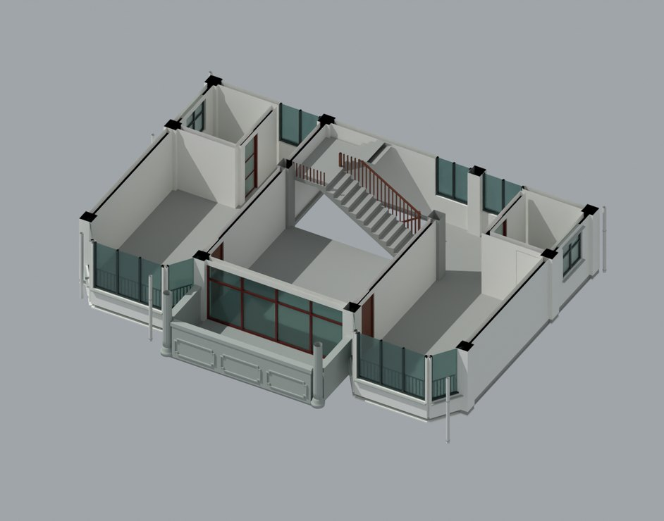](media/sources/ground-video.jpg) 依据地面视频修正的二层室内 · 模型复核图 | 使用 Insta360 全景相机记录门窗、楼梯和室内构件细节。首版 `Rebuild/03_Insta360_Frames/` 保存原视频抽帧与透视参考。 |
| 无人机采集  无人机采集与用途 · 过程资料图 | 使用 DJI Mini 2 无人机采集场地地理信息和屋顶鸟瞰照片，用于核对场地关系、屋脊和院墙轮廓。V3 的 `Rebuild_V3/10_DJI_Reference/` 登记航拍参考。 |
| ContextCapture 倾斜摄影  ContextCapture 实景生产 · 过程资料图 | 用 ContextCapture（CC）处理航拍照片，生成高细节的室外实景网格和贴图。`JIA.ccm`、`Project files/` 和 `Productions/` 保存工程及 3MX、OBJ、OSGB 等成果。 |
| 实景修订 [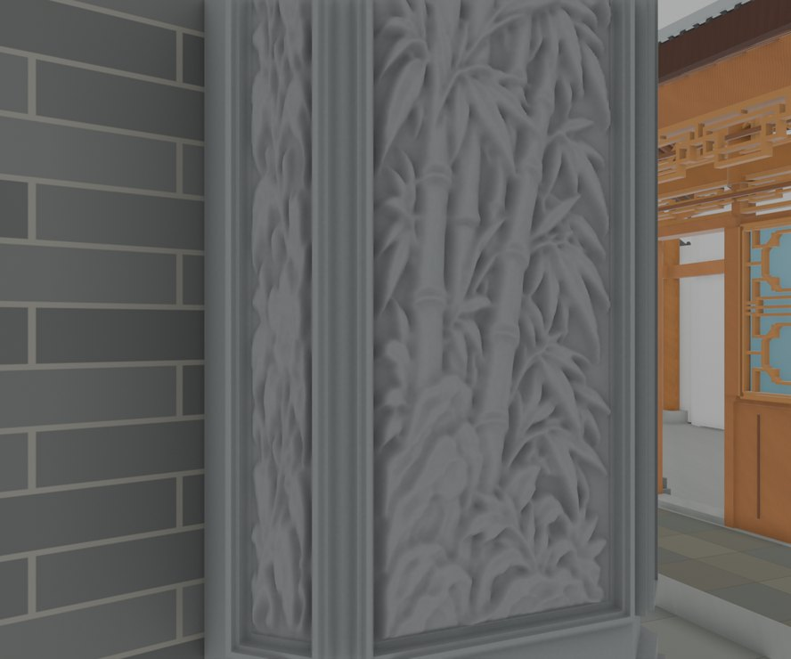](media/sources/site-photo-refinement.jpg) 按实景核对的柱角与浮雕 · 模型复核图 | 对于室内及航拍遮挡的近地面区域，使用地面实景照片和全景视频补建，并按逐轮修改指令校正构件。图纸尺寸、照片拟合和待复测项分别登记。 |

采集设备由项目采集者补记。过程目录用于回查相应的原始参考与抽帧记录。

### 空地融合建模

航拍实景提供外部几何与贴图，室内和近地面细节作为可编辑几何补建。V5 按地面全景视频修正室内门位、房间布局和通行关系。V6 将补建部分配准到实景场地的主空洞内，保留原实景网格和 UV，并对照切边检查衔接。局部米制模型与原 ENU 坐标之间的变换随各版存档。过程记录见 `Rebuild_V5/V5_使用说明.md` 和 `Rebuild_V6_Hybrid/使用说明.md`。

### 结构参考与尺寸来源

实景照片看不清构件关系时，项目用 GPT Image 推敲整体设计和结构分解。以大门为例，先对照照片确认门楼与相邻屋面的关系，再把瓦顶、檐口、门柱、门楣和门扇拆开看。根据倾斜摄影模型量取和 AI 辅助测算确定建模尺寸，注明参考面、单位和来源。把确认的设计图、尺寸与改动范围写成指令，交给 Codex 修改模型。照片里仍无法辨认的节点标为待核。[大门改模示例](../case-studies/residential-reconstruction.zh-CN.md#大门结构推敲与改模)

V9 过程文件记录了用关系图核对厨房与门楼檐口的高低、覆盖和前后关系。V24.03 依据同一院落实景模型的配准剖面复核门楼屋顶的深度与高度。分别见 `Rebuild_V9_Hybrid/使用说明.md` 和 `Rebuild_V24_03/README_V24_03.txt`。

已从 **81 个版本目录**和 V24 内另存的 **V24.02** 整理出 **82 条**版本记录。V24.02 另有同名历史压缩包可交叉核对。V24 与 V24.02 之间的独立 V24.01 过程记录待查。完整编辑版、Fast 漫游版、交换格式、同版备份和图像输出归在对应版本。

V25 由 V24.37 派生；V26 按指定改从 V24.34 继续。V26.20 的 Blender 编辑成果是后续 Rhino / Datasmith 和 UE5 工程的基线。[接续智慧家迭代](smart-home.md)

## V1 至 V5 · 从图纸与实景到原生模型

| 版本与配图 | 本次迭代 | 过程文件 |
| --- | --- | --- |
| [`V1`](research/versions/v1.md) [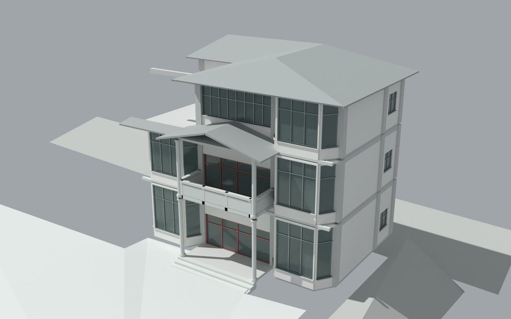](media/reconstruction/v1.jpg) 首版住宅正面 · 原版模型图 | 建立可编辑的 Rhino 与 SketchUp 建筑基线。对照整理后的图纸、全景抽帧与 ContextCapture，分别保存 ARCH、VIS 和交换格式。 | `Rebuild/09_Report/Model_Report.md` |
| [`V2`](research/versions/v2.md) [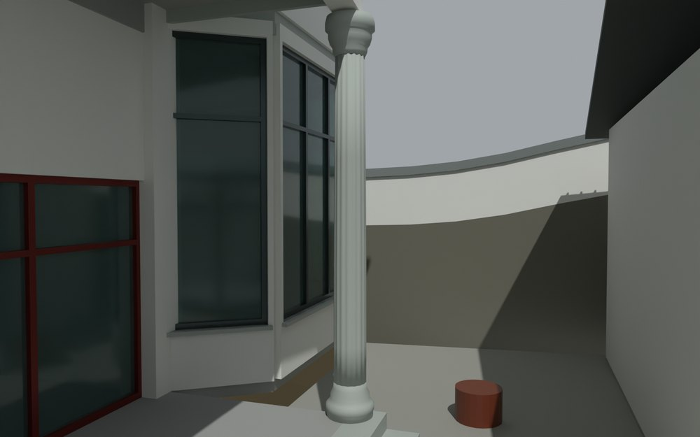](media/reconstruction/v2.jpg) 罗马柱及柱顶弧梁 · 原版模型图 | 重建连续楼板、分层墙体与完整场地，恢复实景四坡屋顶和西侧平屋面设备区，细化罗马柱及柱顶弧梁交接。 | `Rebuild_V2/09_Report/Model_Report_V2.md` |
| [`V3`](research/versions/v3.md) [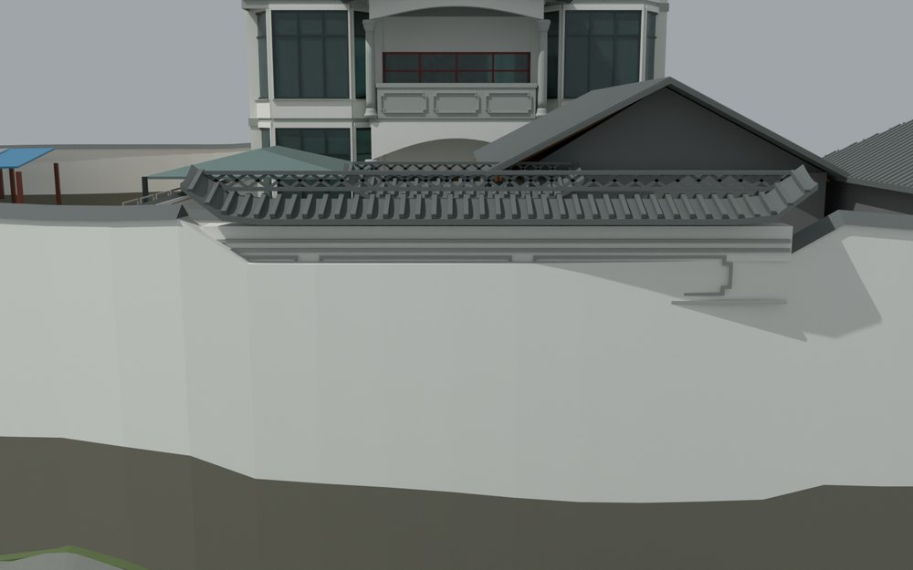](media/reconstruction/v3.jpg) 南侧照壁与场地接合 · 原版模型图 | 按航拍修正西南入口、连续南侧照壁、灰色内院门楼、厨房木构、瓦墙和罗马柱比例。 | `Rebuild_V3/README_V3.md` |
| [`V4`](research/versions/v4.md) [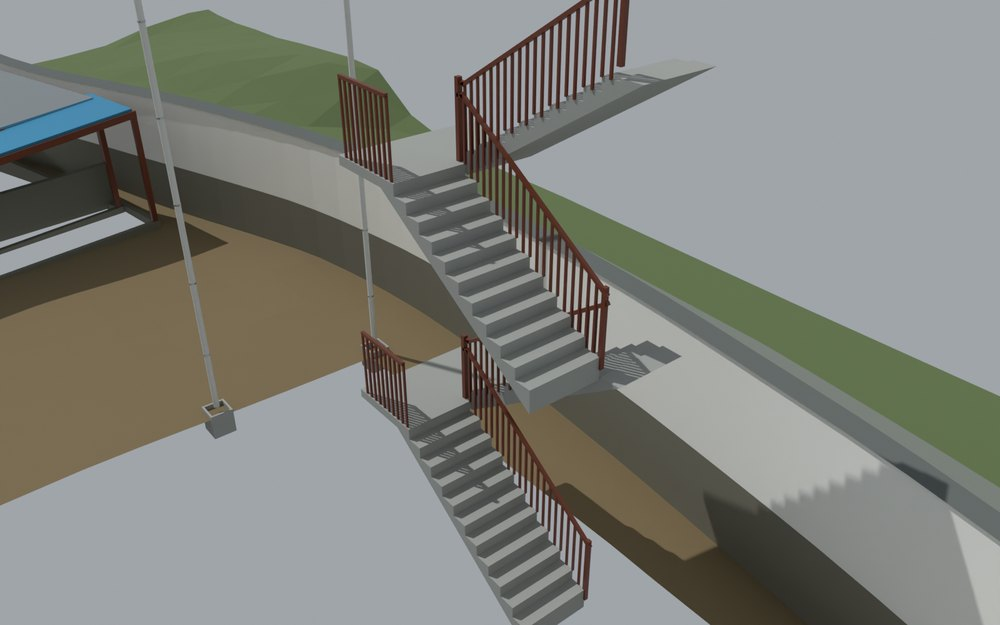](media/reconstruction/v4.jpg) 楼梯与平台交接 · 原版模型图 | 修整梁墙、弧梁柱头和楼梯平台交接，扣除共面梯板。门窗收口、防护和排水构造作为提案分开登记。 | `Rebuild_V4/09_Report/REPORT_V4.md` |
| [`V5`](research/versions/v5.md) [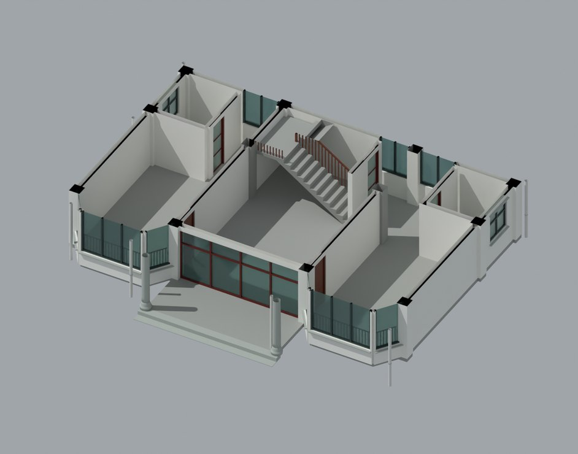](media/reconstruction/v5.jpg) 首层室内布局剖切 · 原版模型图 | 按全景视频修正各层房间用途、卧室门与湿区连通。补旧门洞并为 13 樘平开门拆分固定框和活动扇。 | `Rebuild_V5/V5_使用说明.md` |

## V6 至 V11 · 纯场地融合与局部修模

| 版本与配图 | 本次迭代 | 过程文件 |
| --- | --- | --- |
| [`V6`](research/versions/v6.md) [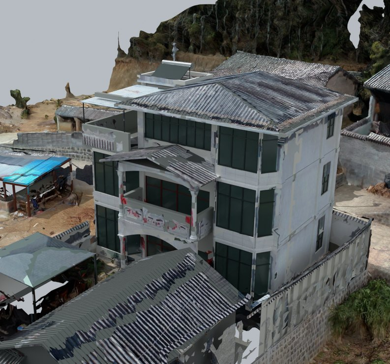](media/reconstruction/v6.jpg) 补建模型与实景底座融合 · 原版模型图 | 把 V5 建筑补入新实景场地的主空洞。保留五块原实景网格及 UV，分别交付融合模型和 ENU 对齐的可编辑副本。 | `Rebuild_V6_Hybrid/使用说明.md` |
| [`V7`](research/versions/v7.md) [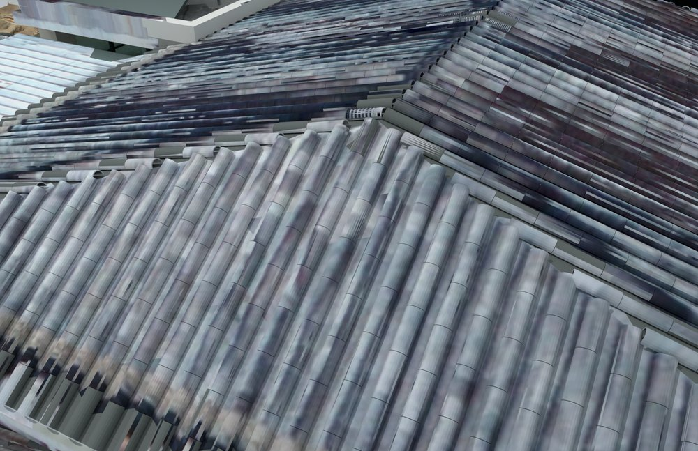](media/reconstruction/v7.jpg) 瓦件与墙面细化 · 原版模型图 | 继续按照片与标注改墙门，增补盖瓦、灰砖、陶砖和栏带。完整实体与空洞裁切补块分别保存。 | `Rebuild_V7_Hybrid/使用说明.md` |
| [`V8`](research/versions/v8.md) [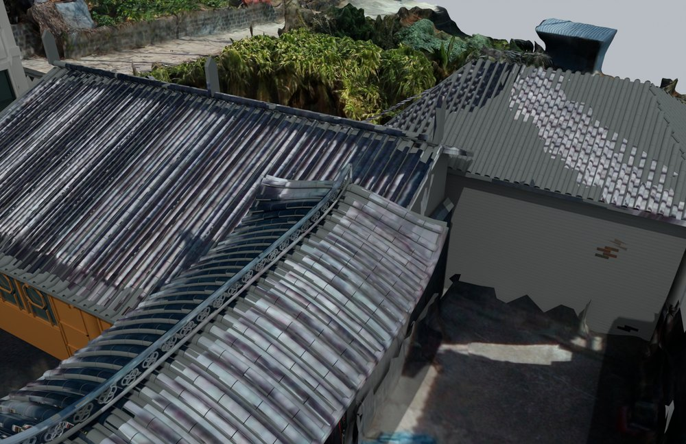](media/reconstruction/v8.jpg) 木构厨房和门楼交接 · 原版模型图 | 修整飞檐、木构屋面交接、院墙、罗马柱弧梁和楼梯，清理指定西侧棚屋区。另存门与房间交互登记。 | `Rebuild_V8_Hybrid/使用说明.md` |
| [`V9`](research/versions/v9.md) [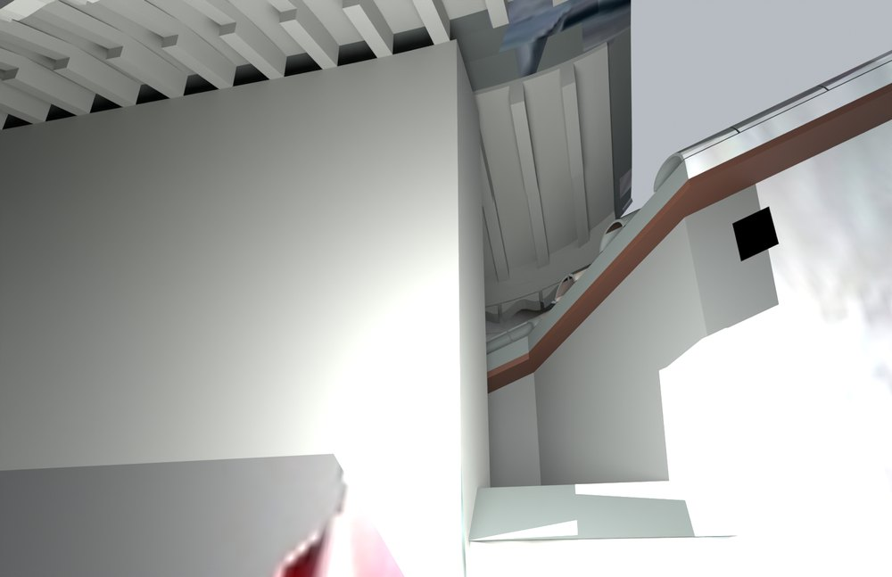](media/reconstruction/v9.jpg) 门楼与厨房檐下关系 · 原版模型图 | 厨房端部伸入较高门楼檐下，重做局部墙芯、封檐和檐下件。以当前保存的 V8 为基线，保留已确认的梁删除。 | `Rebuild_V9_Hybrid/使用说明.md` |
| [`V10`](research/versions/v10.md) [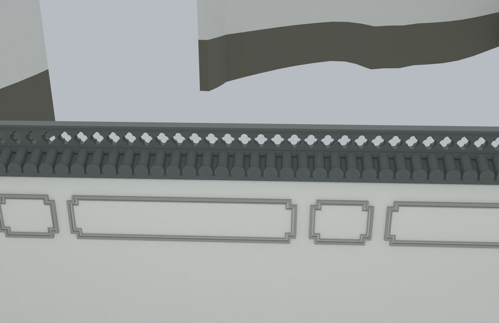](media/reconstruction/v10.jpg) 院墙砖瓦与线脚 · 原版模型图 | 按围墙大样与现场照片深化砖、瓦、瓦当、线脚和花砖。交付独立院墙、可编辑建筑和实景融合三份模型。 | `Rebuild_V10_Hybrid/使用说明.md` |
| [`V11`](research/versions/v11.md) [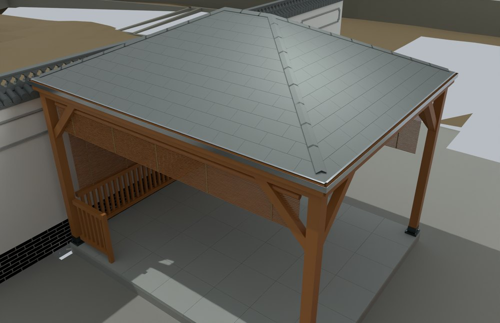](media/reconstruction/v11.jpg) 四坡木亭及围护 · 原版模型图 | 亭旁院墙改直角，新增四坡木亭分件和外门分格，补厨房外壁与外围门墙，保留独立门叶和铰轴信息。 | `Rebuild_V11_Hybrid/使用说明.md` |

## V12 至 V23 · 场地、围护、木构与通行

| 版本与配图 | 本次迭代 | 过程文件 |
| --- | --- | --- |
| [`V12`](research/versions/v12.md) [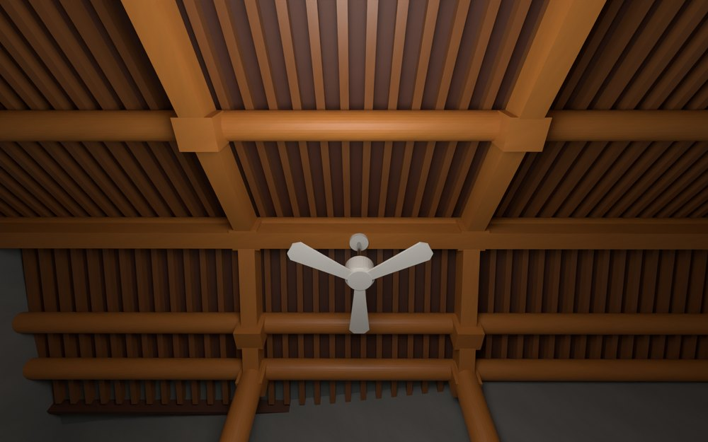](media/reconstruction/v12.jpg) 厨房木架和檩椽 · 原版模型图 | 建立全建模场地，完善入口坡面及地坪衔接。深化厨房格心、木架、吊扇和灯具，补照壁翘脊及瓦当。 | `Rebuild_V12/使用说明.md` |
| [`V13`](research/versions/v13.md) [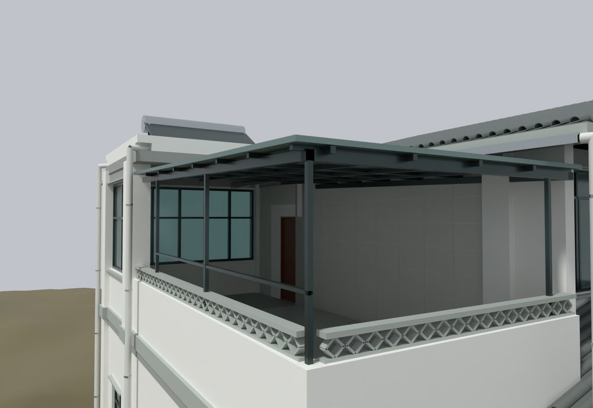](media/reconstruction/v13.jpg) 雨棚檐梁与檩条接触 · 原版模型图 | 重做露台雨棚边缘、檩条、檐梁、贴墙梁及返梁，保持屋顶坡度和柱脚。原生实体接触检查通过。 | `Rebuild_V13/06_Report/Native_Support_Contact_QA.json` |
| [`V14`](research/versions/v14.md) [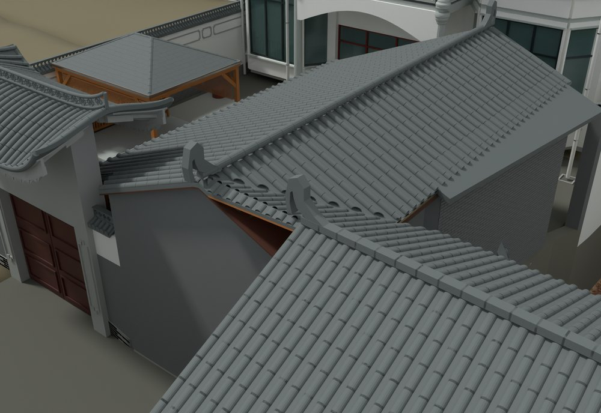](media/reconstruction/v14.jpg) 厨储屋面谷缝 · 原版模型图 | 恢复纯场地实景外圈，调整厨房与内外储藏房屋面、谷缝和金属棚，裁去穿墙饰件。三楼出口移到有支承的侧廊。 | `Rebuild_V14/README_V14_请先阅读.txt` |
| [`V15`](research/versions/v15.md) [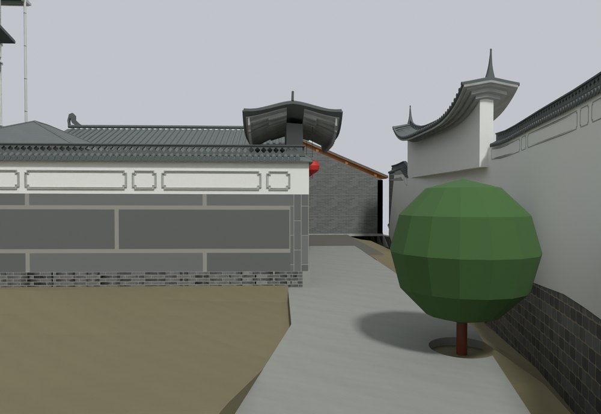](media/reconstruction/v15.jpg) 入口连续通路 · 原版模型图 | 补足网格 UV 和法线并清理黑面，贯通外门至内门的道路，分开围墙内白外砖，裁去穿入卧室的瓦面并细化内门。 | `Rebuild_V15/README_V15_请先阅读.txt` |
| [`V16`](research/versions/v16.md) [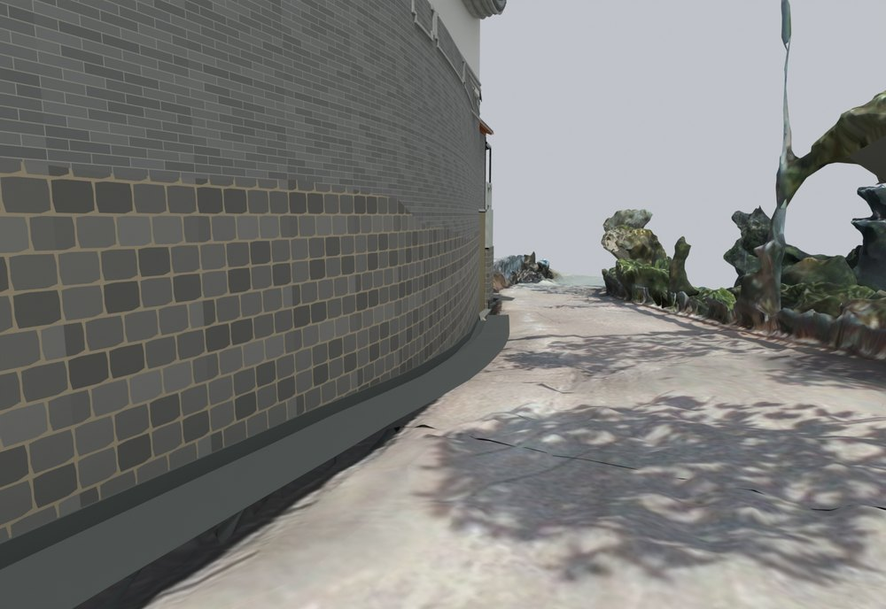](media/reconstruction/v16.jpg) 南墙墙脚与排水沟 · 原版模型图 | 重建连续院内土面、墙脚和排水沟，按切边高程衔接扫描道路，保留入口坡道、树池和主要建筑。 | `Rebuild_V16/README_V16_请先阅读.txt` |
| [`V17`](research/versions/v17.md) [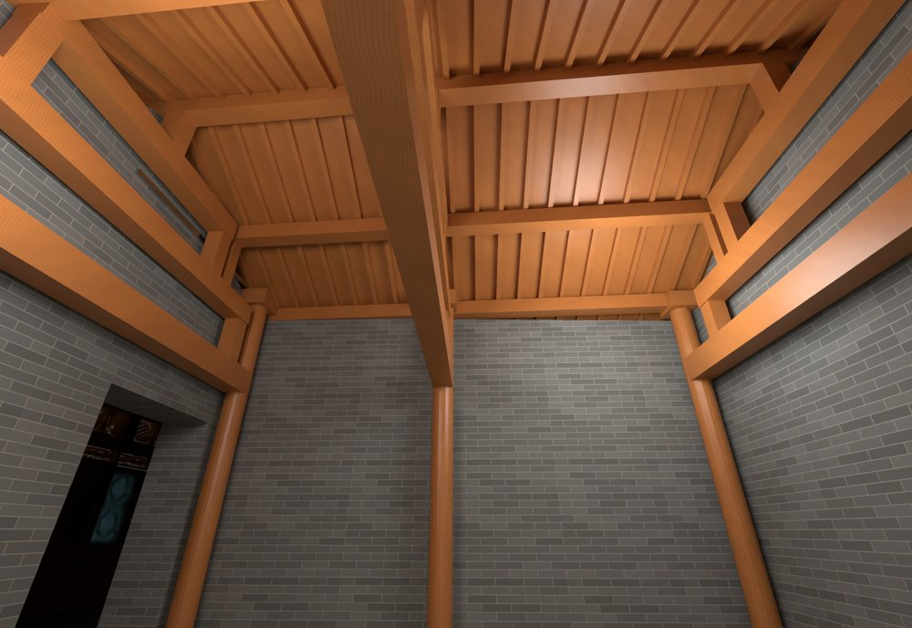](media/reconstruction/v17.jpg) 储藏房木桁架 · 原版模型图 | 去除穿过厨储转角的旧墙饰，恢复转角地坪高差，补木桁架、开敞檐廊、格扇和连续石栏。 | `Rebuild_V17/README_V17_请先阅读.txt` |
| [`V18`](research/versions/v18.md) [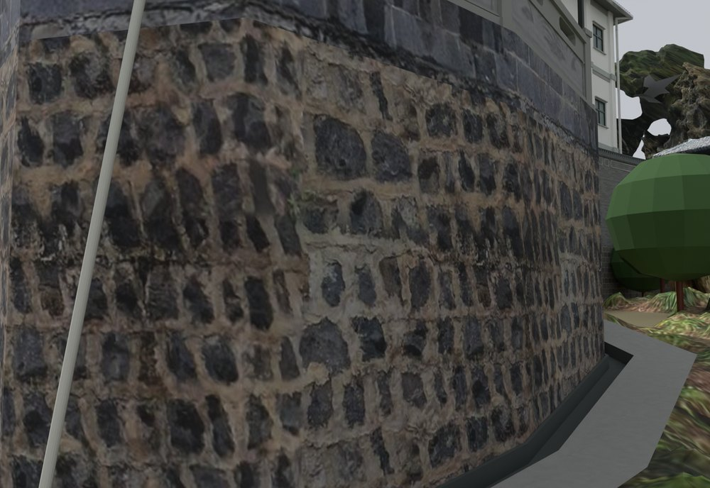](media/reconstruction/v18.jpg) 储藏房连续石基与沟边 · 原版模型图 | 按实景重做储藏房连续石基与宽分格石栏，调整深木色、玻璃和外侧金属棚的薄板与支承。 | `Rebuild_V18/README_V18_请先阅读.txt` |
| [`V19`](research/versions/v19.md) [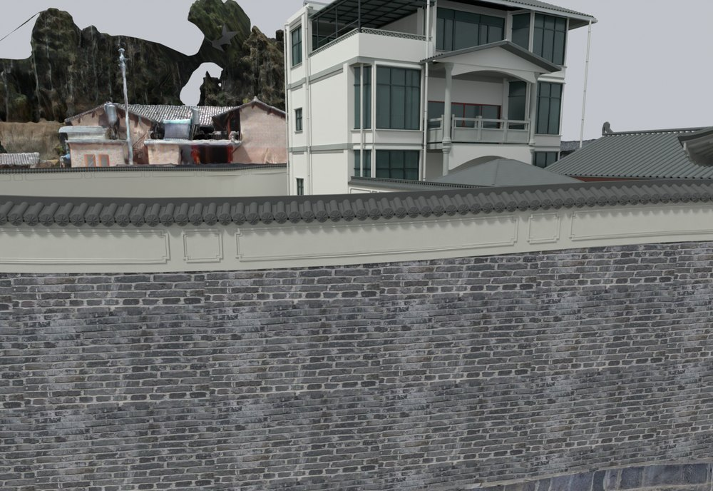](media/reconstruction/v19.jpg) 外围墙压顶和灰砖层次 · 原版模型图 | 外围墙按毛石、深色整石和青砖分层，修照壁灰砖上墙、长短框及弧形檐口贴合。 | `Rebuild_V19/README_V19_请先阅读.txt` |
| [`V20`](research/versions/v20.md) [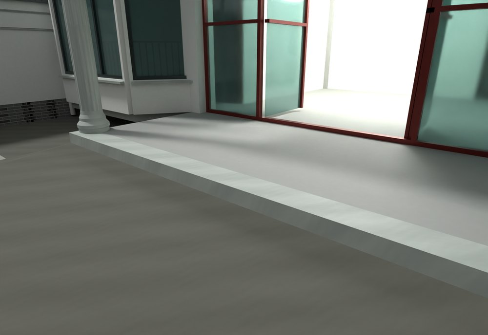](media/reconstruction/v20.jpg) 主楼一阶实心台阶 · 原版模型图 | 修主楼缺墙与三楼木地面，入口改一阶实心台阶，亭子向内收。修厨储通道、石栏、沟路及活动门扇。 | `Rebuild_V20/README_V20_请先阅读.txt` |
| [`V21`](research/versions/v21.md) [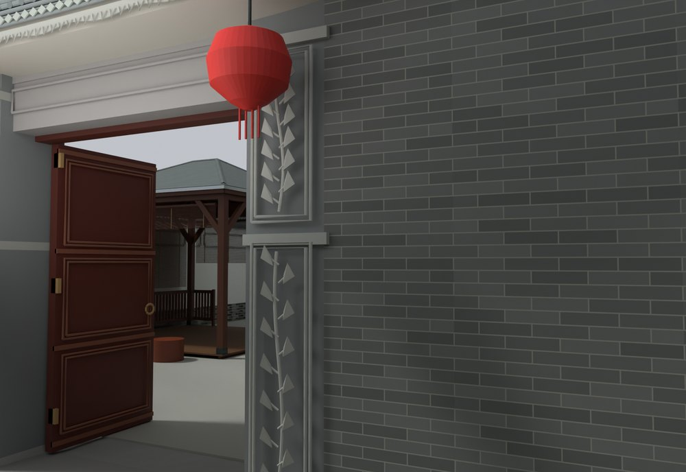](media/reconstruction/v21.jpg) 内门与厨房接口 · 原版模型图 | 导入指定分层内门，修门柱与厨房接口、三楼门位和檐廊饰面，前玻璃门恢复横向推拉。 | `Rebuild_V21/README_V21_请先阅读.txt` |
| [`V22`](research/versions/v22.md) [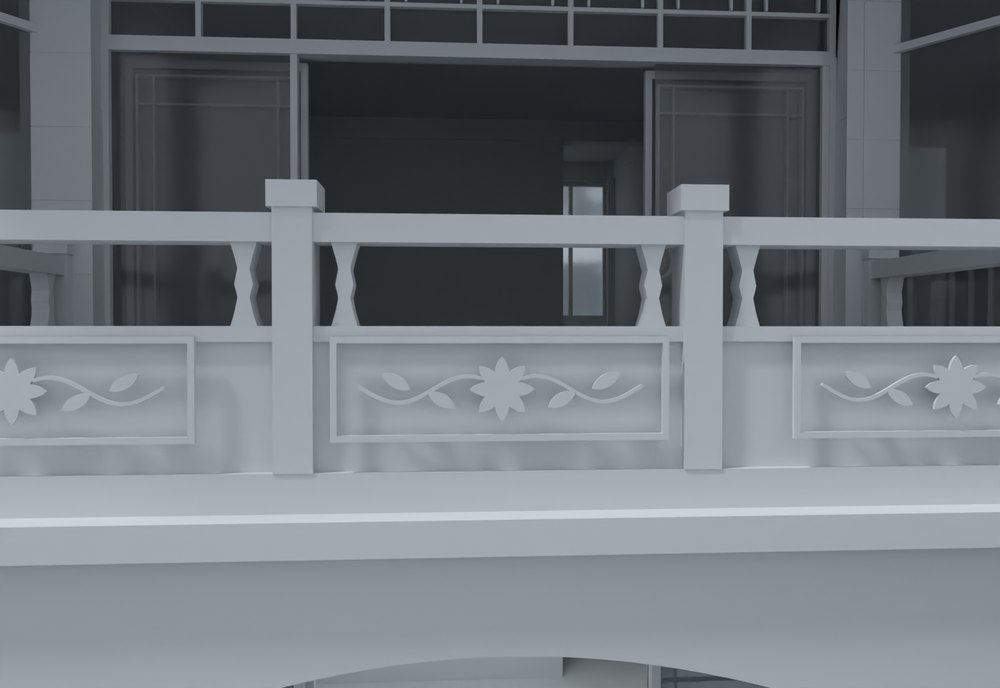](media/reconstruction/v22.jpg) 阳台栏板与柱脚 · 原版模型图 | 深化入口玻璃上亮、阳台栏板、厨房柱础、内院石铺和木亭细部。内大门补浮雕、瓦端、门饰和石阶。 | `Rebuild_V22/README_V22_请先阅读.txt` |
| [`V23`](research/versions/v23.md) [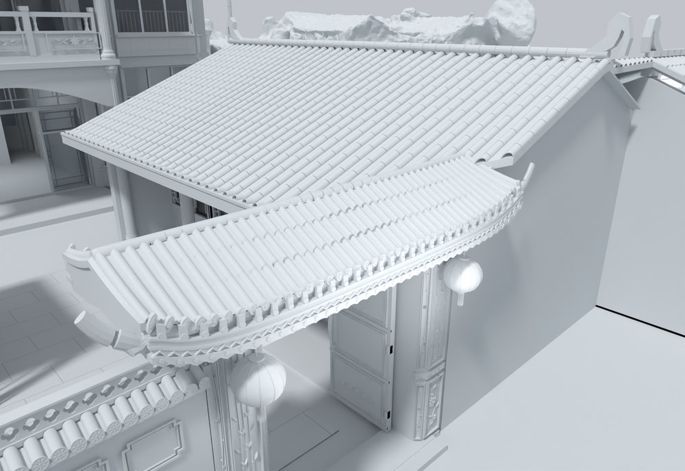](media/reconstruction/v23.jpg) 内门屋面与翘角 · 原版模型图 | 精修内大门柱角体积浮雕、瓦件、椽枋及门叶细节。按反馈收短屋檐并压低翘角，补局部墙柱连接。 | `Rebuild_V23/README_V23_请先阅读.txt` |

## V24 至 V24.20 · Blender 雕刻与构件深化

| 版本与配图 | 本次迭代 | 过程文件 |
| --- | --- | --- |
| [`V24`](research/versions/v24.md) [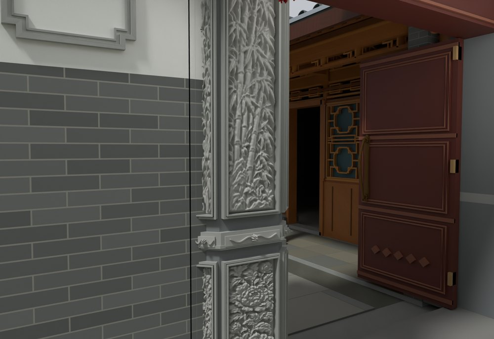](media/reconstruction/v24.jpg) 门楼灰度纹样转实体浮雕 · 原版模型图 | 以 V23 的 Blender 回读为源，将 15 块灰度图石画和翼角纹样做成实体网格，保留原材质。 | `Rebuild_V24/Reports/V24_Build.json` |
| [`V24.02`](research/versions/v24-02.md) [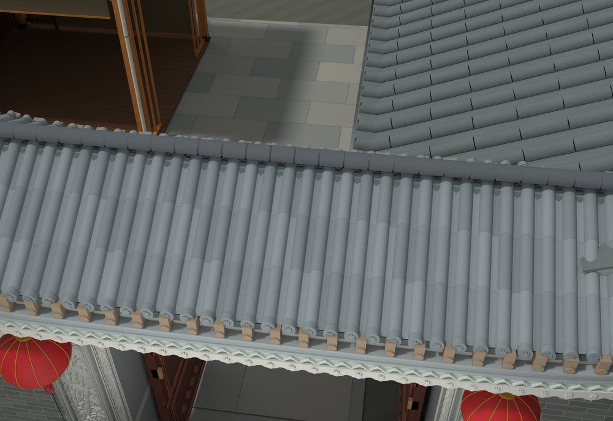](media/reconstruction/v24-02.jpg) 门楼正脊和菱花带 · 原版模型图 | 清内门筒瓦重面，补正脊菱花带、脊座和侧收口，完善厨房曲线山墙压顶及交接。 | `Rebuild_V24/README_V24.txt` |
| [`V24.03`](research/versions/v24-03.md) [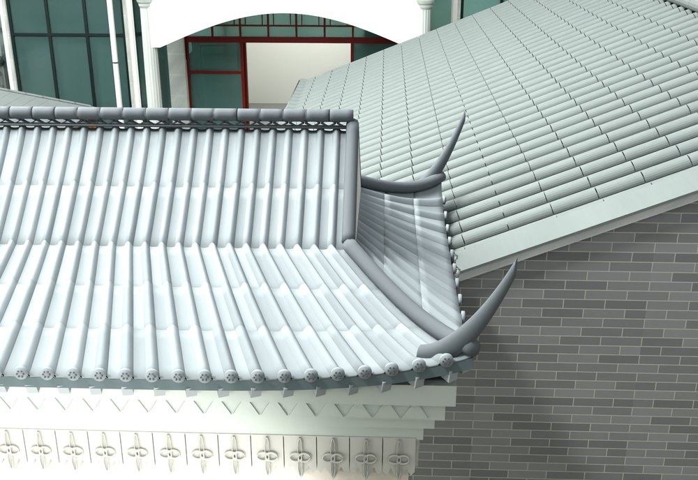](media/reconstruction/v24-03.jpg) 歇山门楼与厨房接合 · 原版模型图 | 按配准剖面重做歇山门楼及封闭檐底。补厨房后墙和三角缺面，改一根中部檐廊柱并处理墙脚排水。 | `Rebuild_V24_03/README_V24_03.txt` |
| [`V24.04`](research/versions/v24-04.md) [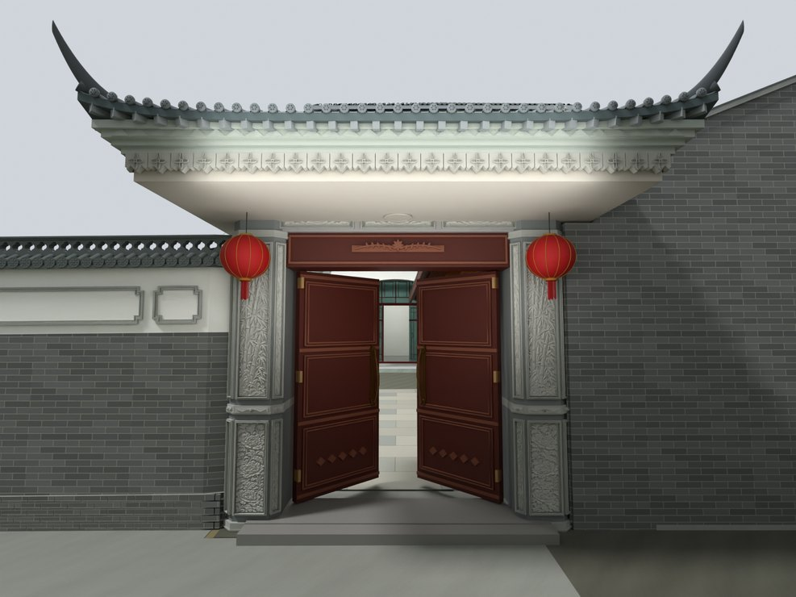](media/reconstruction/v24-04.jpg) 减薄后的内门屋面 · 原版模型图 | 减薄并压低内门歇山屋面，保留分层瓦件。延伸厨房后墙到外围墙端部并做实体封闭。 | `Rebuild_V24_04/README_V24_04.txt` |
| [`V24.05`](research/versions/v24-05.md) [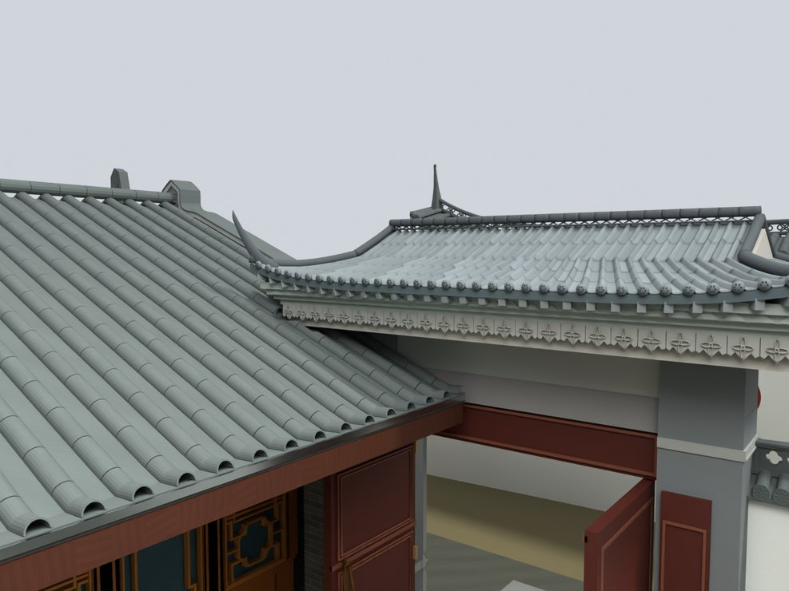](media/reconstruction/v24-05.jpg) 门楼抬高后的屋面关系 · 原版模型图 | 轻薄歇山屋顶整体上移 0.50 m，增石柱承接段及墙颈，重接厨房相邻屋面。 | `Rebuild_V24_05/README_V24_05.txt` |
| [`V24.06`](research/versions/v24-06.md) [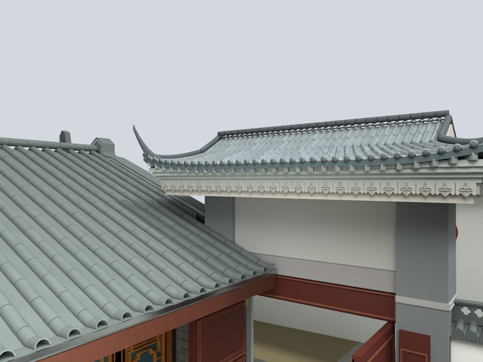](media/reconstruction/v24-06.jpg) 门楼短檐与相邻屋面净空 · 原版模型图 | 屋顶按门柱居中、前后短檐，檐底调整到 3.50 m。配套调整墙线与厨房檐廊木构。 | `Rebuild_V24_06/README_V24_06.txt` |
| [`V24.07`](research/versions/v24-07.md) [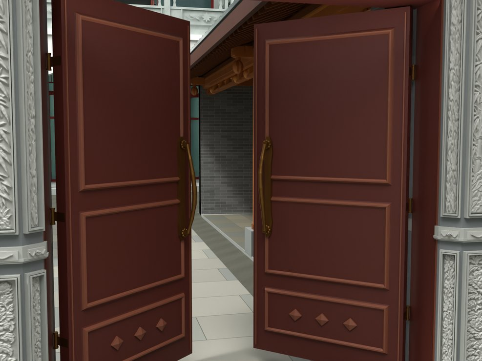](media/reconstruction/v24-07.jpg) 门扇芯板与五金细化 · 原版模型图 | 檐底按标注回落到 3.10 m，闭合与厨房相交构件。细化内门芯板、框、铜拉手与合页。 | `Rebuild_V24_07/README_V24_07.txt` |
| [`V24.08`](research/versions/v24-08.md) [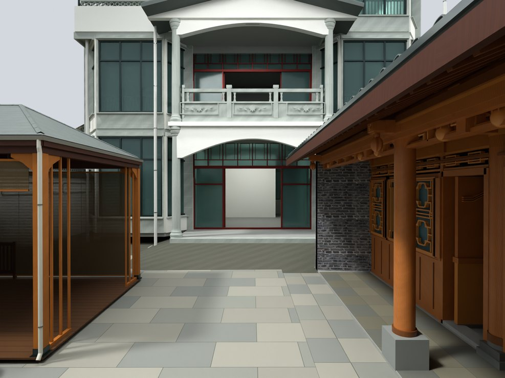](media/reconstruction/v24-08.jpg) 厨房退让后的院落与廊道 · 原版模型图 | 厨房向院外退让 0.45 m，联动门窗、屋架与储物间。补释放区石铺、外侧灰砖和排烟构件。 | `Rebuild_V24_08/README_V24_08.txt` |
| [`V24.09`](research/versions/v24-09.md) [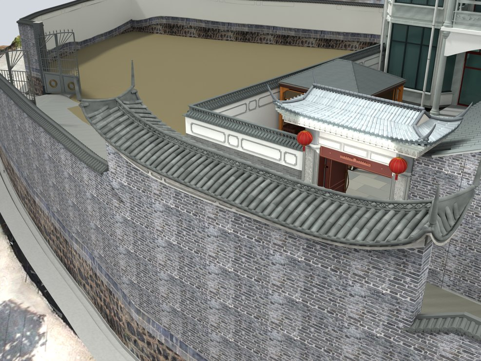](media/reconstruction/v24-09.jpg) 照壁分叉脊与翘角 · 原版模型图 | 照壁重做四条分叉脊和四个翘角，配置扇铺瓦、菱格脊带、莲花瓦当、曲面承托与连续檐底。 | `Rebuild_V24_09/README_V24_09.txt` |
| [`V24.10`](research/versions/v24-10.md) [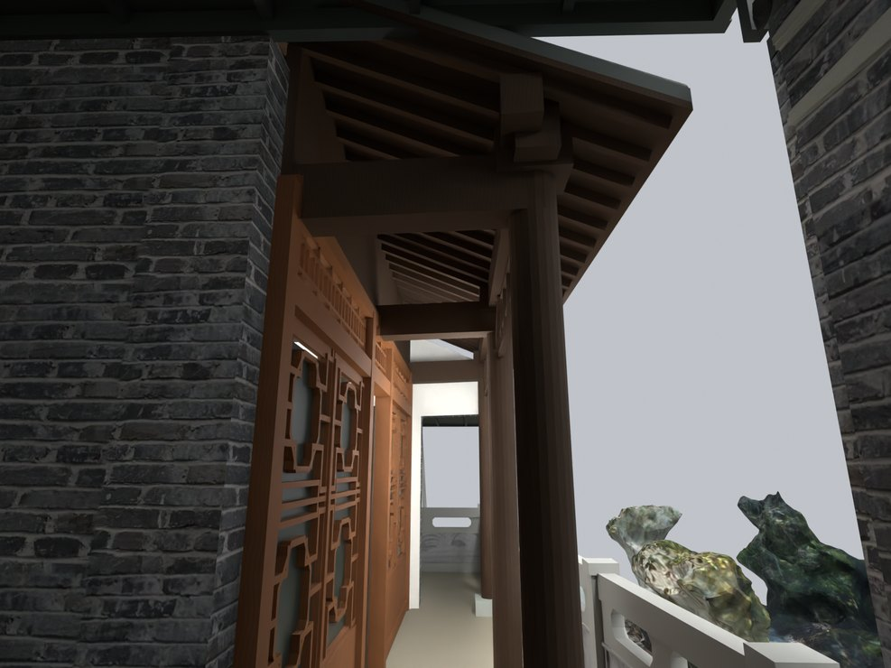](media/reconstruction/v24-10.jpg) 储藏房小入口与檐廊 · 原版模型图 | 按实景地块关系修正储藏房、外边界、房体和小入口，保留可编辑模型与门扇动作。 | `Rebuild_V24_10/README_V24_10.md` |
| [`V24.11`](research/versions/v24-11.md) [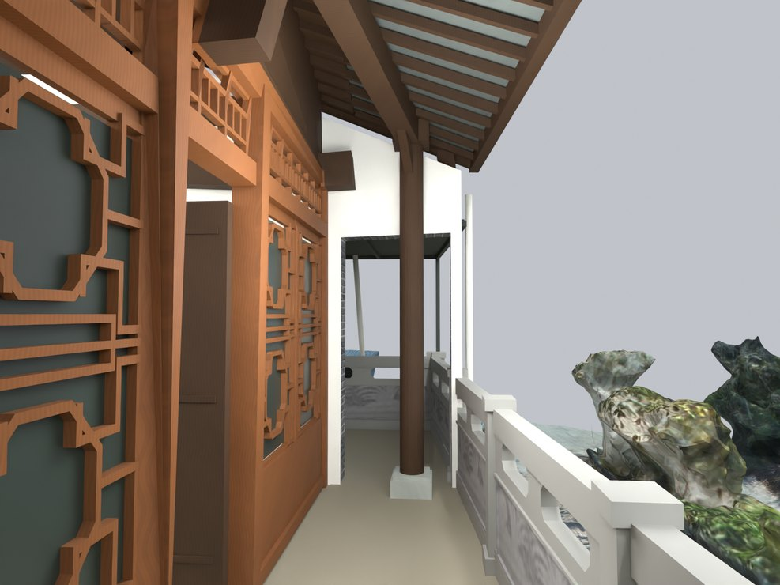](media/reconstruction/v24-11.jpg) 储藏房双柱斜廊 · 原版模型图 | 储藏房改双柱斜廊、连续弧形后墙与无重面基础，移除小入口铁皮棚，修白灰照壁和叠涩。 | `Rebuild_V24_11/README_V24_11.md` |
| [`V24.12`](research/versions/v24-12.md) [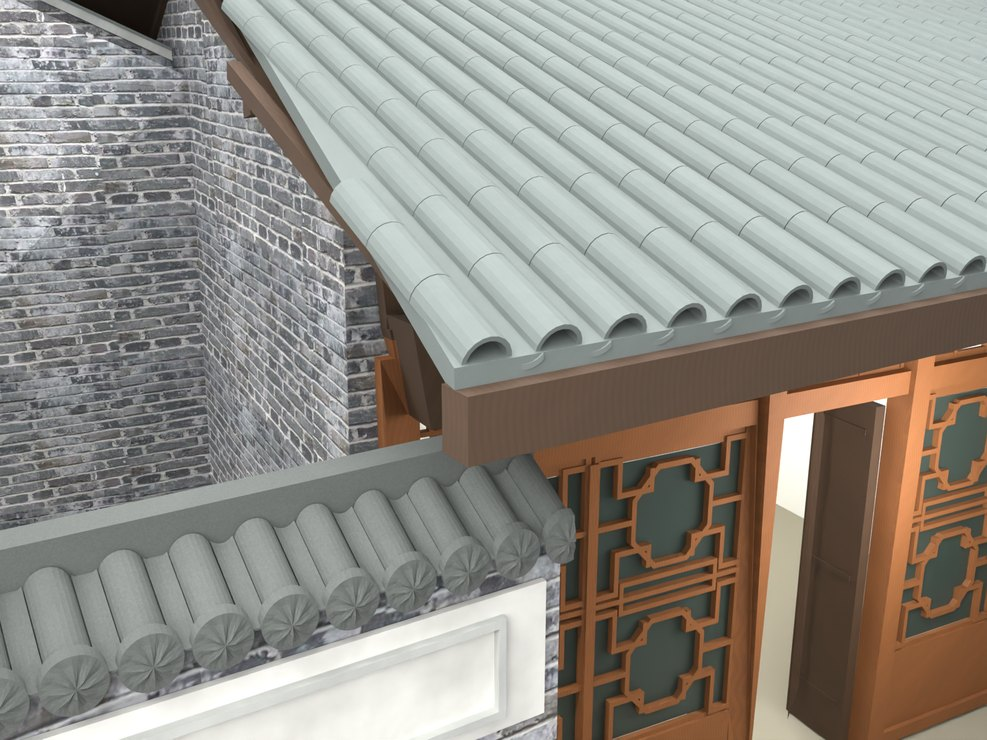](media/reconstruction/v24-12.jpg) 调平后的储藏房屋檐 · 原版模型图 | 调平次照壁墙冠、瓦压顶和饰带，把储藏房正脊与前檐恢复为水平平行直线，重排瓦件。 | `Rebuild_V24_12/README_V24_12.md` |
| [`V24.13`](research/versions/v24-13.md) [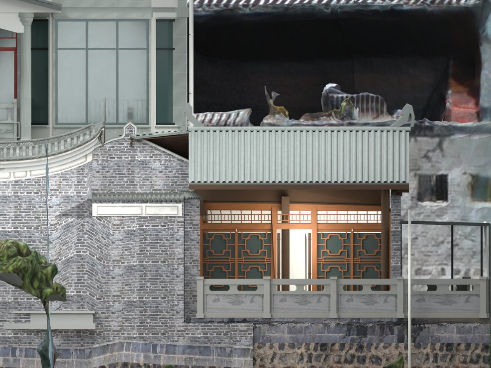](media/reconstruction/v24-13.jpg) 收回楔形外伸后的前坡 · 原版模型图 | 按蓝线切除储藏房前坡楔形外伸，使前坡两侧成平行直边，保持屋脊与檐口水平。 | `Rebuild_V24_13/README_V24_13.md` |
| [`V24.14`](research/versions/v24-14.md) [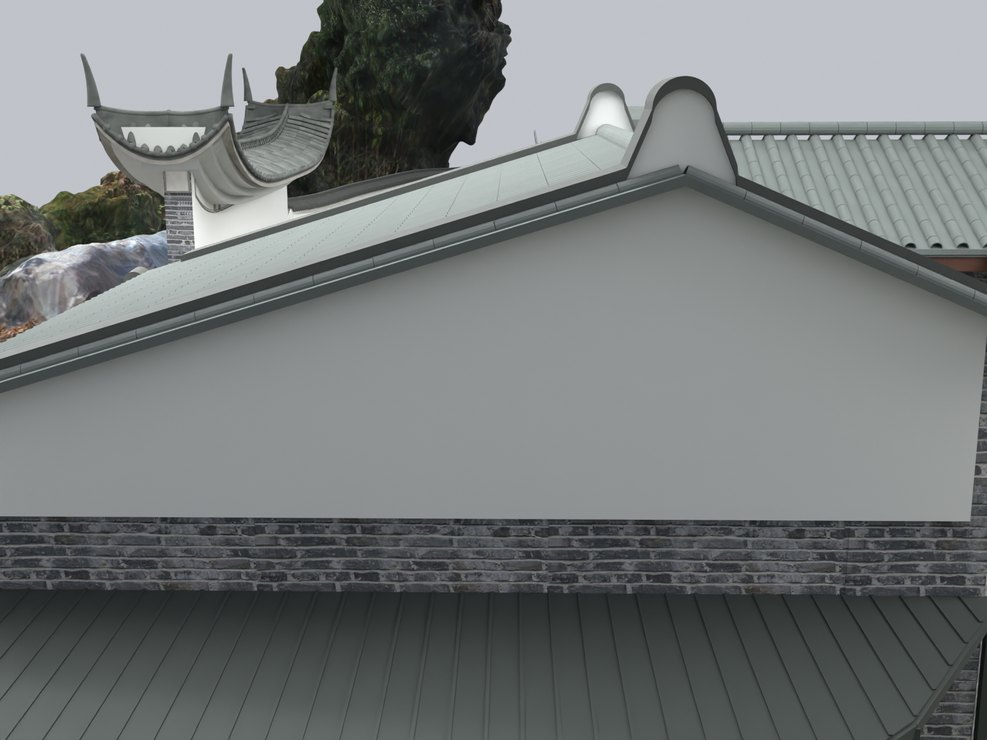](media/reconstruction/v24-14.jpg) 储藏房封合山墙 · 原版模型图 | 封合储藏房山墙，木隔扇、玻璃及门轴后退 0.48 m，形成连续檐廊。 | `Rebuild_V24_14/README_V24_14.md` |
| [`V24.15`](research/versions/v24-15.md) [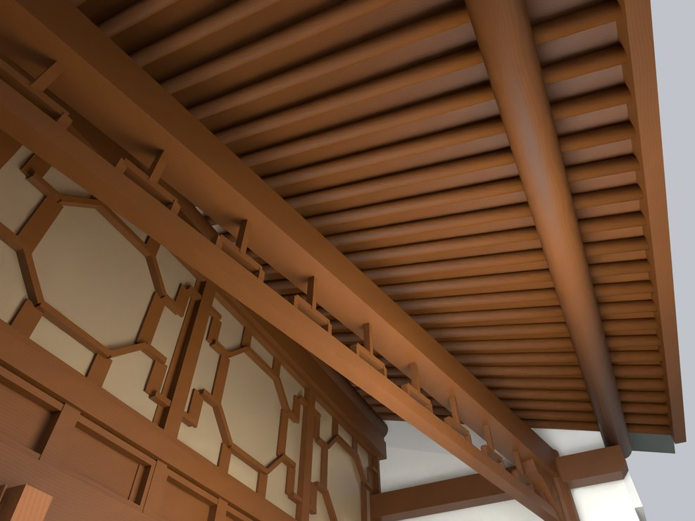](media/reconstruction/v24-15.jpg) 储藏房檐下传统木构 · 原版模型图 | 清断梁和重复屋架，重做传统木构檐口，增四组花格横披，保留既有门扇。 | `Rebuild_V24_15/README_V24_15.md` |
| [`V24.16`](research/versions/v24-16.md) [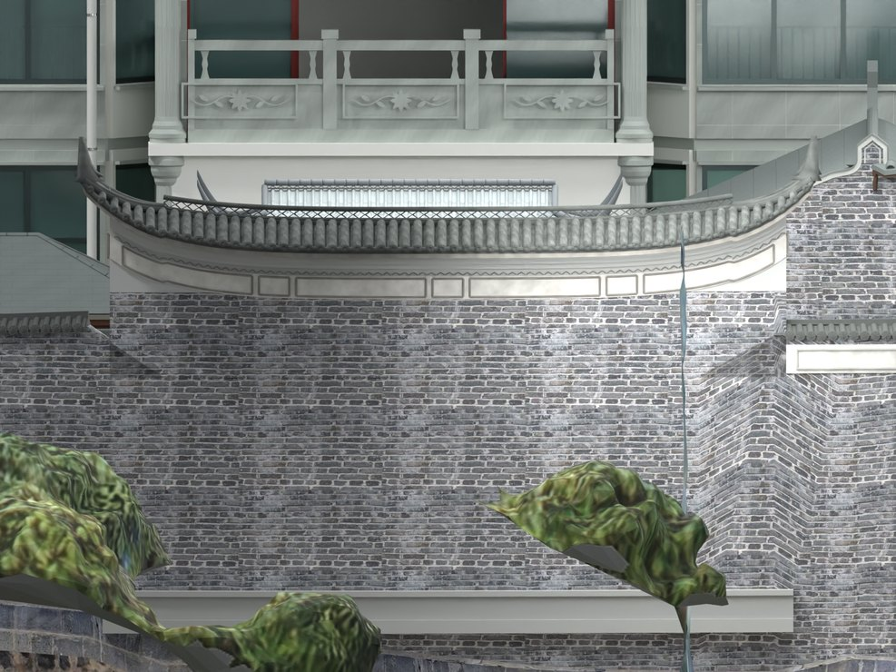](media/reconstruction/v24-16.jpg) 按墙身中线重建的照壁 · 原版模型图 | 入口柱外移并补白灰侧墙。按墙身中线重建照壁底座、叠涩、瓦面及分叉脊。 | `Rebuild_V24_16/README_V24_16.md` |
| [`V24.17`](research/versions/v24-17.md) [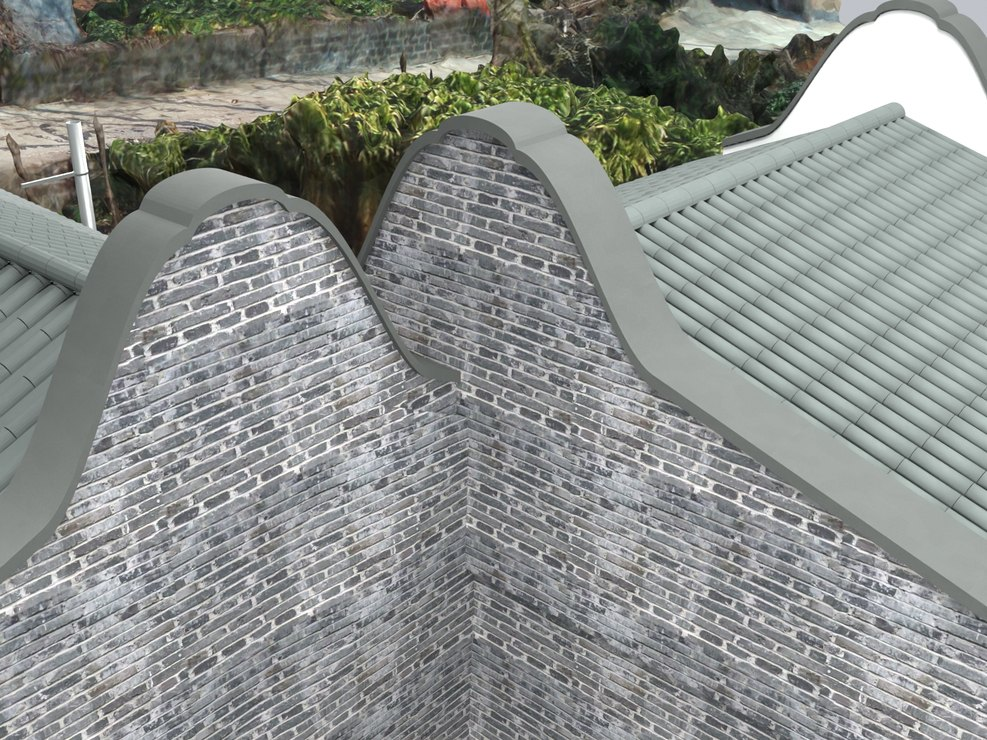](media/reconstruction/v24-17.jpg) 储藏房西侧青砖封边 · 原版模型图 | 青砖封齐储藏房与厨房山墙，修镬耳及瓦面交接，清理导致闪烁的叠面。 | `Rebuild_V24_17/README_V24_17.md` |
| [`V24.18`](research/versions/v24-18.md) [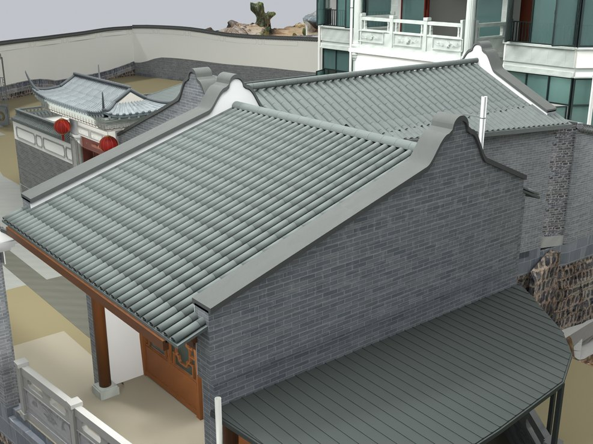](media/reconstruction/v24-18.jpg) 收窄的镬耳山墙 · 原版模型图 | 补建筑与地坪之间的接地基座，收窄镬耳，修凹照壁和外开窗。 | `Rebuild_V24_18/README_V24_18.md` |
| [`V24.19`](research/versions/v24-19.md) [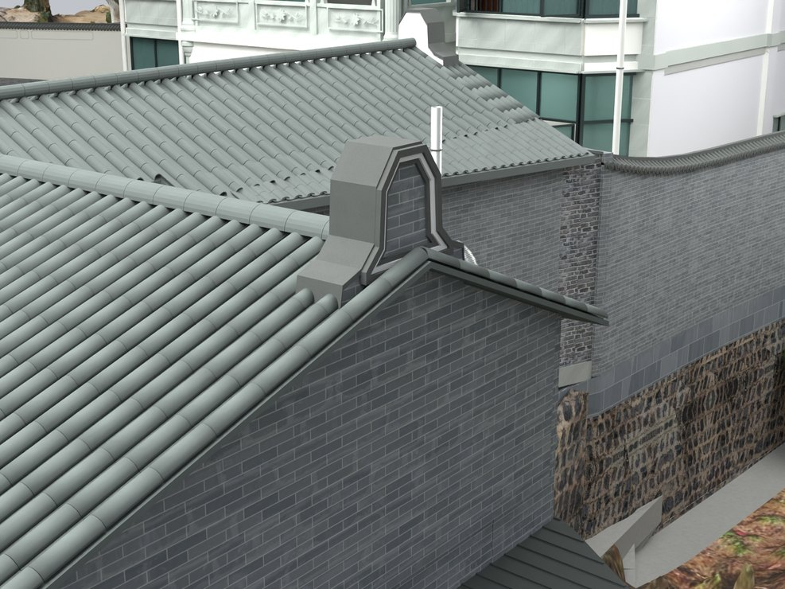](media/reconstruction/v24-19.jpg) 山墙瓦挑檐与收口 · 原版模型图 | 复核首层悬空的高程成因并修墙脚，调整实景山墙瓦挑檐，处理基座与外墙交界。 | `Rebuild_V24_19/README_V24_19.md` |
| [`V24.20`](research/versions/v24-20.md) [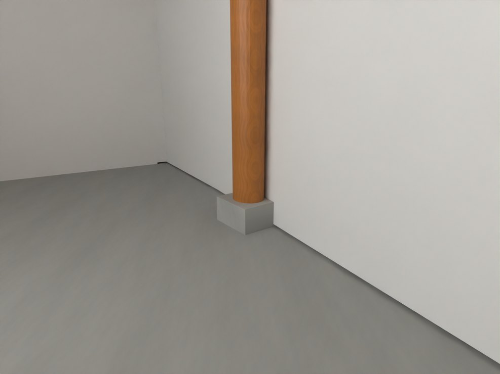](media/reconstruction/v24-20.jpg) 厨房灰色地砖 · 原版模型图 | 统一外围墙实景砖纹，修首层卫生间及厨储交接，按参考改厨房灰色地砖。 | `Rebuild_V24_20/README_V24_20.md` |

## V24.21 至 V25 · 漫游、外景与 Rhino 配套

| 版本与配图 | 本次迭代 | 过程文件 |
| --- | --- | --- |
| [`V24.21`](research/versions/v24-21.md) [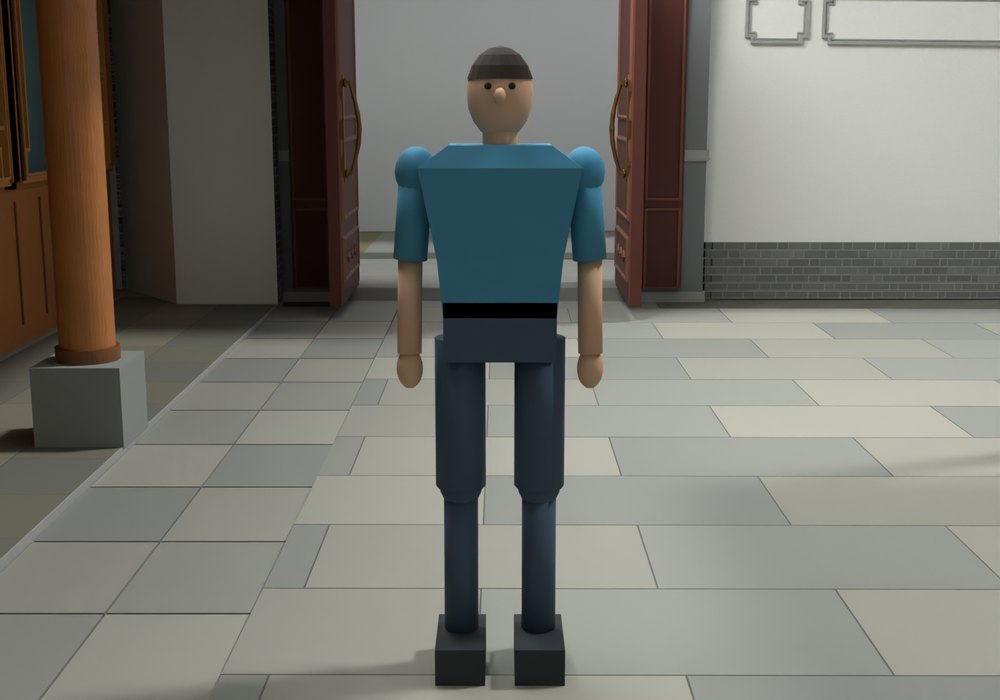](media/reconstruction/v24-21.jpg) 人物漫游与场地碰撞 · 原版模型图 | 新增 1.65 m 人物、碰撞、台阶与第一/第三人称漫游。按实景补外围墙白饰带和长短框。 | `Rebuild_V24_21/README_漫游使用说明.md` |
| [`V24.22`](research/versions/v24-22.md) [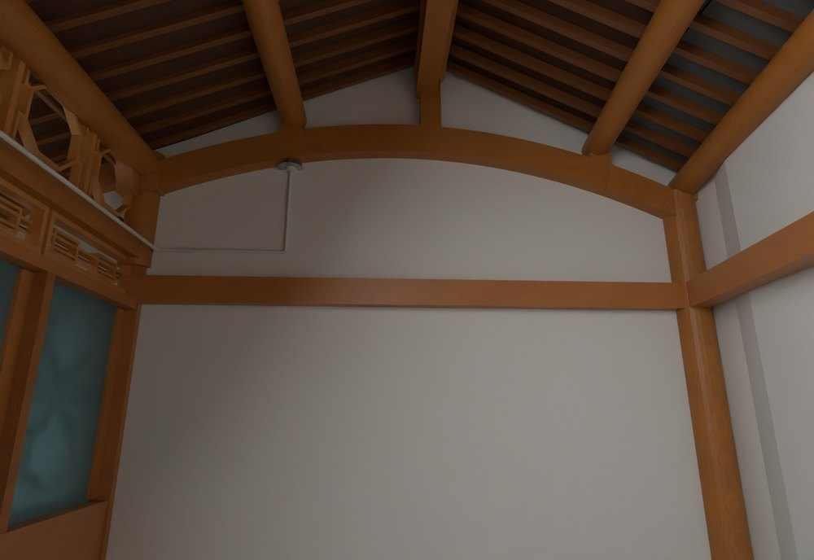](media/reconstruction/v24-22.jpg) 厨房山墙和木架 · 原版模型图 | 修厨房两端曲线山墙与封檐，调整圆檩、木架、廊梁及墙拉结。使用说明为空，改动依据为构件差异。 | `Rebuild_V24_22/Reports/V24_22_Changes.json` |
| [`V24.23`](research/versions/v24-23.md) [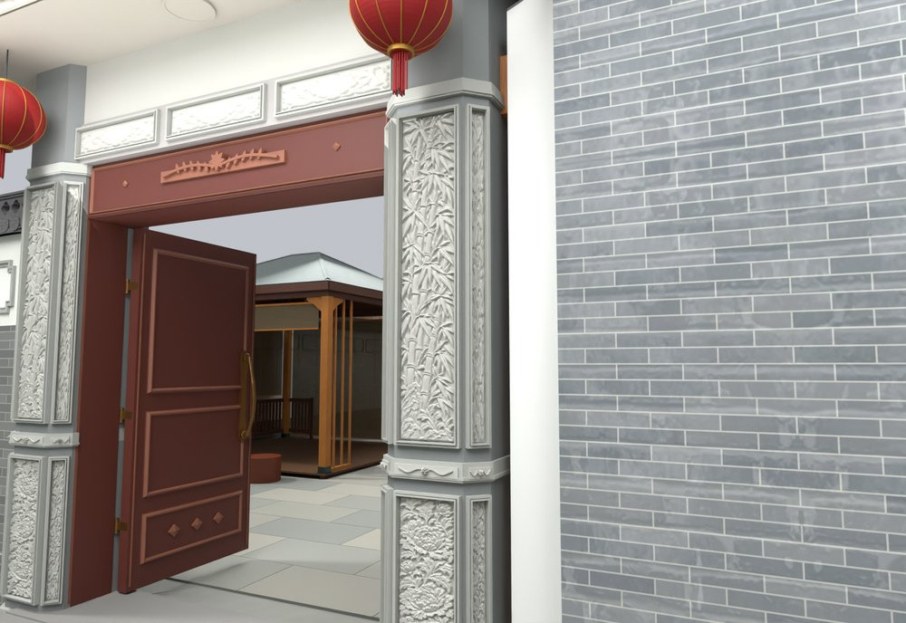](media/reconstruction/v24-23.jpg) 内大门石柱细部 · 原版模型图 | 调整厨房端柱、内大门和储藏房接口，继续保留漫游入口及活动构件。 | `Rebuild_V24_23/使用说明.txt` |
| [`V24.24`](research/versions/v24-24.md) [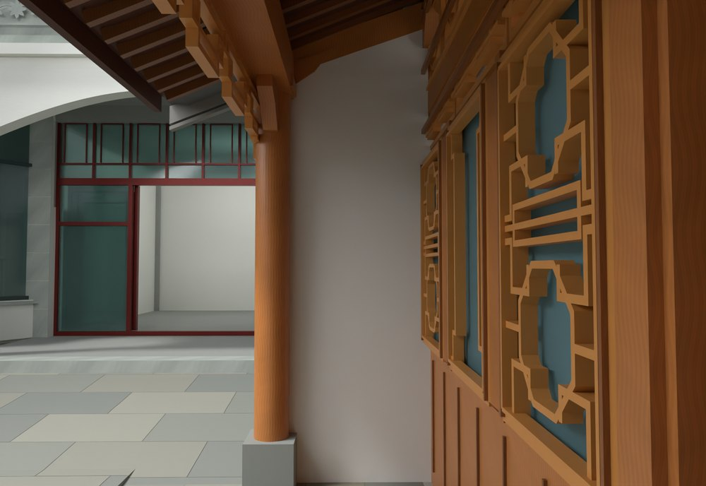](media/reconstruction/v24-24.jpg) 厨房封墙 · 原版模型图 | 做厨房封墙、门前退墙和院落补铺，逐处核对门背及屋檐接合。 | `Rebuild_V24_24/使用说明.txt` |
| [`V24.25`](research/versions/v24-25.md) [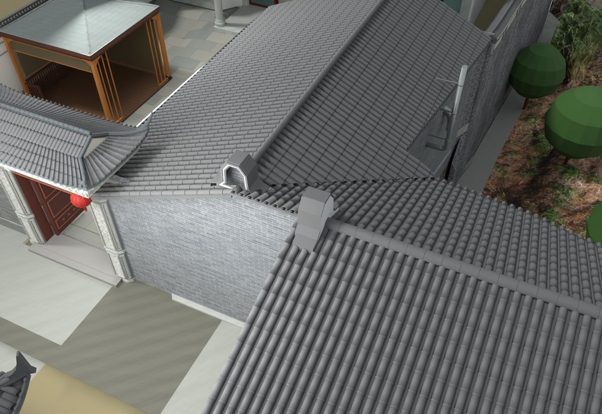](media/reconstruction/v24-25.jpg) 厨房屋面谷缝 · 原版模型图 | 修高窗、门墙接缝、厨房屋面和入口地面，增加长度与面积测量。 | `Rebuild_V24_25/使用说明.txt` |
| [`V24.26`](research/versions/v24-26.md)  内院围墙瓦顶转角 · 原版模型图 | 青砖封墙，收短厨房靠储藏房一侧出檐，加宽加厚内院 L 形墙瓦顶。 | `Rebuild_V24_26/使用说明.txt` |
| [`V24.27`](research/versions/v24-27.md)  主楼入口台阶和院坪 · 原版模型图 | 调整院坪、入口台阶和厨房沟边标高，更新漫游碰撞。保存模型有场地高程与保留核验。 | `Rebuild_V24_27/Reports/V24_27_Native_QA.json` |
| [`V24.28`](research/versions/v24-28.md)  沿厨房廊边接续的台阶 · 原版模型图 | 外墙旁地坪收平，内侧台阶沿厨房廊边直线接入口，修厨房端墙及平直白墙。 | `Rebuild_V24_28/使用说明.txt` |
| [`V24.29`](research/versions/v24-29.md)  门前与原院坪齐平 · 原版模型图 | 三层楼整体下移 0.45 m，门前与原院坪齐平；墙、梁柱、楼梯、门窗及屋面一起移动。 | `Rebuild_V24_29/使用说明.txt` |
| [`V24.30`](research/versions/v24-30.md)  外门渐变路沿 · 原版模型图 | 统一内院灰石铺装，建立可编辑白色外院场地，修渐变路沿及墙厚。 | `Rebuild_V24_30/使用说明.txt` |
| [`V24.31`](research/versions/v24-31.md)  楼梯墙面及木扶手 · 原版模型图 | 补地面和窗下实体，消除道路及路沿重面，统一白色天花，按实景重做木扶手。 | `Rebuild_V24_31/使用说明.txt` |
| [`V24.32`](research/versions/v24-32.md)  三楼连续栏杆 · 原版模型图 | 收平外立面，清窗下与铺地重叠，连通楼梯扶手并修三楼门开向。 | `Rebuild_V24_32/使用说明.txt` |
| [`V24.33`](research/versions/v24-33.md)  取消多余找坡后的露台 · 原版模型图 | 把楼梯口白带归回楼板，取消多余露台找坡层，裁穿出露台的瓦角并收平墙体。 | `Rebuild_V24_33/使用说明.txt` |
| [`V24.34`](research/versions/v24-34.md)  新增南侧道路外景 · 原版模型图 | 从 MB7 选不重叠叶节点，配准后补缺失外景，刷新完整模型的碰撞与安全漫游。 | `Rebuild_V24_34/使用说明.txt` |
| [`V24.35`](research/versions/v24-35.md)  厨房檐口去除扫描遮挡 · 原版模型图 | 在厨房附近局部裁切或移除覆盖屋檐及外墙的 MB7 扫描残片，核对原屋面、墙体和管道。 | `Rebuild_V24_35/Reports/V24_35_Changes.json` |
| [`V24.36`](research/versions/v24-36.md)  补齐后的外景网格局部 · 原版模型图 | 增补 PTJIA6 外景，处理拼接高程，剔除落进受保护空隙的片段，更新漫游碰撞。 | `Rebuild_V24_36/Reports/V24_36_Changes.json` |
| [`V24.37`](research/versions/v24-37.md)  清理后的厨房青砖与檐口 · 原版模型图 | 清厨房青砖及檐口白色扫描残片，按覆盖边界保留连续 PTJIA6 外景，交付安全漫游。 | `Rebuild_V24_37/使用说明.txt` |
| [`V25`](research/versions/v25.md)  Rhino 分层模型中的屋面与墙基 · 原版模型图 | 以 V24.37 生成 Rhino 8 分层可编辑网格，提供 LOCAL 与 ENU 两套对齐文件、贴图和 Blender 安全漫游配套。 | `Rebuild_V25/使用说明.txt` |

## V26 至 V26.20 · 实景细修与发布基线

| 版本与配图 | 本次迭代 | 过程文件 |
| --- | --- | --- |
| [`V26`](research/versions/v26.md)  院墙内侧白色饰面 · 原版模型图 | 按指定回到 V24.34 底稿，改院墙内侧白面、恢复原入口坡面，接实楼梯与平台并恢复相关柱体。 | `Rebuild_V26/使用说明.txt` |
| [`V26.1`](research/versions/v26-1.md)  楼梯踏步和平台修整 · 原版模型图 | 修踏步、半层平台与扶手柱座、露台和玻璃门边，复核照壁、内门地面、外墙与原入口坡。 | `Rebuild_V26_1/Reports/修正说明与预览.md` |
| [`V26.2`](research/versions/v26-2.md)  玻璃门与门框标高 · 原版模型图 | 收口墙梁与窗头窗下，校正门框厚度、玻璃门标高、廊下饰面和院墙石砖层次。 | `Rebuild_V26_2/使用说明.md` |
| [`V26.3`](research/versions/v26-3.md)  三楼高窗与墙顶收口 · 原版模型图 | 补卫生间隔墙及门上亮，收口高窗与墙顶，从 V24.34 恢复原次照壁。 | `Rebuild_V26_3/Reports/V26_3_修正对比.html` |
| [`V26.4`](research/versions/v26-4.md)  三楼白顶和楼梯井 · 原版模型图 | 保持一楼两个卫生间各有入口，二、三楼卫浴墙收平，封三楼白色平顶并修门框、平台和窗角。 | `Rebuild_V26_4/使用说明.txt` |
| [`V26.5`](research/versions/v26-5.md)  右侧飘窗转角 · 原版模型图 | 修首层卫浴隔墙及后高窗，裁穿斜窗玻璃的院墙瓦片，接外墙与楼板边，清五组飘窗转角多余白片。 | `Rebuild_V26_5/使用说明.txt` |
| [`V26.6`](research/versions/v26-6.md)  三楼露台通口 · 原版模型图 | 用原视频校正平台石纹、三楼露台通口与窗头，更新材质预览环境以减轻天花偏色。 | `Rebuild_V26_6/使用说明.txt` |
| [`V26.7`](research/versions/v26-7.md)  车木扶手起步段 · 原版模型图 | 收整墙柱、楼梯凸带和车木扶手，降低内门石槛并补基座，清理院墙重复白带与错材质。 | `Rebuild_V26_7/使用说明.txt` |
| [`V26.8`](research/versions/v26-8.md)  楼梯井和栏杆 · 原版模型图 | 楼梯井和门窗石材节点按实景收口。引入阴天柔光与独立 Fast 预览，优化贴图、采样及待机更新。 | `Rebuild_V26_8/使用说明.txt` |
| [`V26.9`](research/versions/v26-9.md)  首层窗下固定玻璃 · 原版模型图 | 修首层固定玻璃和各层窗台，恢复厨房北山墙线并接储藏房栏板，抬内门门楣，后窗改双轨推拉。 | `Rebuild_V26_9/使用说明.txt` |
| [`V26.10`](research/versions/v26-10.md)  内门矩形石柱与雕刻 · 原版模型图 | 收平 11 处墙角凸棱，校正三楼水平扶手，内门改矩形石柱并补浮雕、柱础及门前平台。 | `Rebuild_V26_10/使用说明.txt` |
| [`V26.11`](research/versions/v26-11.md)  储藏房斜顶梯形青砖 · 原版模型图 | 加储藏房斜顶梯形青砖，补墙梁及四边形平台，用参考灰度图重建内门实体浮雕。 | `Rebuild_V26_11/使用说明.txt` |
| [`V26.12`](research/versions/v26-12.md)  局部遮蔽开关对照 · 显示对照 | 读取 V24 原雕刻网格和 UV，恢复竹叶花卉纹样，修正浮雕嵌槽及 Fast 视口显示。 | `Rebuild_V26_12/使用说明.txt` |
| [`V26.13`](research/versions/v26-13.md)  内门柱角与浮雕分格 · 原版模型图 | 按实景调内门柱角、腰线、下段浮雕分格与较薄柱脚，收短门前平台外伸。 | `Rebuild_V26_13/使用说明.txt` |
| [`V26.14`](research/versions/v26-14.md)  卫生间门边墙角收口 · 原版模型图 | 接齐各层卫生间门边 L 形墙角，补梁后墙头至顶板并复核原门洞。 | `Rebuild_V26_14/使用说明.txt` |
| [`V26.15`](research/versions/v26-15.md)  门廊与地坪重面修复 · 原版模型图 | 清门廊与地坪重面，修楼梯墙角、储藏房悬空木片和内门后地面。 | `Rebuild_V26_15/使用说明.txt` |
| [`V26.16`](research/versions/v26-16.md)  三楼右飘窗与梁端 · 原版模型图 | 修五组前房间窗边、梁端和饰面，补三楼右飘窗的连续封顶。 | `Rebuild_V26_16/使用说明.txt` |
| [`V26.17`](research/versions/v26-17.md)  固定斜窗和原柱节点 · 原版模型图 | 恢复梁柱板原节点，把十处固定斜窗收至柱前，复核窗脚接原板边。 | `Rebuild_V26_17/使用说明.txt` |
| [`V26.18`](research/versions/v26-18.md)  楼梯斜板与板底接平 · 原版模型图 | 接平楼梯斜板与板底错台，校正半层平台立面颜色，移除内门后固定红板。 | `Rebuild_V26_18/使用说明.txt` |
| [`V26.19`](research/versions/v26-19.md)  三楼西侧梁端和窗角 · 原版模型图 | 清除推定雨水支管，修梁端与西侧窗角。过程记录先试作陶盆，V26.20 的输入记录确认已去除该盆。 | `Rebuild_V26_19/使用说明.txt` |
| [`V26.20`](research/versions/v26-20.md)  储藏房入口台阶同机位对照 · 同机位前后 | 储藏房及相连廊道完成面局部抬高 150 mm，入口形成单阶。厨房和墙体纳入保护，修短门扇后复核开合和通行。 | `Rebuild_V26_20/使用说明.txt` |

## 图文对照

V24.26 有青砖封口、短出檐和内院瓦顶渲染。V26.19 与 V26.20 保留同机位入口对照，台阶高差来自保存后几何检查。[看模型对照图](../case-studies/reconstruction-to-smart-home.zh-CN.md#1-建筑重建)

实际量测、用户指定的模型目标、照片拟合与软件核验分别登记。档案中的接触、尺寸和碰撞检查描述当时的模型。[重建方法与验证边界](../case-studies/residential-reconstruction.zh-CN.md)
