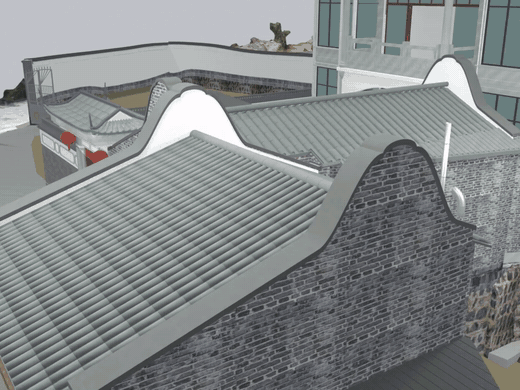
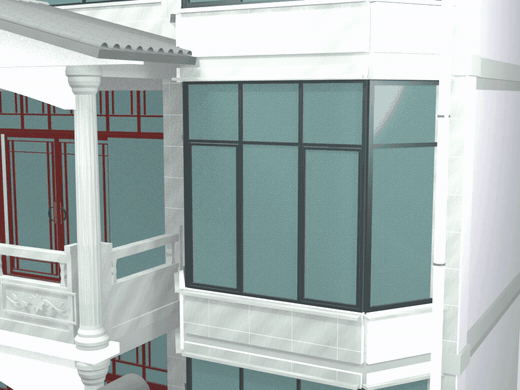
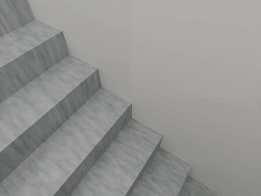
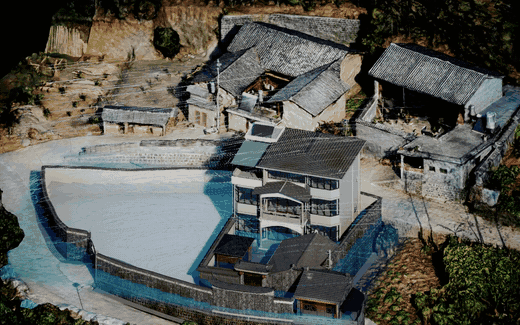
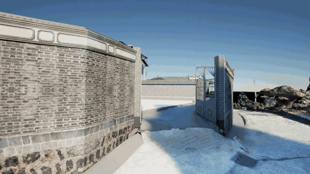

# 过程动画与动态核验

[项目首页](../../../../README.md) · [逐版文章](../versions/README.md) · [动画来源和 SHA-256](manifest.json)

以下五段均来自已经保存的过程视频，没有使用生成图片补帧。GIF 是完整片段的轻量预览，点击画面打开 MP4；三段短片保留原字节，两段 UE 长片仅压缩编码并清除容器元数据。原画面、时长和镜头顺序保留。

模型动作、相机复核和 CFD 软件模拟分别标注。风场片段属于 2026-10-29 的旧室外基准，不表示 2026-11-09 全开风场已录制新视频。

## V24.17 · 外景环绕

**模型复核 · 3 秒**

原过程相机环绕，用于观察山墙、镬耳和屋面交接；不是误差量化或实物检测。

[查看 MP4](v24-17-exterior-orbit.mp4) · [对应迭代记录](../versions/v24-17.md)

**原过程文件**

~~~text
Rebuild_V24_17/Reports/V24_17_Exterior_Orbit.mp4
~~~

## V24.18 · 外开窗动作

**模型动作演示 · 3.334 秒**

原过程窗扇动作，用于观察外开方向和可动层级；不代表实物电机或传感器已连接。

[查看 MP4](v24-18-outward-windows.mp4) · [对应迭代记录](../versions/v24-18.md)

**原过程文件**

~~~text
Rebuild_V24_18/Reports/V24_18_Outward_Windows.mp4
~~~

## V26.8 · 楼梯贴墙斜视

**模型复核 · 1.5 秒**

12 帧斜视复核短片，用于检查台阶与墙体交接；不是人物步行、碰撞或施工验收。

[查看 MP4](v26-8-stair-oblique.mp4) · [对应迭代记录](../versions/v26-8.md)

**原过程文件**

~~~text
Rebuild_V26_8/Reports/楼梯斜视复核/楼梯贴墙斜视复核.mp4
~~~

## UE5 · 旧室外基准风场

**软件模拟 · 8 秒**

annual_coarse 稳态求解结果的 UE 原生流线时间演示，原报告 display_revision 为 season_controls_20261029；与当前全开门窗工况区分。

[查看 MP4](ue-wind-annual-coarse.mp4) · [对应迭代记录](../../smart-home.md)

**原过程文件**

~~~text
WindAnalysis/Reports/wind_demo.mp4
~~~

## UE5 · 五参考机位巡游

**软件场景预览 · 18.1 秒**

原序列按 04→02→03→05→07 巡游，543 帧；用于场景观察，不是实物确认。

[查看 MP4](ue-five-view-tour.mp4) · [对应迭代记录](../../smart-home.md)

**原过程文件**

~~~text
InteractionUpgrade/ReferenceViews/智慧家_五个参考视角.mp4
~~~
