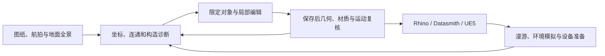
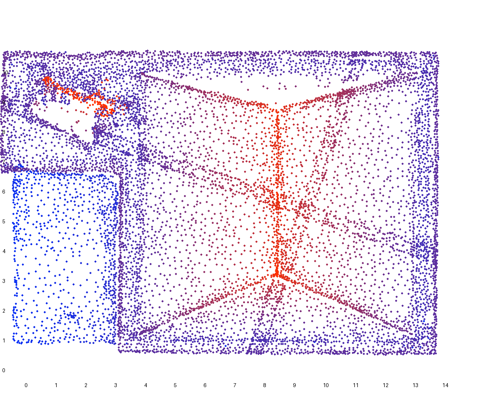
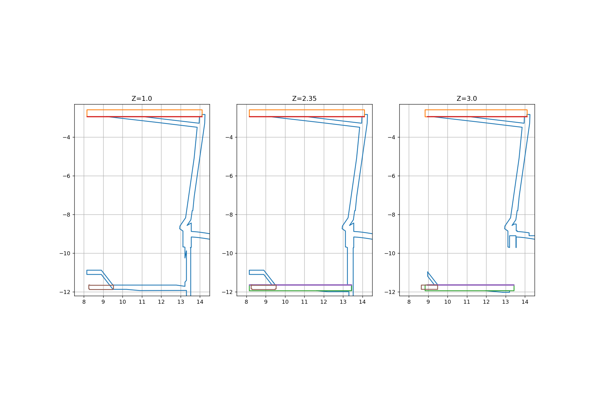
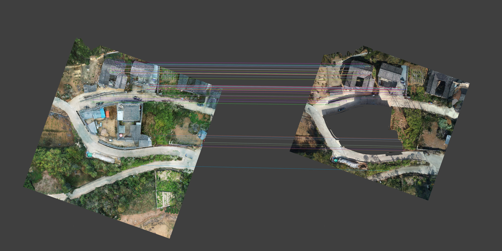

# 从实景重建到家庭数字孪生：实现方法、误差与证据闭环

[逐版技术文章](versions/README.md) · [完整过程覆盖](process-coverage.md) · [智慧家研究顺序](smart-home.md) · [原实现脚本](source-code/README.md)

## 摘要

本项目以同一住宅和院落为对象，使用 DJI Mini 2 航拍、Insta360 地面全景、实景照片及未随施工完整更新的设计图纸，逐轮建立可编辑建筑，再进入 UE5 家庭场景。本文解释资料如何转成坐标、对象、材质、运动和环境结果，以及每类结果应怎样验收。建筑部分按 82 个已归档版本组织，原脚本、诊断图、失败项和后续修订均有入口；智慧家部分按发布号及专题记录衔接。

2026-11-11 本轮工作是原文件核对与技术解释补充，软件运行和保存日期沿用原报告。文中的新复算只涉及已有数值和坐标矩阵；不将其写成新一轮模型或实物验收。

## 1. 研究对象、资料层次与版本来源

项目中有四类不同依据。图纸提供轴网、开间和设计尺度；航拍重建提供可见外表面的三角网格；全景与近景提供室内连通、遮挡后的构造线索和材质样本；GPT Image 图用于解释或推敲看不清的结构。具体尺寸结合摄影测量模型量取、图纸约束和 AI 辅助估算，来源在各版中分别记录。构件分解图可以指导实体如何拆分，不能自动成为隐藏构造的实测证明。

版本号也不是一条简单的数字递增链。V24.02 保存在 V24 工程中；V25 的直接来源为 V24.37；V26 按指定回到 V24.34 底稿，随后迭代到 V26.20，再成为智慧家导入基线。V24.01 尚无独立归档证据。比较前后结果时，应先比较实际输入文件及其哈希，再看显示的版本号。[来源与逐版记录](../reconstruction.md) · [过程覆盖与缺口](process-coverage.md)

## 2. 坐标、采样与拟合的数学含义

### 三角面样本为何按面积加权

V1 的 `register_reality.py` 对三角面顶点 $`a,b,c`$ 计算重心、面积和单位法线：

$$
\begin{aligned}
p&=\frac{a+b+c}{3},\\
A&=\frac{\lVert(b-a)\times(c-a)\rVert}{2},\\
n&=\frac{(b-a)\times(c-a)}{2A}.
\end{aligned}
$$

退化面不能按该式直接归一化。样本中的点、法线和面积必须保持相同索引。方向直方图和屋面拟合采用面积权重，目的是减小网格细分密度不均的影响；它并不校正摄影测量本身的系统误差。[原始采样实现](source-code/v1/history/register_reality.py) · [首版屋面诊断](source-code/v1/project/05_Intermediate/Scripts/roof_diagnostics.py#L22)

### 局部坐标、位置和法线分别怎样变换

对列向量约定，局部到参考坐标写作 $`p_s=Rp_l+t`$。当 $`R`$ 是正交旋转矩阵时，代码使用的行向量反变换为：

$$
\begin{aligned}
p_l&=(p_s-t)R,\\
n_l&=n_sR.
\end{aligned}
$$

位置要扣平移，法线不扣平移。该法线公式依赖正交旋转；一般带非均匀缩放的仿射变换应使用逆转置并重新归一化。凉亭研究使用的 V23 矩阵经本轮只读复算，旋转块行列式为 1，$`R^TR-I`$ 的最大绝对元素约为 $`2.12\times10^{-17}`$，满足该写法的数值前提。绝对坐标不公开。[凉亭图的完整复算](pavilion.md) · [本轮数值复核](numerical-review.json)

**图 1** · 原屋面高度诊断。颜色表示模型坐标中的高度，不能从色差直接读出测量不确定度。

### 拟合残差和现场精度为何要分开

V1 屋面采用 $`z=ax+by+c`$，令 $`X_i=[x_i,y_i,1]`$，参数向量为 β=(a,b,c)ᵀ。通过在矩阵和观测值两侧乘 $`\sqrt{A_i}`$ 求解面积加权最小二乘，等价于最小化下式目标：

$$
J(\beta)=\sum_i A_i(X_i\beta-z_i)^2.
$$

源码随后根据残差保留样本，阈值使用 `max(0.08, quantile(res, 0.8))`。这类筛选减少局部离群面的影响，也改变了最终用于拟合的样本集合。拟合面与保留样本的残差小，说明两者相容；独立控制点、真实施工尺寸和采集标定仍须另有证据。首版报告的屋面 P90 约 0.478 m，应按其原比较样本和度量阅读。[V1 的结果与局限](versions/v1.md)

## 3. 从截图圈画定位到对象与剖面

用户圈画首先是图像位置。Codex 需要结合镜头朝向、楼层、开口、墙线和已命名对象，把它约束到模型中的候选范围，再用平面、剖面、包围盒或射线区分重叠构件。一个像素位置本身不能唯一确定三维深度。[圈画与材质等过程图档](../codex-methods.md)

V24.22 提供了可直接复查的例子。源码先固定六个墙体对象，再在 Z=1.0、2.35、3.0 m 提取水平轮廓。纵向剖面把几何绕 X 轴旋转 −90°，使 $`(x,y,z)`$ 变成 $`(x,z,-y)`$，所以在新坐标中取 `slice(-y0)` 就对应原模型 $`y=y_0`$ 的 XZ 截面。原脚本的六处 Y 值、对象清单和写出的轮廓 JSON 均可按行查到。[剖切实现第 2–9 行](source-code/v24-22/history/v24_22_analyze.py#L2-L9)

**图 2** · V24.22 修改前水平剖面。应沿相同颜色追踪同一个对象，观察轮廓在相邻高度是否持续，进而辨认墙芯、饰面与封口。不同图的坐标范围和比例也须一致。

诊断图说明“应修改哪里”，改动清单说明“实际修改了什么”，保存后实体与射线报告说明“修改是否写进文件并满足所列判据”。三者相互补充。V24.22 使用说明为空，当前解释依据原脚本、变更清单和保存后 QA，未补写无法回查的终端操作。[本版全部过程](versions/process/v24-22.md)

## 4. 局部改模如何限定影响范围

### 空地融合：先固定原网格，再定义补建域

V6 将原实景五块网格与可编辑补块分开。设主孔洞平面域为 $`H`$，补建几何的投影为 $`P`$，裁切应在 $`P\cap H`$ 内进行；残余孔洞为 $`H\setminus P`$，越界部分为 $`P\setminus H`$。外环和内孔都参与布尔计算，联系表里的栅格掩码只是诊断表达，最终范围以原孔洞多边形为准。

`build_v6_patch.py` 读取坐标、裁切三角面并统计覆盖与越界；照片投影查询还带有 `max_distance=.35`、`min_normal_dot=.65` 等局部条件。`stitch_v6_rim.py` 把过渡面限制在孔洞侧。最近表面匹配得到的是与参考面的对应关系，不能据此宣布全场景表面都已经过独立测量。[补块与覆盖](source-code/v6/history/build_v6_patch.py#L26-L54) · [投影筛选](source-code/v6/history/build_v6_patch.py#L90) · [边沿过渡](source-code/v6/history/stitch_v6_rim.py)

### V26.20：共用基础不能按对象整体平移

厨房与储藏房共享连续基础。将整个基础或其包围盒抬高会影响厨房，因此本轮读取 V24.10 的储藏房实景平面，和厨房东侧保护边界求交，形成储藏房及廊道的新增域。名义标高从 −0.40 m 到 −0.25 m，外院保持原标高。几何操作可表示为：

$$
\begin{aligned}
P_{add}&=P_{storage}\cap P_{allowed},\\
G_{new}&=G_{old}\cup\left(P_{add}\times[z_0,z_1]\right).
\end{aligned}
$$

这表示在限定域增加实体，同时保留原下部基础。门扇另外裁短底部并封口，不能通过移动铰轴代替底部修改。[限域与新增体](source-code/v26-20/project/Sources/Scripts/v26_20_prepare_floor.py#L10-L21) · [门扇底部与原 UV](source-code/v26-20/project/Sources/Scripts/v26_20_prepare_doors.py)

原变更报告给出面积 46.973092 m²、浮点高差 0.15000000596 m 和净增体积 7.043785 m³。本轮用原数值计算的 $`Ah`$ 约为 7.045964 m³，两者相差约 0.002179 m³。$`Ah`$ 表示名义挤出量，保存报告中的净增量则由布尔合并前后体积差计算；交叠及数值运算应单独考虑，不应将二者直接当成同一个量。这里的微小浮点偏差也不能被解释为现场高程量测精度。[原变更字段与复算](numerical-review.json)

### 保护检查为何需要比较区域内的几何、材质和 UV

布尔运算可能把原三角形细分，顶点序号或面数随之变化；仅比较数组哈希会把合法细分与真实破坏混在一起。V26.20 的 QA 先比较能完全对应的原三角形和角点 UV；对受细分影响的部分，再用重心坐标 $`p=\sum\lambda_i v_i`$、$`u=\sum\lambda_i u_i`$ 采样，检查同位置的平面、材质与 UV 是否一致。

原检查中有一条专门处理很窄的旧三角形：若角点记录完全一致，优先采用这一证据，避免病态重心基底放大数值误差。报告记录厨房原面 509 个、区域采样 2,096 个，最大 UV 误差约 $`5.87\times10^{-8}`$ m。该值是模型纹理坐标回归误差，既不是照片分辨率，也不是建筑测量精度。[区域 UV 检查第 150–178 行](source-code/v26-20/project/Sources/Scripts/v26_20_geometry_qa.py#L150-L178)

## 5. 材质与浮雕分别保留什么证据

V18 的毛石、条石和石栏来自实景的不同四角范围，原脚本使用 Pillow `QUAD` 采样及双三次重采样。这个准确实现应写作“四角采样展开”；本脚本没有进行独立相机标定。源照片哈希、像素四角和输出尺寸都写进材质证据。[取样及来源记录](source-code/v18/project/08_Editable_Source/V18_Scripts/v18_design.py#L16-L22)

周期处理也不是随意加噪声。源码从图像的上下、左右边界亮度跳变构造边界项，通过 FFT 解平滑校正项，直流分量设为零，再从图像中扣除该平滑项。保留的是原石块与灰缝图案，同时减轻重复铺贴的接边。照片中的光照仍烘在颜色里，不能把结果直接认作经光照分离的物理反照率。[周期边界处理第 23–30 行](source-code/v18/project/08_Editable_Source/V18_Scripts/v18_design.py#L23-L30)

同一个脚本也含程序生成的路肩微骨料纹理，以及从旧木纹调整颜色得到的材料。因此应逐材质区分：实景取样、既有材质重用、程序合成、AI 设计参考。不能把一个版本中的所有贴图都写成“原照片还原”。[同脚本后续材质处理](source-code/v18/project/08_Editable_Source/V18_Scripts/v18_design.py#L35-L37)

灰度高度图、法线图和真实浮雕网格是三种不同表达。灰度到几何可写作 $`h=h_0+d\,g(u,v)`$，其中深度 $`d`$ 仍是建模约束；灰度较亮不等于现场一定更高。几何浮雕需要检查厚度、封边、体积、槽位和背板接触，法线及 AO 只改变显示。V26.12 恢复旧雕刻网格后又做同机位 AO 开关对照，就是为了把真实几何与遮蔽显示分开判断。[V24 浮雕实体](versions/v24.md) · [V26.11 高度图](versions/v26-11.md) · [V26.12 几何与 AO](versions/v26-12.md)

## 6. 外景配准为什么需要两种误差

V24.34 先制作新旧正射图，通过 SIFT 与 RANSAC 获取共同地物，再将成对像素映回三维表面。脚本的平面映射使用 156 m / 2560 像素，即 60.9375 mm/px；4 px 的 RANSAC 阈值对应约 0.24375 m 的正射平面尺度。它是图像筛选参数，不是最终三维配准误差。[像素到局部平面](source-code/v24-34/project/Sources/v24_34_match.py#L13)

三维初配准拟合 $`y\approx kRx+t`$。源码使用 SVD 估计旋转，遇到负行列式时纠正反射；在 4,000 次随机试验中，每次取四对样本，按 0.40 m 阈值筛内点。随后对内点重拟合，再进入固定尺度的点到面 ICP。[相似变换与内点筛选](source-code/v24-34/project/Sources/v24_34_register.py#L11-L20)

点到点残差为 $`\lVert y_i-Tx_i\rVert`$；点到面残差为 $`n_i^T(y_i-Tx_i)`$。后者只取法向分量，对切向滑移不敏感，所以不能将两种 RMS 相互替代。原记录的同名点 RMS 约 0.132 m，最后一轮点到面 RMS 约 0.153 m，使用的数据及筛选过程也不同。[原结果及范围](versions/v24-34.md)

ICP 代码先按距离与法线夹角过滤，再求小旋转和平移。距离门限前八轮为 0.65 m，之后为 0.40 m，法线点积绝对值要求大于 0.85；超过 0.10 m 的法向残差被降权。源码对系数矩阵和右端同时乘 `weights`，因此其实际最小二乘目标中的系数是 `weights²`。记录算法时应按实现写明，不能只套用另一种加权定义。此步不再次自由拟合尺度。[ICP 实现第 24–29 行](source-code/v24-34/project/Sources/v24_34_register.py#L24-L29)

**图 3** · 正射匹配用于建立候选对应；三维命中、内点和接缝仍需后续检查。V24.36 的表面覆盖通过不消除其原生 QA 的三项失败，V24.37 后续清理应作为独立迭代阅读。[V24.36 失败项](versions/v24-36.md) · [V24.37 后续处理](versions/v24-37.md)

## 7. 门窗、漫游与 Fast 怎样核验

旋转门窗的点位置可表达为 $`p'=h+R(\theta)(p-h)`$，$`h`$ 是铰轴。固定框、活动扇、玻璃与拉手应有明确归属，不能为修净空而一起移动。平移窗则沿登记的轨道方向运动，验证的是不同运动模型。[门窗逐轮实现](smart-home.md)

V26.20 两扇门各取第 1–40 帧，共 80 个姿态，对新完成面检查底部净空。采样通过支持这些姿态及报告覆盖的几何范围；若没有连续扫掠检查，就不能据此断言所有中间角度和任意运行状态均无碰撞。[本版动作核验](versions/v26-20.md)

人物路线还需要落地、净空和步高接续。V24.36 先过滤地面网格上过陡的邻边，再以约 0.09 m 步进尝试人物胶囊运动；正射图上的路点只是待检索位置，不能仅因线段画通就认作可行路线。[路线实现与原结果](versions/v24-36.md)

Fast 是显示与运行配置的另存文件：Eevee、视口贴图尺寸、预览分辨率和控制器设置可降低显示负担。模型几何是否保留、读入哪份碰撞、实际材质视口是否正确，要分别查原报告。单张渲染不能替代实际 Fast 视口验证。[V26.8 性能过程](versions/v26-8.md) · [V26.20 实际视口](versions/v26-20.md) · [现有动态复核片段](animations/README.md)

## 8. 从 Blender、Rhino 到 UE5 的交接

跨软件交付不仅是“模型能打开”。Blender 求值网格要保留世界变换、面索引、角点 UV、法线和材质归属；Rhino 中需要米制、图层、对象身份与贴图引用；UE5 使用的厘米尺度和构件登记再独立复核。相同位置若因 UV 缝具有不同角点纹理坐标，不能只按顶点位置合并属性。[Rhino 转换与首次导入](smart-home.md#v2620-入场与发布基础--2026-10-26-至-10-27)

ModelSync 按 PartId / GUID 比较候选几何与材质，保存备份和覆盖快照，再更新同一 Datasmith Scene，并恢复 UE 端已登记覆盖。空差异应保持无更新，失败候选不能计入保存通过。当前台账有 22 个发布目录，其中 21 次保存通过、1 个候选；另有门窗、环境和界面的专题验证。[22 次发布顺序](../smart-home.md)

V25 是 V24.37 的 Rhino 交付轮次，而智慧家主链使用 V26.20 之后的受控发布。两者需要同时保留，不能用后来的 Blender 发布号覆盖早期 Rhino 过程。[V25 转换实现及读回](versions/v25.md)

## 9. 风场图与分析动画应怎样解释

EPW 典型年数据用于选择代表来风。项目先按 16 个方向扇区统计，低于 0.5 m/s 的样本另计，再为代表方向设置边界。几何、网格、求解残差和后处理均有独立报告。门窗关闭、厨房四窗双门开启、全场地全开，需要在相同来流和比较条件下读取各自计算结果。[气象到风场的步骤](reproduce.md#ue5-从气象输入到可比较的风场图)

三向切片分别在指定平面采样速度，固体与无效区域用掩码处理；灰色区域不能一律读成零风速。比较开闭状态时，应统一切片高度、来流和色标；独立自动缩放色标会改变同一种颜色代表的风速。[三工况与切片](../../case-studies/reconstruction-to-smart-home.zh-CN.md#4-风环境与三向切片)

现有 8 秒风场片段来自旧 `annual_coarse` 结果，原记录为 96 帧、12 fps、2× 轨迹播放。它沿稳态求解场显示流线运动，播放速度可调不等于重新做了瞬态 CFD。V24.17 相机环绕、V24.18 外开窗与 V26.8 斜视复核也分别属于视角、动作和几何观察。动画索引保留了原视频、转码过程和哈希，且未补造新的分析镜头。[五段原过程动画](animations/README.md)

## 10. 判据、失败项与完整过程的查阅方式

| 证据或状态 | 可以支持的结论 | 还需另行确认的内容 |
| --- | --- | --- |
| 原照片／全景可见关系 | 可见部位的外观与相邻关系 | 隐藏构造、遮挡区域及绝对尺寸 |
| 图纸或 AI 辅助估算 | 当轮建模约束及候选尺度 | 与现状一致性、独立实测 |
| 保存后几何与属性 QA | 所列文件、对象及采样判据 | 未覆盖范围、实物性能 |
| 运行时或 PIE 验证 | 对应场景、操作和采样状态 | 未测试设备、打包或长期运行 |
| CFD／日照／软件灯 | 对应计算和软件配置结果 | 实测标定与真实设备反馈 |
| 实物确认 | 原记录明确测得或收到的物理反馈 | 原记录之外的对象与状态 |

完整过程应保留问题、输入、诊断、候选、改动、保存、验证及下一轮反馈。V24.18 的砖纹勒脚后来在 V24.19 被替换，V26.19 的试作花盆最后被移除，V24.36 的原生失败留待后版处理；这些过程不能只留下最后一张成功图。[V24.18 → V24.19](versions/v24-19.md) · [V26.19 的最终状态](versions/v26-19.md)

每篇版本文章现在给出原脚本行号，另有完整过程索引列出其归属图页、全部已识别交付报告和源码入口。全库联系表仍保留无法唯一归属单版的历史视图及智慧家资料。核验结论以对应报告的判据为准，归档完整性与工程验收分别阅读。[覆盖台账](process-coverage.md) · [全过程图档](../process/README.md) · [机器可读映射](evidence-map.json)
