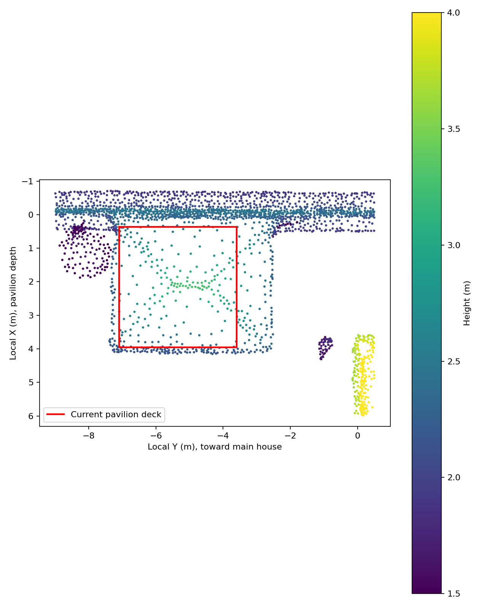
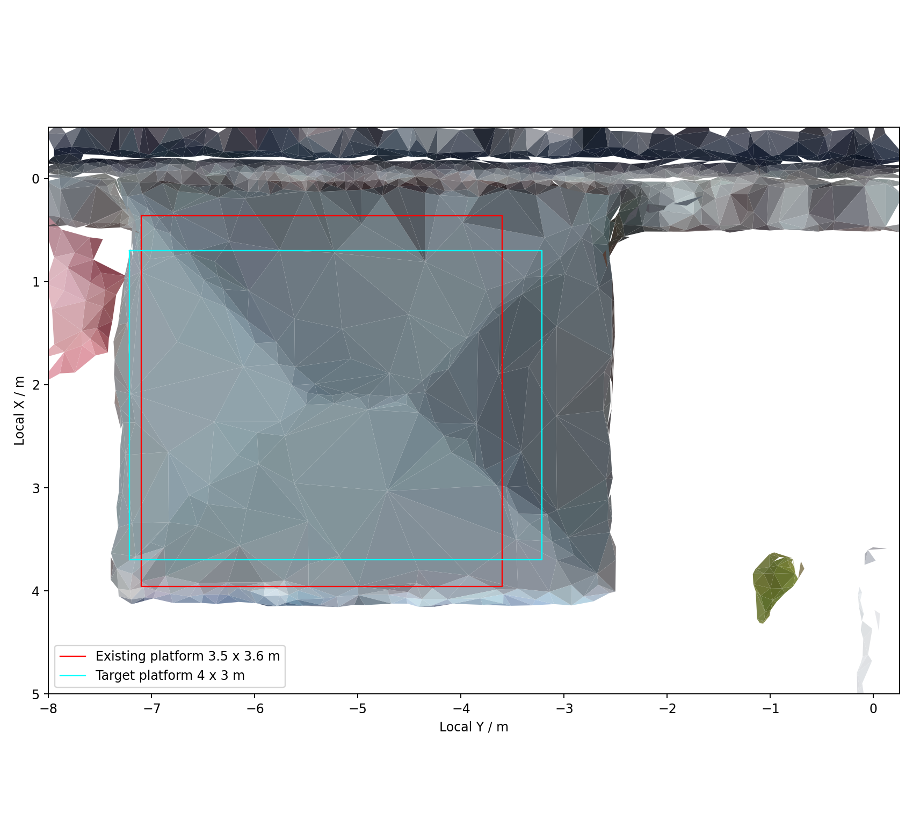
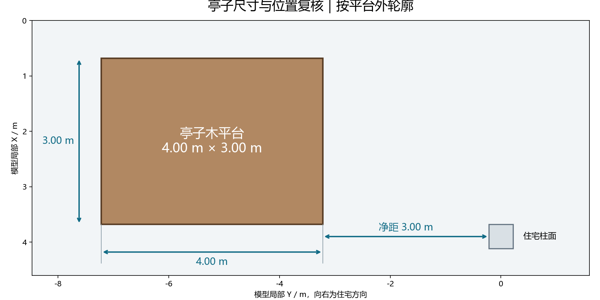
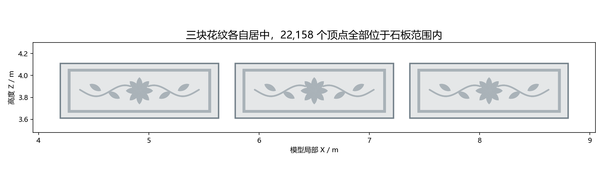

# 2026-10-27 凉亭研究图怎样做出来

这张散点图属于智慧家发布 `20261027_205418_6569f3a8` 的准备阶段。它把摄影测量样本和当时的平台放到同一张平面图里，先判断采样覆盖和旧平台的相对位置，再做带色屋面和拟合。附件与 `photogrammetry_pavilion_plan.png` 的原文件一致。 [智慧家迭代顺序](smart-home.md) · [图源索引](figure-sources.md)

[](media/pavilion-roof-plan.png)

## 1. 把早期实景样本带回建筑局部坐标

重建首版的 `work/register_reality.py` 从 ContextCapture 的 OBJ 取每个三角面的重心、单位法线和面积。结果存在 `JIA/Rebuild/05_Intermediate/Reality_Geometry.npz`，本次实际读到 763,428 组样本。凉亭轮次从 `JIA/Rebuild_V23/02_Data/Coordinate.json` 读取 `local_to_survey` 矩阵。设其中的旋转为 `R`、平移为 `t`，以行向量写法，局部点为 `(p_survey - t) @ R`，局部法线为 `n_survey @ R`。位置和平面方向因此可以与 Blender 模型对应。

`ModelRepair_PavilionRail_20261027/analyze_reference.py` 取局部 `−1 < X < 6`、`−9 < Y < 0.5`、`1.4 < Z < 4.8` 米，并要求法线的 Z 分量大于 `0.3`。筛出 2,215 组，连同法线和面积存为 `Reports/photogrammetry_pavilion_roi.npz`。竖直面大多被法线条件排除，采样范围内仍有周边其他朝上的面，所以接下来会再分坡。

## 2. 用 Y 作横轴、X 作纵轴、Z 作颜色

绘图时保持 XY 同尺度并反转纵轴，使 X 向下增大。横轴 Y 增大的方向指向主楼。点颜色固定用 `viridis`，色标从 1.5 到 4.0 米，范围之外映射到端点颜色。红线来自当时平台的模型矩形，横向 Y 从 −7.10 到 −3.60 米，纵向 X 从 0.36 到 3.96 米。它给散点提供了可比较的边界。

下面摘出原绘图步骤。把代码存为 `replay_pavilion.py`，传入本机 `JIA` 目录和输出 PNG 路径。依赖 NumPy 与 Matplotlib，原始矩阵和实景样本从工程读入。

```python
import json
import sys
from pathlib import Path

import matplotlib
matplotlib.use("Agg")
import matplotlib.pyplot as plt
import numpy as np

jia = Path(sys.argv[1])
destination = Path(sys.argv[2])
coord = json.loads((jia / "Rebuild_V23/02_Data/Coordinate.json").read_text("utf-8"))
matrix = np.array(coord["local_to_survey"])
rotation = matrix[:3, :3]
with np.load(jia / "Rebuild/05_Intermediate/Reality_Geometry.npz") as source:
    points = (source["points"] - matrix[:3, 3]) @ rotation
    normals = source["normals"] @ rotation
x, y, z = points.T
keep = (-1 < x) & (x < 6) & (-9 < y) & (y < 0.5)
keep &= (1.4 < z) & (z < 4.8) & (normals[:, 2] > 0.3)
q = points[keep]
print(f"{len(points)} samples, {len(q)} in ROI")

fig, ax = plt.subplots(figsize=(8, 10))
scatter = ax.scatter(q[:, 1], q[:, 0], c=q[:, 2], s=3, cmap="viridis", vmin=1.5, vmax=4)
ax.plot([-7.1, -3.6, -3.6, -7.1, -7.1], [0.36, 0.36, 3.96, 3.96, 0.36],
        color="red", lw=2, label="Current pavilion deck")
ax.set_aspect("equal")
ax.set_xlabel("Local Y (m), toward main house")
ax.set_ylabel("Local X (m), pavilion depth")
ax.invert_yaxis()
ax.legend()
fig.colorbar(scatter, ax=ax, label="Height (m)")
fig.tight_layout()
fig.savefig(destination, dpi=160)
plt.close(fig)
```

本次复算与原 ROI 的点、法线、面积数组逐元素相同，输出 1280 × 1600 像素的 PNG 与原附件逐字节一致。SHA-256 为 `669230ba6b71b58274af0e08c29b19d63ddf8c2f9850b57accb11ddd188a8fa0`。

## 3. 从散点进一步做到屋面分坡与平台改模

`reference_roof.py` 直接读取原 CC 瓦片的有色三角面，将顶点转回同一局部坐标后投到 Y/X 平面。结合屋面范围，用法线在 X 或 Y 上的符号及大小划为四个坡面方向。每组拟合 `z = ax + by + c`，初始权重取三角面面积，随后 12 轮用 `面积 × min(1, 0.025 / max(|残差|, 1e−6))` 降低离群样本的权重。最终按 60 mm 残差记录内点。四组从 92、145、64、97 个候选面分别留下 91、109、62、90 个内点。这里的误差是对摄影测量面拟合的残差。

[](media/pavilion-roof-overlay.png)

青框用于对照目标尺寸，改模脚本 `refine_source.py` 另外读取主楼柱脚最近的 Y 边界。以用户确认的 **X 向 3.0 m、Y 向 4.0 m** 和主楼柱到平台 **3.0 m** 的净距为约束，目标 X 为 0.68 到 3.68 米，Y 的近主楼一侧取 `主楼柱最小 Y − 3.0 m`。脚本将旧平台范围仿射映射到新 XY 范围，只调整归属亭子的 20 个网格的平面坐标，逐件校对 UV 和其他网格的摘要。

## 4. 用独立射线和保存后读回验收

同轮还查了阳台三组浮雕是否贴到石栏背板。脚本将每个浮雕顶点的 X/Z 保留，发射点放到 `Y = −0.4 m`，沿 `+Y` 射入栏板，取首个命中。修前 22,158 个点中有 96 个未命中，命中点与原浮雕间隙约 1.9–7.8 cm。将三组浮雕对到各自平背板并设置背面约 2 mm 搭接后，`verify_geometry.py` 在暂存几何上重新发射，22,158 个点全部命中。脚本还对比 UV、面索引和最小三角面积，再由原生 Blender 保存读回、UE 关卡读回查平台尺寸和构件位置。

| 保存后的亭台尺寸 | 阳台栏杆浮雕位置 |
| --- | --- |
| [](media/pavilion-size-check.png) | [](media/balcony-relief-check.png) |

原记录相对于 `Twin_Preparation/ModelRepair_PavilionRail_20261027`，包括 `Reports/reference_and_relief_audit.json`、`Reports/geometry_validation.json`、`Reports/saved_blender_validation.json` 和 `Reports/ue_validation.json`。发布保存状态见 `ModelSync/Revisions/20261027_205418_6569f3a8/result.json`。 [更多从研究图到改模的案例](reproduce.md)
