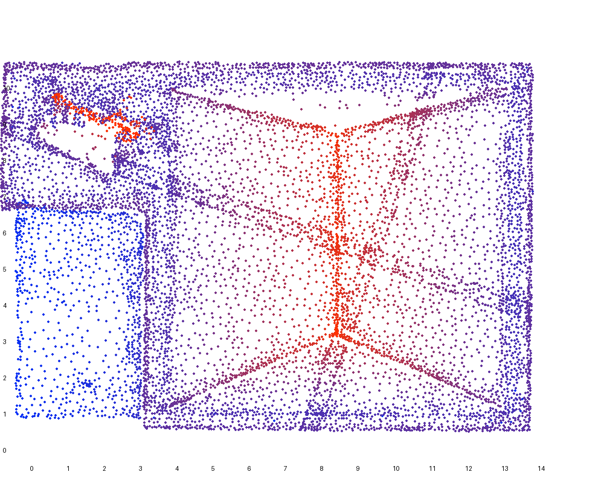
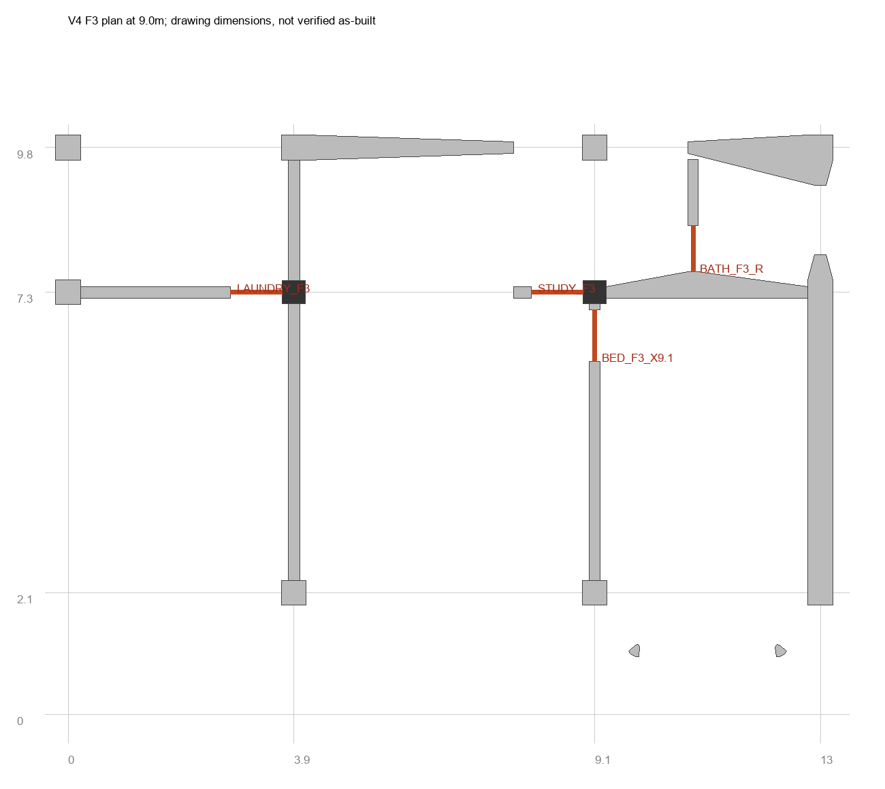
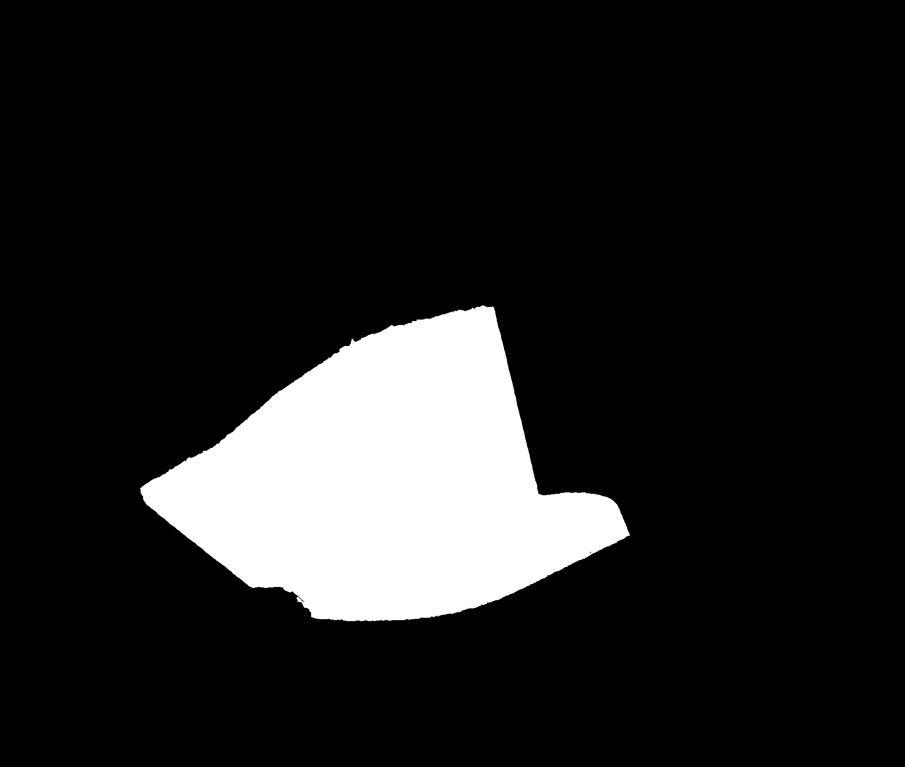
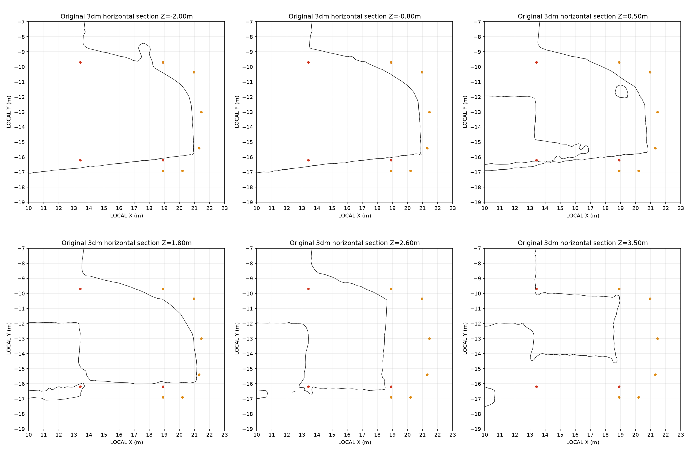
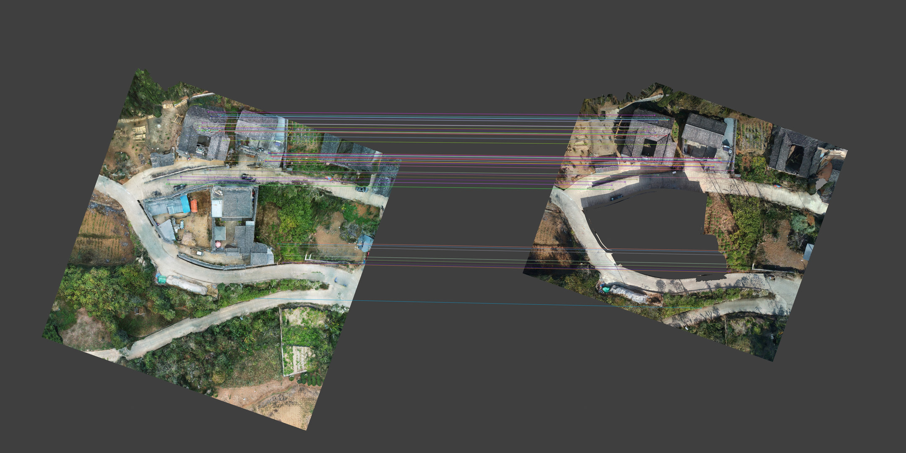
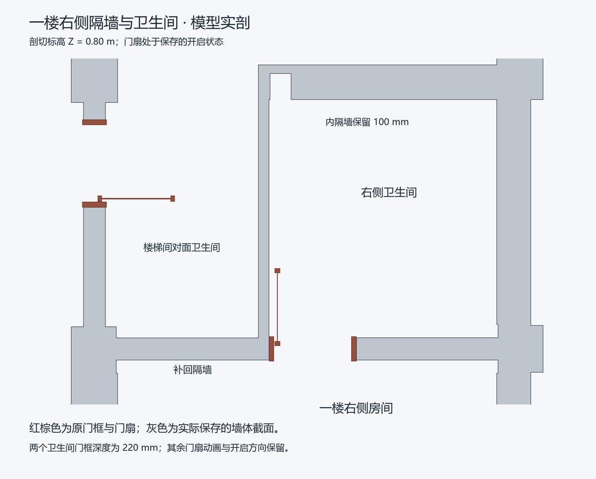
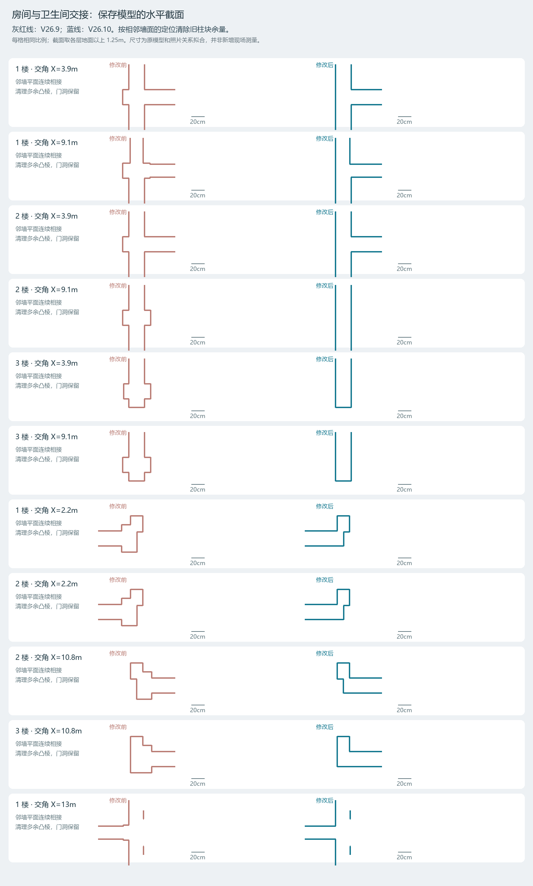

# 按迭代复查研究图是怎样实现的

[方法原理与误差定义](methodology.md) · [82 版完整过程索引](process-coverage.md)

这些案例按模型演进排列。每一节从原输入、计算步骤和图的读法接到实际改动，列出保存数据与核验。`JIA` 和 `work/` 指“整理建筑重建资料”的交付及历史工作目录。`Twin_Preparation` 指“准备数学孪生智慧家庭模型”的工作目录。 [逐版方法总表](README.md) · [单张图和写图脚本索引](figure-sources.md)

## V1 从倾斜摄影三角面找轴网和屋面

`work/register_reality.py` 读 CC 的 OBJ 三角面。对三个顶点 `a, b, c` 求 `p = (a+b+c)/3`，法线用 `(b−a) × (c−a)` 归一化，面积取叉积长度的一半。把 `points`、`normals` 和 `areas` 一一对应写入 `Reality_Geometry.npz`。在主楼范围找近竖直面的法线方向，按 90° 折叠、0.1° 分箱，以三角面积加权找峰。把样本转入局部坐标后，沿两轴的面位置峰与图纸轴网交叉核对。

`work/roof_diagnostics.py` 用坐标和法线选上部屋面，在局部 XY 图上把 Z 映射成颜色。各主要坡面从选定范围做面积加权的 `z = ax + by + c` 拟合，每轮剔除较大的残差，再从相近 Y 带的高点核对屋脊。输出用来确定 V1 的屋面几何和后续 V2 四坡、平屋面区的修订。面积和角度来自 CC 三角面。复查入口为 `Rebuild/05_Intermediate/Reality_Geometry.npz`、`Registration_ROI.npz` 和 `Rebuild/09_Report/Coordinate_System_Report.md`。

## V5 用双鱼眼抽帧判断楼层、门位和连通

`work/v5_video_plan/extract_views.py` 按指定秒点取 `0:v:0`、`0:v:1` 两路视频，FFmpeg `v360` 将 180° 鱼眼变为 110° 透视，重点转角再加偏航 ±40°。记录 `(秒数, 镜头, 偏航, 文件)`，以每页最多 16 图排联系表。本轮补 56 张，原资料另有既存抽帧。连续跟随进门、回望和下楼，用同现的门、栏杆与露台辨认楼层。

例如 212–237 秒先经过浅木门进入中心房，再从平台转向红木门进入另一房间，据此把两道门建成两个独立开口。下图是用于对照的 V4 三层基线。按设计外壳定候选坐标，再让 `build_scene_v5.py` 更新墙洞、框和活动扇。原图通过 `View_Index.json` 反查，推断与已确认连通分别写在 `Rebuild_V5/12_Video_Layout_Evidence/Video_Plan_Analysis.md`。影像提供空间关系，门洞尺度沿用设计或留待测量。 [抽帧联系表 P97E2C60E](../process/rebuild-01.md)

## V6 用孔洞掩码把室内补建接入原实景

`prepare_v6_base.py` 分开保存五块原网格的顶点、面、UV 和法线。把主空洞投影成带外环与内孔的平面多边形，检查相对 V5 的落位。`build_v6_patch.py` 用该多边形裁出补建体在孔洞内的部分。`stitch_v6_rim.py` 只在孔洞侧建立边沿过渡，用相邻原三角面检查贴合及照片 UV。这样可以在保存报告里分别检查原网格与修补网格。

栅格掩码用于观察覆盖与切边，最终裁切以 `Rebuild_V6_Hybrid/02_Data/Hole_Polygon.json` 的多边形为准。重读融合版的原网格与 UV，另存与之对齐的可编辑实体副本。V7–V11 沿用这套边界关系，对墙门、飞檐和厨储接口逐轮修补。 [早期各版实现](v01-v23.md)

## V18 把实景斜面做成可贴用的石材

`Rebuild_V18/08_Editable_Source/V18_Scripts/v18_design.py` 在照片里给毛石、深色条石、栏板分别选四个角，通过透视四边形采样展开成平面。例如毛石输出 1024 × 768，用周期分解压低相对边缘的亮度跳变，再用灰度和对比度生成微凹凸图。条石与石栏使用各自样本。原参考、颜色、微凹凸及模型应用分别可查。粗糙度、凹凸量和石基几何按外观及原模型数据设定。 [实景取样到材质的四图对照](../codex-methods.md#从实景取样到可用材质)

## V24.10 从实景三角面量挡墙外沿和两坡屋面

先把选定实景 3dm 按已存 ENU 到 LOCAL 变换放到模型坐标，用 Z=−0.8 m 水平截面提取挡墙连续外轮廓。`v24_10_fit.py` 对两坡分开筛选，法线朝上且沿 Y 相反，按三角面积拟合 `z = ax + by + c`，再用 15 轮残差筛选更新两平面。把两平面交线用于读屋脊，另在入口、檐廊与室内用 0.05 m 高度箱统计水平面主标高。南北坡在实景网格上的加权残差约 17 mm 和 16 mm。

`v24_10_sections.py` 将截面变成能比较的曲线。结合全景确认小入口、檐廊和储藏房连通后，再将结果交给地块、屋面和门扇改模。保存后在入口、檐廊、储藏门和东端通道的四个净空盒做实体相交。实现与证据位于 `Rebuild_V24_10/Source/` 和 `Reports/V24_10_Resolved_Issues.md`。地块轮廓也成为 V26.20 地坪限域的输入。

## V24.16 与 V24.22 用剖切区分墙身、盖瓦和饰面

V24.16 `v24_16_analyse.py` 在墙身 Z=1.0 m 取两侧轮廓并求中点，以此找原墙缓弯。旧直线瓦顶与中线最大偏离约 0.305 m。沿新中线建底座、叠涩和瓦顶，保存重读后用 459 处截面复查，报告的最大偏差为 0.17 mm。这是保存网格相对既有墙线的对中误差。 [照壁对中截面原图](../process/media/focus/v24-16-wall-centerline.jpg)

V24.22 `work/v24_22_analyze.py` 读取六组原墙体，把几何在 Z=1.0、2.35、3.0 m 直接切成 XY 轮廓。要取定 Y 的 XZ 截面，先绕 X 轴转 −90°，再在旋转后的 `Z=−Y` 切片。把各对象轮廓写入 `Wall_Contours_Before.json`，由 `v24_22_plot.py` 用对象顺序分色，所有图使用固定比例。近邻剖面帮助辨别墙芯、旧山墙补片和白灰饰面，再依据 `V24_22_Changes.json` 与 `V24_22_Solid_QA.json` 查看替换了哪些实体及保存结果。 [水平剖切](../process/media/focus/v24-22-z-sections.png) · [纵向剖切](../process/media/focus/v24-22-y-sections.png)

## V24.34 与 V24.36 用正射匹配和高程图补外景与路线

V24.34 先用 CC 坐标种子制作等尺度正射图。`v24_34_match.py` 用 SIFT 找特征，近邻比值取 0.90，再以 4 像素重投影阈值做 RANSAC。`v24_34_landmarks.py` 将成对图点映回局部 XY，在新旧三角面 BVH 上沿 Z 向下发射射线，保留都有命中且法线 Z 绝对值超过 0.4 的地物点对。

`v24_34_register.py` 用 SVD 求三维相似变换，按 0.40 m 门限找同名点内点，再固定尺度做刚性点到面 ICP。报告记录 71 个同名内点、RMS 约 0.132 m，最后一轮的点到面 RMS 约 0.153 m。两个误差分属不同数据与度量。将新叶节点与既有覆盖求差，重三角化被切开的边并插值原 UV，用交界高程和漫游碰撞继续核对。 [V24.34 与 V24.36 逐版记录](v24-22-v25.md)

V24.36 在 PTJIA6 配准后，把地面采样的 XYZ 点叠到等尺度正射图，红叉标记待查路点。`v24_36_plan_walkable_routes.py` 先在邻接网格上过滤过陡的边，再让人物胶囊以约 0.09 m 步进试走，满足落地、净空与高程接续才把边加入路线。图和最终路线分别保存。 [道路诊断图](../process/media/focus/v24-36-road-grid.webp)

## V26.3 与 V26.10 对保存网格量房间和墙角

V26.3 用平面和保存模型剖面定位一楼卫生间隔墙、原门洞和门上亮。剖面与改前平面分开读，相关变更和保存核验可在 `Rebuild_V26_3/Reports/` 回查。

V26.10 `v26_10_specific_qa.py` 从 V26.9 与 V26.10 保存模型读取墙角轮廓，把截面和邻墙平面采样写为 JSON。`v26_10_plot_sections.py` 对每楼取地面以上 1.25 m，前后图统一为每米 190 像素，灰红为旧版，蓝色为新版。图检查墙角余量去除和相邻墙面接续，原门洞另读几何与净空。图源 `Rebuild_V26_10/Reports/Wall_Sections_Before_After.png`。

## V26.20 用足迹裁切保护相连的厨房

地面是储藏房与厨房共用的一件连续网格。`v26_20_prepare_floor.py` 取 V24.10 的 `AsBuilt_Plan.json` 外轮廓，以厨房东边界裁出储藏房和廊道足迹。只在 `−0.40 ≤ Z ≤ −0.25 m` 挤出并合并新体，入口只留一道 150 mm 台阶。新增顶面用世界 XY 纹理，入口竖面用实尺 Y/Z 投影，其他同平面的外露侧面从最近匹配的原三角面按重心坐标继承 UV。

门扇沿原铰链保留动作，几何修改限于底沿。保存后用 161 个入口采样点检查高差，两扇门各取 1–40 帧检查底沿净空，厨房保护区另比对标高和材质。 [同机位修改前后](../media/reconstruction/v26-20.jpg) · [保存后的 Fast 视口](../process/media/focus/v26-20-blender-viewport.jpg)

## UE5 从原始坐标样本到凉亭诊断，再到受控发布

2026-10-27 的凉亭修订复用了 V1 的三角面样本和 V23 的坐标矩阵。流程依次为局部 ROI 散点、带色三角面和分坡拟合、按确认边界改平台、栏杆浮雕射线、Blender 和 UE 保存读回。附件这张图的代码和原数据复算结果已经单列。 [凉亭散点图逐步复算](pavilion.md) · [UE5 全部迭代实现](smart-home.md)

## UE5 从气象输入到可比较的风场图

`WindAnalysis/Scripts/analyze_weather.py` 读 EPW 小时来风，按 16 个 22.5° 扇区分组，低于 0.5 m/s 的样本单独统计。全年、夏季、冬季各取最多小时的扇区及其平均速度，再加全年主导扇区的 P95。`prepare_cases.py` 将气象来向变为模型中的流向向量，据此设置入口；几何闭合、网格及 OpenFOAM 残差核验各自留报告。原始气象是典型年，边界参考高度和粗糙度采用项目建模设置。

`SliceRefinement/build_slice.py` 在指定平面采样速度，并用占用网格把固体区域屏蔽。看不同开闭状态时，选同来流、同模型高度和同色标，在关闭、厨房四窗双门开启、全场地门窗全开三套几何上各自求解。图例固定后，变化才可按同一颜色量级阅读。三向面板把水平 Z、纵向 X、横向 Y 的位置、切片和迹线独立绑定，另存隔离 PIE 与安装核验。 [同条件三工况图](../../case-studies/media/reconstruction-to-smart-home/cfd-opening-comparison.png) · [三向面板核验图](../../case-studies/media/reconstruction-to-smart-home/ue-three-slice-panel.png)
