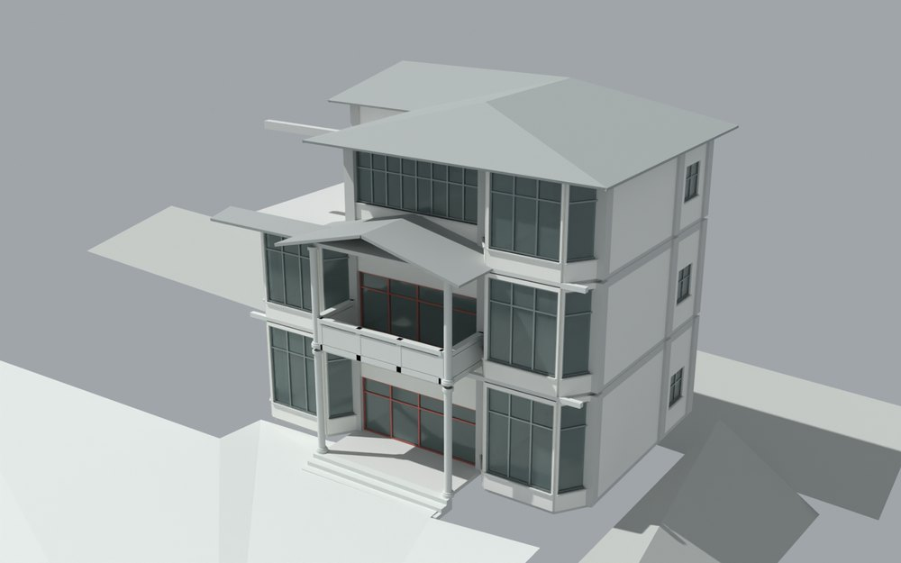
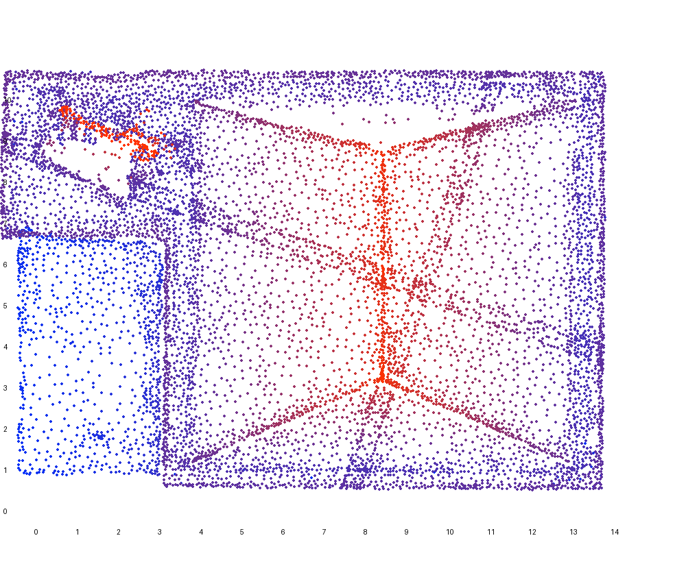

# V1 · 从图纸轴网、全景和航测三角面建立建筑基准

[逐版目录](README.md) · [建筑重建台账](../../reconstruction.md) · [阶段方法汇总](../v01-v23.md)

## 摘要

建立可编辑的 Rhino 与 SketchUp 建筑基线。对照整理后的图纸、全景抽帧与 ContextCapture，分别保存 ARCH、VIS 和交换格式。

## 1. 问题与输入

首版把有尺度的设计图、室内可见关系和有孔洞的室外摄影测量网格放在同一参考框架内。墙、柱、楼板采用可编辑的米制几何，实景三角网格作为独立叠合参考。

## 2. 实现方法

1. 对每个非退化 OBJ 三角形求重心、叉积单位法线和面积，用面积加权方向直方图确定主要立面轴向。将墙体和屋面样本变换到局部坐标。

2. 由整理后的图纸恢复轴网、层高和开间，再根据全景帧核对门窗及楼梯关系。图纸与可见现状冲突的位置记入差异和不确定项。

3. 按局部高度和法线筛选候选屋面，按坡面分组后做面积加权平面拟合。由同一场景定义导出 ARCH 和增加 16 件细节的 VIS，再分别回读原生与交换文件。

设三角面顶点为 a、b、c。重心为 (a+b+c)/3，面积为 ‖(b−a) × (c−a)‖/2。方向统计用面积加权，避免细分较密的局部单靠面数主导方向。屋面模型与摄影测量数据对齐后，比较每个样本到拟合平面的距离分布。

### 实现链与源码定位

以下按诊断、处理、保存与复核组织阅读。调用和文件引用来自原脚本，输入输出方向由对应读写调用判断；辅助文件是否在本轮运行，以报告为准。

**1. 定位与诊断** · [`register_reality.py`](../source-code/v1/history/register_reality.py#L18)

叉积／面法线 [`np.cross`](../source-code/v1/history/register_reality.py#L18)。

文件引用：[`Reality_Geometry.npz`](../source-code/v1/history/register_reality.py#L20) · [`Registration_ROI.npz`](../source-code/v1/history/register_reality.py#L33)。

**2. 定位与诊断** · [`roof_diagnostics.py`](../source-code/v1/project/05_Intermediate/Scripts/roof_diagnostics.py#L22)

最小二乘求解 [`np.linalg.lstsq`](../source-code/v1/project/05_Intermediate/Scripts/roof_diagnostics.py#L22)。

文件引用：[`Reality_Geometry.npz`](../source-code/v1/project/05_Intermediate/Scripts/roof_diagnostics.py#L6) · [`Architecture_Scene.json`](../source-code/v1/project/05_Intermediate/Scripts/roof_diagnostics.py#L6) · [`Roof_Local_Height.png`](../source-code/v1/project/05_Intermediate/Scripts/roof_diagnostics.py#L12)。

**3. 构建或写入** · [`build_scene.py`](../source-code/v1/project/05_Intermediate/Scripts/build_scene.py#L200)

叉积／面法线 [`np.cross`](../source-code/v1/project/05_Intermediate/Scripts/build_scene.py#L200)。

文件引用：[`Reality_Geometry.npz`](../source-code/v1/project/05_Intermediate/Scripts/build_scene.py#L233) · [`Architecture_Scene.json`](../source-code/v1/project/05_Intermediate/Scripts/build_scene.py#L270) · [`Element_Register.csv`](../source-code/v1/project/05_Intermediate/Scripts/build_scene.py#L271)。

该附件为站点坐标脱敏副本，恢复私有常量后方可执行；行号对应公开文件。

**4. 构建或写入** · [`export_models.py`](../source-code/v1/project/05_Intermediate/Scripts/export_models.py#L10)

叉积／面法线 [`np.cross`](../source-code/v1/project/05_Intermediate/Scripts/export_models.py#L10)；图像或几何变换 [`ex.Transform`](../source-code/v1/project/05_Intermediate/Scripts/export_models.py#L63)；Rhino 原生读写 [`rh.File3dm.Read`](../source-code/v1/project/05_Intermediate/Scripts/export_models.py#L127)。

文件引用：[`Architecture_Scene.json`](../source-code/v1/project/05_Intermediate/Scripts/export_models.py#L6) · [`Production_1QK_Local_REFERENCE.3dm`](../source-code/v1/project/05_Intermediate/Scripts/export_models.py#L123) · [`Native_Model_QA.json`](../source-code/v1/project/05_Intermediate/Scripts/export_models.py#L208)。

**5. 辅助实现** · [`skp_api.py`](../source-code/v1/project/05_Intermediate/Scripts/skp_api.py#L45)

判据与回归检查 [`ck`](../source-code/v1/project/05_Intermediate/Scripts/skp_api.py#L30)；图像或几何变换 [`Transform`](../source-code/v1/project/05_Intermediate/Scripts/skp_api.py#L45)。

**6. 保存后核验** · [`check_geometry.py`](../source-code/v1/project/05_Intermediate/Scripts/check_geometry.py#L14)

叉积／面法线 [`np.cross`](../source-code/v1/project/05_Intermediate/Scripts/check_geometry.py#L14)；Rhino 原生读写 [`rh.File3dm.Read`](../source-code/v1/project/05_Intermediate/Scripts/check_geometry.py#L29)。

文件引用：[`Solid_Geometry_QA.csv`](../source-code/v1/project/05_Intermediate/Scripts/check_geometry.py#L23) · [`Reality_Geometry.npz`](../source-code/v1/project/05_Intermediate/Scripts/check_geometry.py#L33) · [`Source_Inventory.csv`](../source-code/v1/project/05_Intermediate/Scripts/check_geometry.py#L41)。

**7. 保存后核验** · [`check_exchange.py`](../source-code/v1/project/05_Intermediate/Scripts/check_exchange.py#L21)

文件引用：[`Exchange_Readback_QA.json`](../source-code/v1/project/05_Intermediate/Scripts/check_exchange.py#L21)。

[方法原理：三角面采样、坐标与拟合](../methodology.md#2-坐标采样与拟合的数学含义) · [本版完整过程索引](process/v1.md)

本版索引汇合 5 幅已归档过程图、20 份交付及历史目录中的报告／说明／中间记录和全部 9 个源码附件。继承文件和本轮新增文件按来源保留，实际完成范围以第 4 节及原报告为准。

## 3. 过程图

**图 1** · 首版住宅正面

**图 2** · 首版摄影测量三角面样本在建筑局部系中的屋面高度分布

## 4. 验证与适用范围

几何报告对 8,136 个屋面比较样本给出点到平面距离 P90 约 0.478 m。这个量反映摄影样本与简化屋面的差异。首版交付定位为可审查的资料驱动模型，报告将现状精度和 LOD300 验收留为待核项。

- **几何核验** 
  屋面比较样本数 8,136，屋面点到平面距离 P90（m） 0.478092。

- **Native Model QA** 
  记录本轮参数、对象和处理结果。

- **Exchange Readback QA** 
  记录本轮参数、对象和处理结果。

## 5. 复现入口与出处

过程路径以本地 `JIA` 项目为根，`work/` 指重建项目的历史工作目录。复核时按交付记录打开本轮输入与保存成果，再依方法中的截面、对象或动作采样对照原报告。

交付与参考记录（3 项）

~~~text
Rebuild/09_Report/Model_Report.md
Rebuild/09_Report/Drawing_vs_Reality_Report.md
Rebuild/09_Report/Uncertainty_Log.csv
~~~

### 原实现脚本附件

[浏览本版全部 9 个文件](../source-code/v1/README.md) · [原件与公开副本校验值](../source-code/v1/manifest.json)

- [`register_reality.py`](../source-code/v1/history/register_reality.py)
- [`roof_diagnostics.py`](../source-code/v1/project/05_Intermediate/Scripts/roof_diagnostics.py)
- [`build_scene.py`](../source-code/v1/project/05_Intermediate/Scripts/build_scene.py) · 站点坐标脱敏
- [`check_geometry.py`](../source-code/v1/project/05_Intermediate/Scripts/check_geometry.py)
- [`skp_api.py`](../source-code/v1/project/05_Intermediate/Scripts/skp_api.py)

本版 1 个文件含站点坐标，公开副本已标记脱敏位置并阻断直接执行，原字节保留在本机。其余附件与原件逐字节一致。

原脚本本地路径

~~~text
work/register_reality.py
Rebuild/05_Intermediate/Scripts/roof_diagnostics.py
Rebuild/05_Intermediate/Scripts/build_scene.py
Rebuild/05_Intermediate/Scripts/check_geometry.py
Rebuild/05_Intermediate/Scripts/skp_api.py
~~~

核验报告路径（3 项）

**几何核验**

~~~text
Rebuild/09_Report/Geometry_QA.json
~~~

**Native Model QA**

~~~text
Rebuild/09_Report/Native_Model_QA.json
~~~

**Exchange Readback QA**

~~~text
Rebuild/09_Report/Exchange_Readback_QA.json
~~~

图源与 SHA-256（2 张）

### 图 1 · 首版住宅正面

~~~text
Rebuild/09_Report/VIS_CAM_02_Front.png
~~~

**原过程图 SHA-256**

~~~text
49402142a8e08dab6ef3ced7be3bfa45da8d9c949263bdd18ceab2a1582b6571
~~~

台账发布图，按原图缩放及压缩。

### 图 2 · 首版摄影测量三角面样本在建筑局部系中的屋面高度分布

~~~text
work/Roof_Local_Height.png
~~~

**原过程图 SHA-256**

~~~text
0d746ece549a073497d73aa5bfd3c96c8817ab678e507cf6c00dec1dd5cdeb33
~~~

原文件。

---

下一篇 [V2 · 连续楼板、分层墙和四坡屋面的几何重建](v2.md)
