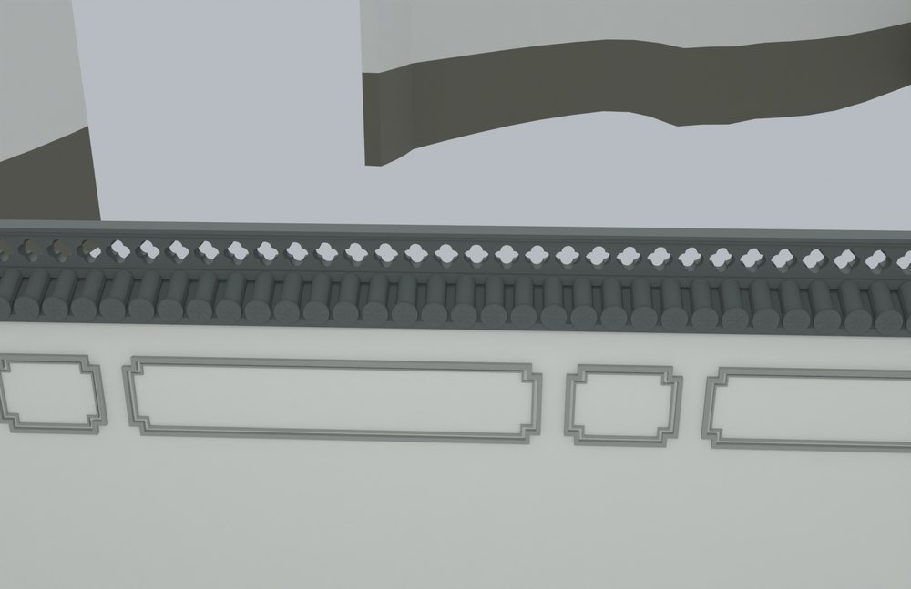
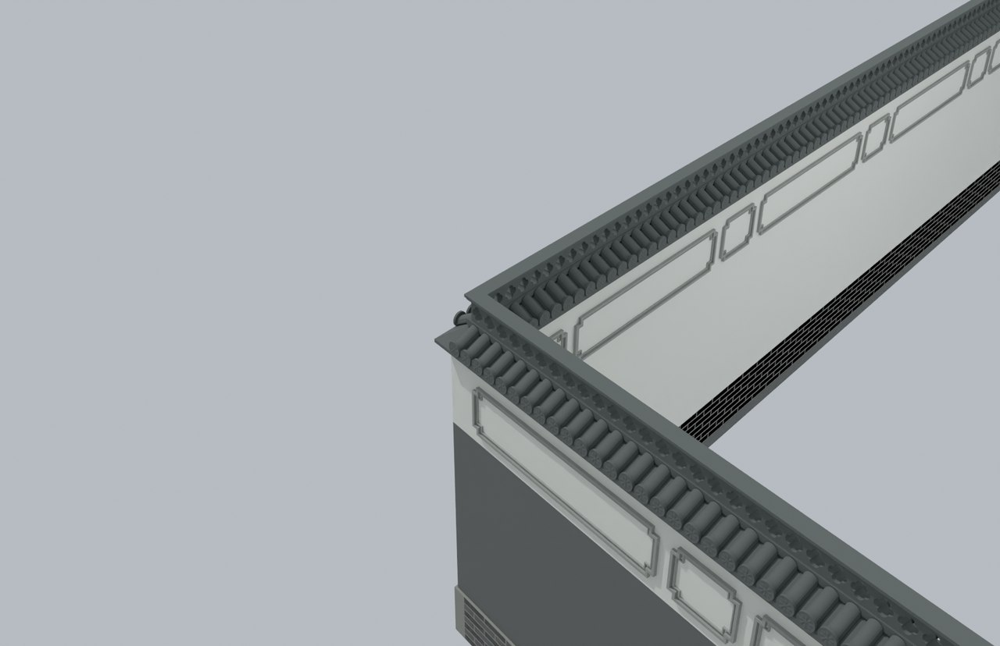

# V10 · 按真实墙线和开口深化砖、瓦与透空花脊

[逐版目录](README.md) · [建筑重建台账](../../reconstruction.md) · [阶段方法汇总](../v01-v23.md) · [上一篇 V9](v9.md) · [下一篇 V11](v11.md)

## 摘要

按围墙大样与现场照片深化砖、瓦、瓦当、线脚和花砖。交付独立院墙、可编辑建筑和实景融合三份模型。

## 1. 问题与输入

围墙大样提供纹样和层次，现场照片确定哪些墙段确有对应做法。继承原墙线、门洞和挡土基座，分别处理院内瓦墙、外围墙和照壁。

## 2. 实现方法

1. 按墙段长度、朝向和开口分类，延用现有石基与墙芯。墙身与砖饰采用 Brep 或挤出，密集瓦件与镂空花砖采用闭合网格。
2. 砖、瓦当、线脚和冠顶分件，墙角按角平分线裁接。在厨房砌体交接处终止门楼侧冠顶，防止进入山墙和屋面。
3. 分别输出院墙独立文件、完整可编辑建筑和融合模型。用实孔探针与部件闭合检查识别纹样画出来但实际未开孔的情况。

## 3. 过程图

*图 1 · 院墙砖瓦与线脚。过程文件 `Rebuild_V10_Hybrid/06_Report/V10_Wall_Detail.png`。*

*图 2 · V10 转角砖瓦、线脚和镂空花砖拼接。过程文件 `Rebuild_V10_Hybrid/06_Report/V10_Courtyard_Corner.png`。*

## 4. 验证与适用范围

院墙终检覆盖 6,917 个新部件，记录 919 次实际孔洞探查，并列出厨房交接与花冠交叉检查。外周冠顶仍按参考造型暂定，大样的典型尺寸与本地已保留开口分别登记。

| 过程报告 | 原报告读数 |
| --- | --- |
| `Rebuild_V10_Hybrid/07_Evidence/v10_wall_audit/Final_Wall_Geometry_QA.json` | 状态 `PASS`，检查条目 60，核验的新部件 6,917。 |
| `Rebuild_V10_Hybrid/06_Report/Native_Hybrid_QA.json` | 无效对象记录 0，实景底网格 5。 |

### 原记录中的关键检查

| 检查项 | 结果与读数 | 原记录位置 |
| --- | --- | --- |
| all_actual_registered_holes_clear_other_new_layers_and_retained_pier_gate_kitchen_cores | 通过，`actual_holes_tested=919`，`failed_hole_count=0` | `Final_Wall_Geometry_QA.json` 的 `checks[53]` |
| floral_aperture_is_true_through_hole_SITE_COURTYARD_WEST_TILE_WALL_V10_OPEN_FLOWER_BRICKS | 通过，`through_depth_m=0.068`，`maximum_blockage_volume_m3=0` | `Final_Wall_Geometry_QA.json` 的 `checks[44]` |
| all_new_detail_parts_closed_positive_finite | 通过，`parts_checked=6917` | `Final_Wall_Geometry_QA.json` 的 `checks[42]` |

## 5. 复现入口与出处

过程路径以本地 `JIA` 项目为根，`work/` 指重建项目的历史工作目录。复核时按交付记录打开本轮输入与保存成果，再依方法中的截面、对象或动作采样对照原报告。

- **交付与参考记录**。`Rebuild_V10_Hybrid/使用说明.md`

- **原实现脚本**。`work/v10_wall_audit_faces.py` · `work/v10_wall_audit_openings.py` · `work/export_v10_changed_cad.py` · `Rebuild_V10_Hybrid/07_Evidence/v10_courtyard_wall/mutation.py` · `Rebuild_V10_Hybrid/07_Evidence/v10_wall_audit/extend_audit.py`

过程图校验值

| 图 | 原过程图 SHA-256 | 发布方式 |
| --- | --- | --- |
| 1 | `43b81c469b282fd28792d685f62219f16d918e28234cdae78b6d4d649b259f4d` | 台账发布图，按原图缩放及压缩 |
| 2 | `081d64559a1b87187b7c1ba4b5727b13ed4afc63ce8a5da4abbaf391438491c8` | 保留原画面，发布用 JPEG |

