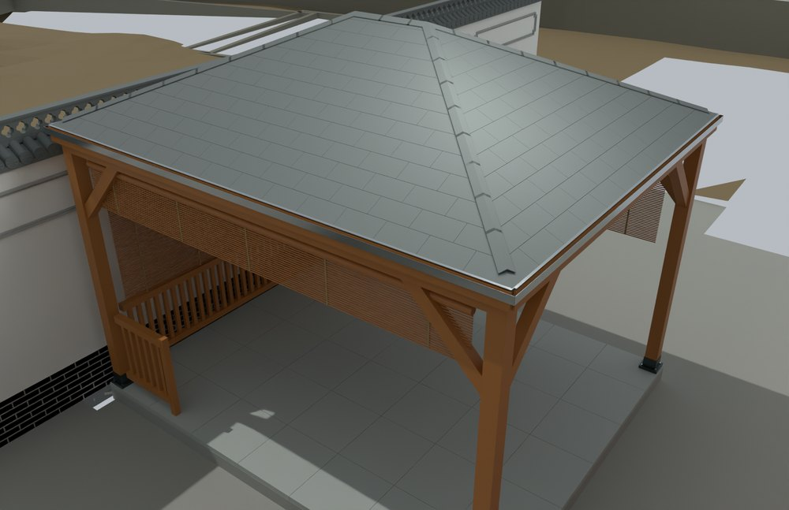
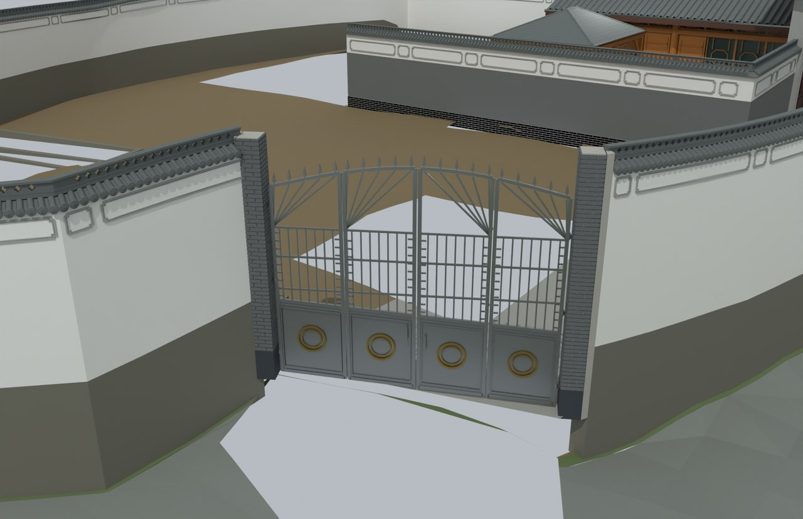

# V11 · 四坡木亭、直角院墙与四扇外围门

[逐版目录](README.md) · [建筑重建台账](../../reconstruction.md) · [阶段方法汇总](../v01-v23.md)

## 摘要

亭旁院墙改直角，新增四坡木亭分件和外门分格，补厨房外壁与外围门墙，保留独立门叶和铰轴信息。

## 1. 问题与输入

V10 的墙线与构件体系用于处理亭旁斜折、旧亭跨墙和外门开口。亭子外观使用指定参考，外门分格从实景与全景判断。

## 2. 实现方法

1. 由实景样本的兴趣区提取墙顶和开口剖面。以 90° 重建亭旁墙芯、瓦帽和花砖拼角，逐侧检查亭子与内侧墙帽的净距。

2. 亭子按 4.2 × 3.5 m 参考轮廓建木梁柱、四坡椽檩、内衬、防水面、瓦片、天沟和栏杆。圈梁分方向端接，斜撑止于柱侧或梁底。

3. 外门依据全景约 897 s 的四分格构造建立固定框和四扇独立门叶。融合版内按有效缺失范围补厨房外壁及外围墙，完整构件可在独立周边模型读回。

## 3. 过程图

**图 1** · 四坡木亭及围护

**图 2** · V11 西南外门及四分格门叶

## 4. 验证与适用范围

亭子几何报告记录 908 个闭合分件，其中沥青瓦 440 片，亭子至西墙压顶最小模型净距 105 mm。亭尺寸和木构样式为参考方案，外门分格有视频依据。

- **几何核验** 
  状态 `PASS`，检查条目 1,822，至西墙压顶净距（m） 0.105。

- **Native Hybrid QA** 
  无效对象记录 0，实景底网格 5。

### 原记录中的关键检查

- **all_pavilion_inside_west_wall** 
  通过，`minimum_x_m` = `0.325`，`wall_coping_interior_limit_m` = `0.22` 
  原记录 `Geometry_QA.json` 的 `checks[1816]`

- **all_pavilion_inside_south_return** 
  通过，`minimum_y_m` = `-7.135` 
  原记录 `Geometry_QA.json` 的 `checks[1817]`

- **SITE_GAZEBO_POSTS__0 closed** 
  通过，`volume_m3` = `0.0338791` 
  原记录 `Geometry_QA.json` 的 `checks[0]`

## 5. 复现入口与出处

过程路径以本地 `JIA` 项目为根，`work/` 指重建项目的历史工作目录。复核时按交付记录打开本轮输入与保存成果，再依方法中的截面、对象或动作采样对照原报告。

交付与参考记录（1 项）

~~~text
Rebuild_V11_Hybrid/使用说明.md
~~~

原实现脚本（5 项）

~~~text
Rebuild_V11_Hybrid/07_Evidence/v11_outer_gate/scan_levels.py
Rebuild_V11_Hybrid/07_Evidence/v11_outer_gate/profile_gate.py
Rebuild_V11_Hybrid/07_Evidence/v11_pavilion/build_pavilion.py
Rebuild_V11_Hybrid/07_Evidence/v11_ground_gap/prepare.py
Rebuild_V11_Hybrid/07_Evidence/v11_outer_gate/mutation.py
~~~

核验报告路径（2 项）

**几何核验**

~~~text
Rebuild_V11_Hybrid/07_Evidence/v11_pavilion/Geometry_QA.json
~~~

**Native Hybrid QA**

~~~text
Rebuild_V11_Hybrid/06_Report/Native_Hybrid_QA.json
~~~

图源与 SHA-256（2 张）

### 图 1 · 四坡木亭及围护

~~~text
Rebuild_V11_Hybrid/06_Report/V11_Pavilion.png
~~~

**原过程图 SHA-256**

~~~text
466d81f21b6861b7778dc836a806f440d0623d5896436e43bc2ea4b57f5000c8
~~~

台账发布图，按原图缩放及压缩。

### 图 2 · V11 西南外门及四分格门叶

~~~text
Rebuild_V11_Hybrid/06_Report/V11_Outer_Gate.png
~~~

**原过程图 SHA-256**

~~~text
b4c224a9c6434981f7383793f53eb2a9affa527df32622bfe82258e01f050427
~~~

保留原画面，发布用 JPEG。

---

上一篇 [V10 · 按真实墙线和开口深化砖、瓦与透空花脊](v10.md) 
下一篇 [V12 · 全建模场地与木构厨房的原生交付](v12.md)
