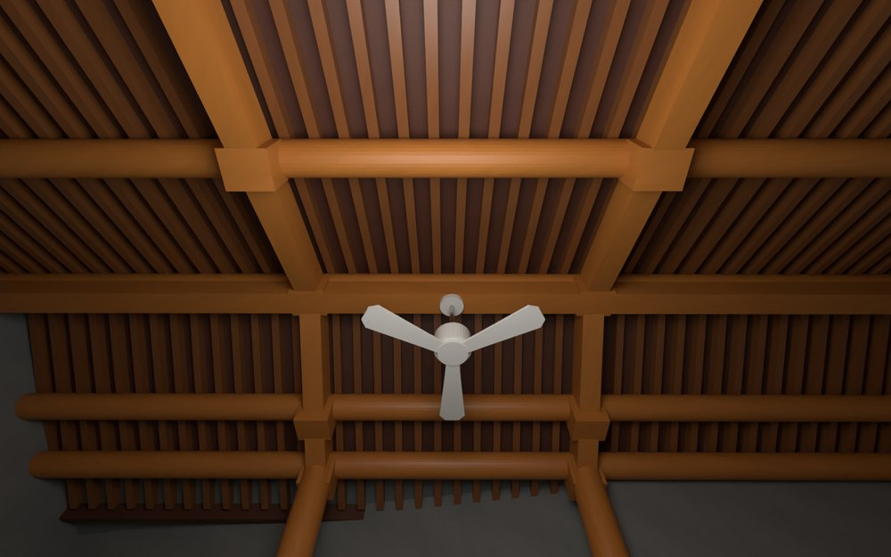
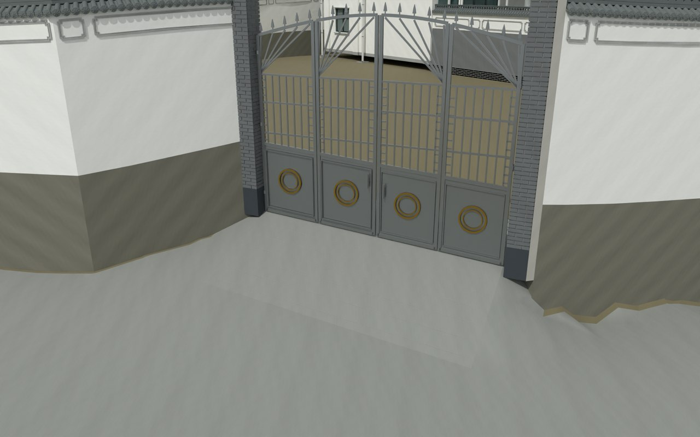

# V12 · 全建模场地与木构厨房的原生交付

[逐版目录](README.md) · [建筑重建台账](../../reconstruction.md) · [阶段方法汇总](../v01-v23.md)

## 摘要

建立全建模场地，完善入口坡面及地坪衔接。深化厨房格心、木架、吊扇和灯具，补照壁翘脊及瓦当。

## 1. 问题与输入

以既有厨房木构和原场地形态为参照，组合可编辑厨房与完整重建地形。视频提供格扇和梁檩构成，旧地形与坡道控制连续地坪。

## 2. 实现方法

1. 由全景和近景判定回纹、双八角格心、上下格带和露明梁椽。清理共面窗棂，分离门框、活动扇、吊扇和灯具，逐柱核对石础与接触位置。

2. 以新闭合网格建约 7,120 m² 场地，保留约 13.8 m 高差。地面分区共享边标高统一，在外门压槽坡坪、主楼台阶和亭台处处理接路。

3. 把模型、贴图和材料保存于米制 Rhino 文件，分别回读主文件与交换格式的包围盒、部件和嵌入资源。

### 实现链与源码定位

以下按诊断、处理、保存与复核组织阅读。调用和文件引用来自原脚本，输入输出方向由对应读写调用判断；辅助文件是否在本轮运行，以报告为准。

**1. 定位与诊断** · [`audit_seams.py`](../source-code/v12/project/07_Reference/v12_terrain/audit_seams.py#L12)

叉积／面法线 [`np.cross`](../source-code/v12/project/07_Reference/v12_terrain/audit_seams.py#L12)。

文件引用：[`Terrain_Domain.json`](../source-code/v12/project/07_Reference/v12_terrain/audit_seams.py#L6) · [`Mutation_Before_Seam_Repair.json`](../source-code/v12/project/07_Reference/v12_terrain/audit_seams.py#L40) · [`Mutation.json`](../source-code/v12/project/07_Reference/v12_terrain/audit_seams.py#L41)。

**2. 构建或写入** · [`export_v5.py`](../source-code/v12/project/08_Editable_Source/Build_Scripts/export_v5.py#L12)

叉积／面法线 [`np.cross`](../source-code/v12/project/08_Editable_Source/Build_Scripts/export_v5.py#L12)；图像或几何变换 [`ex.Transform`](../source-code/v12/project/08_Editable_Source/Build_Scripts/export_v5.py#L67)；Rhino 原生读写 [`rh.File3dm.Read`](../source-code/v12/project/08_Editable_Source/Build_Scripts/export_v5.py#L131)。

文件引用：[`Architecture_Scene.json`](../source-code/v12/project/08_Editable_Source/Build_Scripts/export_v5.py#L8) · [`Production_1QK_Local_REFERENCE.3dm`](../source-code/v12/project/08_Editable_Source/Build_Scripts/export_v5.py#L127) · [`Native_Model_QA.json`](../source-code/v12/project/08_Editable_Source/Build_Scripts/export_v5.py#L222)。

**3. 构建或写入** · [`rebuild.py`](../source-code/v12/project/07_Reference/v12_terrain/rebuild.py#L63)

叉积／面法线 [`np.cross`](../source-code/v12/project/07_Reference/v12_terrain/rebuild.py#L63)；差集裁切 [`difference`](../source-code/v12/project/07_Reference/v12_terrain/rebuild.py#L64)；交集限域 [`intersection`](../source-code/v12/project/07_Reference/v12_terrain/rebuild.py#L64)。

文件引用：[`Coordinate.json`](../source-code/v12/project/07_Reference/v12_terrain/rebuild.py#L14) · [`Ground_Samples_Raw.npz`](../source-code/v12/project/07_Reference/v12_terrain/rebuild.py#L15) · [`V8_Measured_Ground_Support.npz`](../source-code/v12/project/07_Reference/v12_terrain/rebuild.py#L22)。

该附件为站点坐标脱敏副本，恢复私有常量后方可执行；行号对应公开文件。

**4. 辅助实现** · [`extract_v12.py`](../source-code/v12/history/v12_panorama_reference/extract_v12.py#L47)

文件引用：[`Frame_Index.json`](../source-code/v12/history/v12_panorama_reference/extract_v12.py#L55) · [`Frame_Index.csv`](../source-code/v12/history/v12_panorama_reference/extract_v12.py#L56) · [`Raw_L0_0005s.jpg`](../source-code/v12/history/v12_panorama_reference/extract_v12.py#L67)。

**5. 过程出图** · [`record_v12_visual_review.py`](../source-code/v12/project/08_Editable_Source/Build_Scripts/record_v12_visual_review.py#L5)

文件引用：[`Native_Assembly_QA.json`](../source-code/v12/project/08_Editable_Source/Build_Scripts/record_v12_visual_review.py#L6) · [`Modeled_Exchange_QA.json`](../source-code/v12/project/08_Editable_Source/Build_Scripts/record_v12_visual_review.py#L6) · [`Terrain_Seam_Continuity_QA.json`](../source-code/v12/project/08_Editable_Source/Build_Scripts/record_v12_visual_review.py#L6)。

**6. 保存后核验** · [`validate_v12_native.py`](../source-code/v12/project/08_Editable_Source/Build_Scripts/validate_v12_native.py#L16)

Rhino 原生读写 [`Rhino.FileIO.File3dm.Read`](../source-code/v12/project/08_Editable_Source/Build_Scripts/validate_v12_native.py#L16)。

文件引用：[`Architecture_Complete_V12_ALIGNED_ENU.3dm`](../source-code/v12/project/08_Editable_Source/Build_Scripts/validate_v12_native.py#L8) · [`Native_Assembly_QA.json`](../source-code/v12/project/08_Editable_Source/Build_Scripts/validate_v12_native.py#L16) · [`V12_validated_temp.3dm`](../source-code/v12/project/08_Editable_Source/Build_Scripts/validate_v12_native.py#L33)。

**7. 交付封装** · [`write_v12_delivery.py`](../source-code/v12/project/08_Editable_Source/Build_Scripts/write_v12_delivery.py#L28)

判据与回归检查 [`source_checks.append`](../source-code/v12/project/08_Editable_Source/Build_Scripts/write_v12_delivery.py#L21)；Rhino 原生读写 [`rh.File3dm.Read`](../source-code/v12/project/08_Editable_Source/Build_Scripts/write_v12_delivery.py#L28)。

文件引用：[`Native_Assembly_QA.json`](../source-code/v12/project/08_Editable_Source/Build_Scripts/write_v12_delivery.py#L12) · [`Modeled_Exchange_QA.json`](../source-code/v12/project/08_Editable_Source/Build_Scripts/write_v12_delivery.py#L12) · [`Extraction_QA.json`](../source-code/v12/project/08_Editable_Source/Build_Scripts/write_v12_delivery.py#L12)。

[方法原理：局部实体、接合与保护域](../methodology.md#4-局部改模如何限定影响范围) · [本版完整过程索引](process/v12.md)

本版索引汇合 153 幅已归档过程图、60 份交付及历史目录中的报告／说明／中间记录和全部 42 个源码附件。继承文件和本轮新增文件按来源保留，实际完成范围以第 4 节及原报告为准。

## 3. 过程图

**图 1** · 厨房木架和檩椽

**图 2** · V12 外门压槽坡坪和接路过渡

## 4. 验证与适用范围

原生装配报告记录 1,661 个有效闭合新部件、主模型内摄影测量源网格数量为 0。风扇净距是模型上的几何核查，定位尺寸来自照片拟合。

- **Native Assembly QA** 
  状态 `PASS`，无效对象记录 0，有效闭合新部件 1,661。

- **Modeled Exchange QA** 
  状态 `PASS`，报告统计的三角面 2,209,144。

- **交付核验** 
  状态 `PASS`。

## 5. 复现入口与出处

过程路径以本地 `JIA` 项目为根，`work/` 指重建项目的历史工作目录。复核时按交付记录打开本轮输入与保存成果，再依方法中的截面、对象或动作采样对照原报告。

交付与参考记录（1 项）

~~~text
Rebuild_V12/使用说明.md
~~~

### 原实现脚本附件

[浏览本版全部 42 个文件](../source-code/v12/README.md) · [原件与公开副本校验值](../source-code/v12/manifest.json)

- [`extract_v12.py`](../source-code/v12/history/v12_panorama_reference/extract_v12.py)
- [`export_v5.py`](../source-code/v12/project/08_Editable_Source/Build_Scripts/export_v5.py)
- [`validate_v12_native.py`](../source-code/v12/project/08_Editable_Source/Build_Scripts/validate_v12_native.py)
- [`rebuild.py`](../source-code/v12/project/07_Reference/v12_terrain/rebuild.py) · 站点坐标脱敏
- [`audit_seams.py`](../source-code/v12/project/07_Reference/v12_terrain/audit_seams.py)

本版 2 个文件含站点坐标，公开副本已标记脱敏位置并阻断直接执行，原字节保留在本机。其余附件与原件逐字节一致。

原脚本本地路径

~~~text
work/v12_panorama_reference/extract_v12.py
Rebuild_V12/08_Editable_Source/Build_Scripts/export_v5.py
Rebuild_V12/08_Editable_Source/Build_Scripts/validate_v12_native.py
Rebuild_V12/07_Reference/v12_terrain/rebuild.py
Rebuild_V12/07_Reference/v12_terrain/audit_seams.py
~~~

核验报告路径（3 项）

**Native Assembly QA**

~~~text
Rebuild_V12/06_Report/Native_Assembly_QA.json
~~~

**Modeled Exchange QA**

~~~text
Rebuild_V12/06_Report/Modeled_Exchange_QA.json
~~~

**交付核验**

~~~text
Rebuild_V12/06_Report/Delivery_QA_V12.json
~~~

图源与 SHA-256（2 张）

### 图 1 · 厨房木架和檩椽

~~~text
Rebuild_V12/06_Report/V12_Kitchen_Truss.png
~~~

**原过程图 SHA-256**

~~~text
81cc8b993f16a73018372b3d4ab112ab7e96a5bd30313daf8acf950b60a5f3ce
~~~

台账发布图，按原图缩放及压缩。

### 图 2 · V12 外门压槽坡坪和接路过渡

~~~text
Rebuild_V12/06_Report/V12_Entrance_Ramp.png
~~~

**原过程图 SHA-256**

~~~text
6969e521f15d3f8ce98a99b5002800fefcd83b9d48316d3bc6ce9a6447443251
~~~

保留原画面，发布用 JPEG。

---

上一篇 [V11 · 四坡木亭、直角院墙与四扇外围门](v11.md) 
下一篇 [V13 · 露台雨棚的屋面约束和原生接触复核](v13.md)
