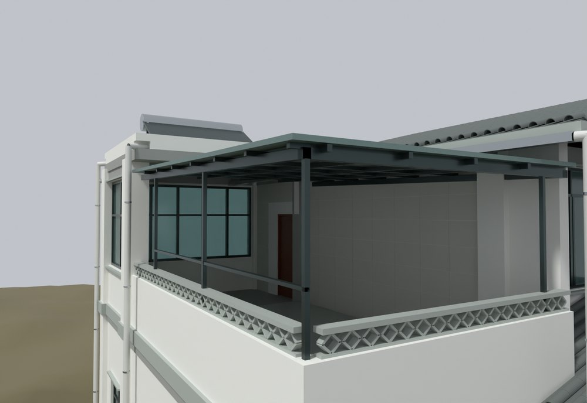
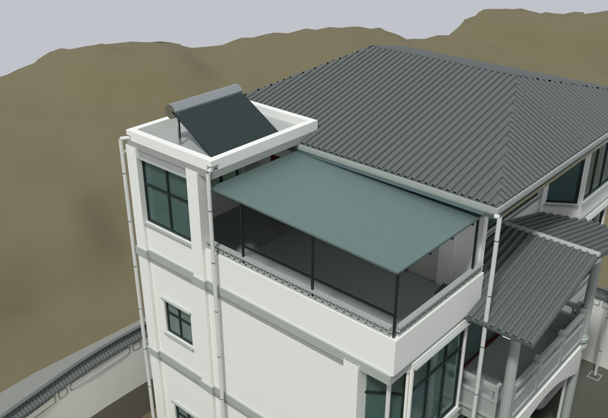

# V13 · 露台雨棚的屋面约束和原生接触复核

[逐版目录](README.md) · [建筑重建台账](../../reconstruction.md) · [阶段方法汇总](../v01-v23.md)

## 摘要

重做露台雨棚边缘、檩条、檐梁、贴墙梁及返梁，保持屋顶坡度和柱脚。原生实体接触检查通过。

## 1. 问题与输入

在 V12 上修复露台雨棚的悬空和梁端收口问题。保留原屋面高度、坡度和柱脚，以现有构件为目标支承面。

## 2. 实现方法

1. 把檩条、檐梁、贴墙梁和返梁划为独立构件，按原坡面和柱中心关系重新设定边缘。右边界局部模型值从 3.45 m 调整到 3.81 m。

2. 先按预定的柱、梁和屋盖接触对检查端部，再生成 Rhino 原生文件。用保存文件中的实际几何重新判断每条接触。

3. 对既有对象对比几何校验值，对视图网格与原生模型比较包围盒。预览从保存文件抽取。

## 3. 过程图

**图 1** · 雨棚檐梁与檩条接触

**图 2** · V13 保存模型中的露台和雨棚整体

## 4. 验证与适用范围

接触报告采用 2 mm 容差，记录 11 条雨棚接触边和 21 项检查，状态为 PASS。支座连接强度和荷载能力属于报告范围外的工程问题。

- **Native Support Contact QA** 
  状态 `PASS`，检查条目 21，雨棚接触边 11，实体接触容差（m） 0.002。

- **Canopy Connection Changes** 
  状态 `ASSEMBLED_PENDING_ACTUAL_NATIVE_CONTACT_QA`。

- **原生保存与读回** 
  状态 `PASS_ACTUAL_3DM_READBACK`。

### 原记录中的关键检查

- **cross_members_to_wall_ledger** 
  通过，`actual_native_solid_min_gap_m` = `0`，`tolerance_m` = `0.002` 
  原记录 `Native_Support_Contact_QA.json` 的 `checks[2]`

- **side_wall_ledger_contacts_backing_wall** 
  通过，`tolerance_m` = `0.002` 
  原记录 `Native_Support_Contact_QA.json` 的 `checks[11]`

- **roof_panel_on_cross_members** 
  通过，`actual_native_solid_min_gap_m` = `0`，`tolerance_m` = `0.002` 
  原记录 `Native_Support_Contact_QA.json` 的 `checks[0]`

## 5. 复现入口与出处

过程路径以本地 `JIA` 项目为根，`work/` 指重建项目的历史工作目录。复核时按交付记录打开本轮输入与保存成果，再依方法中的截面、对象或动作采样对照原报告。

交付与参考记录（1 项）

~~~text
Rebuild_V13/06_Report/Canopy_Connection_Changes.json
~~~

### 原实现脚本附件

[浏览本版全部 13 个文件](../source-code/v13/README.md) · [原件与公开副本校验值](../source-code/v13/manifest.json)

- [`v13_canopy.py`](../source-code/v13/history/v13_canopy.py)
- [`v13_support_audit.py`](../source-code/v13/history/v13_support_audit.py)
- [`v13_native_readback.py`](../source-code/v13/history/v13_native_readback.py)
- [`v13_probe.py`](../source-code/v13/history/v13_probe.py)
- [`v13_ray_probe.py`](../source-code/v13/history/v13_ray_probe.py)

原脚本本地路径

~~~text
work/v13_canopy.py
work/v13_support_audit.py
work/v13_native_readback.py
work/v13_probe.py
work/v13_ray_probe.py
~~~

核验报告路径（3 项）

**Native Support Contact QA**

~~~text
Rebuild_V13/06_Report/Native_Support_Contact_QA.json
~~~

**Canopy Connection Changes**

~~~text
Rebuild_V13/06_Report/Canopy_Connection_Changes.json
~~~

**原生保存与读回**

~~~text
Rebuild_V13/06_Report/Native_Readback_QA.json
~~~

图源与 SHA-256（2 张）

### 图 1 · 雨棚檐梁与檩条接触

~~~text
Rebuild_V13/06_Report/V13_Native_Canopy_Underside.png
~~~

**原过程图 SHA-256**

~~~text
0fe08b3cb795d9956bc1822eebb10cc0ee184cad9b5f49b5923cd9c69d117a50
~~~

台账发布图，按原图缩放及压缩。

### 图 2 · V13 保存模型中的露台和雨棚整体

~~~text
Rebuild_V13/06_Report/V13_Native_Terrace.png
~~~

**原过程图 SHA-256**

~~~text
cd3119f9bb0a2d89144af4e5e97bf443d002368aa9c17eb25d5aa7d4e1b1b0d3
~~~

保留原画面，发布用 JPEG。

---

上一篇 [V12 · 全建模场地与木构厨房的原生交付](v12.md) 
下一篇 [V14 · 实景外圈复用、厨储屋谷和三层出口修订](v14.md)
