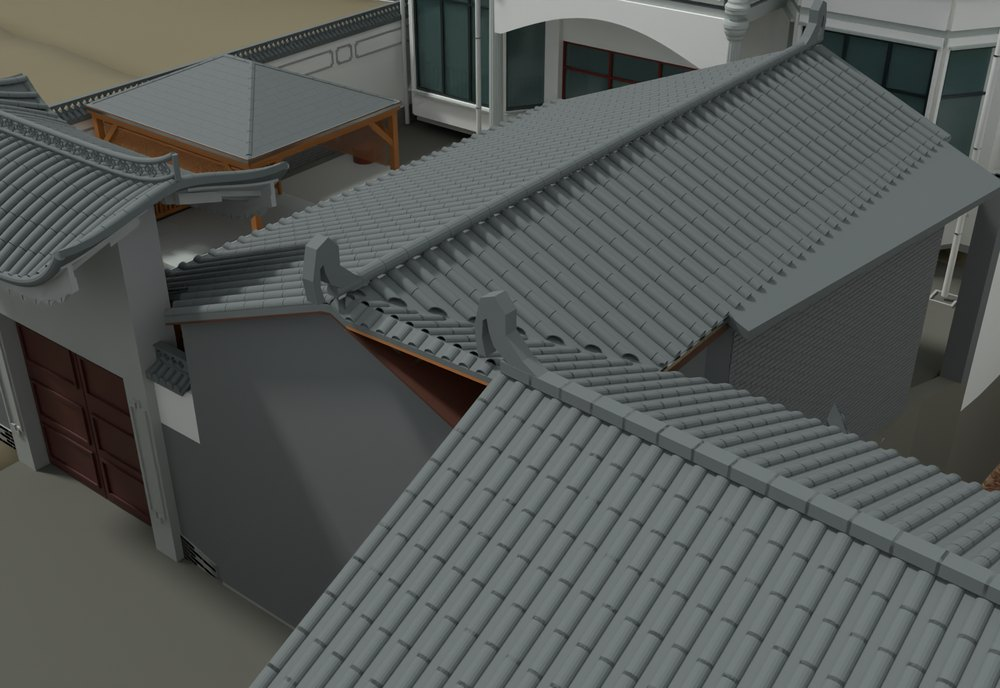
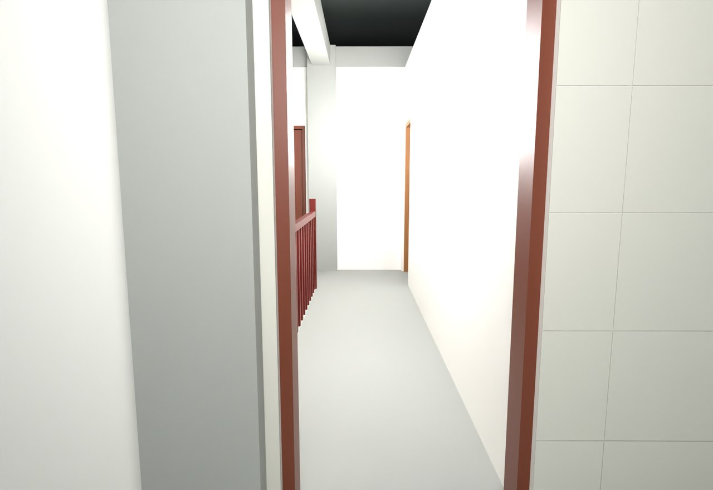

# V14 · 实景外圈复用、厨储屋谷和三层出口修订

[逐版目录](README.md) · [建筑重建台账](../../reconstruction.md) · [阶段方法汇总](../v01-v23.md) · [上一篇 V13](v13.md) · [下一篇 V15](v15.md)

## 摘要

恢复纯场地实景外圈，调整厨房与内外储藏房屋面、谷缝和金属棚，裁去穿墙饰件。三楼出口移到有支承的侧廊。

## 1. 问题与输入

在 V13 的建模场地上恢复用户指定的原贴图外圈。厨储汇水交线和楼梯井旁出口需要分别解决屋面重复与通行落脚问题。

## 2. 实现方法

1. 以原五块纯场地网格为外圈来源，裁除与重建院内和入口坡道重叠的部分。对保留区域的原坐标、UV 和贴图来源回查。
2. 按航拍屋脊方向和两侧坡面得到斜向屋谷，裁去谷线内重复瓦片，补内储藏房瓦行、卷脊与下部支承。外储藏区采用低金属棚、钢柱梁和半开石栏。
3. 将三层出口移到有板承托的侧廊，关闭楼梯井旁旧口，按门洞和平台关系读回路线。保留下部挡土基础，旧墙上部饰件按建筑占用范围裁切。

## 3. 过程图

*图 1 · 厨储屋面谷缝。过程文件 `Rebuild_V14/06_Report/V14_Native_Valley_Detail.png`。*

*图 2 · V14 三层露台与有板承托的出口。过程文件 `Rebuild_V14/06_Report/V14_Native_F3_Terrace.png`。*

## 4. 验证与适用范围

接触报告列出 606 处支承接触与 857 个瓦件，曲瓦支承失效清单为空。原生回读采用本轮可用的读回路径，日志注明该轮 RhinoCommon 核心可用性。

| 过程报告 | 原报告读数 |
| --- | --- |
| `Rebuild_V14/06_Report/Contact_QA.json` | 状态 `PASS`，记录的支承接触 606。 |
| `Rebuild_V14/06_Report/V14_Native_Readback_QA.json` | 状态 `PASS_NATIVE_FILE_READBACK`。 |

## 5. 复现入口与出处

过程路径以本地 `JIA` 项目为根，`work/` 指重建项目的历史工作目录。复核时按交付记录打开本轮输入与保存成果，再依方法中的截面、对象或动作采样对照原报告。

- **交付与参考记录**。`Rebuild_V14/README_V14_请先阅读.txt`

- **原实现脚本**。`Rebuild_V14/08_Editable_Source/V14_Scripts/v14_building.py` · `Rebuild_V14/08_Editable_Source/V14_Scripts/v14_contact_audit.py` · `Rebuild_V14/08_Editable_Source/V14_Scripts/v14_merge_route_audit.py` · `work/v14_kernel_probe.py` · `work/v14_relief_probe.py`

过程图校验值

| 图 | 原过程图 SHA-256 | 发布方式 |
| --- | --- | --- |
| 1 | `ea52689ae40df1a11b91b0240c284cf46134d4a59d8c241620b1feb10555da09` | 台账发布图，按原图缩放及压缩 |
| 2 | `301b2f47c27425d9c4030fcd7d1a8cc34a2a3f21acd6c5d177cb07fb262dae44` | 保留原画面，发布用 JPEG |

