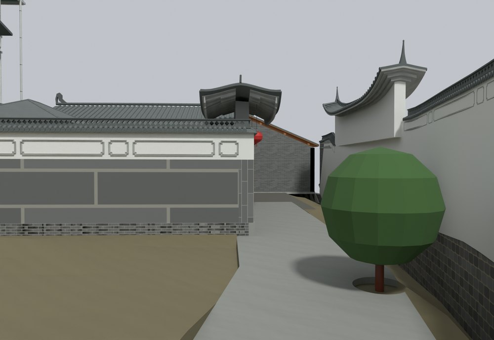
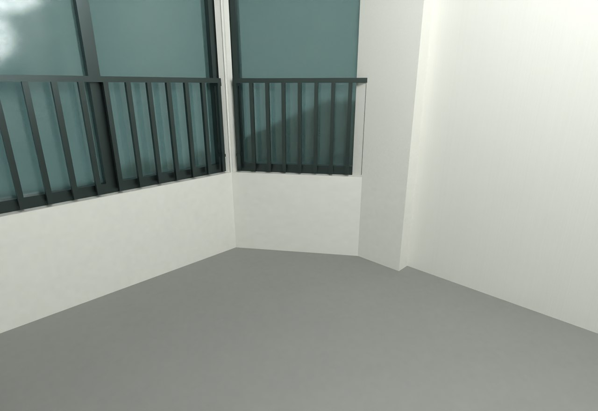

# V15 · 把网格黑面和入口路面重叠分开诊断

[逐版目录](README.md) · [建筑重建台账](../../reconstruction.md) · [阶段方法汇总](../v01-v23.md)

## 摘要

补足网格 UV 和法线并清理黑面，贯通外门至内门的道路，分开围墙内白外砖，裁去穿入卧室的瓦面并细化内门。

## 1. 问题与输入

V14 保存场景中，黑面可能由贴图坐标、法线方向或重复面引起。本轮分别检查渲染属性和实际几何，并处理外门至内门的道路连续性。

## 2. 实现方法

1. 检查重建网格每面 UV 和法线长度，硬边以分面法线表达。按闭合体朝向修正 16 个朝内网格。

2. 在入口处布尔去除新路面与原地坪的重合部分。连续混凝土与填土共享接触面，保留外门坡道，围绕原树位留半径 0.40 m 的树池。

3. 按路径每 0.20 m 采样检查缺口，另用卧室及围墙近景核对穿入的瓦面与内白外砖材质分界。

## 3. 过程图

**图 1** · 入口连续通路

**图 2** · V15 三层卧室原生视图用于核对穿入瓦面

## 4. 验证与适用范围

原说明记录模型路径无缺口、24 处储藏房内墙基降至完成面以下。坡面标高来自模型约束和影像，采样结果用于判断模型中的通行面连续性。

- **几何核验** 
  记录本轮参数、对象和处理结果。

- **原生保存与读回** 
  状态 `PASS_NATIVE_FILE_READBACK`。

## 5. 复现入口与出处

过程路径以本地 `JIA` 项目为根，`work/` 指重建项目的历史工作目录。复核时按交付记录打开本轮输入与保存成果，再依方法中的截面、对象或动作采样对照原报告。

交付与参考记录（1 项）

~~~text
Rebuild_V15/README_V15_请先阅读.txt
~~~

### 原实现脚本附件

[浏览本版全部 20 个文件](../source-code/v15/README.md) · [原件与公开副本校验值](../source-code/v15/manifest.json)

- [`v15_black_probe.py`](../source-code/v15/history/v15_black_probe.py)
- [`v15_geometry.py`](../source-code/v15/project/08_Editable_Source/V15_Scripts/v15_geometry.py)
- [`v15_route_probe.py`](../source-code/v15/history/v15_route_probe.py)
- [`v15_probe.py`](../source-code/v15/history/v15_probe.py)
- [`v15_display_probe.py`](../source-code/v15/history/v15_display_probe.py)

原脚本本地路径

~~~text
work/v15_black_probe.py
Rebuild_V15/08_Editable_Source/V15_Scripts/v15_geometry.py
work/v15_route_probe.py
work/v15_probe.py
work/v15_display_probe.py
~~~

核验报告路径（2 项）

**几何核验**

~~~text
Rebuild_V15/06_Report/Geometry_QA.json
~~~

**原生保存与读回**

~~~text
Rebuild_V15/06_Report/V15_Native_Readback_QA.json
~~~

图源与 SHA-256（2 张）

### 图 1 · 入口连续通路

~~~text
Rebuild_V15/06_Report/V15_Native_Entry_Route.png
~~~

**原过程图 SHA-256**

~~~text
04e2cd0f7d963897efc0505bb2462d2d7ca997ad6fde95fb34f35d26145d7236
~~~

台账发布图，按原图缩放及压缩。

### 图 2 · V15 三层卧室原生视图用于核对穿入瓦面

~~~text
Rebuild_V15/06_Report/V15_Native_F3_Bedroom.png
~~~

**原过程图 SHA-256**

~~~text
7538c001cf1b821984d58dbb9ef322817ec0ce4bbb6196ac8e68742361243748
~~~

保留原画面，发布用 JPEG。

---

上一篇 [V14 · 实景外圈复用、厨储屋谷和三层出口修订](v14.md) 
下一篇 [V16 · 重建连续院内土面与排水沟接缝](v16.md)
