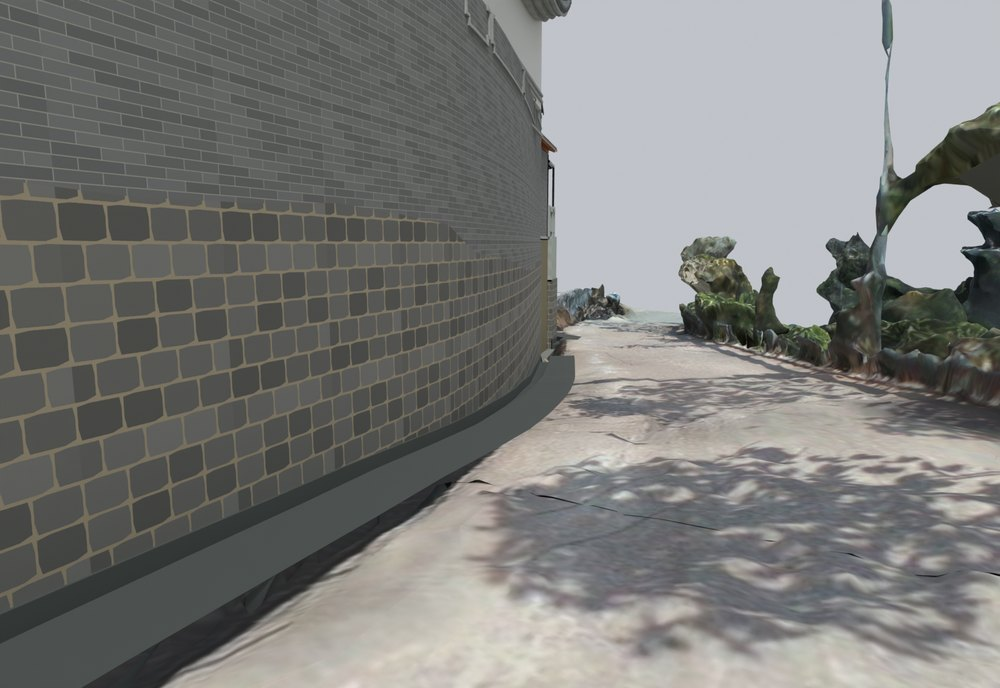
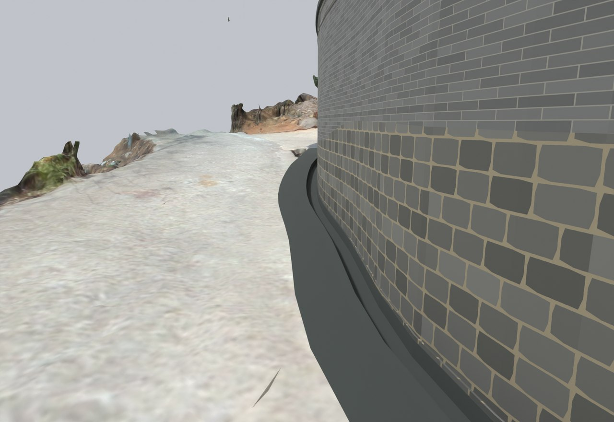

# V16 · 重建连续院内土面与排水沟接缝

[逐版目录](README.md) · [建筑重建台账](../../reconstruction.md) · [阶段方法汇总](../v01-v23.md)

## 摘要

重建连续院内土面、墙脚和排水沟，按切边高程衔接扫描道路，保留入口坡道、树池和主要建筑。

## 1. 问题与输入

V15 已贯通入口道路，庭院仍有碎片地形和墙脚不连续。以既有硬地面、航测道路边线和视频中的窄沟为边界建立连续土体。

## 2. 实现方法

1. 将院内碎片并入同一土体。主要土面约 −0.48 m，西侧约 0.4% 缓坡，接入口与原路在 3 m 范围内平滑过渡。

2. 在旧路与院坪的窄高差接头设置有土体承托的石收口。以全景 749、775、950、972 s 的墙边关系确定墙脚、沟底和路肩，沟槽保留独立断面。

3. 回读保存文件，检查新土体与硬地面、树池平面交叠，复核建筑、坡道、台阶和屋顶的对象一致性。

## 3. 过程图

**图 1** · 南墙墙脚与排水沟

**图 2** · V16 西墙脚排水沟与道路衔接

## 4. 验证与适用范围

原生回读中土体与硬地面、树池的重叠面积均记录为 0。约 0.4% 的坡率是模型控制值，排水能力仍需要现场坡度和水文证据。

- **原生保存与读回** 
  状态 `PASS_NATIVE_READBACK_AND_GROUND_DRAIN_CONTACT`。

- **交付核验** 
  状态 `PASS_DELIVERY_FILES`，报告统计的三角面 2,906,699。

## 5. 复现入口与出处

过程路径以本地 `JIA` 项目为根，`work/` 指重建项目的历史工作目录。复核时按交付记录打开本轮输入与保存成果，再依方法中的截面、对象或动作采样对照原报告。

交付与参考记录（1 项）

~~~text
Rebuild_V16/README_V16_请先阅读.txt
~~~

原实现脚本（5 项）

~~~text
Rebuild_V16/08_Editable_Source/V16_Scripts/v16_soil_probe.py
Rebuild_V16/08_Editable_Source/V16_Scripts/v16_geometry.py
Rebuild_V16/08_Editable_Source/V16_Scripts/v16_probe.py
Rebuild_V16/08_Editable_Source/V16_Scripts/v16_source_probe.py
Rebuild_V16/08_Editable_Source/V16_Scripts/v16_compact.py
~~~

核验报告路径（2 项）

**原生保存与读回**

~~~text
Rebuild_V16/06_Report/V16_Native_Readback_QA.json
~~~

**交付核验**

~~~text
Rebuild_V16/06_Report/Delivery_QA.json
~~~

图源与 SHA-256（2 张）

### 图 1 · 南墙墙脚与排水沟

~~~text
Rebuild_V16/06_Report/V16_Native_South_Wall_Drain.png
~~~

**原过程图 SHA-256**

~~~text
1fcf507e825b8fec27bcf5b5e16e5cacb254d822ca0381f2ceb1858741da32aa
~~~

台账发布图，按原图缩放及压缩。

### 图 2 · V16 西墙脚排水沟与道路衔接

~~~text
Rebuild_V16/06_Report/V16_Native_West_Wall_Drain.png
~~~

**原过程图 SHA-256**

~~~text
6682d13a6f4415688cf5906f3706fe4bc6920b322b5a0e58ad1dde016431c184
~~~

保留原画面，发布用 JPEG。

---

上一篇 [V15 · 把网格黑面和入口路面重叠分开诊断](v15.md) 
下一篇 [V17 · 厨储转角外地坪、木桁架与石栏连续化](v17.md)
