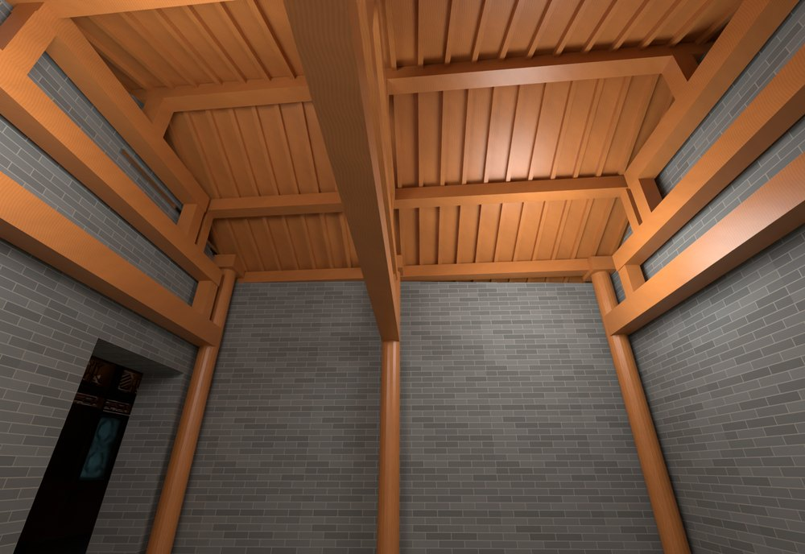
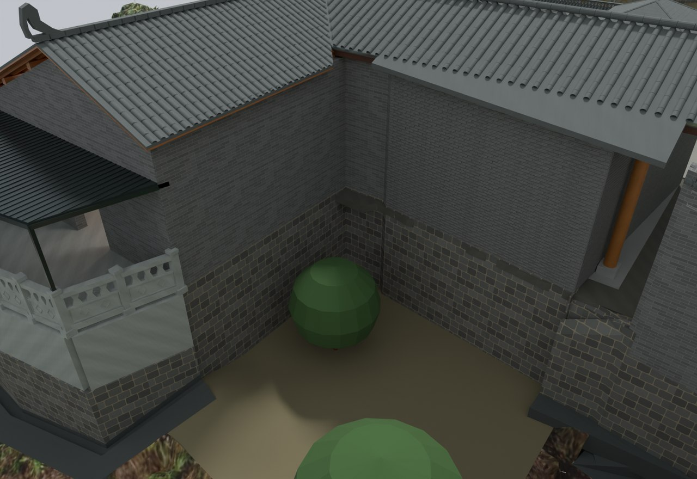

# V17 · 厨储转角外地坪、木桁架与石栏连续化

[逐版目录](README.md) · [建筑重建台账](../../reconstruction.md) · [阶段方法汇总](../v01-v23.md) · [上一篇 V16](v16.md) · [下一篇 V18](v18.md)

## 摘要

去除穿过厨储转角的旧墙饰，恢复转角地坪高差，补木桁架、开敞檐廊、格扇和连续石栏。

## 1. 问题与输入

V16 的连续场地需要跟随厨房与储藏房真实转折。航拍约束屋面边界，全景约束内外地坪高差与檐廊开放程度。

## 2. 实现方法

1. 删除进入储藏房轮廓的旧墙、压顶和饰面，剪掉外凸转角高填土楔及残留实景面。按石基底部与航测切边恢复较低外侧地面。
2. 在保持瓦面、屋谷形状的条件下，将木柱、抬梁、短柱、檩条和椽子依承托关系接合，交角部木件裁在现有屋面包络内。
3. 将格扇退到檐廊内，保持厨储连通口，石栏沿外侧转折连续布置。以原生读回核对柱脚接触、栏板连通和地坪切边。

## 3. 过程图

*图 1 · 储藏房木桁架。过程文件 `Rebuild_V17/06_Report/V17_Native_Storage_Timber_Interior.png`。*

*图 2 · V17 厨储转角外地坪与石基座。过程文件 `Rebuild_V17/06_Report/V17_Native_Concave_Corner.png`。*

## 4. 验证与适用范围

原报告登记 38 个新建或修改网格的原生检查，并记录 6 处木柱接触。极小的切边数值误差对应模型共用边，实景标高仍取决于原航测与场地拟合。

| 过程报告 | 原报告读数 |
| --- | --- |
| `Rebuild_V17/06_Report/V17_Native_Readback_QA.json` | 状态 `PASS_FRESH_NATIVE_GEOMETRY_AND_JUNCTION_QA`，检查条目 354，改动或新增网格核验数 38，报告统计的三角面 2,873,245。 |
| `Rebuild_V17/06_Report/Delivery_QA.json` | 状态 `PASS_DELIVERY_FILES`，报告统计的三角面 2,873,245。 |

### 原记录中的关键检查

| 检查项 | 结果与读数 | 原记录位置 |
| --- | --- | --- |
| Outward closed solid SITE_PERIMETER_JOINED_RETAINING_WALL_0__123 | 通过，`signed_volume_m3=0.440917` | `V17_Native_Readback_QA.json` 的 `checks[4]` |
| No obsolete wall branch SITE_PERIMETER_JOINED_RETAINING_WALL_0 | 通过，`remaining_area_m2=0` | `V17_Native_Readback_QA.json` 的 `checks[209]` |
| Garden/scan cut edge shared elevation | 通过，`max_error_m=1.13687e-13` | `V17_Native_Readback_QA.json` 的 `checks[233]` |

## 5. 复现入口与出处

过程路径以本地 `JIA` 项目为根，`work/` 指重建项目的历史工作目录。复核时按交付记录打开本轮输入与保存成果，再依方法中的截面、对象或动作采样对照原报告。

- **交付与参考记录**。`Rebuild_V17/README_V17_请先阅读.txt`

- **原实现脚本**。`Rebuild_V17/08_Editable_Source/V17_Scripts/v17_height_probe.py` · `Rebuild_V17/08_Editable_Source/V17_Scripts/v17_storage_geometry.py` · `Rebuild_V17/08_Editable_Source/V17_Scripts/v17_local_audit.py` · `Rebuild_V17/08_Editable_Source/V17_Scripts/v17_probe.py` · `Rebuild_V17/08_Editable_Source/V17_Scripts/v17_geometry.py`

过程图校验值

| 图 | 原过程图 SHA-256 | 发布方式 |
| --- | --- | --- |
| 1 | `ba5249afd7aa27f80ad70a46e8bbbd5ff6bd494ed393f73ae9329a76d6c652fd` | 台账发布图，按原图缩放及压缩 |
| 2 | `4aca140eda903ee34d3be8470c1131e22ac6477dec85a18a0adc3e9709081bb9` | 保留原画面，发布用 JPEG |

