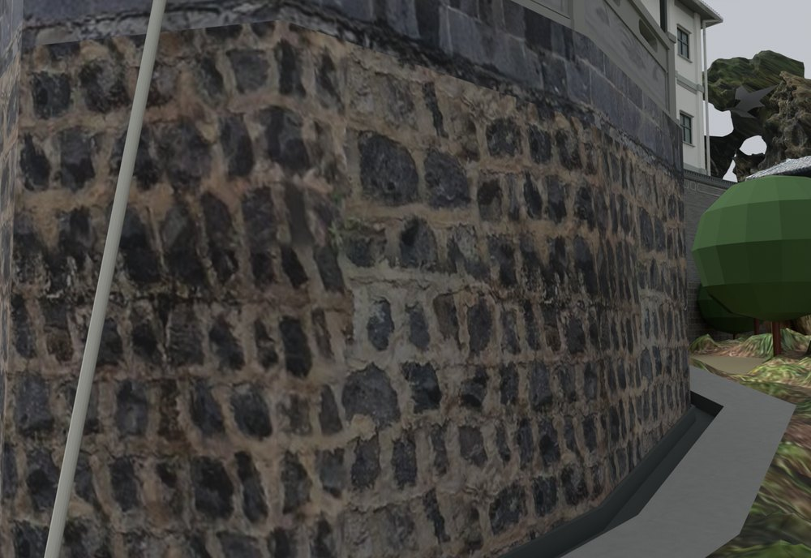
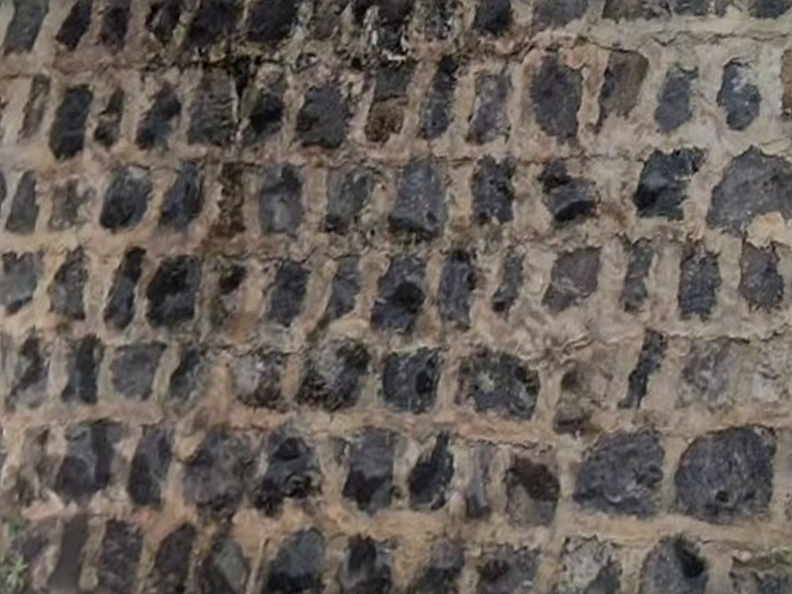
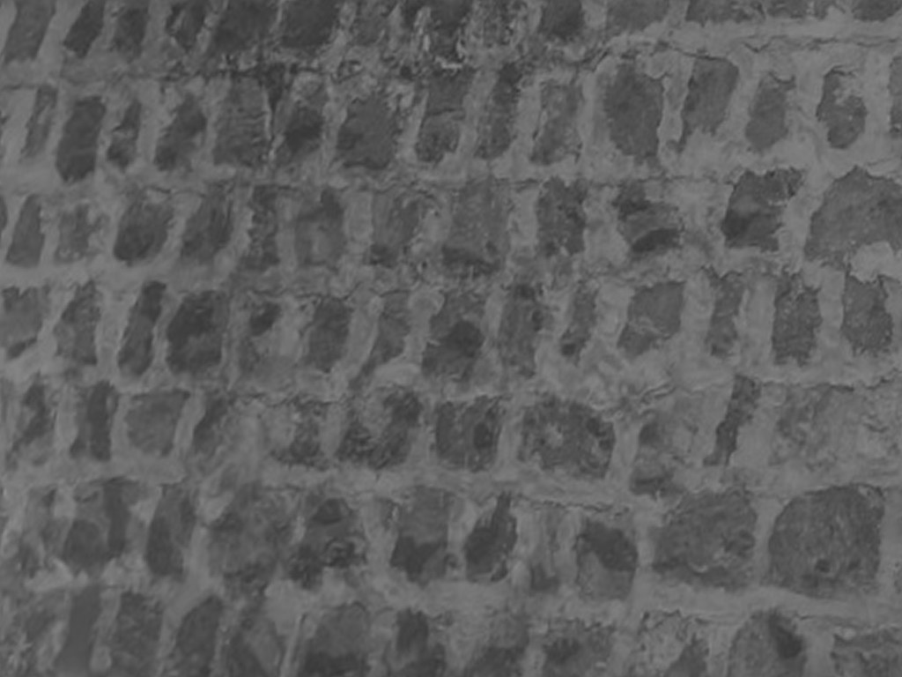

# V18 · 储藏房石基与石栏的实景几何和纹理映射

[逐版目录](README.md) · [建筑重建台账](../../reconstruction.md) · [阶段方法汇总](../v01-v23.md)

## 摘要

按实景重做储藏房连续石基与宽分格石栏，调整深木色、玻璃和外侧金属棚的薄板与支承。

## 1. 问题与输入

V17 的石基上下轮廓错位，栏板分格与同侧照片也不一致。用局部实景和全景 950、972 s 分辨石带、栏板和薄金属棚。

## 2. 实现方法

1. 分别选毛石、深色条石与石栏照片上的对应四边，做透视展开、接缝周期亮度校正，并由灰度派生微凹凸。沿基座转折连续分配 UV。

2. 重建上下连续的石基，上段深色整石带约 0.64 m。檐廊前三个宽分格采用横向透空，栏柱与上下枋落在实体石基上。

3. 按原棚轮廓和坡面替换薄金属板与支承，墙脚降到道路与沟底，保留 0.25 m 排水沟。保存后回读 UV、网格闭合、石栏连通及 15 处墙脚与沟体截面。

同一照片的各类石材分区分别展开。颜色图用于材质基色，微凹凸图用于光照下的表面响应。基座转角沿墙线累计长度作为展开方向，以角点连续性检查贴图是否错位。

## 3. 过程图

**图 1** · 储藏房连续石基与沟边

 

**图 2** · 从实景取样校正和周期接边后的毛石颜色贴图 
**图 3** · 由同一取样派生的微凹凸图

## 4. 验证与适用范围

本轮量化核对包括模型截面的正向搭接和基座连续性。石带高度、栏板比例和棚板厚度是照片拟合，灰度凹凸表达纹理视觉起伏。

- **原生保存与读回** 
  状态 `PASS_FRESH_NATIVE_STORAGE_EXTERIOR_QA`，检查条目 38,149，改动或新增网格核验数 14，报告统计的三角面 2,865,547。

- **交付核验** 
  状态 `PASS_DELIVERY_FILES`，报告统计的三角面 2,865,547。

### 原记录中的关键检查

- **Stone guard seated on continuous base** 
  通过，`positive_contact_m3` = `0.000988416` 
  原记录 `V18_Native_Readback_QA.json` 的 `checks[538]`

- **Outward volume SITE_V17_CONTINUOUS_STORAGE_STONE_GUARD__1** 
  通过，`volume_m3` = `1.40497` 
  原记录 `V18_Native_Readback_QA.json` 的 `checks[15]`

- **Timber seated on SITE_V17_STORAGE_TIMBER_COLUMNS_AND_STONE_BASES__7** 
  通过，`overlap_m3` = `0.000204415` 
  原记录 `V18_Native_Readback_QA.json` 的 `checks[540]`

## 5. 复现入口与出处

过程路径以本地 `JIA` 项目为根，`work/` 指重建项目的历史工作目录。复核时按交付记录打开本轮输入与保存成果，再依方法中的截面、对象或动作采样对照原报告。

交付与参考记录（1 项）

~~~text
Rebuild_V18/README_V18_请先阅读.txt
~~~

原实现脚本（5 项）

~~~text
Rebuild_V18/08_Editable_Source/V18_Scripts/v18_design.py
Rebuild_V18/08_Editable_Source/V18_Scripts/v18_section_probe.py
Rebuild_V18/08_Editable_Source/V18_Scripts/v18_readback_qa.py
Rebuild_V18/08_Editable_Source/V18_Scripts/v18_probe.py
Rebuild_V18/08_Editable_Source/V18_Scripts/v18_camera_probe.py
~~~

核验报告路径（2 项）

**原生保存与读回**

~~~text
Rebuild_V18/06_Report/V18_Native_Readback_QA.json
~~~

**交付核验**

~~~text
Rebuild_V18/06_Report/Delivery_QA.json
~~~

图源与 SHA-256（3 张）

### 图 1 · 储藏房连续石基与沟边

~~~text
Rebuild_V18/06_Report/V18_Storage_Base_Drain.png
~~~

**原过程图 SHA-256**

~~~text
9a9db7c1209e1a10a14857aa6e3fe105614610df80571af1ce6231402d93a30f
~~~

台账发布图，按原图缩放及压缩。

### 图 2 · 从实景取样校正和周期接边后的毛石颜色贴图

~~~text
Rebuild_V18/03_Textures/V18_Storage_AsBuilt/Photo_Rubble_Stone.png
~~~

**原过程图 SHA-256**

~~~text
954030fc0b9fccb6e375c8d29d57738f09ba0aab40c289fc675294bc5ab5f68d
~~~

已有过程图的发布副本。

### 图 3 · 由同一取样派生的微凹凸图

~~~text
Rebuild_V18/03_Textures/V18_Storage_AsBuilt/Photo_Rubble_Microheight.png
~~~

**原过程图 SHA-256**

~~~text
8c51d276c09b04128ee2276ceabe3eddd4d92b448ad99c63c112dbb788306472
~~~

已有过程图的发布副本。

---

上一篇 [V17 · 厨储转角外地坪、木桁架与石栏连续化](v17.md) 
下一篇 [V19 · 沿外围墙分带贴图并贴合弧形照壁檐口](v19.md)
