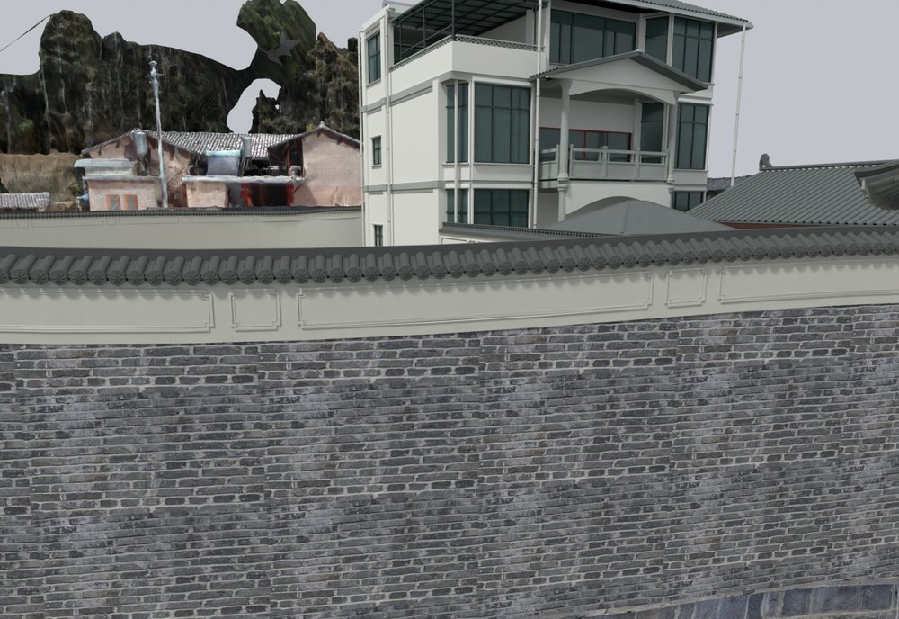
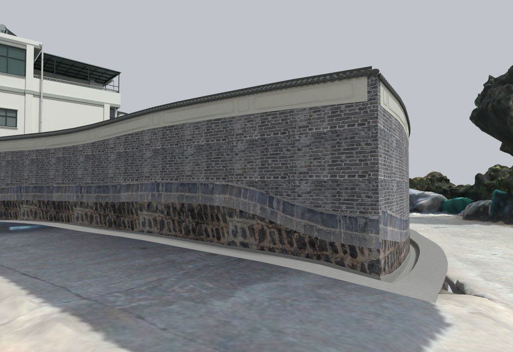

# V19 · 沿外围墙分带贴图并贴合弧形照壁檐口

[逐版目录](README.md) · [建筑重建台账](../../reconstruction.md) · [阶段方法汇总](../v01-v23.md)

## 摘要

外围墙按毛石、深色整石和青砖分层，修照壁灰砖上墙、长短框及弧形檐口贴合。

## 1. 问题与输入

在 V18 的沟体和注册墙线上修正外围墙材料连续性。通过全景沿墙确认毛石、深色整石和上部青砖各自范围。

## 2. 实现方法

1. 将三类表面分带，深色整石带拟合约 0.56 m。以展开后的真实漫游帧贴图，沿墙线铺展 UV，转角端面用各自面方向映射。

2. 照壁采用四长框、三短框，逐段细分框带使上缘跟随曲瓦。西北角用既有两墙线交点收口，三带端部约 2 mm 几何搭接。

3. 普通围墙恢复低瓦脊，调整瓦与座底落位，删裁切产生的零体积薄片。对保存后的瓦压顶、照壁和墙脚接触查原生实体。

## 3. 过程图

**图 1** · 外围墙压顶和灰砖层次

**图 2** · V19 西北转角的石基与砖墙收口

## 4. 验证与适用范围

核验涵盖保留对象指纹、闭合网格、原生与缓存 UV 一致性，以及墙脚和沟体接合。2 mm 是模型接头搭接量，约 0.56 m 是影像拟合的装饰分带高度。

- **原生保存与读回** 
  状态 `PASS_FRESH_NATIVE_PERIMETER_QA`，检查条目 47,442，改动或新增网格核验数 897，报告统计的三角面 2,872,415。

- **交付核验** 
  状态 `PASS_DELIVERY_FILES`，报告统计的三角面 2,872,415。

### 原记录中的关键检查

- **Outward volume SITE_PERIMETER_JOINED_RETAINING_WALL_0_TILE_COPING__1** 
  通过，`volume_m3` = `2.43914` 
  原记录 `V19_Native_Readback_QA.json` 的 `checks[691]`

- **Coping section backed SITE_PERIMETER_JOINED_RETAINING_WALL_00** 
  通过，`section_volume_m3` = `0.542702`，`bearing_overlap_m3` = `0.0102949` 
  原记录 `V19_Native_Readback_QA.json` 的 `checks[4530]`

- **Registered retaining envelope kept SITE_PERIMETER_JOINED_RETAINING_WALL_0** 
  通过，`lost_volume_m3` = `-8.88178e-16` 
  原记录 `V19_Native_Readback_QA.json` 的 `checks[4527]`

## 5. 复现入口与出处

过程路径以本地 `JIA` 项目为根，`work/` 指重建项目的历史工作目录。复核时按交付记录打开本轮输入与保存成果，再依方法中的截面、对象或动作采样对照原报告。

交付与参考记录（1 项）

~~~text
Rebuild_V19/README_V19_请先阅读.txt
~~~

### 原实现脚本附件

[浏览本版全部 16 个文件](../source-code/v19/README.md) · [原件与公开副本校验值](../source-code/v19/manifest.json)

- [`v19_design.py`](../source-code/v19/project/08_Editable_Source/V19_Scripts/v19_design.py)
- [`v19_coping_probe.py`](../source-code/v19/history/v19_coping_probe.py)
- [`v19_native_envelope_probe.py`](../source-code/v19/history/v19_native_envelope_probe.py)
- [`v19_probe.py`](../source-code/v19/history/v19_probe.py)
- [`v19_view_probe.py`](../source-code/v19/history/v19_view_probe.py)

原脚本本地路径

~~~text
Rebuild_V19/08_Editable_Source/V19_Scripts/v19_design.py
work/v19_coping_probe.py
work/v19_native_envelope_probe.py
work/v19_probe.py
work/v19_view_probe.py
~~~

核验报告路径（2 项）

**原生保存与读回**

~~~text
Rebuild_V19/06_Report/V19_Native_Readback_QA.json
~~~

**交付核验**

~~~text
Rebuild_V19/06_Report/Delivery_QA.json
~~~

图源与 SHA-256（2 张）

### 图 1 · 外围墙压顶和灰砖层次

~~~text
Rebuild_V19/06_Report/V19_Perimeter_Coping_Detail.png
~~~

**原过程图 SHA-256**

~~~text
607185b7fc74fca781d6fec09641309bef1e06871559fc5a22cf3cb298b3b692
~~~

台账发布图，按原图缩放及压缩。

### 图 2 · V19 西北转角的石基与砖墙收口

~~~text
Rebuild_V19/06_Report/V19_Perimeter_Northwest_Corner.png
~~~

**原过程图 SHA-256**

~~~text
6ae9518dd9ea576e2da647486c89483a4730bfc75aceb425a8ee7d237e5c5ec7
~~~

保留原画面，发布用 JPEG。

---

上一篇 [V18 · 储藏房石基与石栏的实景几何和纹理映射](v18.md) 
下一篇 [V20 · 按通行证据修楼梯边墙、单阶入口与活动门](v20.md)
