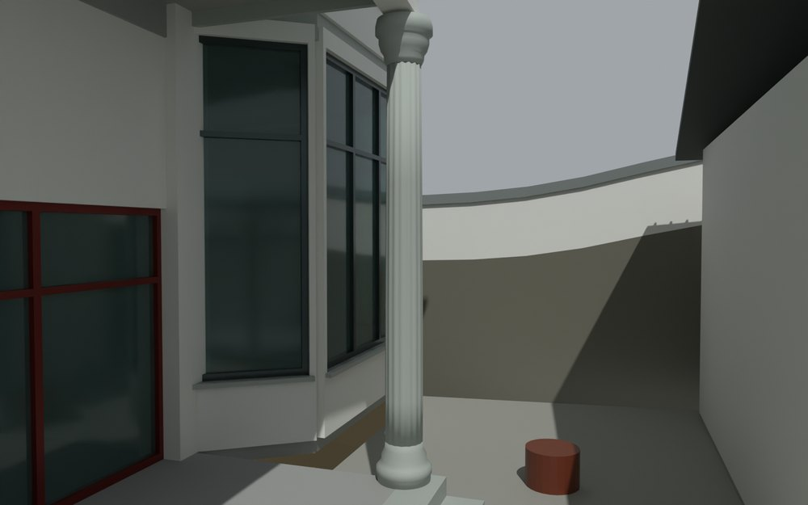
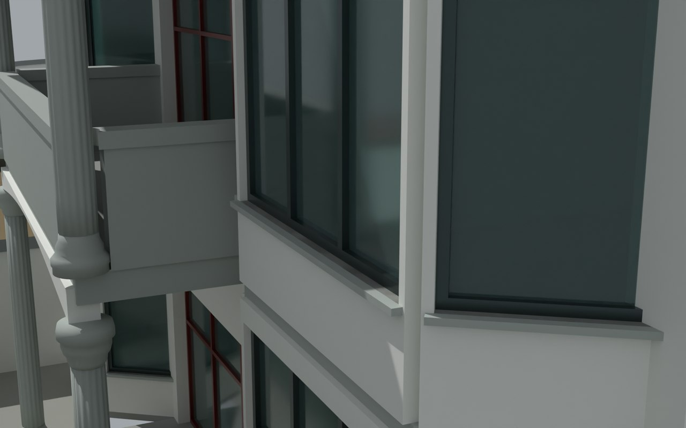

# V2 · 连续楼板、分层墙和四坡屋面的几何重建

[逐版目录](README.md) · [建筑重建台账](../../reconstruction.md) · [阶段方法汇总](../v01-v23.md) · [上一篇 V1](v1.md) · [下一篇 V3](v3.md)

## 摘要

重建连续楼板、分层墙体与完整场地，恢复实景四坡屋顶和西侧平屋面设备区，细化罗马柱及柱顶弧梁交接。

## 1. 问题与输入

V1 的楼板和墙体存在分段交界，场地在主模型里的表达也不足。用原设计层间关系控制主体连续性，用摄影测量高度分布检查屋顶类型和设备区。

## 2. 实现方法

1. 每层墙沿门窗上下口切片，统一墙面基线并清理柱边和转角重叠。把分散板面并为连续轮廓，保留楼梯开口及平台承托区域。
2. 按实景屋顶的高程和矩形轮廓恢复四坡，将西侧低区单独建成平屋面设备露台与金属棚。层间线脚沿同一楼板轮廓绕过折角飘窗。
3. 罗马柱拆分为柱脚、带 16 道凹槽的柱身和柱头，弧梁另设接合。分别回读 Rhino、SketchUp 和交换文件，核对场地在主模型中的可见性。

## 3. 过程图

*图 1 · 罗马柱及柱顶弧梁。过程文件 `Rebuild_V2/09_Report/VIS_CAM_07_Column.png`。*

*图 2 · V2 柱、弧梁与周边构件的接口近景。过程文件 `Rebuild_V2/09_Report/VIS_CAM_08_Junction.png`。*

## 4. 验证与适用范围

原几何检查展开 1,910 个闭合部件，未记录非正向体积。交换文件复核包含完整场地。柱头比例及屋面尺寸是图纸与实景结合的建模值。

| 过程报告 | 原报告读数 |
| --- | --- |
| `Rebuild_V2/09_Report/Geometry_QA_V2.json` | 展开后的闭合部件 1,910。 |
| `Rebuild_V2/09_Report/Native_Model_QA.json` | 记录本轮参数、对象和处理结果。 |
| `Rebuild_V2/09_Report/Exchange_Readback_QA.json` | 记录本轮参数、对象和处理结果。 |

## 5. 复现入口与出处

过程路径以本地 `JIA` 项目为根，`work/` 指重建项目的历史工作目录。复核时按交付记录打开本轮输入与保存成果，再依方法中的截面、对象或动作采样对照原报告。

- **交付与参考记录**。`Rebuild_V2/README_V2.md`

- **原实现脚本**。`Rebuild_V2/05_Intermediate/Scripts/roof_check_v2.py` · `Rebuild_V2/05_Intermediate/Scripts/v2_geometry.py` · `Rebuild_V2/05_Intermediate/Scripts/geometry_qa_v2.py` · `Rebuild_V2/05_Intermediate/Scripts/prepare_export_v2.py` · `work/v2_plan_preview.py`

过程图校验值

| 图 | 原过程图 SHA-256 | 发布方式 |
| --- | --- | --- |
| 1 | `6d433bf84a247dfca633800c9ea986662fbfda78b77581b1c04f7e63cd2771fa` | 台账发布图，按原图缩放及压缩 |
| 2 | `af2eea33c51520722ae92daada420f6398b2c113afb00becb386b519e866f1c0` | 保留原画面，发布用 JPEG |

