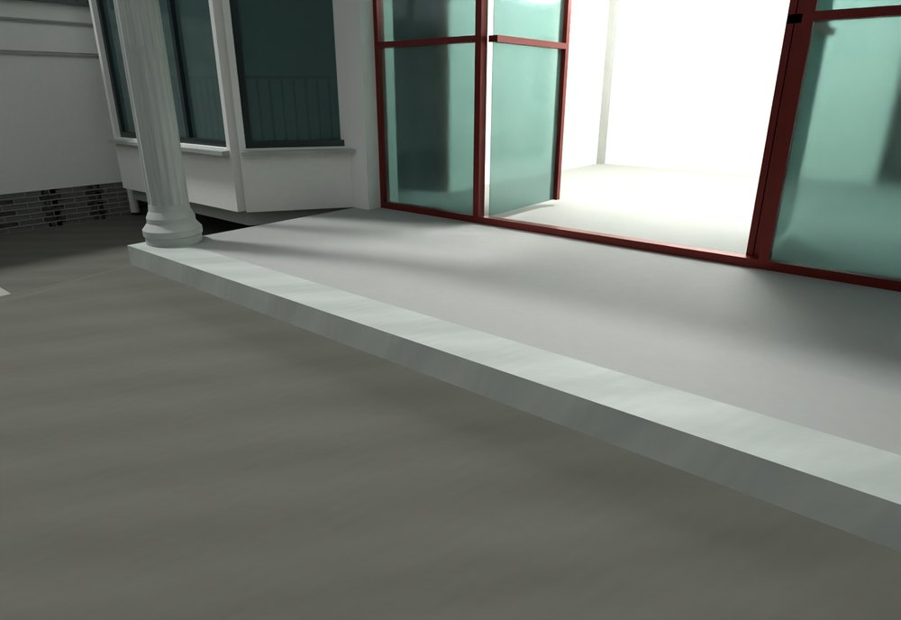
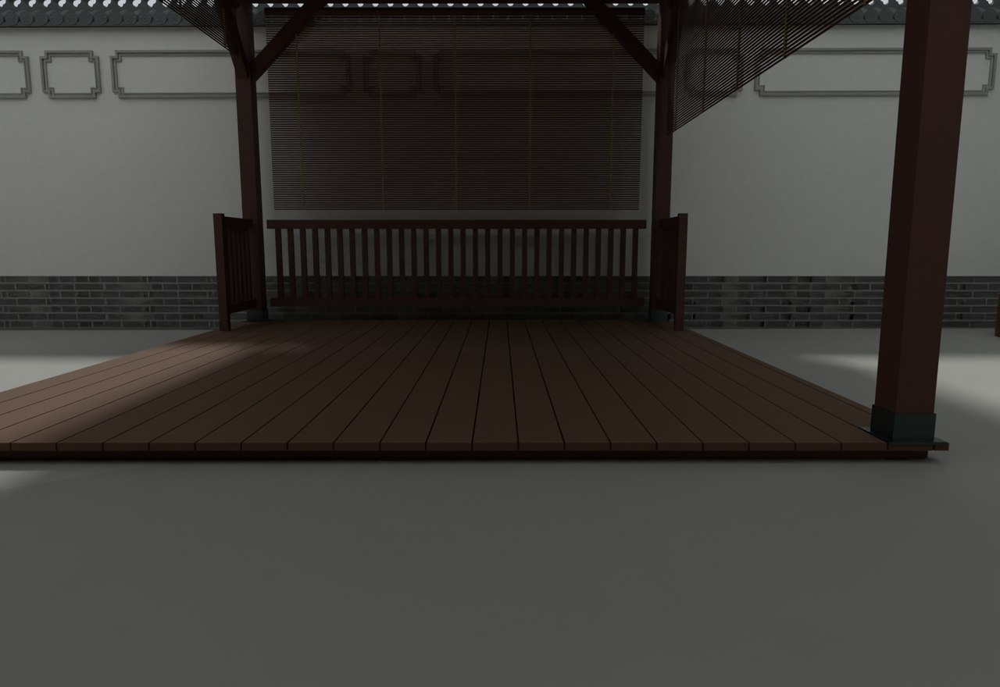

# V20 · 按通行证据修楼梯边墙、单阶入口与活动门

[逐版目录](README.md) · [建筑重建台账](../../reconstruction.md) · [阶段方法汇总](../v01-v23.md)

## 摘要

修主楼缺墙与三楼木地面，入口改一阶实心台阶，亭子向内收。修厨储通道、石栏、沟路及活动门扇。

## 1. 问题与输入

V19 的通道与门扇在主楼、亭子和厨储交界需要逐处复核。红框和视频先区分缺墙与应当保留的楼梯、房门开口。

## 2. 实现方法

1. 逐楼层核对门的连通对象，仅封合首层楼梯前和右后已确认的缺墙。三层补已确认卧室的木地面。

2. 以 150 mm 高实心单阶替换原主楼三阶，填实廊底并渐接邻接地坪。亭子沿靠墙边固定，向主轴一侧回收约 0.60 m，屋顶和下部木构同步适配。

3. 对门扇用实际保存几何重放运动，按活动叶、门框、附近墙体和地面检查冲突。地坪、沟路接缝另做边界高度采样。

### 实现链与源码定位

以下按诊断、处理、保存与复核组织阅读。调用和文件引用来自原脚本，输入输出方向由对应读写调用判断；辅助文件是否在本轮运行，以报告为准。

**1. 定位与诊断** · [`plan.py`](../source-code/v20/project/08_Editable_Source/V20_Scripts/house/plan.py#L2)

文件引用：[`House_Plans.png`](../source-code/v20/project/08_Editable_Source/V20_Scripts/house/plan.py#L27)。

**2. 定位与诊断** · [`grade_probe.py`](../source-code/v20/project/08_Editable_Source/V20_Scripts/house/grade_probe.py#L8)

叉积／面法线 [`np.cross`](../source-code/v20/project/08_Editable_Source/V20_Scripts/house/grade_probe.py#L8)。

**3. 构建或写入** · [`build_patch.py`](../source-code/v20/project/08_Editable_Source/V20_Scripts/house/build_patch.py#L30)

实体运算对象 [`mf.Manifold`](../source-code/v20/project/08_Editable_Source/V20_Scripts/house/build_patch.py#L30)；叉积／面法线 [`np.cross`](../source-code/v20/project/08_Editable_Source/V20_Scripts/house/build_patch.py#L32)；交集限域 [`intersection`](../source-code/v20/project/08_Editable_Source/V20_Scripts/house/build_patch.py#L52)。

文件引用：[`Architecture_Scene_V19.json`](../source-code/v20/project/08_Editable_Source/V20_Scripts/house/build_patch.py#L11) · [`Native_Readback_Index_V19.json`](../source-code/v20/project/08_Editable_Source/V20_Scripts/house/build_patch.py#L12) · [`Mutation.json`](../source-code/v20/project/08_Editable_Source/V20_Scripts/house/build_patch.py#L84)。

**4. 构建或写入** · [`final_native_seam.py`](../source-code/v20/project/08_Editable_Source/V20_Scripts/storage/final_native_seam.py#L9)

Rhino 原生读写 [`rh.File3dm.Read`](../source-code/v20/project/08_Editable_Source/V20_Scripts/storage/final_native_seam.py#L9)。

文件引用：[`Architecture_Complete_V20_ALIGNED_ENU.3dm`](../source-code/v20/project/08_Editable_Source/V20_Scripts/storage/final_native_seam.py#L6) · [`Seam_Correction.json`](../source-code/v20/project/08_Editable_Source/V20_Scripts/storage/final_native_seam.py#L7) · [`Native_Readback_Index_V20.json`](../source-code/v20/project/08_Editable_Source/V20_Scripts/storage/final_native_seam.py#L7)。

**5. 保存后核验** · [`v20_door_check.py`](../source-code/v20/project/08_Editable_Source/V20_Scripts/v20_door_check.py#L10)

实体运算对象 [`manifold`](../source-code/v20/project/08_Editable_Source/V20_Scripts/v20_door_check.py#L10)；判据与回归检查 [`checks.append`](../source-code/v20/project/08_Editable_Source/V20_Scripts/v20_door_check.py#L30)；网格与实体转换 [`inter.to_mesh64`](../source-code/v20/project/08_Editable_Source/V20_Scripts/v20_door_check.py#L32)。

文件引用：[`Mutation.json`](../source-code/v20/project/08_Editable_Source/V20_Scripts/v20_door_check.py#L5) · [`Native_Readback_Index_V19.json`](../source-code/v20/project/08_Editable_Source/V20_Scripts/v20_door_check.py#L5) · [`Door_Manifest.json`](../source-code/v20/project/08_Editable_Source/V20_Scripts/v20_door_check.py#L14)。

**6. 保存后核验** · [`v20_native_qa.py`](../source-code/v20/project/08_Editable_Source/V20_Scripts/v20_native_qa.py#L12)

实体运算对象 [`mf.Manifold`](../source-code/v20/project/08_Editable_Source/V20_Scripts/v20_native_qa.py#L12)；判据与回归检查 [`check`](../source-code/v20/project/08_Editable_Source/V20_Scripts/v20_native_qa.py#L12)。

文件引用：[`Architecture_Scene_V20.json`](../source-code/v20/project/08_Editable_Source/V20_Scripts/v20_native_qa.py#L8) · [`Mutation.json`](../source-code/v20/project/08_Editable_Source/V20_Scripts/v20_native_qa.py#L10) · [`Design_Control.json`](../source-code/v20/project/08_Editable_Source/V20_Scripts/v20_native_qa.py#L18)。

[方法原理：门扇运动与漫游碰撞](../methodology.md#7-门窗漫游与-fast-怎样核验) · [本版完整过程索引](process/v20.md)

本版索引汇合 60 幅已归档过程图、47 份交付及历史目录中的报告／说明／中间记录和全部 41 个源码附件。继承文件和本轮新增文件按来源保留，实际完成范围以第 4 节及原报告为准。

## 3. 过程图

**图 1** · 主楼一阶实心台阶

**图 2** · V20 亭子回收后的木铺面

## 4. 验证与适用范围

原生门检验覆盖 27 扇，关键碰撞和小铰边接触清单均为空。模型接缝以 1 mm 阈值复核，没有超限样本。指标适用于报告中的路径和采样姿态。

- **Final Native Door QA** 
  状态 `PASS_FINAL_NATIVE_INWARD_POSE_COLLISION_REVIEW`，门扇数量 27，门扇条目 27，关键碰撞记录 0。

- **Final Native Seam QA** 
  状态 `PASS_FINAL_FRESH_NATIVE_SEAM_QA`。

## 5. 复现入口与出处

过程路径以本地 `JIA` 项目为根，`work/` 指重建项目的历史工作目录。复核时按交付记录打开本轮输入与保存成果，再依方法中的截面、对象或动作采样对照原报告。

交付与参考记录（1 项）

~~~text
Rebuild_V20/README_V20_请先阅读.txt
~~~

### 原实现脚本附件

[浏览本版全部 41 个文件](../source-code/v20/README.md) · [原件与公开副本校验值](../source-code/v20/manifest.json)

- [`v20_door_check.py`](../source-code/v20/project/08_Editable_Source/V20_Scripts/v20_door_check.py)
- [`v20_native_qa.py`](../source-code/v20/project/08_Editable_Source/V20_Scripts/v20_native_qa.py)
- [`plan.py`](../source-code/v20/project/08_Editable_Source/V20_Scripts/house/plan.py)
- [`build_patch.py`](../source-code/v20/project/08_Editable_Source/V20_Scripts/house/build_patch.py)
- [`grade_probe.py`](../source-code/v20/project/08_Editable_Source/V20_Scripts/house/grade_probe.py)

原脚本本地路径

~~~text
Rebuild_V20/08_Editable_Source/V20_Scripts/v20_door_check.py
Rebuild_V20/08_Editable_Source/V20_Scripts/v20_native_qa.py
Rebuild_V20/08_Editable_Source/V20_Scripts/house/plan.py
Rebuild_V20/08_Editable_Source/V20_Scripts/house/build_patch.py
Rebuild_V20/08_Editable_Source/V20_Scripts/house/grade_probe.py
~~~

核验报告路径（2 项）

**Final Native Door QA**

~~~text
Rebuild_V20/06_Report/Final_Native_Door_QA.json
~~~

**Final Native Seam QA**

~~~text
Rebuild_V20/06_Report/Final_Native_Seam_QA.json
~~~

图源与 SHA-256（2 张）

### 图 1 · 主楼一阶实心台阶

~~~text
Rebuild_V20/06_Report/V20_House_Entry_One_Solid_Step.png
~~~

**原过程图 SHA-256**

~~~text
95d723e94f1319a5c814eb9e1b974335052111c8823986e7ea83cb93142b20da
~~~

台账发布图，按原图缩放及压缩。

### 图 2 · V20 亭子回收后的木铺面

~~~text
Rebuild_V20/06_Report/V20_Pavilion_Wood_Deck.png
~~~

**原过程图 SHA-256**

~~~text
457c1c35564b0a1ebb83b0d652aff21e2f126551847eba7400d40d28cc0dddc1
~~~

保留原画面，发布用 JPEG。

---

上一篇 [V19 · 沿外围墙分带贴图并贴合弧形照壁檐口](v19.md) 
下一篇 [V21 · 分层门楼导入与住宅前门推拉轨迹复核](v21.md)
