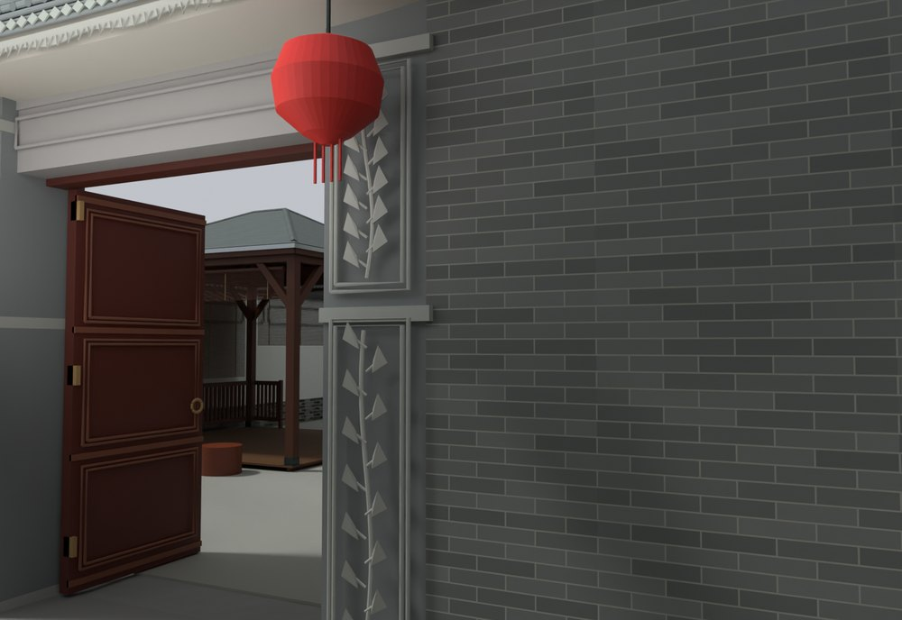
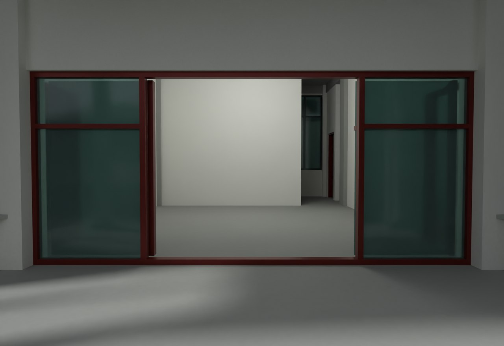

# V21 · 分层门楼导入与住宅前门推拉轨迹复核

[逐版目录](README.md) · [建筑重建台账](../../reconstruction.md) · [阶段方法汇总](../v01-v23.md)

## 摘要

导入指定分层内门，修门柱与厨房接口、三楼门位和檐廊饰面，前玻璃门恢复横向推拉。

## 1. 问题与输入

从 V20 的原生保存状态继续，将用户指定的分层内大门与原门柱、厨房接口重新对位，并依据全景和批注调整三层门与檐廊。

## 2. 实现方法

1. 读取指定 Rhino 8 门楼分层对象。以既有开口和柱基约束导入位置，保留门楣、门柱、木上亮和活动叶各自的图层与编辑粒度。

2. 将前玻璃门的活动叶按轨道做横向平移，运动件与固定框分开。三层从承托平台、门扇开启位置和实景路径复核开口。

3. 从保存文件读取更改门扇的采样姿态与檐廊实际接合，保留 LOCAL 导出供后续漫游。

## 3. 过程图

**图 1** · 内门与厨房接口

**图 2** · V21 主楼玻璃推拉门及固定框

## 4. 验证与适用范围

原门扇报告列 26 扇门和 7 组更改门运动采样记录，未解决碰撞清单为空。验证使用 Rhino 保存对象及导出数据，UE 导入为后续阶段。

- **Final Native Door QA** 
  状态 `PASS_FINAL_NATIVE_DOOR_CLEARANCE`，未解决碰撞记录 0，门扇条目 26。

- **house House Native QA** 
  状态 `PASS_HOUSE_FINAL_NATIVE_QA`。

## 5. 复现入口与出处

过程路径以本地 `JIA` 项目为根，`work/` 指重建项目的历史工作目录。复核时按交付记录打开本轮输入与保存成果，再依方法中的截面、对象或动作采样对照原报告。

交付与参考记录（1 项）

~~~text
Rebuild_V21/README_V21_请先阅读.txt
~~~

原实现脚本（5 项）

~~~text
Rebuild_V21/08_Editable_Source/V21_Scripts/v21_door_native_review.py
work/v21_prepare_package.py
Rebuild_V21/08_Editable_Source/V21_Scripts/house/build.py
Rebuild_V21/08_Editable_Source/V21_Scripts/house/planes.py
Rebuild_V21/08_Editable_Source/V21_Scripts/house/floor_probe.py
~~~

核验报告路径（2 项）

**Final Native Door QA**

~~~text
Rebuild_V21/06_Report/Final_Native_Door_QA.json
~~~

**house House Native QA**

~~~text
Rebuild_V21/06_Report/house_House_Native_QA.json
~~~

图源与 SHA-256（2 张）

### 图 1 · 内门与厨房接口

~~~text
Rebuild_V21/06_Report/V21_Inner_Gate_Kitchen_Flush_Junction.png
~~~

**原过程图 SHA-256**

~~~text
1155615803155ccf898177140b49d78593af3d2b90d469c265d7896099169b66
~~~

台账发布图，按原图缩放及压缩。

### 图 2 · V21 主楼玻璃推拉门及固定框

~~~text
Rebuild_V21/06_Report/V21_House_Sliding_Entry.png
~~~

**原过程图 SHA-256**

~~~text
1b43725872bd4c258ace8d71844652b545f7ef470a01dd5f214b444946b13939
~~~

保留原画面，发布用 JPEG。

---

上一篇 [V20 · 按通行证据修楼梯边墙、单阶入口与活动门](v20.md) 
下一篇 [V22 · 用实景与理想构造对照细化门楼、柱础和铺地](v22.md)
