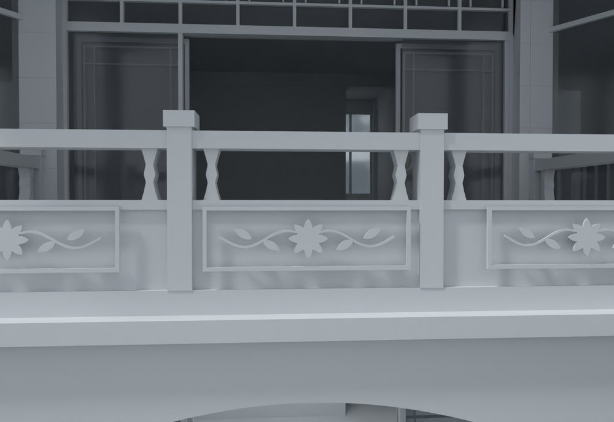
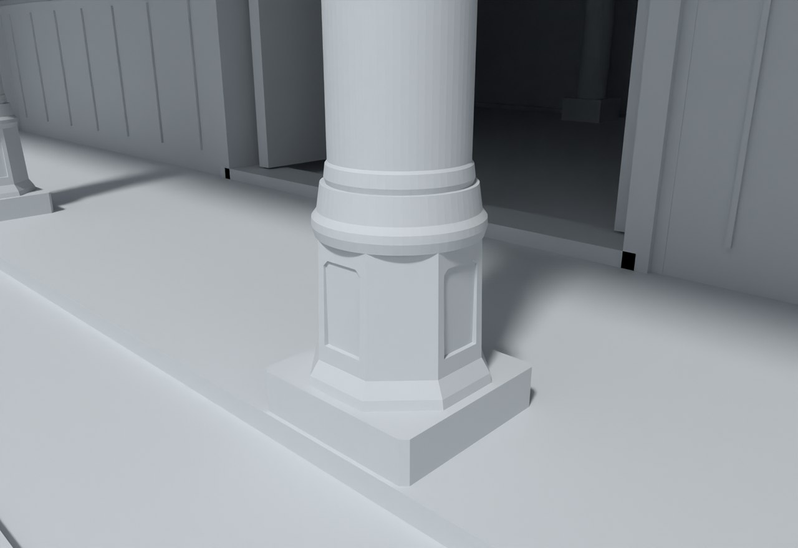

# V22 · 用实景与理想构造对照细化门楼、柱础和铺地

[逐版目录](README.md) · [建筑重建台账](../../reconstruction.md) · [阶段方法汇总](../v01-v23.md)

## 摘要

深化入口玻璃上亮、阳台栏板、厨房柱础、内院石铺和木亭细部。内大门补浮雕、瓦端、门饰和石阶。

## 1. 问题与输入

V21 给出分层内门及通行结构。V22 将理想参考中的细部按对象与实景核对，几何分件集中于入口、栏板、石铺、厨房柱础、亭子和内门。

## 2. 实现方法

1. 入口实心墙带开为玻璃上亮，细分回纹格、薄砖缝、栏板浅框及卷草纹。补阳台边梁和接触位置，同时保留排水管孔。

2. 以原排水地面实体裁分石板和接缝，石板保留旧坡面，缝面下凹 1.5 mm。四处柱础拆成方足、八角鼓身和圆承托。

3. 对内门浮雕、瓦端、檐饰及石阶分件建模，推拉门沿原运动类别在保存文件采样复核。

### 实现链与源码定位

以下按诊断、处理、保存与复核组织阅读。调用和文件引用来自原脚本，输入输出方向由对应读写调用判断；辅助文件是否在本轮运行，以报告为准。

**1. 定位与诊断** · [`v22_finish_probe.py`](../source-code/v22/project/08_Editable_Source/V22_Scripts/v22_finish_probe.py#L4)

**2. 定位与诊断** · [`probe.py`](../source-code/v22/project/08_Editable_Source/V22_Scripts/pavilion/probe.py#L5)

文件引用：[`Architecture_Scene_V21.json`](../source-code/v22/project/08_Editable_Source/V22_Scripts/pavilion/probe.py#L5) · [`Native_Readback_Index_V21.json`](../source-code/v22/project/08_Editable_Source/V22_Scripts/pavilion/probe.py#L5)。

**3. 定位与诊断** · [`probe_parts.py`](../source-code/v22/project/08_Editable_Source/V22_Scripts/pavilion/probe_parts.py#L1)

**4. 参数与几何处理** · [`v22_archive_prepare.py`](../source-code/v22/project/08_Editable_Source/V22_Scripts/v22_archive_prepare.py#L3)

文件引用：[`Mutation.json`](../source-code/v22/project/08_Editable_Source/V22_Scripts/v22_archive_prepare.py#L3) · [`Photo_Patch_Input.json`](../source-code/v22/project/08_Editable_Source/V22_Scripts/v22_archive_prepare.py#L6)。

**5. 过程出图** · [`v22_final_review.py`](../source-code/v22/project/08_Editable_Source/V22_Scripts/v22_final_review.py#L16)

判据与回归检查 [`checks.append`](../source-code/v22/project/08_Editable_Source/V22_Scripts/v22_final_review.py#L11)；实体运算对象 [`mf.Manifold`](../source-code/v22/project/08_Editable_Source/V22_Scripts/v22_final_review.py#L16)。

文件引用：[`V22_Native_Readback_QA.json`](../source-code/v22/project/08_Editable_Source/V22_Scripts/v22_final_review.py#L4) · [`Final_Native_Door_QA.json`](../source-code/v22/project/08_Editable_Source/V22_Scripts/v22_final_review.py#L4) · [`Architecture_Complete_V22_ALIGNED_ENU.3dm`](../source-code/v22/project/08_Editable_Source/V22_Scripts/v22_final_review.py#L6)。

**6. 保存后核验** · [`v22_native_qa.py`](../source-code/v22/project/08_Editable_Source/V22_Scripts/v22_native_qa.py#L6)

Rhino 原生读写 [`rh.File3dm.Read`](../source-code/v22/project/08_Editable_Source/V22_Scripts/v22_native_qa.py#L6)；判据与回归检查 [`checks.append`](../source-code/v22/project/08_Editable_Source/V22_Scripts/v22_native_qa.py#L11)；叉积／面法线 [`np.cross`](../source-code/v22/project/08_Editable_Source/V22_Scripts/v22_native_qa.py#L25)。

文件引用：[`Architecture_Complete_V22_ALIGNED_ENU.3dm`](../source-code/v22/project/08_Editable_Source/V22_Scripts/v22_native_qa.py#L6) · [`V22_Assembly_QA.json`](../source-code/v22/project/08_Editable_Source/V22_Scripts/v22_native_qa.py#L6) · [`Native_Readback_Index_V22.json`](../source-code/v22/project/08_Editable_Source/V22_Scripts/v22_native_qa.py#L6)。

**7. 交付封装** · [`v22_package.py`](../source-code/v22/project/08_Editable_Source/V22_Scripts/v22_package.py#L12)

Rhino 原生读写 [`rh.File3dm.Read`](../source-code/v22/project/08_Editable_Source/V22_Scripts/v22_package.py#L12)。

文件引用：[`Architecture_Complete_V22_ALIGNED_ENU.3dm`](../source-code/v22/project/08_Editable_Source/V22_Scripts/v22_package.py#L6) · [`V22_Native_Readback_QA.json`](../source-code/v22/project/08_Editable_Source/V22_Scripts/v22_package.py#L12) · [`Final_Native_Door_QA.json`](../source-code/v22/project/08_Editable_Source/V22_Scripts/v22_package.py#L13)。

[方法原理：照片、程序材质与高度图](../methodology.md#5-材质与浮雕分别保留什么证据) · [本版完整过程索引](process/v22.md)

本版索引汇合 70 幅已归档过程图、35 份交付及历史目录中的报告／说明／中间记录和全部 27 个源码附件。继承文件和本轮新增文件按来源保留，实际完成范围以第 4 节及原报告为准。

## 3. 过程图

**图 1** · 阳台栏板与柱脚

**图 2** · V22 厨房石柱础的方足、八角鼓身与圆承托

## 4. 验证与适用范围

原门检报告列 26 扇及 6 组修改运动采样，未解决碰撞清单为空。1.5 mm 是模型缝深，理想图用于细部构造推敲，实景可见范围决定可确认的外形。

- **Final Native Door QA** 
  状态 `PASS_FINAL_NATIVE_DOOR_CLEARANCE`，未解决碰撞记录 0，门扇条目 26。

- **交付核验** 
  状态 `PASS_DELIVERY_FILES`，报告统计的三角面 2,970,124，GLB 动画数 24，独立门叶 26。

## 5. 复现入口与出处

过程路径以本地 `JIA` 项目为根，`work/` 指重建项目的历史工作目录。复核时按交付记录打开本轮输入与保存成果，再依方法中的截面、对象或动作采样对照原报告。

交付与参考记录（1 项）

~~~text
Rebuild_V22/README_V22_请先阅读.txt
~~~

### 原实现脚本附件

[浏览本版全部 27 个文件](../source-code/v22/README.md) · [原件与公开副本校验值](../source-code/v22/manifest.json)

- [`v22_finish_probe.py`](../source-code/v22/project/08_Editable_Source/V22_Scripts/v22_finish_probe.py)
- [`v22_native_qa.py`](../source-code/v22/project/08_Editable_Source/V22_Scripts/v22_native_qa.py)
- [`probe.py`](../source-code/v22/project/08_Editable_Source/V22_Scripts/pavilion/probe.py)
- [`v22_archive_prepare.py`](../source-code/v22/project/08_Editable_Source/V22_Scripts/v22_archive_prepare.py)
- [`probe_parts.py`](../source-code/v22/project/08_Editable_Source/V22_Scripts/pavilion/probe_parts.py)

原脚本本地路径

~~~text
Rebuild_V22/08_Editable_Source/V22_Scripts/v22_finish_probe.py
Rebuild_V22/08_Editable_Source/V22_Scripts/v22_native_qa.py
Rebuild_V22/08_Editable_Source/V22_Scripts/pavilion/probe.py
Rebuild_V22/08_Editable_Source/V22_Scripts/v22_archive_prepare.py
Rebuild_V22/08_Editable_Source/V22_Scripts/pavilion/probe_parts.py
~~~

核验报告路径（2 项）

**Final Native Door QA**

~~~text
Rebuild_V22/06_Report/Final_Native_Door_QA.json
~~~

**交付核验**

~~~text
Rebuild_V22/06_Report/Delivery_QA.json
~~~

图源与 SHA-256（2 张）

### 图 1 · 阳台栏板与柱脚

~~~text
Rebuild_V22/06_Report/V22_House_Balcony_Detail.png
~~~

**原过程图 SHA-256**

~~~text
ded015fd95abbf13da003e789d279c5e979874d11b131330cd43d8801cb6cf6f
~~~

台账发布图，按原图缩放及压缩。

### 图 2 · V22 厨房石柱础的方足、八角鼓身与圆承托

~~~text
Rebuild_V22/06_Report/V22_Kitchen_Stone_Base_Detail.png
~~~

**原过程图 SHA-256**

~~~text
b9bb8385ea2b2ba2c4770f51629e15a10533a3afc0dd05daf7142b4dec330fbb
~~~

保留原画面，发布用 JPEG。

---

上一篇 [V21 · 分层门楼导入与住宅前门推拉轨迹复核](v21.md) 
下一篇 [V23 · 内大门柱角体积浮雕、分段瓦件与檐口回调](v23.md)
