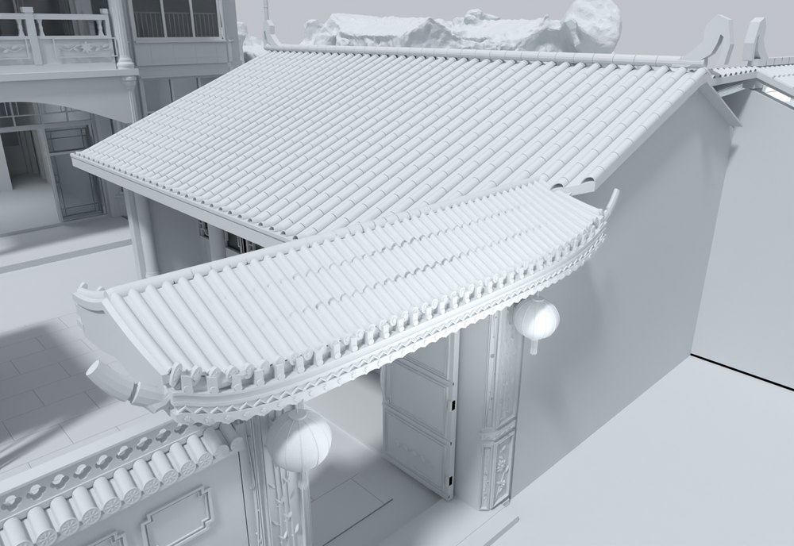
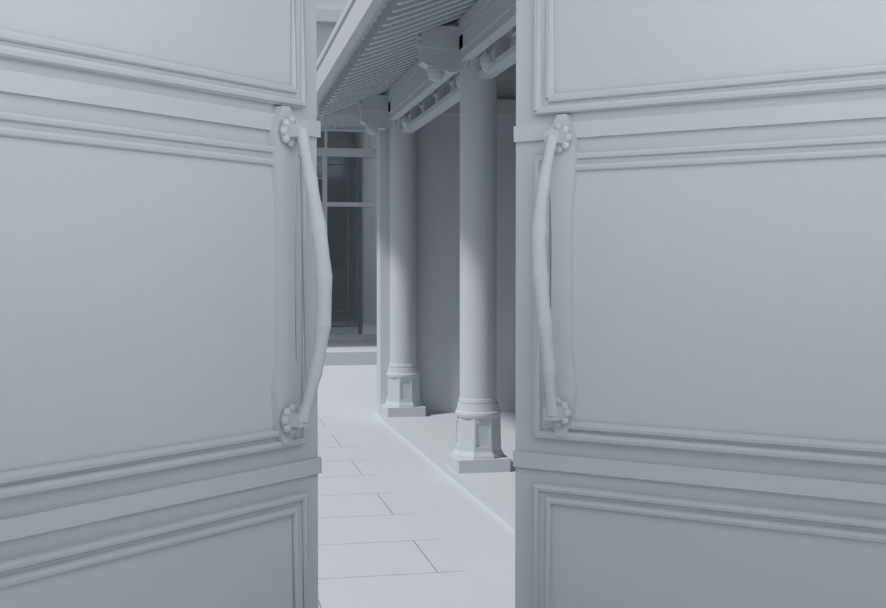

# V23 · 内大门柱角体积浮雕、分段瓦件与檐口回调

[逐版目录](README.md) · [建筑重建台账](../../reconstruction.md) · [阶段方法汇总](../v01-v23.md)

## 摘要

精修内大门柱角体积浮雕、瓦件、椽枋及门叶细节。按反馈收短屋檐并压低翘角，补局部墙柱连接。

## 1. 问题与输入

V22 的门柱与屋面细节仍需贴近实景。两组航拍分别核对瓦件搭接和檐底，理想与当前模型的对照用于定位形态差异。

## 2. 实现方法

1. 两根石柱做 90 mm 前折角，正面与斜面布置 12 组体积浮雕。瓦面离散成 510 件筒瓦与凹板瓦和 86 件瓦当，檐下按椽尾、檐枋和纹带分层。

2. 按最终反馈将屋面总宽由 6.107 m 收到 5.313 m，最高点从 3.928 m 降至 3.292 m。瓦件、翼角、檐口和封闭檐底连续联动，中央承托标高维持原约束。

3. 门芯板、铜拉手和背面压线随门叶运动。填合左墙至门柱的约 33 mm 断缝，并检查腰线闭门和门扇全开时与墙的关系。

## 3. 过程图

**图 1** · 内门屋面与翘角

**图 2** · V23 门叶、铜拉手与底座

## 4. 验证与适用范围

原生门检读取 26 扇门，未解决碰撞清单为空。GLB 记录 24 段动画、4 个推拉叶。屋面和柱角数字来自模型设计回调，坐标变换后来为凉亭实景样本的局部投影提供参考。

- **Final Native Door QA** 
  状态 `PASS_FINAL_NATIVE_DOOR_CLEARANCE`，未解决碰撞记录 0，门扇条目 26。

- **交付核验** 
  状态 `PASS_DELIVERY_FILES`，报告统计的三角面 3,424,914，GLB 动画数 24，独立门叶 26。

## 5. 复现入口与出处

过程路径以本地 `JIA` 项目为根，`work/` 指重建项目的历史工作目录。复核时按交付记录打开本轮输入与保存成果，再依方法中的截面、对象或动作采样对照原报告。

交付与参考记录（1 项）

~~~text
Rebuild_V23/README_V23_请先阅读.txt
~~~

原实现脚本（5 项）

~~~text
Rebuild_V23/08_Editable_Source/V23_Scripts/v23_gate_roof_refit.py
Rebuild_V23/08_Editable_Source/V23_Scripts/v23_apply_roof_refit.py
Rebuild_V23/08_Editable_Source/V23_Scripts/v23_native_overlap_probe.py
Rebuild_V23/08_Editable_Source/V23_Scripts/v2_geometry.py
Rebuild_V23/08_Editable_Source/V23_Scripts/v23_overlap_probe.py
~~~

核验报告路径（2 项）

**Final Native Door QA**

~~~text
Rebuild_V23/06_Report/Final_Native_Door_QA.json
~~~

**交付核验**

~~~text
Rebuild_V23/06_Report/Delivery_QA.json
~~~

图源与 SHA-256（2 张）

### 图 1 · 内门屋面与翘角

~~~text
Rebuild_V23/06_Report/V23_Gate_Roof_Oblique.png
~~~

**原过程图 SHA-256**

~~~text
1d535cada5960ec2dfd1eaf97e95c231d6da81d31c4976e4aacaa913f8fd7f55
~~~

台账发布图，按原图缩放及压缩。

### 图 2 · V23 门叶、铜拉手与底座

~~~text
Rebuild_V23/06_Report/V23_Gate_Hardware.png
~~~

**原过程图 SHA-256**

~~~text
3ea62afbb0bd09ad1884f2392dfe86ee0eab70993a6133251c504aa5d97790b8
~~~

保留原画面，发布用 JPEG。

---

上一篇 [V22 · 用实景与理想构造对照细化门楼、柱础和铺地](v22.md) 
下一篇 [V24 · 从灰度参考到可继续雕刻的门楼实体](v24.md)
