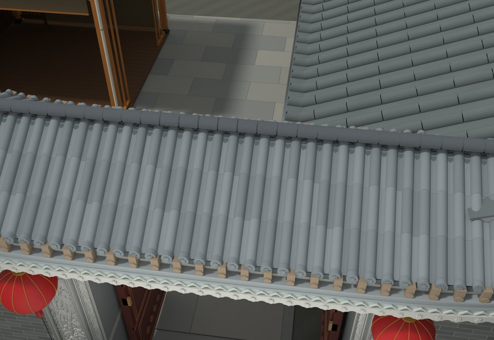
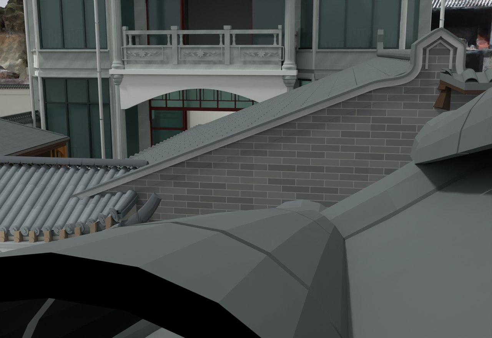

# V24.02 · 清除筒瓦重面并闭合菱花脊和曲线山墙

[逐版目录](README.md) · [建筑重建台账](../../reconstruction.md) · [阶段方法汇总](../v24-v24-21.md) · [上一篇 V24](v24.md) · [下一篇 V24.03](v24-03.md)

## 摘要

清内门筒瓦重面，补正脊菱花带、脊座和侧收口，完善厨房曲线山墙压顶及交接。

## 1. 问题与输入

以 V24 门楼和厨房为基础。航拍及近景表明门楼正脊花带缺失，厨房斜山墙需连续压顶并延到门楼檐下。该轮模型和说明保存在 V24 项目的同名子版文件中。

## 2. 实现方法

1. 按瓦的搭接次序清筒瓦重面，做窄接缝和独立脊座、透空菱花带及侧收口。原已收短的檐宽作为边界。
2. 厨房三角砖墙保留注册基址，在顶部建立弧形肩部、薄压顶和短竖脊头。逐层处理瓦面、封檐与山墙的前后关系。
3. 读回同版 Blender，检查承托搭接、原图像与门根。历史目录可重开并渲染复核，构造记录取自交付说明和变更数据。

## 3. 过程图

*图 1 · 门楼正脊和菱花带。过程文件 `Rebuild_V24/Reports/V24_02_Ridge_Top.png`。*

*图 2 · V24.02 厨房曲线山墙与门楼檐口。过程文件 `Rebuild_V24/Reports/V24_02_Kitchen_Gate_Junction.png`。*

## 4. 验证与适用范围

复开检查记录 107 个既有材质、73 张既有图像、26 个门根，失败清单为空。曲线压顶与菱花脊尺寸为照片拟合，未恢复的施工尺寸留在原报告边界内。

| 过程报告 | 原报告读数 |
| --- | --- |
| `Rebuild_V24/Reports/V24_02_Fresh_Blend_QA.json` | 状态 `PASS_V24_02_FRESH_BLEND_QA`，检查条目 1,953，失败记录 0。 |
| `Rebuild_V24/Reports/V24_02_Build.json` | 记录本轮参数、对象和处理结果。 |

### 原记录中的关键检查

| 检查项 | 结果与读数 | 原记录位置 |
| --- | --- | --- |
| Exactly 26 original moving door roots | 通过，`count=26` | `V24_02_Fresh_Blend_QA.json` 的 `checks[1747]` |
| Fifteen independent carved fields | 通过，`count=15` | `V24_02_Fresh_Blend_QA.json` 的 `checks[1826]` |
| Relief depth bounded V24_Gate_Reference_Relief_Header_1 | 通过，`nominal_depth_m=0.015` | `V24_02_Fresh_Blend_QA.json` 的 `checks[1829]` |

## 5. 复现入口与出处

过程路径以本地 `JIA` 项目为根，`work/` 指重建项目的历史工作目录。复核时按交付记录打开本轮输入与保存成果，再依方法中的截面、对象或动作采样对照原报告。

- **交付与参考记录**。`Rebuild_V24/README_V24.txt`

- **原实现脚本**。`Rebuild_V24/Source/v24_02_verify_render.py`

过程图校验值

| 图 | 原过程图 SHA-256 | 发布方式 |
| --- | --- | --- |
| 1 | `099cb62e54b72785da62baf0b49ee0338ee9b684e204024336c709c3e63564c0` | 台账发布图，按原图缩放及压缩 |
| 2 | `4465fdc26c9baf33f3d719d764947bb421b790f621af2cd92dd8e2f97f842e58` | 保留原画面，发布用 JPEG |

