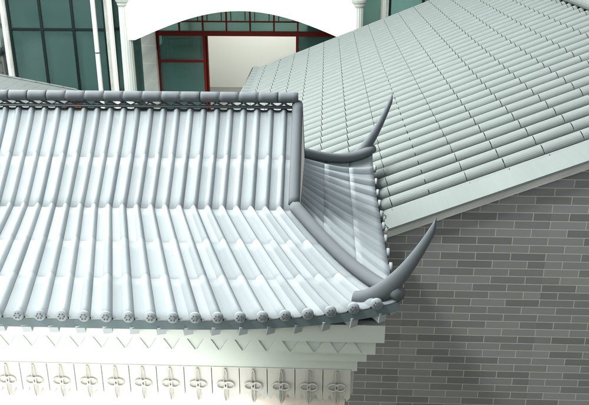
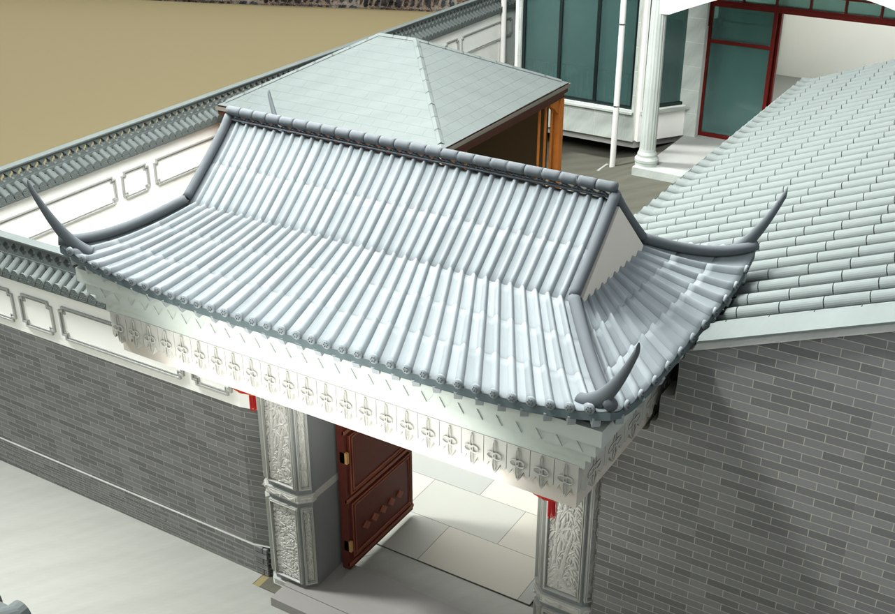

# V24.03 · 以实景相似配准和局部剖面重做歇山门楼

[逐版目录](README.md) · [建筑重建台账](../../reconstruction.md) · [阶段方法汇总](../v24-v24-21.md)

## 摘要

按配准剖面重做歇山门楼及封闭檐底。补厨房后墙和三角缺面，改一根中部檐廊柱并处理墙脚排水。

## 1. 问题与输入

上轮模型屋顶进深与高度不足。参考 2 号实景模型和项目坐标、高程不同，先通过共同地物配准，再从门楼中部剖面读体量。

## 2. 实现方法

1. 用 9 组纹理或顶面特征拟合初值，在纯场地保留区做三维配准。拟合尺度约 1.0187，末轮近邻残差约 0.32 m。由配准剖面判断中部最高点和进深。

2. 按上部两主坡、两端山花、四面下披檐及九脊构造歇山。普通檐口进深取 2.60 m，主脊模型高约 4.284 m。以封闭檐底收口。

3. 对厨房三角缺面、后墙和独立檐廊柱分别补建。墙脚与排水按原位置衔接，邻接屋面逐组做三角交叉检查。

### 实现链与源码定位

以下按诊断、处理、保存与复核组织阅读。调用和文件引用来自原脚本，输入输出方向由对应读写调用判断；辅助文件是否在本轮运行，以报告为准。

**1. 定位与诊断** · [`v24_03_junction_probe.py`](../source-code/v24-03/history/v24_03_junction_probe.py#L4)

打开保存的 Blender [`bpy.ops.wm.open_mainfile`](../source-code/v24-03/history/v24_03_junction_probe.py#L4)。

文件引用：[`Architecture_Complete_V24_02.blend`](../source-code/v24-03/history/v24_03_junction_probe.py#L4) · [`End_Profile.json`](../source-code/v24-03/history/v24_03_junction_probe.py#L17)。

**2. 定位与诊断** · [`v24_03_finish_intersection.py`](../source-code/v24-03/project/Source/v24_03_finish_intersection.py#L5)

打开保存的 Blender [`bpy.ops.wm.open_mainfile`](../source-code/v24-03/project/Source/v24_03_finish_intersection.py#L5)；差集裁切 [`j._difference`](../source-code/v24-03/project/Source/v24_03_finish_intersection.py#L7)；另存 Blender [`bpy.ops.wm.save_as_mainfile`](../source-code/v24-03/project/Source/v24_03_finish_intersection.py#L23)。

文件引用：[`Architecture_Complete_V24_03.blend`](../source-code/v24-03/project/Source/v24_03_finish_intersection.py#L5) · [`V24_03_Changes.json`](../source-code/v24-03/project/Source/v24_03_finish_intersection.py#L8) · [`V24_03_Junction_Report.json`](../source-code/v24-03/project/Source/v24_03_finish_intersection.py#L22)。

**3. 定位与诊断** · [`v24_register_icp.py`](../source-code/v24-03/project/Source/v24_register_icp.py#L12)

奇异值分解 [`np.linalg.svd`](../source-code/v24-03/project/Source/v24_register_icp.py#L12)。

文件引用：[`Registration_Seed.json`](../source-code/v24-03/project/Source/v24_register_icp.py#L6) · [`reference2_points.npz`](../source-code/v24-03/project/Source/v24_register_icp.py#L6) · [`current_site_points.npz`](../source-code/v24-03/project/Source/v24_register_icp.py#L6)。

**4. 构建或写入** · [`v24_03_build.py`](../source-code/v24-03/project/Source/v24_03_build.py#L21)

打开保存的 Blender [`bpy.ops.wm.open_mainfile`](../source-code/v24-03/project/Source/v24_03_build.py#L21)；另存 Blender [`bpy.ops.wm.save_as_mainfile`](../source-code/v24-03/project/Source/v24_03_build.py#L50)。

文件引用：[`Architecture_Complete_V24_02.blend`](../source-code/v24-03/project/Source/v24_03_build.py#L9) · [`Architecture_Complete_V24_03.blend`](../source-code/v24-03/project/Source/v24_03_build.py#L9) · [`V24_03_Before_Snapshot.json`](../source-code/v24-03/project/Source/v24_03_build.py#L22)。

**5. 过程出图** · [`v24_03_render.py`](../source-code/v24-03/project/Source/v24_03_render.py#L4)

打开保存的 Blender [`bpy.ops.wm.open_mainfile`](../source-code/v24-03/project/Source/v24_03_render.py#L4)。

文件引用：[`Architecture_Complete_V24_03.blend`](../source-code/v24-03/project/Source/v24_03_render.py#L4) · [`V24_03_Preview_States.json`](../source-code/v24-03/project/Source/v24_03_render.py#L15) · [`V24_03_Whole_Site_Inventory.json`](../source-code/v24-03/project/Source/v24_03_render.py#L20)。

**6. 保存后核验** · [`v24_03_verify.py`](../source-code/v24-03/project/Source/v24_03_verify.py#L7)

打开保存的 Blender [`bpy.ops.wm.open_mainfile`](../source-code/v24-03/project/Source/v24_03_verify.py#L7)；判据与回归检查 [`checks.append`](../source-code/v24-03/project/Source/v24_03_verify.py#L10)；网格与实体转换 [`bm.from_mesh`](../source-code/v24-03/project/Source/v24_03_verify.py#L32)。

文件引用：[`Architecture_Complete_V24_03.blend`](../source-code/v24-03/project/Source/v24_03_verify.py#L6) · [`V24_03_Before_Snapshot.json`](../source-code/v24-03/project/Source/v24_03_verify.py#L8) · [`V24_03_Changes.json`](../source-code/v24-03/project/Source/v24_03_verify.py#L8)。

**7. 交付封装** · [`v24_03_package.py`](../source-code/v24-03/project/Source/v24_03_package.py#L8)

文件引用：[`Architecture_Complete_V24_03.blend`](../source-code/v24-03/project/Source/v24_03_package.py#L5) · [`V24_03_Build.json`](../source-code/v24-03/project/Source/v24_03_package.py#L8) · [`V24_03_Fresh_Blend_QA.json`](../source-code/v24-03/project/Source/v24_03_package.py#L8)。

[方法原理：局部实体、接合与保护域](../methodology.md#4-局部改模如何限定影响范围) · [本版完整过程索引](process/v24-03.md)

本版索引汇合 14 幅已归档过程图、27 份交付及历史目录中的报告／说明／中间记录和全部 22 个源码附件。继承文件和本轮新增文件按来源保留，实际完成范围以第 4 节及原报告为准。

## 3. 过程图

**图 1** · 歇山门楼与厨房接合

**图 2** · V24.03 重建歇山的两主坡、下披檐和脊线

## 4. 验证与适用范围

配准残差决定参考剖面适合比较体量。最终 Blender 复开记录 3,031 项检查，失败清单为空；接头和门扇的毫米尺度关系另由模型实体及动作检查判读。

- **Dimension Audit** 
  状态 `PASS_SITE_REFERENCE_REGISTRATION`，特征内点数 9，纹理同名特征 RMS（m） 0.271378。

- **Fresh Blend QA** 
  状态 `PASS_V24_03_FRESH_BLEND_QA`，检查条目 3,031，失败记录 0。

### 原记录中的关键检查

- **Closed finite new solid V24_03_Kitchen_Rear_Gable_Wall** 
  通过，`non_manifold_edges` = `0`，`volume_m3` = `4.24619` 
  原记录 `V24_03_Fresh_Blend_QA.json` 的 `checks[2889]`

- **Closed finite new solid V24_03_Wall_Flower_Ridge_Terminal_Bearing** 
  通过，`non_manifold_edges` = `0`，`volume_m3` = `0.000728056` 
  原记录 `V24_03_Fresh_Blend_QA.json` 的 `checks[2905]`

- **Closed finite new solid V24_03_Kitchen_Rear_Corner_Downpipe** 
  通过，`non_manifold_edges` = `0`，`volume_m3` = `0.00824925` 
  原记录 `V24_03_Fresh_Blend_QA.json` 的 `checks[2879]`

## 5. 复现入口与出处

过程路径以本地 `JIA` 项目为根，`work/` 指重建项目的历史工作目录。复核时按交付记录打开本轮输入与保存成果，再依方法中的截面、对象或动作采样对照原报告。

交付与参考记录（1 项）

~~~text
Rebuild_V24_03/README_V24_03.txt
~~~

### 原实现脚本附件

[浏览本版全部 22 个文件](../source-code/v24-03/README.md) · [原件与公开副本校验值](../source-code/v24-03/manifest.json)

- [`v24_03_junction_probe.py`](../source-code/v24-03/history/v24_03_junction_probe.py)
- [`v24_03_build.py`](../source-code/v24-03/project/Source/v24_03_build.py)
- [`v24_03_finish_intersection.py`](../source-code/v24-03/project/Source/v24_03_finish_intersection.py)
- [`v24_03_render.py`](../source-code/v24-03/project/Source/v24_03_render.py)
- [`v24_03_verify.py`](../source-code/v24-03/project/Source/v24_03_verify.py)

原脚本本地路径

~~~text
work/v24_03_junction_probe.py
Rebuild_V24_03/Source/v24_03_build.py
Rebuild_V24_03/Source/v24_03_finish_intersection.py
Rebuild_V24_03/Source/v24_03_render.py
Rebuild_V24_03/Source/v24_03_verify.py
~~~

核验报告路径（2 项）

**Dimension Audit**

~~~text
Rebuild_V24_03/Reports/V24_03_Dimension_Audit.json
~~~

**Fresh Blend QA**

~~~text
Rebuild_V24_03/Reports/V24_03_Fresh_Blend_QA.json
~~~

图源与 SHA-256（2 张）

### 图 1 · 歇山门楼与厨房接合

~~~text
Rebuild_V24_03/Reports/V24_03_Gate_Kitchen_Intersection.png
~~~

**原过程图 SHA-256**

~~~text
8ed925910aa4cb1f901d58440c8d14f59a03548833f7fdf552c17282dc883320
~~~

台账发布图，按原图缩放及压缩。

### 图 2 · V24.03 重建歇山的两主坡、下披檐和脊线

~~~text
Rebuild_V24_03/Reports/V24_03_Xieshan_Top.png
~~~

**原过程图 SHA-256**

~~~text
d8ebeb6e5324f1c0a57895cb234ab35c77cfc7460d7f07d5dd029371c18cb526
~~~

保留原画面，发布用 JPEG。

---

上一篇 [V24.02 · 清除筒瓦重面并闭合菱花脊和曲线山墙](v24-02.md) 
下一篇 [V24.04 · 门楼屋面减薄与厨房后墙实体封闭](v24-04.md)
