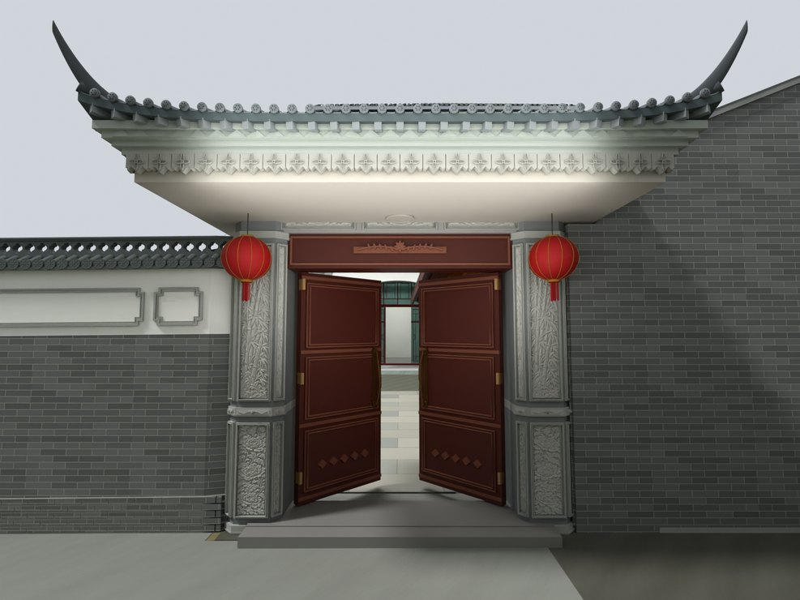
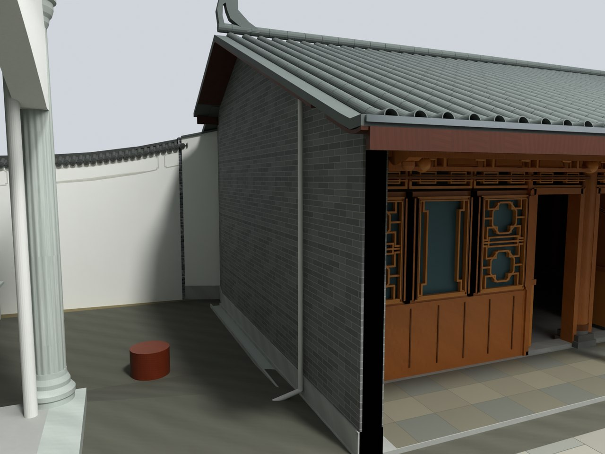

# V24.04 · 门楼屋面减薄与厨房后墙实体封闭

[逐版目录](README.md) · [建筑重建台账](../../reconstruction.md) · [阶段方法汇总](../v24-v24-21.md)

## 摘要

减薄并压低内门歇山屋面，保留分层瓦件。延伸厨房后墙到外围墙端部并做实体封闭。

## 1. 问题与输入

V24.03 恢复歇山体量后，檐下叠层偏厚。厨房后墙在外围墙端部仍有可见开口。两个问题采用独立几何域修改。

## 2. 实现方法

1. 保持屋面宽深和歇山层级，以屋脊和檐底为控制缩减檐层厚度，由 0.762 m 减至 0.402 m。六坡、九脊和独立瓦件分别保留。

2. 从后墙端部探针读取外围墙接合位置。将 230 mm 后墙向边界延伸，墙顶用下屋面包络裁切并封闭，保留单根檐廊柱。

3. 重开 Blender，对减薄后屋檐、厨房墙端射线和接面做几何检查。以原材质和门扇数据作为回归项。

### 实现链与源码定位

以下按诊断、处理、保存与复核组织阅读。调用和文件引用来自原脚本，输入输出方向由对应读写调用判断；辅助文件是否在本轮运行，以报告为准。

**1. 定位与诊断** · [`v24_04_wall_end_probe.py`](../source-code/v24-04/history/v24_04_wall_end_probe.py#L4)

打开保存的 Blender [`bpy.ops.wm.open_mainfile`](../source-code/v24-04/history/v24_04_wall_end_probe.py#L4)；网格与实体转换 [`bm.from_mesh`](../source-code/v24-04/history/v24_04_wall_end_probe.py#L8)。

文件引用：[`Architecture_Complete_V24_04.blend`](../source-code/v24-04/history/v24_04_wall_end_probe.py#L4)。

**2. 定位与诊断** · [`v24_04_probe.py`](../source-code/v24-04/history/v24_04_probe.py#L8)

打开保存的 Blender [`bpy.ops.wm.open_mainfile`](../source-code/v24-04/history/v24_04_probe.py#L8)。

文件引用：[`Architecture_Complete_V24_03.blend`](../source-code/v24-04/history/v24_04_probe.py#L6) · [`near_rear.json`](../source-code/v24-04/history/v24_04_probe.py#L15)。

**3. 参数与几何处理** · [`v24_04_roof.py`](../source-code/v24-04/history/v24_04_roof.py#L67)

叉积／面法线 [`t.cross`](../source-code/v24-04/history/v24_04_roof.py#L67)；写入网格拓扑 [`me.from_pydata`](../source-code/v24-04/history/v24_04_roof.py#L224)；网格与实体转换 [`bm.from_mesh`](../source-code/v24-04/history/v24_04_roof.py#L228)。

文件引用：[`V24_04_Xieshan_Roof_Report.json`](../source-code/v24-04/history/v24_04_roof.py#L241)。

**4. 构建或写入** · [`v24_04_build.py`](../source-code/v24-04/history/v24_04_build.py#L10)

打开保存的 Blender [`bpy.ops.wm.open_mainfile`](../source-code/v24-04/history/v24_04_build.py#L10)；射线命中检查 [`tr.ray_cast`](../source-code/v24-04/history/v24_04_build.py#L59)；差集裁切 [`_difference`](../source-code/v24-04/history/v24_04_build.py#L107)。

文件引用：[`V24_04_Before_Snapshot.json`](../source-code/v24-04/history/v24_04_build.py#L11) · [`V24_03_Junction_Report.json`](../source-code/v24-04/history/v24_04_build.py#L22) · [`Architecture_Complete_V24_02.blend`](../source-code/v24-04/history/v24_04_build.py#L25)。

**5. 辅助实现** · [`v24_04_rays.py`](../source-code/v24-04/history/v24_04_rays.py#L3)

打开保存的 Blender [`bpy.ops.wm.open_mainfile`](../source-code/v24-04/history/v24_04_rays.py#L3)；射线命中检查 [`sc.ray_cast`](../source-code/v24-04/history/v24_04_rays.py#L7)。

文件引用：[`Architecture_Complete_V24_03.blend`](../source-code/v24-04/history/v24_04_rays.py#L3)。

**6. 保存后核验** · [`v24_04_verify.py`](../source-code/v24-04/history/v24_04_verify.py#L8)

打开保存的 Blender [`bpy.ops.wm.open_mainfile`](../source-code/v24-04/history/v24_04_verify.py#L8)；判据与回归检查 [`checks.append`](../source-code/v24-04/history/v24_04_verify.py#L11)；射线命中检查 [`bands.ray_cast`](../source-code/v24-04/history/v24_04_verify.py#L38)。

文件引用：[`V24_04_Before_Snapshot.json`](../source-code/v24-04/history/v24_04_verify.py#L9) · [`V24_04_Changes.json`](../source-code/v24-04/history/v24_04_verify.py#L9) · [`V24_04_Closure_and_Contact.json`](../source-code/v24-04/history/v24_04_verify.py#L9)。

**7. 交付封装** · [`v24_04_package.py`](../source-code/v24-04/history/v24_04_package.py#L7)

文件引用：[`Architecture_Complete_V24_04.blend`](../source-code/v24-04/history/v24_04_package.py#L4) · [`V24_04_Fresh_Blend_QA.json`](../source-code/v24-04/history/v24_04_package.py#L7) · [`V24_04_Preview_States.json`](../source-code/v24-04/history/v24_04_package.py#L7)。

[方法原理：局部实体、接合与保护域](../methodology.md#4-局部改模如何限定影响范围) · [本版完整过程索引](process/v24-04.md)

本版索引汇合 11 幅已归档过程图、14 份交付及历史目录中的报告／说明／中间记录和全部 12 个源码附件。继承文件和本轮新增文件按来源保留，实际完成范围以第 4 节及原报告为准。

## 3. 过程图

**图 1** · 减薄后的内门屋面

**图 2** · V24.04 厨房后墙延伸后与外围墙端部的封合

## 4. 验证与适用范围

保存后报告列 4,201 项检查，失败清单为空。0.402 m 为模型檐层厚度，230 mm 是本轮实体补墙参数。

- **Fresh Blend QA** 
  状态 `PASS_V24_04_FRESH_BLEND_QA`，检查条目 4,201，失败记录 0。

- **模型构建记录** 
  状态 `SAVED`。

### 原记录中的关键检查

- **Independent closed positive solids V24_03_Kitchen_Rear_Gable_Wall** 
  通过，`vertices` = `284`，`faces` = `282`，`signed_volume_m3` = `5.76408` 
  原记录 `V24_04_Fresh_Blend_QA.json` 的 `checks[4074]`

- **Independent closed positive solids V24_XIESHAN_01_Upper_Two_Main_Slopes** 
  通过，`vertices` = `3380`，`faces` = `3376`，`signed_volume_m3` = `0.167508` 
  原记录 `V24_04_Fresh_Blend_QA.json` 的 `checks[4054]`

- **Independent closed positive solids V24_XIESHAN_02_Four_Lower_Hipped_Eaves** 
  通过，`vertices` = `4920`，`faces` = `4912`，`signed_volume_m3` = `0.4389` 
  原记录 `V24_04_Fresh_Blend_QA.json` 的 `checks[4055]`

## 5. 复现入口与出处

过程路径以本地 `JIA` 项目为根，`work/` 指重建项目的历史工作目录。复核时按交付记录打开本轮输入与保存成果，再依方法中的截面、对象或动作采样对照原报告。

交付与参考记录（1 项）

~~~text
Rebuild_V24_04/README_V24_04.txt
~~~

### 原实现脚本附件

[浏览本版全部 12 个文件](../source-code/v24-04/README.md) · [原件与公开副本校验值](../source-code/v24-04/manifest.json)

- [`v24_04_roof.py`](../source-code/v24-04/history/v24_04_roof.py)
- [`v24_04_wall_end_probe.py`](../source-code/v24-04/history/v24_04_wall_end_probe.py)
- [`v24_04_rays.py`](../source-code/v24-04/history/v24_04_rays.py)
- [`v24_04_build.py`](../source-code/v24-04/history/v24_04_build.py)
- [`v24_04_probe.py`](../source-code/v24-04/history/v24_04_probe.py)

原脚本本地路径

~~~text
work/v24_04_roof.py
work/v24_04_wall_end_probe.py
work/v24_04_rays.py
work/v24_04_build.py
work/v24_04_probe.py
~~~

核验报告路径（2 项）

**Fresh Blend QA**

~~~text
Rebuild_V24_04/Reports/V24_04_Fresh_Blend_QA.json
~~~

**模型构建记录**

~~~text
Rebuild_V24_04/Reports/V24_04_Build.json
~~~

图源与 SHA-256（2 张）

### 图 1 · 减薄后的内门屋面

~~~text
Rebuild_V24_04/Reports/V24_04_Gate_Front.png
~~~

**原过程图 SHA-256**

~~~text
c2d0b628b53c831ab12857480dd2d52063b19bcc5a7c9453bec6daa80c260d76
~~~

台账发布图，按原图缩放及压缩。

### 图 2 · V24.04 厨房后墙延伸后与外围墙端部的封合

~~~text
Rebuild_V24_04/Reports/V24_04_Kitchen_Wall_Closed.png
~~~

**原过程图 SHA-256**

~~~text
ad5c87e96c21120940554a9e9e56c836a8202a02942b77d6452725dcecfa930c
~~~

保留原画面，发布用 JPEG。

---

上一篇 [V24.03 · 以实景相似配准和局部剖面重做歇山门楼](v24-03.md) 
下一篇 [V24.05 · 整体抬升薄歇山并重接柱颈和厨房屋面](v24-05.md)
