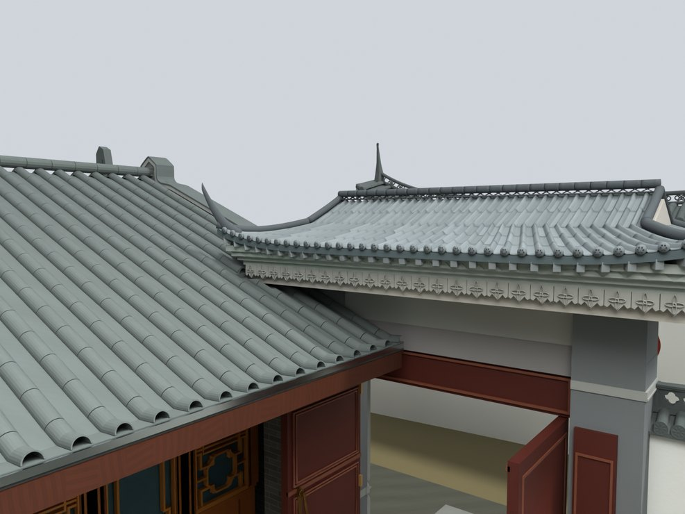
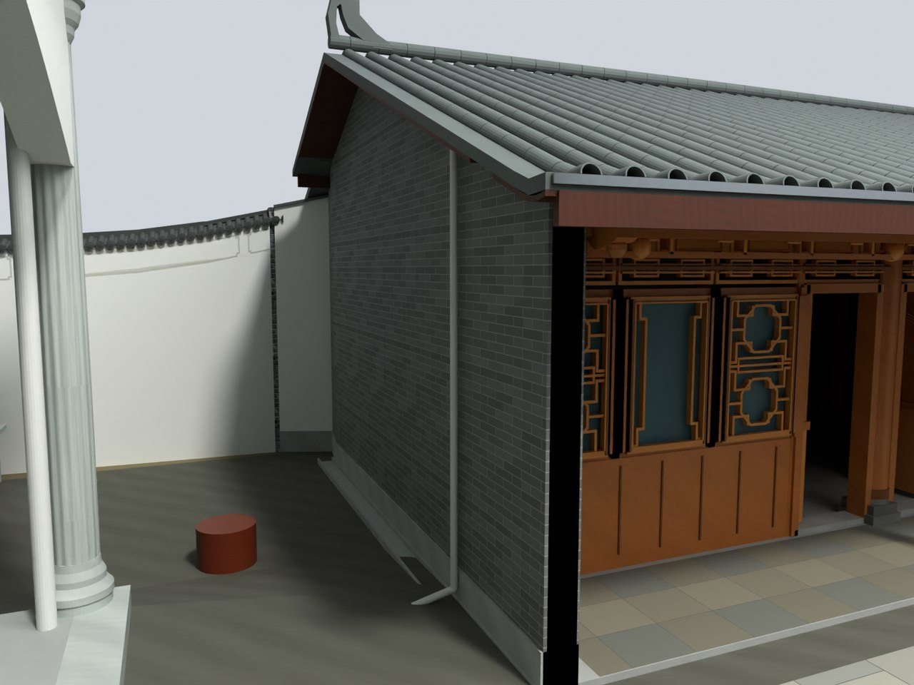

# V24.05 · 整体抬升薄歇山并重接柱颈和厨房屋面

[逐版目录](README.md) · [建筑重建台账](../../reconstruction.md) · [阶段方法汇总](../v24-v24-21.md)

## 摘要

轻薄歇山屋顶整体上移 0.50 m，增石柱承接段及墙颈，重接厨房相邻屋面。

## 1. 问题与输入

V24.04 已减薄屋顶。本轮以整体上移解决檐下标高，保持屋面形态，由石柱上段和门楣上方墙颈承接新高度。

## 2. 实现方法

1. 将屋面、檐下层次、灯笼和顶灯的 20 组构件沿全局 Z 同移 0.500 m。保留各组 UV、宽深和形状。

2. 按原柱顶与新檐底之间的差补建两侧柱段和素面墙颈。重做与厨房交接的可见收口，保持厨房后墙端封闭。

3. 在用户圈示的共享屋面投影内取高度差，另查实际三角面穿插。保存后读回整组构件的位移。

## 3. 过程图

**图 1** · 门楼抬高后的屋面关系

**图 2** · V24.05 保留的厨房后墙端部封闭

## 4. 验证与适用范围

檐口中点从 2.94 m 到 3.44 m，采样区域内门楼屋面高于厨房坡面的最小值约 0.277 m。该高差适用于报告的共享投影区。

- **Fresh Blend QA** 
  状态 `PASS_V24_05_FRESH_BLEND_QA`，检查条目 4,205，失败记录 0，屋面抬高（m） 0.5，圈示区最小高差（m） 0.277245。

- **模型构建记录** 
  状态 `SAVED`。

### 原记录中的关键检查

- **Closed new bearing V24_05_Gate_Plain_Neck_Above_Carved_Lintel** 
  通过，`vertices` = `8`，`faces` = `6`，`signed_volume_m3` = `0.397356` 
  原记录 `V24_05_Fresh_Blend_QA.json` 的 `checks[4095]`

- **Closed new bearing V24_05_Gate_Upper_Pier_Bearing_1** 
  通过，`vertices` = `12`，`faces` = `8`，`signed_volume_m3` = `0.126184` 
  原记录 `V24_05_Fresh_Blend_QA.json` 的 `checks[4096]`

- **Closed new bearing V24_05_Gate_Upper_Pier_Bearing_2** 
  通过，`vertices` = `12`，`faces` = `8`，`signed_volume_m3` = `0.126185` 
  原记录 `V24_05_Fresh_Blend_QA.json` 的 `checks[4097]`

## 5. 复现入口与出处

过程路径以本地 `JIA` 项目为根，`work/` 指重建项目的历史工作目录。复核时按交付记录打开本轮输入与保存成果，再依方法中的截面、对象或动作采样对照原报告。

交付与参考记录（1 项）

~~~text
Rebuild_V24_05/README_V24_05.txt
~~~

### 原实现脚本附件

[浏览本版全部 10 个文件](../source-code/v24-05/README.md) · [原件与公开副本校验值](../source-code/v24-05/manifest.json)

- [`v24_05_build.py`](../source-code/v24-05/project/Source/v24_05_build.py)
- [`v24_05_verify.py`](../source-code/v24-05/project/Source/v24_05_verify.py)
- [`v24_05_probe.py`](../source-code/v24-05/history/v24_05_probe.py)
- [`v24_05_common.py`](../source-code/v24-05/project/Source/v24_05_common.py)
- [`v24_05_finish.py`](../source-code/v24-05/project/Source/v24_05_finish.py)

原脚本本地路径

~~~text
Rebuild_V24_05/Source/v24_05_build.py
Rebuild_V24_05/Source/v24_05_verify.py
work/v24_05_probe.py
Rebuild_V24_05/Source/v24_05_common.py
Rebuild_V24_05/Source/v24_05_finish.py
~~~

核验报告路径（2 项）

**Fresh Blend QA**

~~~text
Rebuild_V24_05/Reports/V24_05_Fresh_Blend_QA.json
~~~

**模型构建记录**

~~~text
Rebuild_V24_05/Reports/V24_05_Build.json
~~~

图源与 SHA-256（2 张）

### 图 1 · 门楼抬高后的屋面关系

~~~text
Rebuild_V24_05/Reports/V24_05_Gate_Kitchen_Height.png
~~~

**原过程图 SHA-256**

~~~text
7d819706b8ea32e071496afe051cbb8a9c3ecebfc6bff4d870b9f0d683a2765c
~~~

台账发布图，按原图缩放及压缩。

### 图 2 · V24.05 保留的厨房后墙端部封闭

~~~text
Rebuild_V24_05/Reports/V24_05_Kitchen_Wall_Closed.png
~~~

**原过程图 SHA-256**

~~~text
774a30196dd0a9e19c99afd4d513706255021d8d55e07b960e4d82377d937e2e
~~~

保留原画面，发布用 JPEG。

---

上一篇 [V24.04 · 门楼屋面减薄与厨房后墙实体封闭](v24-04.md) 
下一篇 [V24.06 · 以门柱中线约束短檐和檐下净高](v24-06.md)
