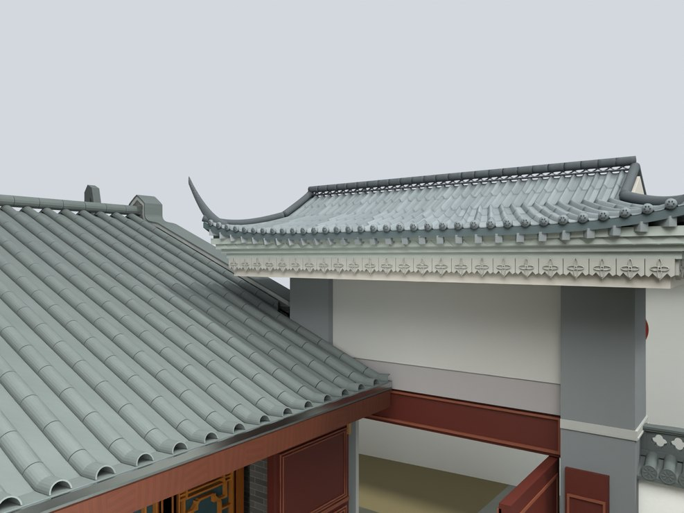
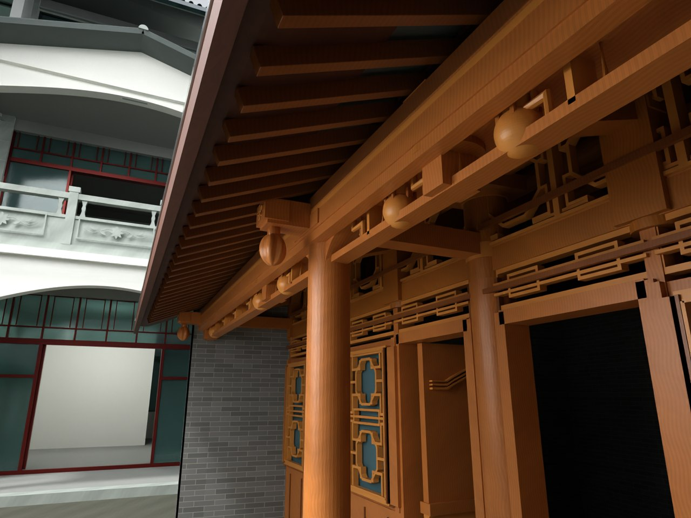

# V24.06 · 以门柱中线约束短檐和檐下净高

[逐版目录](README.md) · [建筑重建台账](../../reconstruction.md) · [阶段方法汇总](../v24-v24-21.md)

## 摘要

屋顶按门柱居中、前后短檐，檐底调整到 3.50 m。配套调整墙线与厨房檐廊木构。

## 1. 问题与输入

V24.05 提升了整套屋顶，前后出檐仍偏心。本轮用柱中心对屋面和围墙对位，厨房木构依据近景分件细化。

## 2. 实现方法

1. 移动屋面中心到门柱中心，前檐向内收约 0.618 m，前后出挑各约 0.786 m。檐底设 3.500 m，承接段随之补齐。

2. 院墙中线向内校正 0.118 m。圈定树和土环移除后，释放带延续邻接过道原坡度与混凝土 UV 尺度。

3. 保留六道圆檩和单根独立檐廊柱，增加 40 对密排椽与局部穿梁、垂瓜和托木。复开测共享投影内的最小檐底净差。

### 实现链与源码定位

以下按诊断、处理、保存与复核组织阅读。调用和文件引用来自原脚本，输入输出方向由对应读写调用判断；辅助文件是否在本轮运行，以报告为准。

**1. 定位与诊断** · [`v24_06_probe.py`](../source-code/v24-06/history/v24_06_probe.py#L6)

打开保存的 Blender [`bpy.ops.wm.open_mainfile`](../source-code/v24-06/history/v24_06_probe.py#L6)；网格与实体转换 [`bm.from_mesh`](../source-code/v24-06/history/v24_06_probe.py#L14)。

文件引用：[`Architecture_Complete_V24_05.blend`](../source-code/v24-06/history/v24_06_probe.py#L6) · [`Inventory.json`](../source-code/v24-06/history/v24_06_probe.py#L11)。

**2. 定位与诊断** · [`v24_06_probe_pit.py`](../source-code/v24-06/history/v24_06_probe_pit.py#L5)

打开保存的 Blender [`bpy.ops.wm.open_mainfile`](../source-code/v24-06/history/v24_06_probe_pit.py#L5)；交集限域 [`ids.intersection`](../source-code/v24-06/history/v24_06_probe_pit.py#L14)。

文件引用：[`V24_06_Pit_Probe.json`](../source-code/v24-06/history/v24_06_probe_pit.py#L15)。

**3. 定位与诊断** · [`v24_06_detail_probe.py`](../source-code/v24-06/history/v24_06_detail_probe.py#L5)

打开保存的 Blender [`bpy.ops.wm.open_mainfile`](../source-code/v24-06/history/v24_06_detail_probe.py#L5)；最小二乘求解 [`np.linalg.lstsq`](../source-code/v24-06/history/v24_06_detail_probe.py#L30)；射线命中检查 [`t.ray_cast`](../source-code/v24-06/history/v24_06_detail_probe.py#L42)。

文件引用：[`Architecture_Complete_V24_05.blend`](../source-code/v24-06/history/v24_06_detail_probe.py#L5) · [`Kitchen_Contact_Heights.json`](../source-code/v24-06/history/v24_06_detail_probe.py#L24) · [`Floor_Samples.json`](../source-code/v24-06/history/v24_06_detail_probe.py#L45)。

**4. 参数与几何处理** · [`v24_06_roof.py`](../source-code/v24-06/project/Source/v24_06_roof.py#L67)

叉积／面法线 [`t.cross`](../source-code/v24-06/project/Source/v24_06_roof.py#L67)；写入网格拓扑 [`me.from_pydata`](../source-code/v24-06/project/Source/v24_06_roof.py#L224)；网格与实体转换 [`bm.from_mesh`](../source-code/v24-06/project/Source/v24_06_roof.py#L228)。

文件引用：[`V24_06_Roof_Geometry.json`](../source-code/v24-06/project/Source/v24_06_roof.py#L241)。

**5. 构建或写入** · [`v24_06_build.py`](../source-code/v24-06/project/Source/v24_06_build.py#L11)

打开保存的 Blender [`bpy.ops.wm.open_mainfile`](../source-code/v24-06/project/Source/v24_06_build.py#L11)；另存 Blender [`bpy.ops.wm.save_as_mainfile`](../source-code/v24-06/project/Source/v24_06_build.py#L111)。

文件引用：[`V24_06_Before_Snapshot.json`](../source-code/v24-06/project/Source/v24_06_build.py#L11) · [`V24_05_Changes.json`](../source-code/v24-06/project/Source/v24_06_build.py#L15) · [`Architecture_Complete_V24_02.blend`](../source-code/v24-06/project/Source/v24_06_build.py#L16)。

**6. 保存后核验** · [`v24_06_verify.py`](../source-code/v24-06/project/Source/v24_06_verify.py#L7)

打开保存的 Blender [`bpy.ops.wm.open_mainfile`](../source-code/v24-06/project/Source/v24_06_verify.py#L7)；判据与回归检查 [`checks.append`](../source-code/v24-06/project/Source/v24_06_verify.py#L9)；网格与实体转换 [`ev.to_mesh`](../source-code/v24-06/project/Source/v24_06_verify.py#L29)。

文件引用：[`V24_06_Before_Snapshot.json`](../source-code/v24-06/project/Source/v24_06_verify.py#L8) · [`V24_06_Changes.json`](../source-code/v24-06/project/Source/v24_06_verify.py#L8) · [`V24_06_Build.json`](../source-code/v24-06/project/Source/v24_06_verify.py#L8)。

**7. 交付封装** · [`v24_06_package.py`](../source-code/v24-06/project/Source/v24_06_package.py#L7)

文件引用：[`Architecture_Complete_V24_06.blend`](../source-code/v24-06/project/Source/v24_06_package.py#L4) · [`V24_06_Fresh_Blend_QA.json`](../source-code/v24-06/project/Source/v24_06_package.py#L7) · [`V24_06_Preview_States.json`](../source-code/v24-06/project/Source/v24_06_package.py#L7)。

[方法原理：局部实体、接合与保护域](../methodology.md#4-局部改模如何限定影响范围) · [本版完整过程索引](process/v24-06.md)

本版索引汇合 19 幅已归档过程图、21 份交付及历史目录中的报告／说明／中间记录和全部 13 个源码附件。继承文件和本轮新增文件按来源保留，实际完成范围以第 4 节及原报告为准。

## 3. 过程图

**图 1** · 门楼短檐与相邻屋面净空

**图 2** · V24.06 厨房圆檩、密排椽和局部穿梁

## 4. 验证与适用范围

报告记录檐底与对应厨房斜檐最高线的最小高差约 0.139 m。该轮檐底控制值在 V24.07 按新标注回调。

- **Fresh Blend QA** 
  状态 `PASS_V24_06_FRESH_BLEND_QA`，检查条目 5,355，失败记录 0。

- **模型构建记录** 
  状态 `SAVED`。

### 原记录中的关键检查

- **Closed positive solid KITCHEN_V22_CARVED_PROJECTING_TIE_ENDS_Geometry** 
  通过，`vertices` = `3000`，`faces` = `2910`，`signed_volume_m3` = `4.54653e-05` 
  原记录 `V24_06_Fresh_Blend_QA.json` 的 `checks[5163]`

- **Closed positive solid SITE_KITCHEN_V12_VISIBLE_DENSE_WOOD_RAFTERS_Geometry** 
  通过，`vertices` = `640`，`faces` = `480`，`signed_volume_m3` = `0.884293` 
  原记录 `V24_06_Fresh_Blend_QA.json` 的 `checks[5164]`

- **Evaluated closed solid SITE_KITCHEN_V12_VISIBLE_DENSE_WOOD_RAFTERS_Geometry** 
  通过，`vertices` = `4480`，`faces` = `4320`，`signed_volume_m3` = `0.882974` 
  原记录 `V24_06_Fresh_Blend_QA.json` 的 `checks[5165]`

## 5. 复现入口与出处

过程路径以本地 `JIA` 项目为根，`work/` 指重建项目的历史工作目录。复核时按交付记录打开本轮输入与保存成果，再依方法中的截面、对象或动作采样对照原报告。

交付与参考记录（1 项）

~~~text
Rebuild_V24_06/README_V24_06.txt
~~~

### 原实现脚本附件

[浏览本版全部 13 个文件](../source-code/v24-06/README.md) · [原件与公开副本校验值](../source-code/v24-06/manifest.json)

- [`v24_06_probe.py`](../source-code/v24-06/history/v24_06_probe.py)
- [`v24_06_roof.py`](../source-code/v24-06/project/Source/v24_06_roof.py)
- [`v24_06_build.py`](../source-code/v24-06/project/Source/v24_06_build.py)
- [`v24_06_probe_pit.py`](../source-code/v24-06/history/v24_06_probe_pit.py)
- [`v24_06_detail_probe.py`](../source-code/v24-06/history/v24_06_detail_probe.py)

原脚本本地路径

~~~text
work/v24_06_probe.py
Rebuild_V24_06/Source/v24_06_roof.py
Rebuild_V24_06/Source/v24_06_build.py
work/v24_06_probe_pit.py
work/v24_06_detail_probe.py
~~~

核验报告路径（2 项）

**Fresh Blend QA**

~~~text
Rebuild_V24_06/Reports/V24_06_Fresh_Blend_QA.json
~~~

**模型构建记录**

~~~text
Rebuild_V24_06/Reports/V24_06_Build.json
~~~

图源与 SHA-256（2 张）

### 图 1 · 门楼短檐与相邻屋面净空

~~~text
Rebuild_V24_06/Reports/V24_06_Gate_Kitchen_Clearance.png
~~~

**原过程图 SHA-256**

~~~text
0f38c882fc5a96c783dbe8f5ad6f9d061517d3556fcd79067db464d7dfafc1b8
~~~

台账发布图，按原图缩放及压缩。

### 图 2 · V24.06 厨房圆檩、密排椽和局部穿梁

~~~text
Rebuild_V24_06/Reports/V24_06_Kitchen_Timber.png
~~~

**原过程图 SHA-256**

~~~text
1c3a716d17b3e00d3a6a0028e09aabb91a967f3b92cac20876a8fe7024133415
~~~

保留原画面，发布用 JPEG。

---

上一篇 [V24.05 · 整体抬升薄歇山并重接柱颈和厨房屋面](v24-05.md) 
下一篇 [V24.07 · 按标注回调檐底与重做木门芯板](v24-07.md)
