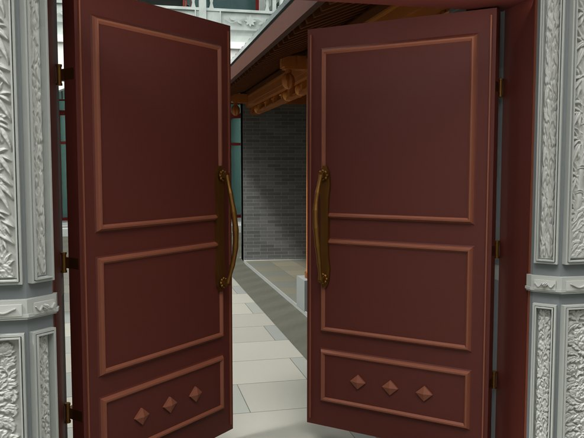
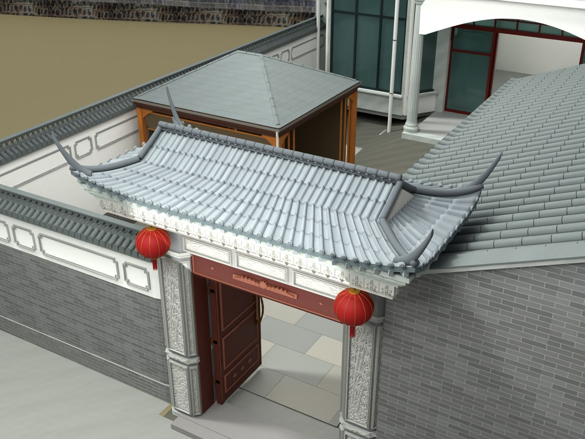

# V24.07 · 按标注回调檐底与重做木门芯板

[逐版目录](README.md) · [建筑重建台账](../../reconstruction.md) · [阶段方法汇总](../v24-v24-21.md) · [上一篇 V24.06](v24-06.md) · [下一篇 V24.08](v24-08.md)

## 摘要

檐底按标注回落到 3.10 m，闭合与厨房相交构件。细化内门芯板、框、铜拉手与合页。

## 1. 问题与输入

以 V24.06 的居中短檐为底稿，按最新标注接近厨房斜檐。内大门的木芯板、固定框和五金按可编辑分件深化。

## 2. 实现方法

1. 把门楼檐底从 3.500 m 降 0.400 m 至 3.100 m。按约 3.071 m 的标注邻近斜檐重做五组局部相交件，柱段与墙颈相应缩短。
2. 门叶分为上芯板、中芯板、菱饰格和踢板，芯板以 8 mm 模型榫舌嵌入框。保留铰轴和铜拉手，补压线、合页和木门额。
3. 在第 1、10、20、30、40 帧检查新门件与柱、腰线、门额和固定框的三角面相交。区分正常五金搭接和有害碰撞。

## 3. 过程图

*图 1 · 门扇芯板与五金细化。过程文件 `Rebuild_V24_07/Reports/V24_07_Door_Panel_Hardware.png`。*

*图 2 · V24.07 回调檐底后的门楼与厨房接头。过程文件 `Rebuild_V24_07/Reports/V24_07_Marked_Junction.png`。*

## 4. 验证与适用范围

报告给局部接触区约 28.8 mm 高差，并记录采样帧无非承接部位的穿插。截面数据用于本地模型协调。

| 过程报告 | 原报告读数 |
| --- | --- |
| `Rebuild_V24_07/Reports/V24_07_Fresh_Blend_QA.json` | 状态 `PASS_V24_07_FRESH_BLEND_QA`，检查条目 4,213，失败记录 0。 |
| `Rebuild_V24_07/Reports/V24_07_Build.json` | 状态 `SAVED`。 |

### 原记录中的关键检查

| 检查项 | 结果与读数 | 原记录位置 |
| --- | --- | --- |
| Closed positive gate component V24_05_Gate_Upper_Pier_Bearing_1 | 通过，`nonmanifold_edges=0`，`volume_m3=0.144252`，`vertices=12` | `V24_07_Fresh_Blend_QA.json` 的 `checks[4103]` |
| Closed positive gate component V24_05_Gate_Upper_Pier_Bearing_2 | 通过，`nonmanifold_edges=0`，`volume_m3=0.144253`，`vertices=12` | `V24_07_Fresh_Blend_QA.json` 的 `checks[4104]` |
| Closed positive gate component V24_05_Gate_Plain_Neck_Above_Carved_Lintel | 通过，`nonmanifold_edges=0`，`volume_m3=0.464485`，`vertices=8` | `V24_07_Fresh_Blend_QA.json` 的 `checks[4105]` |

## 5. 复现入口与出处

过程路径以本地 `JIA` 项目为根，`work/` 指重建项目的历史工作目录。复核时按交付记录打开本轮输入与保存成果，再依方法中的截面、对象或动作采样对照原报告。

- **交付与参考记录**。`Rebuild_V24_07/README_V24_07.txt`

- **原实现脚本**。`work/v24_07_probe.py` · `Rebuild_V24_07/Source/v24_07_doors.py` · `Rebuild_V24_07/Source/v24_07_build.py` · `Rebuild_V24_07/Source/v24_07_common.py` · `Rebuild_V24_07/Source/v24_07_finish.py`

过程图校验值

| 图 | 原过程图 SHA-256 | 发布方式 |
| --- | --- | --- |
| 1 | `f2cb230f2d3344de011ab1585384318bf372f14ff2d2433ec03a54d170821cd5` | 台账发布图，按原图缩放及压缩 |
| 2 | `892afe5c4cc8f8204cd670ff5048fff417cc8d1daf8481e5c57faed1cc541d18` | 保留原画面，发布用 JPEG |

