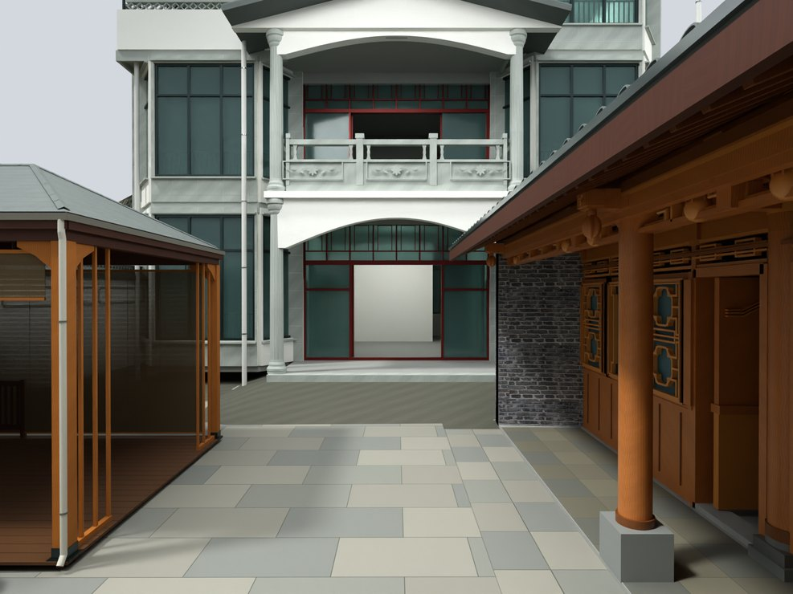
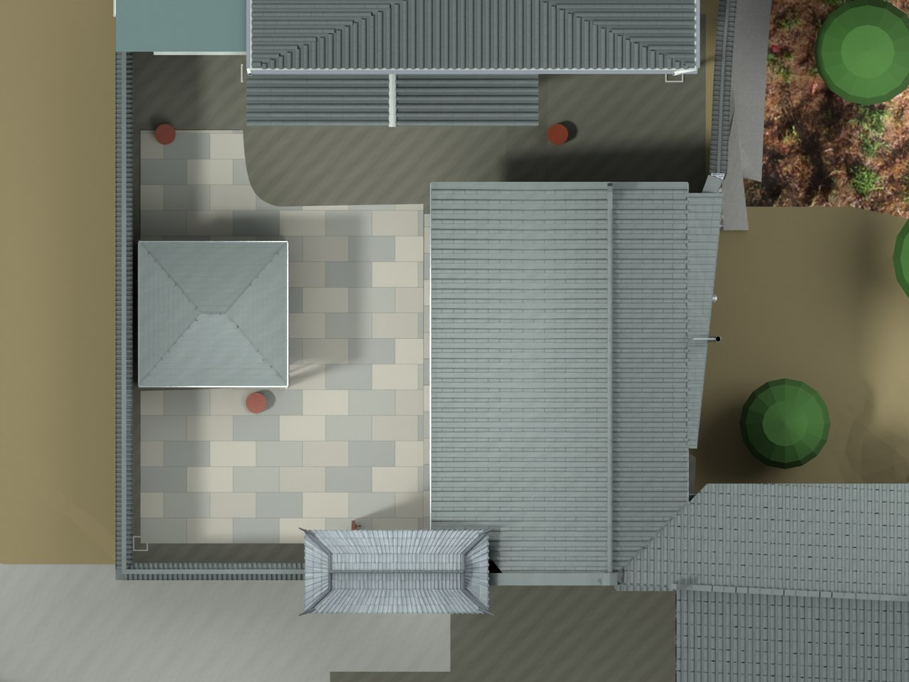

# V24.08 · 固定外墙基线的厨房 0.45 米退让

[逐版目录](README.md) · [建筑重建台账](../../reconstruction.md) · [阶段方法汇总](../v24-v24-21.md) · [上一篇 V24.07](v24-07.md) · [下一篇 V24.09](v24-09.md)

## 摘要

厨房向院外退让 0.45 m，联动门窗、屋架与储物间。补释放区石铺、外侧灰砖和排烟构件。

## 1. 问题与输入

V24.07 的厨房院侧占用通行空间，外墙和场地边界已注册。需要对门窗、屋架、台基与相邻储物间实施有约束的变形。

## 2. 实现方法

1. 院侧基础从局部 X 7.70 m 退到 8.15 m，立面从 9.05 m 退到 9.50 m。内侧组作刚性 +0.450 m 平移，向外墙控制线逐渐减小位移。
2. 轴心、门窗、椽檩和谷线联动。门楼连接墙一端仍接原柱，另一端封到后退的立面；释放约 4.17 m² 条带用邻接石铺和缝材质补齐。
3. 按照片统一外侧灰砖、去除多余白带，分开内外表面。复开核对活动件、屋面和铺地边界。

## 3. 过程图

*图 1 · 厨房退让后的院落与廊道。过程文件 `Rebuild_V24_08/Reports/V24_08_Court.png`。*

*图 2 · V24.08 后退立面和释放地面范围的模型平面。过程文件 `Rebuild_V24_08/Reports/V24_08_Court_Plan.png`。*

## 4. 验证与适用范围

保存后报告记录退让 0.450 m、4,358 项检查和 26 个活动门登记。该位移是根据用户实景与比例要求作的模型校正。

| 过程报告 | 原报告读数 |
| --- | --- |
| `Rebuild_V24_08/Reports/V24_08_Fresh_Blend_QA.json` | 状态 `PASS_V24_08_FRESH_BLEND_QA`，检查条目 4,358，失败记录 0。 |
| `Rebuild_V24_08/Reports/V24_08_Build.json` | 状态 `SAVED`。 |

### 原记录中的关键检查

| 检查项 | 结果与读数 | 原记录位置 |
| --- | --- | --- |
| Closed positive new component V24_08_Exposed_Court_Joint_Bed | 通过，`nonmanifold_edges=0`，`volume_m3=0.20916`，`vertices=8` | `V24_08_Fresh_Blend_QA.json` 的 `checks[4296]` |
| Closed positive new component V24_08_Wall_Exhaust_Collar_-4.97 | 通过，`nonmanifold_edges=0`，`volume_m3=0.000516911`，`vertices=128` | `V24_08_Fresh_Blend_QA.json` 的 `checks[4333]` |
| Closed positive new component V24_08_Wall_Exhaust_Collar_-5.95 | 通过，`nonmanifold_edges=0`，`volume_m3=0.000346106`，`vertices=128` | `V24_08_Fresh_Blend_QA.json` 的 `checks[4334]` |

## 5. 复现入口与出处

过程路径以本地 `JIA` 项目为根，`work/` 指重建项目的历史工作目录。复核时按交付记录打开本轮输入与保存成果，再依方法中的截面、对象或动作采样对照原报告。

- **交付与参考记录**。`Rebuild_V24_08/README_V24_08.txt`

- **原实现脚本**。`Rebuild_V24_08/Source/v24_08_geometry.py` · `work/v24_08_probe.py` · `Rebuild_V24_08/Source/v24_08_build.py` · `Rebuild_V24_08/Source/v24_08_common.py` · `Rebuild_V24_08/Source/v24_08_render.py`

过程图校验值

| 图 | 原过程图 SHA-256 | 发布方式 |
| --- | --- | --- |
| 1 | `02d65c01b34e3a0f9b9cd352559edac456f60d278c7932d8e2e9290ccd46eea7` | 台账发布图，按原图缩放及压缩 |
| 2 | `4f3a0a452fb8e3fad2bed83a557185cc311e43803c18ec1a6623918014a92bb0` | 保留原画面，发布用 JPEG |

