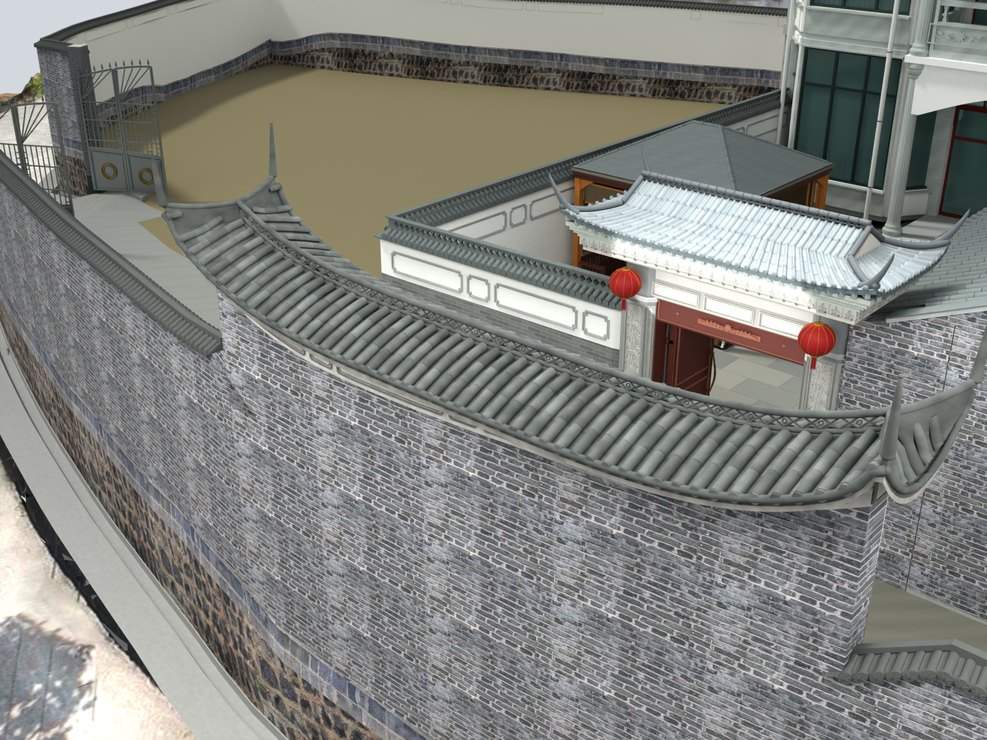
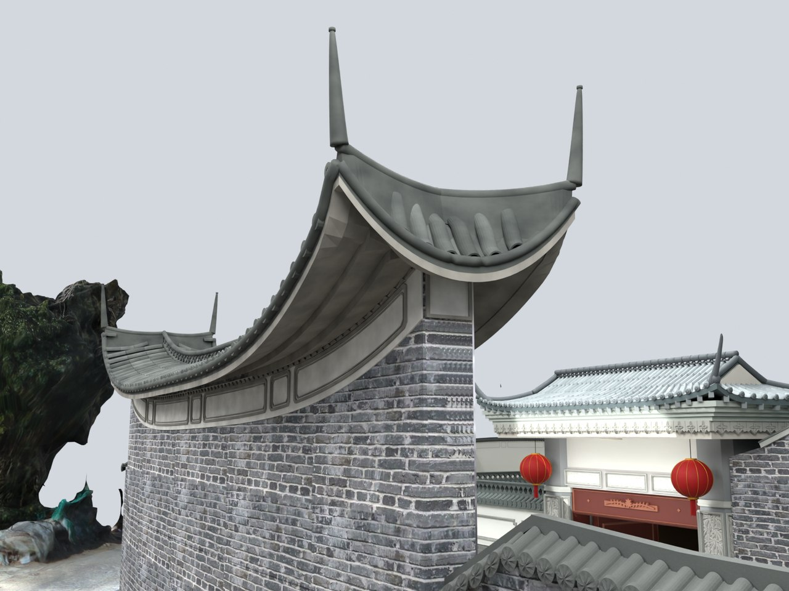

# V24.09 · 由俯仰实景重建照壁分叉脊与瓦面承托

[逐版目录](README.md) · [建筑重建台账](../../reconstruction.md) · [阶段方法汇总](../v24-v24-21.md)

## 摘要

照壁重做四条分叉脊和四个翘角，配置扇铺瓦、菱格脊带、莲花瓦当、曲面承托与连续檐底。

## 1. 问题与输入

俯视可分辨长脊两端的双分叉，仰视可见连续曲面承托。V24.08 的端部独立脊饰和矩形底面需要同步替换。

## 2. 实现方法

1. 让两端各生成两条斜脊与翘角，短端坡的筒板瓦随边界转向。分叉脊和中央镂空带都嵌在闭合承座上。

2. 长坡设 50 条瓦垄、292 块筒瓦、52 格透空菱格和 100 个莲花瓦当。用连续曲面、三道薄叠涩和封檐表达底部。

3. 沿原墙线重做两侧各七组长短框。白灰墙用原过程照片的额外 UV 通道，保留既有材质及图像。

### 实现链与源码定位

以下按诊断、处理、保存与复核组织阅读。调用和文件引用来自原脚本，输入输出方向由对应读写调用判断；辅助文件是否在本轮运行，以报告为准。

**1. 定位与诊断** · [`v24_09_probe.py`](../source-code/v24-09/history/v24_09_probe.py#L6)

打开保存的 Blender [`bpy.ops.wm.open_mainfile`](../source-code/v24-09/history/v24_09_probe.py#L6)。

文件引用：[`Architecture_Complete_V24_08.blend`](../source-code/v24-09/history/v24_09_probe.py#L6) · [`Inventory.json`](../source-code/v24-09/history/v24_09_probe.py#L9)。

**2. 参数与几何处理** · [`v24_09_roof.py`](../source-code/v24-09/project/Source/v24_09_roof.py#L28)

叉积／面法线 [`t.cross`](../source-code/v24-09/project/Source/v24_09_roof.py#L28)；网格与实体转换 [`bm.from_mesh`](../source-code/v24-09/project/Source/v24_09_roof.py#L42)。

文件引用：[`Mutation.json`](../source-code/v24-09/project/Source/v24_09_roof.py#L165)。

**3. 构建或写入** · [`v24_09_build.py`](../source-code/v24-09/project/Source/v24_09_build.py#L8)

打开保存的 Blender [`bpy.ops.wm.open_mainfile`](../source-code/v24-09/project/Source/v24_09_build.py#L8)；另存 Blender [`bpy.ops.wm.save_as_mainfile`](../source-code/v24-09/project/Source/v24_09_build.py#L21)。

文件引用：[`V24_09_Before_Snapshot.json`](../source-code/v24-09/project/Source/v24_09_build.py#L8) · [`V24_09_Forked_Roof.json`](../source-code/v24-09/project/Source/v24_09_build.py#L9) · [`V24_09_Facade_and_Soffit.json`](../source-code/v24-09/project/Source/v24_09_build.py#L10)。

**4. 辅助实现** · [`v24_09_facade.py`](../source-code/v24-09/project/Source/v24_09_facade.py#L50)

网格与实体转换 [`bm.from_mesh`](../source-code/v24-09/project/Source/v24_09_facade.py#L50)。

文件引用：[`Facade_Segments.json`](../source-code/v24-09/project/Source/v24_09_facade.py#L22) · [`屏幕截图 2026-10-11 101327.jpg`](../source-code/v24-09/project/Source/v24_09_facade.py#L120)。

**5. 辅助实现** · [`v24_09_common.py`](../source-code/v24-09/project/Source/v24_09_common.py#L10)

文件引用：[`Architecture_Complete_V24_09.blend`](../source-code/v24-09/project/Source/v24_09_common.py#L5) · [`Architecture_Complete_V24_08.blend`](../source-code/v24-09/project/Source/v24_09_common.py#L6)。

**6. 保存后核验** · [`v24_09_verify.py`](../source-code/v24-09/project/Source/v24_09_verify.py#L9)

判据与回归检查 [`checks.append`](../source-code/v24-09/project/Source/v24_09_verify.py#L8)；打开保存的 Blender [`bpy.ops.wm.open_mainfile`](../source-code/v24-09/project/Source/v24_09_verify.py#L9)；射线命中检查 [`seat.ray_cast`](../source-code/v24-09/project/Source/v24_09_verify.py#L47)。

文件引用：[`V24_09_Before_Snapshot.json`](../source-code/v24-09/project/Source/v24_09_verify.py#L7) · [`V24_09_Changes.json`](../source-code/v24-09/project/Source/v24_09_verify.py#L7) · [`V24_09_Build.json`](../source-code/v24-09/project/Source/v24_09_verify.py#L7)。

**7. 交付封装** · [`v24_09_package.py`](../source-code/v24-09/project/Source/v24_09_package.py#L6)

文件引用：[`Architecture_Complete_V24_09.blend`](../source-code/v24-09/project/Source/v24_09_package.py#L3) · [`V24_09_Fresh_Blend_QA.json`](../source-code/v24-09/project/Source/v24_09_package.py#L6) · [`V24_09_Preview_States.json`](../source-code/v24-09/project/Source/v24_09_package.py#L6)。

[方法原理：局部实体、接合与保护域](../methodology.md#4-局部改模如何限定影响范围) · [本版完整过程索引](process/v24-09.md)

本版索引汇合 16 幅已归档过程图、12 份交付及历史目录中的报告／说明／中间记录和全部 11 个源码附件。继承文件和本轮新增文件按来源保留，实际完成范围以第 4 节及原报告为准。

## 3. 过程图

**图 1** · 照壁分叉脊与翘角

**图 2** · V24.09 封檐、叠涩和连续曲面承托

## 4. 验证与适用范围

保存后记录 3,346 项检查，失败清单为空。瓦件分布、墙头曲率与叠涩厚度属于照片拟合的模型参数。

- **Fresh Blend QA** 
  状态 `PASS_V24_09_FRESH_BLEND_QA`，检查条目 3,346，失败记录 0。

- **构件变更记录** 
  记录本轮参数、对象和处理结果。

### 原记录中的关键检查

- **Closed positive screen-wall component V24_09_Screenwall_Solid_Fork_and_Ridge_Seats** 
  通过，`nonmanifold_edges` = `0`，`volume_m3` = `0.0868122`，`vertices` = `1254` 
  原记录 `V24_09_Fresh_Blend_QA.json` 的 `checks[3313]`

- **Closed positive screen-wall component SITE_SOUTH_SCREENWALL_CURVED_TILE_SHELL_Geometry** 
  通过，`nonmanifold_edges` = `0`，`volume_m3` = `0.6031`，`vertices` = `6050` 
  原记录 `V24_09_Fresh_Blend_QA.json` 的 `checks[3305]`

- **Closed positive screen-wall component V24_09_Screenwall_Curved_Panel_Backings** 
  通过，`nonmanifold_edges` = `0`，`volume_m3` = `0.0648696`，`vertices` = `968` 
  原记录 `V24_09_Fresh_Blend_QA.json` 的 `checks[3314]`

## 5. 复现入口与出处

过程路径以本地 `JIA` 项目为根，`work/` 指重建项目的历史工作目录。复核时按交付记录打开本轮输入与保存成果，再依方法中的截面、对象或动作采样对照原报告。

交付与参考记录（1 项）

~~~text
Rebuild_V24_09/README_V24_09.txt
~~~

### 原实现脚本附件

[浏览本版全部 11 个文件](../source-code/v24-09/README.md) · [原件与公开副本校验值](../source-code/v24-09/manifest.json)

- [`v24_09_roof.py`](../source-code/v24-09/project/Source/v24_09_roof.py)
- [`v24_09_facade.py`](../source-code/v24-09/project/Source/v24_09_facade.py)
- [`v24_09_build.py`](../source-code/v24-09/project/Source/v24_09_build.py)
- [`v24_09_probe.py`](../source-code/v24-09/history/v24_09_probe.py)
- [`v24_09_common.py`](../source-code/v24-09/project/Source/v24_09_common.py)

原脚本本地路径

~~~text
Rebuild_V24_09/Source/v24_09_roof.py
Rebuild_V24_09/Source/v24_09_facade.py
Rebuild_V24_09/Source/v24_09_build.py
work/v24_09_probe.py
Rebuild_V24_09/Source/v24_09_common.py
~~~

核验报告路径（2 项）

**Fresh Blend QA**

~~~text
Rebuild_V24_09/Reports/V24_09_Fresh_Blend_QA.json
~~~

**构件变更记录**

~~~text
Rebuild_V24_09/Reports/V24_09_Changes.json
~~~

图源与 SHA-256（2 张）

### 图 1 · 照壁分叉脊与翘角

~~~text
Rebuild_V24_09/Reports/V24_09_Fork_Oblique.png
~~~

**原过程图 SHA-256**

~~~text
8bcb640927830fc11f3f86ae69e3cf30e5d46d31737408f9de04342952c922cc
~~~

台账发布图，按原图缩放及压缩。

### 图 2 · V24.09 封檐、叠涩和连续曲面承托

~~~text
Rebuild_V24_09/Reports/V24_09_Underside.png
~~~

**原过程图 SHA-256**

~~~text
68729355b0d0c0b61cb67304593bd6777a6a434e4e2c792e287391ff7b19425a
~~~

保留原画面，发布用 JPEG。

---

上一篇 [V24.08 · 固定外墙基线的厨房 0.45 米退让](v24-08.md) 
下一篇 [V24.10 · 通过实景截面收正储藏房地块与小入口](v24-10.md)
