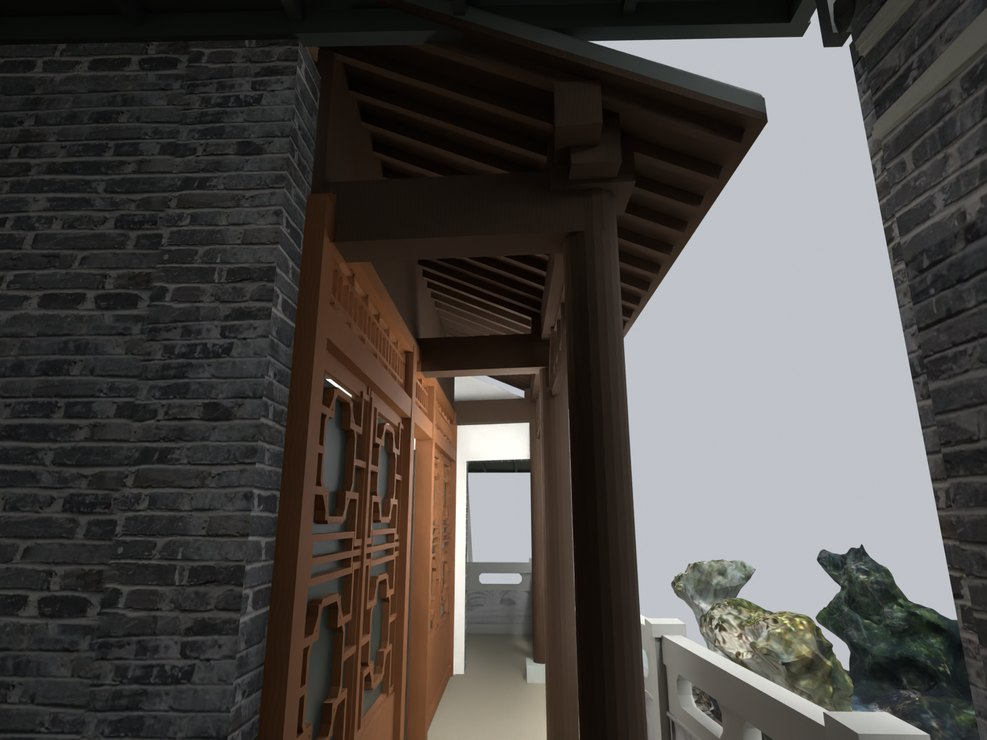
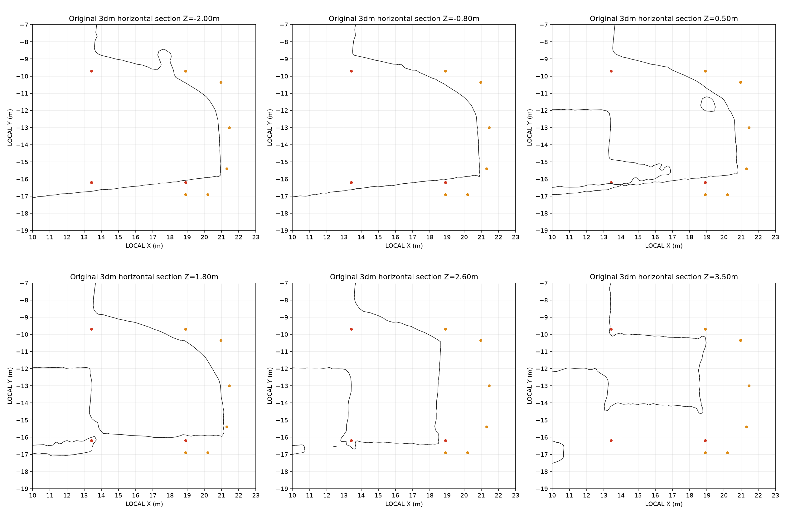

# V24.10 · 通过实景截面收正储藏房地块与小入口

[逐版目录](README.md) · [建筑重建台账](../../reconstruction.md) · [阶段方法汇总](../v24-v24-21.md) · [上一篇 V24.09](v24-09.md) · [下一篇 V24.11](v24-11.md)

## 摘要

按实景地块关系修正储藏房、外边界、房体和小入口，保留可编辑模型与门扇动作。

## 1. 问题与输入

V24.09 的储藏房台基超出实景挡墙外线。比较已注册的实景 3DM 与现状模型，入口的先后关系另由全景确认。

## 2. 实现方法

1. 将参考几何转回局部坐标，取 Z = −0.80 m 的连续挡墙外侧线，以 35 mm 简化保留斜前沿和东端圆折。新旧轮廓在同一范围比较。
2. 按修正轮廓联动基础、房体、门窗、两坡瓦顶、石栏与外金属棚。删除遗留填土、错位墙趾和多余延檐，按实景控制点衔接地面。
3. 用全景辨认次照壁与砖山墙之间的小入口。对保存网格放置四个通行净空盒做实体相交检查，门轴与门板随房体移动。

## 3. 过程图

*图 1 · 储藏房小入口与檐廊。过程文件 `Rebuild_V24_10/Reports/V24_10_Entry_Approach.png`。*

*图 2 · 实景截面与储藏房边界定位的原诊断图。过程文件 `Rebuild_V24_10/Reports/Evidence_AsBuilt_Sections.png`。*

## 4. 验证与适用范围

同一局部轮廓由约 59.43 m² 缩至 49.98 m²，代表建模边界变化。V24.10 的小入口雨棚随本轮交付，在 V24.11 按新要求移除。

| 过程报告 | 原报告读数 |
| --- | --- |
| `Rebuild_V24_10/Reports/V24_10_Fresh_Blend_QA.json` | 状态 `PASS_V24_10_FRESH_BLEND_QA`，检查条目 7,494，失败记录 0。 |
| `Rebuild_V24_10/Reports/V24_10_Independent_Clearance_QA.json` | 状态 `PASS_INDEPENDENT_CLEARANCE`，净空盒数 4，实体条目 9。 |
| `Rebuild_V24_10/Reports/V24_10_Independent_Solid_QA.json` | 状态 `PASS_INDEPENDENT_SAVED_SOLIDS`，实体条目 32。 |

### 原记录中的关键检查

| 检查项 | 结果与读数 | 原记录位置 |
| --- | --- | --- |
| Closed solid / DOOR_STORAGE_V20_L__LEAF_Geometry | 通过，`normalization_precision_m=1e-09` | `V24_10_Fresh_Blend_QA.json` 的 `checks[7452]` |
| Preserved parent / V24_09_Screenwall_Solid_Fork_and_Ridge_Seats | 通过 | `V24_10_Fresh_Blend_QA.json` 的 `checks[6717]` |
| Preserved hide_render / V24_09_Screenwall_Solid_Fork_and_Ridge_Seats | 通过 | `V24_10_Fresh_Blend_QA.json` 的 `checks[6718]` |

## 5. 复现入口与出处

过程路径以本地 `JIA` 项目为根，`work/` 指重建项目的历史工作目录。复核时按交付记录打开本轮输入与保存成果，再依方法中的截面、对象或动作采样对照原报告。

- **交付与参考记录**。`Rebuild_V24_10/README_V24_10.md`

- **原实现脚本**。`Rebuild_V24_10/Source/v24_10_sections.py` · `Rebuild_V24_10/Source/v24_10_fit.py` · `Rebuild_V24_10/Source/v24_10_clearance.py` · `Rebuild_V24_10/Source/v24_10_plan.py` · `Rebuild_V24_10/Source/v24_10_build.py`

过程图校验值

| 图 | 原过程图 SHA-256 | 发布方式 |
| --- | --- | --- |
| 1 | `61b078e9e251e8825d00a845b87394ecf1b9472e1b66abb7fe56e92a71bc5c3b` | 台账发布图，按原图缩放及压缩 |
| 2 | `0f23e697db2a074fc010706ddd3ba6ad9db9d0d8cd980c00fbed6a80f31d14b1` | 原文件 |

