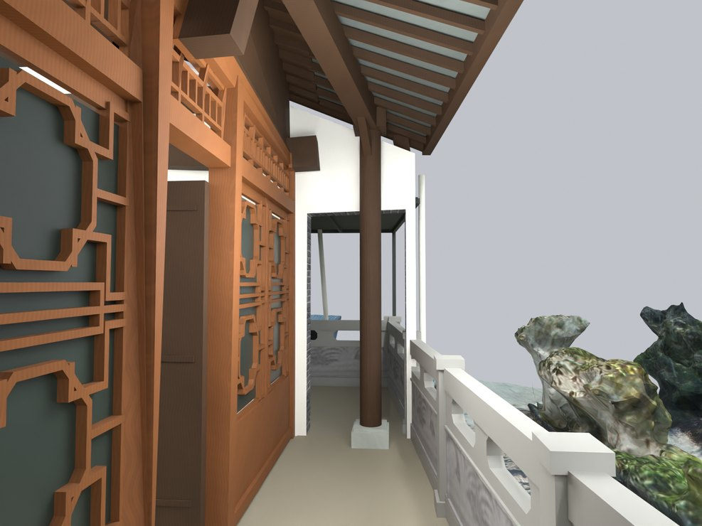
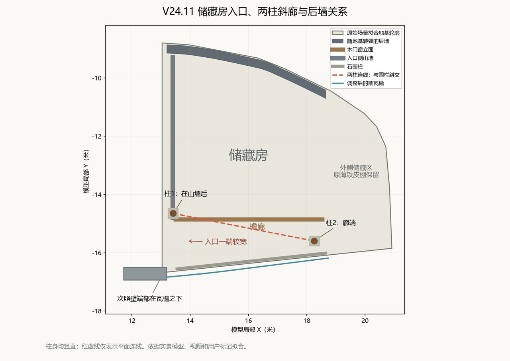

# V24.11 · 双柱斜廊、连续弧形后墙和基础去重

[逐版目录](README.md) · [建筑重建台账](../../reconstruction.md) · [阶段方法汇总](../v24-v24-21.md)

## 摘要

储藏房改双柱斜廊、连续弧形后墙与无重面基础，移除小入口铁皮棚，修白灰照壁和叠涩。

## 1. 问题与输入

在 V24.10 的修正地块内，用户要求取消小入口铁皮棚，并按原实景轮廓重新判定两柱檐廊、储藏房后墙和厨房背侧连接。

## 2. 实现方法

1. 在平面上取斜柱线与弧形后墙，改三前柱为两根竖直木柱，入口侧廊更宽。清除小入口棚和附框，瓦檐向次照壁端部覆盖。

2. 把后墙和厨房缺段补为连续墙。墙根扣除基础占位，毛石与条石共享外表面分界，清除重复内盖面。

3. 照壁内面改原生白灰材质并重做平整实体叠涩。保存模型后检查后墙、柱头与基础各自的闭合和接口。

### 实现链与源码定位

以下按诊断、处理、保存与复核组织阅读。调用和文件引用来自原脚本，输入输出方向由对应读写调用判断；辅助文件是否在本轮运行，以报告为准。

**1. 定位与诊断** · [`v24_11_plan.py`](../source-code/v24-11/project/Source/v24_11_plan.py#L11)

文件引用：[`V24_11_Corrections.json`](../source-code/v24-11/project/Source/v24_11_plan.py#L11) · [`AsBuilt_Plan.json`](../source-code/v24-11/project/Source/v24_11_plan.py#L11) · [`V24_11_Veranda_and_Rear_Wall_Plan.png`](../source-code/v24-11/project/Source/v24_11_plan.py#L27)。

**2. 定位与诊断** · [`v24_11_analyze.py`](../source-code/v24-11/project/Source/v24_11_analyze.py#L9)

文件引用：[`Inventory.json`](../source-code/v24-11/project/Source/v24_11_analyze.py#L9) · [`Existing_Storage_Masonry_Plan.png`](../source-code/v24-11/project/Source/v24_11_analyze.py#L25) · [`AsBuilt_Plan.json`](../source-code/v24-11/project/Source/v24_11_analyze.py#L25)。

**3. 定位与诊断** · [`v24_11_probe.py`](../source-code/v24-11/project/Source/v24_11_probe.py#L7)

打开保存的 Blender [`bpy.ops.wm.open_mainfile`](../source-code/v24-11/project/Source/v24_11_probe.py#L7)；网格与实体转换 [`bm.from_mesh`](../source-code/v24-11/project/Source/v24_11_probe.py#L19)。

文件引用：[`Architecture_Complete_V24_10.blend`](../source-code/v24-11/project/Source/v24_11_probe.py#L7) · [`Inventory.json`](../source-code/v24-11/project/Source/v24_11_probe.py#L30)。

**4. 参数与几何处理** · [`v24_11_geometry.py`](../source-code/v24-11/project/Source/v24_11_geometry.py#L1)

**5. 构建或写入** · [`v24_11_build.py`](../source-code/v24-11/project/Source/v24_11_build.py#L15)

打开保存的 Blender [`bpy.ops.wm.open_mainfile`](../source-code/v24-11/project/Source/v24_11_build.py#L15)；空间加速结构 [`BVHTree.FromPolygons`](../source-code/v24-11/project/Source/v24_11_build.py#L33)；写入网格拓扑 [`me.from_pydata`](../source-code/v24-11/project/Source/v24_11_build.py#L53)。

文件引用：[`Architecture_Complete_V24_10.blend`](../source-code/v24-11/project/Source/v24_11_build.py#L11) · [`Architecture_Complete_V24_11.blend`](../source-code/v24-11/project/Source/v24_11_build.py#L11) · [`V24_11_Before_Snapshot.json`](../source-code/v24-11/project/Source/v24_11_build.py#L15)。

**6. 保存后核验** · [`v24_11_verify.py`](../source-code/v24-11/project/Source/v24_11_verify.py#L12)

判据与回归检查 [`checks.append`](../source-code/v24-11/project/Source/v24_11_verify.py#L11)；打开保存的 Blender [`bpy.ops.wm.open_mainfile`](../source-code/v24-11/project/Source/v24_11_verify.py#L12)；空间加速结构 [`BVHTree.FromPolygons`](../source-code/v24-11/project/Source/v24_11_verify.py#L34)。

文件引用：[`Architecture_Complete_V24_11.blend`](../source-code/v24-11/project/Source/v24_11_verify.py#L7) · [`Architecture_Complete_V24_10.blend`](../source-code/v24-11/project/Source/v24_11_verify.py#L7) · [`V24_11_Before_Snapshot.json`](../source-code/v24-11/project/Source/v24_11_verify.py#L12)。

**7. 交付封装** · [`v24_11_package.py`](../source-code/v24-11/project/Source/v24_11_package.py#L6)

文件引用：[`Architecture_Complete_V24_11.blend`](../source-code/v24-11/project/Source/v24_11_package.py#L3) · [`V24_11_Fresh_Blend_QA.json`](../source-code/v24-11/project/Source/v24_11_package.py#L6) · [`V24_11_Independent_Solid_QA.json`](../source-code/v24-11/project/Source/v24_11_package.py#L6)。

[方法原理：局部实体、接合与保护域](../methodology.md#4-局部改模如何限定影响范围) · [本版完整过程索引](process/v24-11.md)

本版索引汇合 29 幅已归档过程图、20 份交付及历史目录中的报告／说明／中间记录和全部 16 个源码附件。继承文件和本轮新增文件按来源保留，实际完成范围以第 4 节及原报告为准。

## 3. 过程图

**图 1** · 储藏房双柱斜廊

**图 2** · V24.11 两柱斜廊与弧形后墙的平面关系

## 4. 验证与适用范围

独立实体报告列 26 个对象，保存后失败清单为空。斜廊和后墙来自用户标记、视频和注册几何，0.05 mm 是局部边简化上限。

- **Fresh Blend QA** 
  状态 `PASS_V24_11_FRESH_BLEND_QA`，检查条目 7,510，失败记录 0。

- **独立实体核验** 
  状态 `PASS_INDEPENDENT_SAVED_SOLIDS`，实体条目 26。

### 原记录中的关键检查

- **Curved back wall continuous to the base at all tested sections** 
  通过，`probe_count` = `60` 
  原记录 `V24_11_Fresh_Blend_QA.json` 的 `checks[7499]`

- **No overlapping exposed wall and footing skins** 
  通过，`intersection_volume_m3` = `-4.15209e-10` 
  原记录 `V24_11_Fresh_Blend_QA.json` 的 `checks[7502]`

- **Screen-wall stone soffit level across its depth** 
  通过，`maximum_cross_depth_z_difference_m` = `2.38419e-07` 
  原记录 `V24_11_Fresh_Blend_QA.json` 的 `checks[7504]`

## 5. 复现入口与出处

过程路径以本地 `JIA` 项目为根，`work/` 指重建项目的历史工作目录。复核时按交付记录打开本轮输入与保存成果，再依方法中的截面、对象或动作采样对照原报告。

交付与参考记录（1 项）

~~~text
Rebuild_V24_11/README_V24_11.md
~~~

### 原实现脚本附件

[浏览本版全部 16 个文件](../source-code/v24-11/README.md) · [原件与公开副本校验值](../source-code/v24-11/manifest.json)

- [`v24_11_plan.py`](../source-code/v24-11/project/Source/v24_11_plan.py)
- [`v24_11_analyze.py`](../source-code/v24-11/project/Source/v24_11_analyze.py)
- [`v24_11_geometry.py`](../source-code/v24-11/project/Source/v24_11_geometry.py)
- [`v24_11_build.py`](../source-code/v24-11/project/Source/v24_11_build.py)
- [`v24_11_probe.py`](../source-code/v24-11/project/Source/v24_11_probe.py)

原脚本本地路径

~~~text
Rebuild_V24_11/Source/v24_11_plan.py
Rebuild_V24_11/Source/v24_11_analyze.py
Rebuild_V24_11/Source/v24_11_geometry.py
Rebuild_V24_11/Source/v24_11_build.py
Rebuild_V24_11/Source/v24_11_probe.py
~~~

核验报告路径（2 项）

**Fresh Blend QA**

~~~text
Rebuild_V24_11/Reports/V24_11_Fresh_Blend_QA.json
~~~

**独立实体核验**

~~~text
Rebuild_V24_11/Reports/V24_11_Independent_Solid_QA.json
~~~

图源与 SHA-256（2 张）

### 图 1 · 储藏房双柱斜廊

~~~text
Rebuild_V24_11/Reports/V24_11_Veranda.png
~~~

**原过程图 SHA-256**

~~~text
7ae20673f2d2dfe3931bf94973d8bc91d64bd52f14797bdb9d215d5d92f23f40
~~~

台账发布图，按原图缩放及压缩。

### 图 2 · V24.11 两柱斜廊与弧形后墙的平面关系

~~~text
Rebuild_V24_11/Reports/V24_11_Veranda_and_Rear_Wall_Plan.png
~~~

**原过程图 SHA-256**

~~~text
3db89a350dea34d8ed37392d0b42aa95a2ad819055453a96d8c1bf25b39f2b0b
~~~

保留原画面，发布用 JPEG。

---

上一篇 [V24.10 · 通过实景截面收正储藏房地块与小入口](v24-10.md) 
下一篇 [V24.12 · 调平次照壁并恢复储藏房双平面屋坡](v24-12.md)
