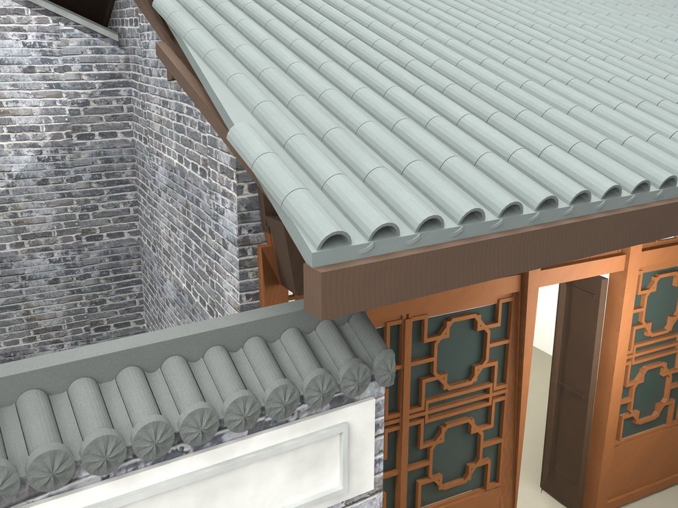
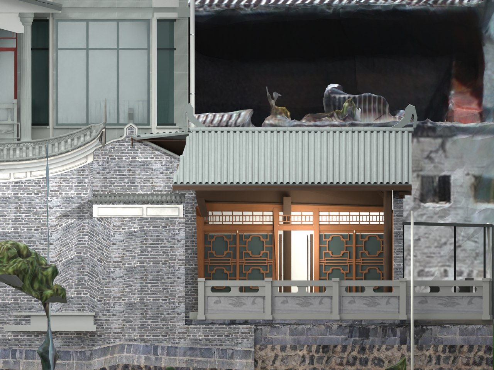

# V24.12 · 调平次照壁并恢复储藏房双平面屋坡

[逐版目录](README.md) · [建筑重建台账](../../reconstruction.md) · [阶段方法汇总](../v24-v24-21.md)

## 摘要

调平次照壁墙冠、瓦压顶和饰带，把储藏房正脊与前檐恢复为水平平行直线，重排瓦件。

## 1. 问题与输入

V24.11 的柱线按平面斜交是所需的檐廊布局。上一轮屋面随柱线扭曲，次照壁冠顶也受接头斜线影响。

## 2. 实现方法

1. 给次照壁墙冠、瓦压顶、内侧檐带和外侧双框各设水平标高，校正被接头遮住的旧斜墙冠。

2. 以水平、平行的前檐和正脊定义两主坡，重新排筒瓦、仰瓦和脊瓦。厨房谷缝锚点固定，用局部连接片过渡。

3. 把穿瓦的旧木基层裁回新檐底范围，联动上部木架和柱头；按保存文件实测次照壁至瓦檐的模型净空。

## 3. 过程图

**图 1** · 调平后的储藏房屋檐

**图 2** · V24.12 水平前檐与屋脊的立面复核

## 4. 验证与适用范围

最终复开记录 7,638 项检查。独立实体报告的木基层与屋面相交体积为 0，数值用于判断该模型部位的层次。

- **Fresh Blend QA** 
  状态 `PASS_FRESH_NATIVE_QA`，检查条目 7,638，失败记录 0。

- **独立实体核验** 
  状态 `PASS_SAVED_SOLIDS_WITH_INHERITED_COMPOUND_WALL`，实体条目 17。

### 原记录中的关键检查

- **Preserved parent / V24_09_Screenwall_Solid_Fork_and_Ridge_Seats** 
  通过 
  原记录 `V24_12_Fresh_Blend_QA.json` 的 `checks[6760]`

- **Preserved hide_render / V24_09_Screenwall_Solid_Fork_and_Ridge_Seats** 
  通过 
  原记录 `V24_12_Fresh_Blend_QA.json` 的 `checks[6761]`

- **Preserved animation / V24_09_Screenwall_Solid_Fork_and_Ridge_Seats** 
  通过 
  原记录 `V24_12_Fresh_Blend_QA.json` 的 `checks[6762]`

## 5. 复现入口与出处

过程路径以本地 `JIA` 项目为根，`work/` 指重建项目的历史工作目录。复核时按交付记录打开本轮输入与保存成果，再依方法中的截面、对象或动作采样对照原报告。

交付与参考记录（1 项）

~~~text
Rebuild_V24_12/README_V24_12.md
~~~

原实现脚本（5 项）

~~~text
Rebuild_V24_12/Source/v24_12_probe.py
Rebuild_V24_12/Source/v24_12_geometry.py
Rebuild_V24_12/Source/v24_12_build.py
Rebuild_V24_12/Source/v24_12_prepare.py
work/v24_12_analyze.py
~~~

核验报告路径（2 项）

**Fresh Blend QA**

~~~text
Rebuild_V24_12/Reports/V24_12_Fresh_Blend_QA.json
~~~

**独立实体核验**

~~~text
Rebuild_V24_12/Reports/V24_12_Independent_Solid_QA.json
~~~

图源与 SHA-256（2 张）

### 图 1 · 调平后的储藏房屋檐

~~~text
Rebuild_V24_12/Reports/V24_12_Eave_Junction.png
~~~

**原过程图 SHA-256**

~~~text
30603f37d37c0685107c3e22a052676852180b6593fd7d644f4b7e360414efa7
~~~

台账发布图，按原图缩放及压缩。

### 图 2 · V24.12 水平前檐与屋脊的立面复核

~~~text
Rebuild_V24_12/Reports/V24_12_Level_Elevation.png
~~~

**原过程图 SHA-256**

~~~text
3b87a44e8132032c8b5dbf9b9436b3bd98b50480cd0d51342344e1ff241abe08
~~~

保留原画面，发布用 JPEG。

---

上一篇 [V24.11 · 双柱斜廊、连续弧形后墙和基础去重](v24-11.md) 
下一篇 [V24.13 · 从蓝线标记到储藏房前坡直边裁切](v24-13.md)
