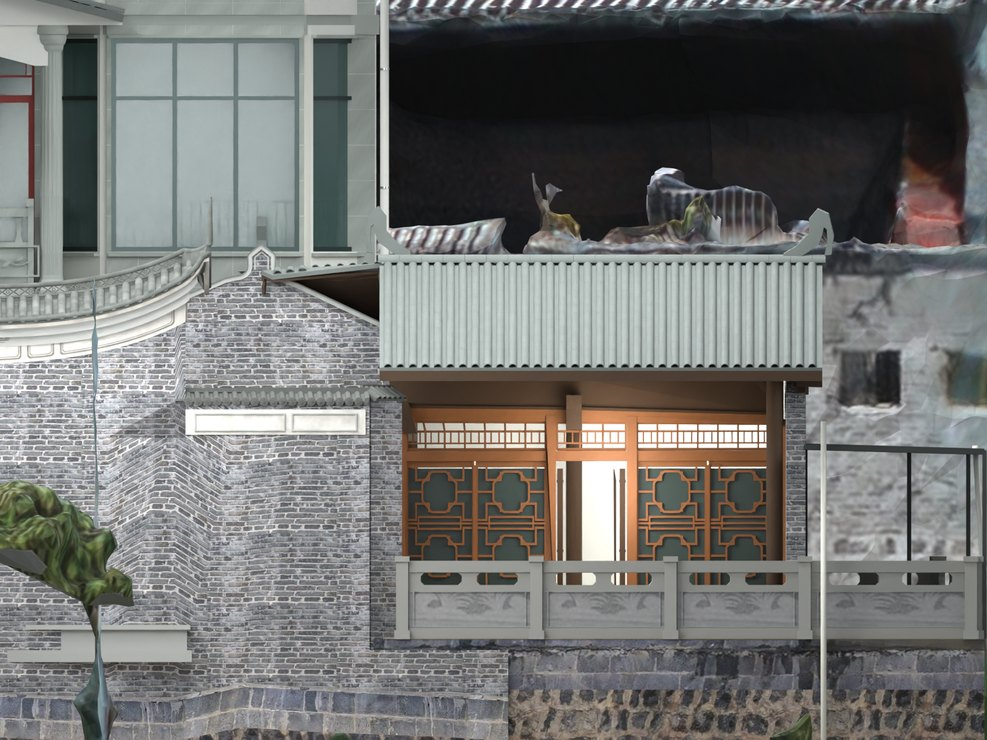
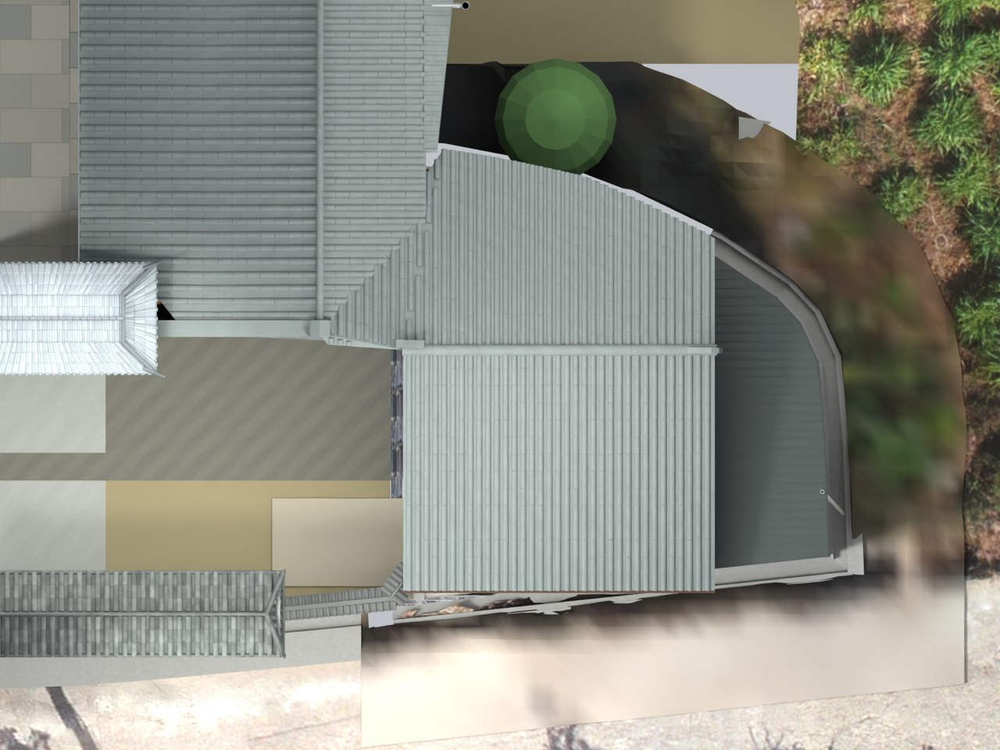

# V24.13 · 从蓝线标记到储藏房前坡直边裁切

[逐版目录](README.md) · [建筑重建台账](../../reconstruction.md) · [阶段方法汇总](../v24-v24-21.md)

## 摘要

按蓝线切除储藏房前坡楔形外伸，使前坡两侧成平行直边，保持屋脊与檐口水平。

## 1. 问题与输入

V24.12 已把前檐、正脊分别调平，左侧仍有多伸出的楔形面。以用户蓝线和同一模型相机核对需要收回的坡边。

## 2. 实现方法

1. 将蓝线对应到局部平面，收回约 0.438 m 的左侧楔形外伸，令前坡侧边互相平行，正脊和前檐仍为各自水平直线。

2. 沿新边界同时裁木基层、上部屋架和椽尾，补接柱头及上部山墙。末端短回墙收进檐下，厨房谷线继续相接。

3. 从保存文件复核屋面平整度、木基层相交及五处通行采样，并按同一版渲染正立面和俯视。

## 3. 过程图

**图 1** · 收回楔形外伸后的前坡

**图 2** · V24.13 前坡直边和檐脊平行关系的俯视

## 4. 验证与适用范围

原报告记录 7,682 项检查、失败 0 项，木基层与屋面相交体积为 0。0.438 m 为以标记定位的模型裁切宽度。

- **Fresh Blend QA** 
  状态 `PASS_FRESH_NATIVE_QA`，检查条目 7,682，失败记录 0。

- **独立实体核验** 
  状态 `PASS_INDEPENDENT_SAVED_SOLIDS`，实体条目 13。

### 原记录中的关键检查

- **Preserved parent / V24_09_Screenwall_Solid_Fork_and_Ridge_Seats** 
  通过 
  原记录 `V24_13_Fresh_Blend_QA.json` 的 `checks[6764]`

- **Preserved hide_render / V24_09_Screenwall_Solid_Fork_and_Ridge_Seats** 
  通过 
  原记录 `V24_13_Fresh_Blend_QA.json` 的 `checks[6765]`

- **Preserved animation / V24_09_Screenwall_Solid_Fork_and_Ridge_Seats** 
  通过 
  原记录 `V24_13_Fresh_Blend_QA.json` 的 `checks[6766]`

## 5. 复现入口与出处

过程路径以本地 `JIA` 项目为根，`work/` 指重建项目的历史工作目录。复核时按交付记录打开本轮输入与保存成果，再依方法中的截面、对象或动作采样对照原报告。

交付与参考记录（1 项）

~~~text
Rebuild_V24_13/README_V24_13.md
~~~

### 原实现脚本附件

[浏览本版全部 15 个文件](../source-code/v24-13/README.md) · [原件与公开副本校验值](../source-code/v24-13/manifest.json)

- [`v24_13_probe.py`](../source-code/v24-13/project/Source/v24_13_probe.py)
- [`v24_13_geometry.py`](../source-code/v24-13/project/Source/v24_13_geometry.py)
- [`v24_13_build.py`](../source-code/v24-13/project/Source/v24_13_build.py)
- [`v24_13_prepare.py`](../source-code/v24-13/project/Source/v24_13_prepare.py)
- [`v24_13_render.py`](../source-code/v24-13/project/Source/v24_13_render.py)

原脚本本地路径

~~~text
Rebuild_V24_13/Source/v24_13_probe.py
Rebuild_V24_13/Source/v24_13_geometry.py
Rebuild_V24_13/Source/v24_13_build.py
Rebuild_V24_13/Source/v24_13_prepare.py
Rebuild_V24_13/Source/v24_13_render.py
~~~

核验报告路径（2 项）

**Fresh Blend QA**

~~~text
Rebuild_V24_13/Reports/V24_13_Fresh_Blend_QA.json
~~~

**独立实体核验**

~~~text
Rebuild_V24_13/Reports/V24_13_Independent_Solid_QA.json
~~~

图源与 SHA-256（2 张）

### 图 1 · 收回楔形外伸后的前坡

~~~text
Rebuild_V24_13/Reports/V24_13_Level_Elevation.png
~~~

**原过程图 SHA-256**

~~~text
6e1b4d961595002f57d16d45e345cb24e84bade6723f1b154e57b28de1111290
~~~

台账发布图，按原图缩放及压缩。

### 图 2 · V24.13 前坡直边和檐脊平行关系的俯视

~~~text
Rebuild_V24_13/Reports/V24_13_Top.png
~~~

**原过程图 SHA-256**

~~~text
05da02253d60e391e9b6e661588b029bb1dbdf9c41d9bdaa6dfbdc00d95fad81
~~~

保留原画面，发布用 JPEG。

---

上一篇 [V24.12 · 调平次照壁并恢复储藏房双平面屋坡](v24-12.md) 
下一篇 [V24.14 · 后退木隔扇并用封闭山墙形成连续檐廊](v24-14.md)
