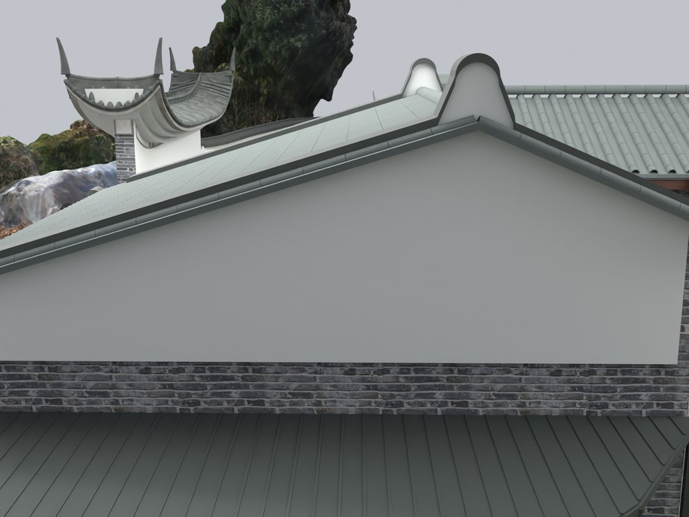
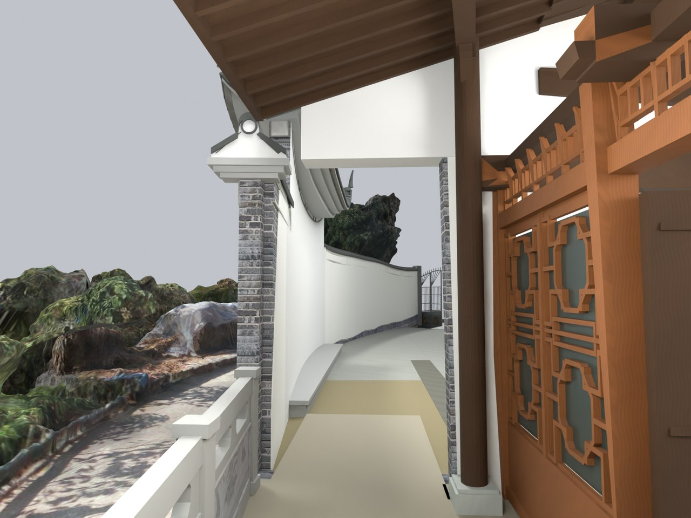

# V24.14 · 后退木隔扇并用封闭山墙形成连续檐廊

[逐版目录](README.md) · [建筑重建台账](../../reconstruction.md) · [阶段方法汇总](../v24-v24-21.md)

## 摘要

封合储藏房山墙，木隔扇、玻璃及门轴后退 0.48 m，形成连续檐廊。

## 1. 问题与输入

V24.13 确定屋坡和入口界线，现场照片要求檐下留出走廊，山墙外部收住木檩与封檐。

## 2. 实现方法

1. 木隔扇、玻璃、两扇门叶和铰链作为关联组后退 0.48 m。原嵌入山墙的入口柱连同柱础内移 0.30 m，按原门动画采样。

2. 按屋面下的侧墙截面生成闭合镬耳轮廓，灰色连续压顶与白墙分层。檐廊木架改用薄望板、细椽、承梁和曲线托木。

3. 删除多余短回墙和瓦盖，次照壁补端部山花和卷头；主照壁四支翘尖改圆头并闭合端坡瓦。

## 3. 过程图

**图 1** · 储藏房封合山墙

**图 2** · V24.14 后退隔扇后形成的檐下通行带

## 4. 验证与适用范围

原生复开记录 7,795 项检查，独立实体报告列 26 个实体及 9 项空间核对。柱位和后退量按影像拟合，开合沿原关键帧验证。

- **Fresh Blend QA** 
  状态 `PASS_FRESH_NATIVE_QA`，检查条目 7,795，失败记录 0。

- **独立实体核验** 
  状态 `PASS_INDEPENDENT_SAVED_SOLIDS`，实体条目 26。

### 原记录中的关键检查

- **Preserved parent / V24_09_Screenwall_Solid_Fork_and_Ridge_Seats** 
  通过 
  原记录 `V24_14_Fresh_Blend_QA.json` 的 `checks[6765]`

- **Preserved hide_render / V24_09_Screenwall_Solid_Fork_and_Ridge_Seats** 
  通过 
  原记录 `V24_14_Fresh_Blend_QA.json` 的 `checks[6766]`

- **Preserved animation / V24_09_Screenwall_Solid_Fork_and_Ridge_Seats** 
  通过 
  原记录 `V24_14_Fresh_Blend_QA.json` 的 `checks[6767]`

## 5. 复现入口与出处

过程路径以本地 `JIA` 项目为根，`work/` 指重建项目的历史工作目录。复核时按交付记录打开本轮输入与保存成果，再依方法中的截面、对象或动作采样对照原报告。

交付与参考记录（1 项）

~~~text
Rebuild_V24_14/README_V24_14.md
~~~

### 原实现脚本附件

[浏览本版全部 14 个文件](../source-code/v24-14/README.md) · [原件与公开副本校验值](../source-code/v24-14/manifest.json)

- [`v24_14_probe.py`](../source-code/v24-14/project/Source/v24_14_probe.py)
- [`v24_14_prepare.py`](../source-code/v24-14/project/Source/v24_14_prepare.py)
- [`v24_14_build.py`](../source-code/v24-14/project/Source/v24_14_build.py)
- [`v24_14_render.py`](../source-code/v24-14/project/Source/v24_14_render.py)
- [`v24_14_solids.py`](../source-code/v24-14/project/Source/v24_14_solids.py)

原脚本本地路径

~~~text
Rebuild_V24_14/Source/v24_14_probe.py
Rebuild_V24_14/Source/v24_14_prepare.py
Rebuild_V24_14/Source/v24_14_build.py
Rebuild_V24_14/Source/v24_14_render.py
Rebuild_V24_14/Source/v24_14_solids.py
~~~

核验报告路径（2 项）

**Fresh Blend QA**

~~~text
Rebuild_V24_14/Reports/V24_14_Fresh_Blend_QA.json
~~~

**独立实体核验**

~~~text
Rebuild_V24_14/Reports/V24_14_Independent_Solid_QA.json
~~~

图源与 SHA-256（2 张）

### 图 1 · 储藏房封合山墙

~~~text
Rebuild_V24_14/Reports/V24_14_Sealed_Gable.png
~~~

**原过程图 SHA-256**

~~~text
6ddb82f4942f099200c4676d6772a32a8320412324577b10d9e37cc0cbc5ab7a
~~~

台账发布图，按原图缩放及压缩。

### 图 2 · V24.14 后退隔扇后形成的檐下通行带

~~~text
Rebuild_V24_14/Reports/V24_14_Gallery.png
~~~

**原过程图 SHA-256**

~~~text
51efd5eceec9e1922fa43114669c7a086af3659a333b3c68d532bdb3a57bfd18
~~~

保留原画面，发布用 JPEG。

---

上一篇 [V24.13 · 从蓝线标记到储藏房前坡直边裁切](v24-13.md) 
下一篇 [V24.15 · 重构储藏房梁檩椽和四组花格横披](v24-15.md)
