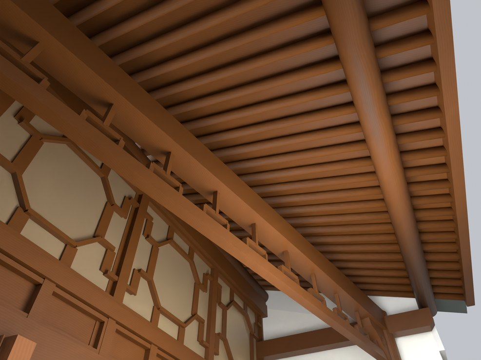
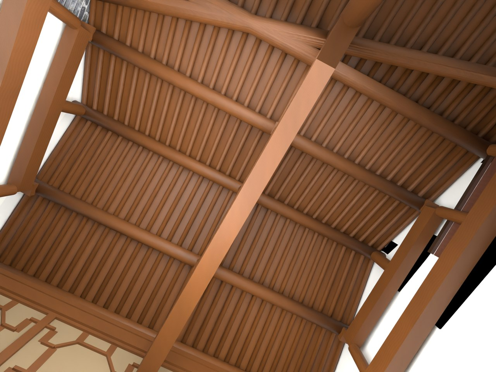

# V24.15 · 重构储藏房梁檩椽和四组花格横披

[逐版目录](README.md) · [建筑重建台账](../../reconstruction.md) · [阶段方法汇总](../v24-v24-21.md)

## 摘要

清断梁和重复屋架，重做传统木构檐口，增四组花格横披，保留既有门扇。

## 1. 问题与输入

V24.14 檐廊调整后仍可见悬空断梁和重复架。仰视照片确定构件的先后与承接，横披近景用于固定窗格细部。

## 2. 实现方法

1. 移除原上部旧屋架，分建三榀梁架、短柱、七道圆檩、62 根圆椽和连续望板。木纹按构件轴向布置，梁端收进既有封闭山墙。

2. 按两根檐柱的实际位置重接水平檐枋、挑梁和雀替。建立四组八角花格固定横披，内外可见的木棂和分格玻璃嵌入独立框。

3. 以旧门位和保存帧查门叶、门洞及木架接触。模型的梁檩基准取实景中可辨方向，避免把广角投影弯曲写入构件。

## 3. 过程图

**图 1** · 储藏房檐下传统木构

**图 2** · V24.15 室内三榀梁架、圆檩及密排椽

## 4. 验证与适用范围

原生复开报告列 7,825 项检查。独立实体和空间报告对应封闭木件、接口和净空，木构尺度及雕纹仍由照片近似。

- **Fresh Blend QA** 
  状态 `PASS_FRESH_NATIVE_QA`，检查条目 7,825，失败记录 0。

- **独立实体核验** 
  状态 `PASS_INDEPENDENT_SAVED_SOLIDS`，实体条目 28。

### 原记录中的关键检查

- **Preserved parent / V24_09_Screenwall_Solid_Fork_and_Ridge_Seats** 
  通过 
  原记录 `V24_15_Fresh_Blend_QA.json` 的 `checks[6770]`

- **Preserved hide_render / V24_09_Screenwall_Solid_Fork_and_Ridge_Seats** 
  通过 
  原记录 `V24_15_Fresh_Blend_QA.json` 的 `checks[6771]`

- **Preserved animation / V24_09_Screenwall_Solid_Fork_and_Ridge_Seats** 
  通过 
  原记录 `V24_15_Fresh_Blend_QA.json` 的 `checks[6772]`

## 5. 复现入口与出处

过程路径以本地 `JIA` 项目为根，`work/` 指重建项目的历史工作目录。复核时按交付记录打开本轮输入与保存成果，再依方法中的截面、对象或动作采样对照原报告。

交付与参考记录（1 项）

~~~text
Rebuild_V24_15/README_V24_15.md
~~~

### 原实现脚本附件

[浏览本版全部 14 个文件](../source-code/v24-15/README.md) · [原件与公开副本校验值](../source-code/v24-15/manifest.json)

- [`v24_15_probe.py`](../source-code/v24-15/project/Source/v24_15_probe.py)
- [`v24_15_prepare.py`](../source-code/v24-15/project/Source/v24_15_prepare.py)
- [`v24_15_build.py`](../source-code/v24-15/project/Source/v24_15_build.py)
- [`v24_15_render.py`](../source-code/v24-15/project/Source/v24_15_render.py)
- [`v24_15_solids.py`](../source-code/v24-15/project/Source/v24_15_solids.py)

原脚本本地路径

~~~text
Rebuild_V24_15/Source/v24_15_probe.py
Rebuild_V24_15/Source/v24_15_prepare.py
Rebuild_V24_15/Source/v24_15_build.py
Rebuild_V24_15/Source/v24_15_render.py
Rebuild_V24_15/Source/v24_15_solids.py
~~~

核验报告路径（2 项）

**Fresh Blend QA**

~~~text
Rebuild_V24_15/Reports/V24_15_Fresh_Blend_QA.json
~~~

**独立实体核验**

~~~text
Rebuild_V24_15/Reports/V24_15_Independent_Solid_QA.json
~~~

图源与 SHA-256（2 张）

### 图 1 · 储藏房檐下传统木构

~~~text
Rebuild_V24_15/Reports/V24_15_Eave_Underside.png
~~~

**原过程图 SHA-256**

~~~text
92b395119ef422707648e009073bda8db7e90247973e677b98ccc6589a4d516a
~~~

台账发布图，按原图缩放及压缩。

### 图 2 · V24.15 室内三榀梁架、圆檩及密排椽

~~~text
Rebuild_V24_15/Reports/V24_15_Interior_Roof.png
~~~

**原过程图 SHA-256**

~~~text
3b6387793f0d6bca5a29e86998c8092236a1665faa21fddba3f441ae90a8f95e
~~~

保留原画面，发布用 JPEG。

---

上一篇 [V24.14 · 后退木隔扇并用封闭山墙形成连续檐廊](v24-14.md) 
下一篇 [V24.16 · 由墙身截面中点重建弧形照壁的同轴构造](v24-16.md)
